# UltimateRDP

[](https://github.com/freeKC/ultimaterdp/actions/workflows/ci.yml)

[English](README.md) | [Français](README.fr.md) | **Deutsch** | [Español](README.es.md) | [Italiano](README.it.md) | [Nederlands](README.nl.md) | [Português](README.pt.md)

Maßgeblich ist das englische README; diese Übersetzung folgt ihm.

UltimateRDP by Aprogsys überträgt große Dateien zwischen Ihrem Computer und einer Remotedesktopsitzung über mehrere TLS-Verbindungen gleichzeitig, außerhalb des RDP-Datenstroms. In einer Produktionsumgebung erreichte es 255 bis 296 MB/s vom PC zum Server und 115 bis 134 MB/s vom Server zum PC, während der virtuelle RDP-Kanal etwa 2 MB/s überträgt und eine einzelne TCP-Verbindung sich bei 20 bis 22 MB/s einpendelte: siehe „Schnelle Übertragungen über parallele Verbindungen“.

Mit UltimateRDP ziehen Sie Dateien oder Ordner von Ihrem Desktop in eine Remotedesktopsitzung und legen sie dort auf der Anwendung unter dem Mauszeiger ab. Der Explorer, ein E-Mail-Programm, ein Browser oder eine Fachanwendung empfängt sie so, als hätten Sie sie innerhalb der Sitzung abgelegt. Wenn nichts unter dem Mauszeiger sie annimmt, wird das Ablegen ignoriert. Dateien gehen auch in die andere Richtung, von der Sitzung zu Ihrem Computer. UltimateRDP öffnet Desktops und RemoteApp-Programme, aus einer .rdp-Datei oder aus einer .bat-Startdatei, die es für Sie schreibt. Es besteht aus einem Client, der das Microsoft-Remotedesktop-Steuerelement enthält, einem kleinen Agent in der Sitzung, einem virtuellen Kanal zwischen beiden, der normalen Laufwerksumleitung und den Direktverbindungen für große Dateien.

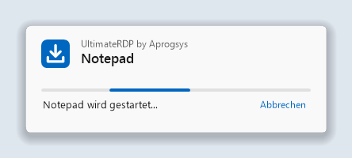

## Inhalt

<!-- toc -->
- [Schnelle Übertragungen über parallele Verbindungen](#schnelle-übertragungen-über-parallele-verbindungen)
- [Warum](#warum)
- [Voraussetzungen](#voraussetzungen)
- [Installation](#installation)
  - [Auf dem Server](#auf-dem-server)
  - [Mit dem Microsoft-Client geöffnete Sitzungen](#mit-dem-microsoft-client-geöffnete-sitzungen)
  - [Auf Ihrem Computer](#auf-ihrem-computer)
- [Verwendung](#verwendung)
  - [Sitzungen und Tabs](#sitzungen-und-tabs)
  - [Das Ladefenster](#das-ladefenster)
  - [Die Sitzung beenden](#die-sitzung-beenden)
  - [In die Sitzung ziehen](#in-die-sitzung-ziehen)
  - [Große Dateien](#große-dateien)
  - [Dateien aus der Sitzung an Ihren Computer senden](#dateien-aus-der-sitzung-an-ihren-computer-senden)
  - [Meldungen der Statusleiste](#meldungen-der-statusleiste)
  - [Menü Ansicht](#menü-ansicht)
  - [Sprache](#sprache)
  - [Gespeicherte Anmeldedaten und das Kennwort](#gespeicherte-anmeldedaten-und-das-kennwort)
- [Einstellungen des Clients](#einstellungen-des-clients)
- [Menü und Einstellungen des Agents](#menü-und-einstellungen-des-agents)
  - [Einstellungen für den ganzen Computer](#einstellungen-für-den-ganzen-computer)
  - [Laufwerke des Clients als Laufwerksbuchstaben](#laufwerke-des-clients-als-laufwerksbuchstaben)
- [Direktverbindung für große Dateien](#direktverbindung-für-große-dateien)
  - [Firewallregeln](#firewallregeln)
  - [Rückfall auf den Kanal](#rückfall-auf-den-kanal)
  - [Einstellungen](#einstellungen)
  - [Die Zusammenfassungszeilen lesen](#die-zusammenfassungszeilen-lesen)
- [RemoteApp-Programme](#remoteapp-programme)
  - [Über eine Verknüpfung oder eine .bat-Datei](#über-eine-verknüpfung-oder-eine-bat-datei)
  - [Auf Ihrem Computer](#auf-ihrem-computer-1)
  - [Auf dem Server](#auf-dem-server-1)
  - [Test mit einem Konto](#test-mit-einem-konto)
  - [Eine Verbindung pro Server und Konto](#eine-verbindung-pro-server-und-konto)
- [Startdateien](#startdateien)
  - [Optionen der Befehlszeile](#optionen-der-befehlszeile)
  - [Der Startdatei-Generator](#der-startdatei-generator)
- [Funktionsweise](#funktionsweise)
- [Fehlerbehebung](#fehlerbehebung)
- [Aus dem Quellcode erstellen](#aus-dem-quellcode-erstellen)
- [Sicherheitshinweise](#sicherheitshinweise)
- [Stand](#stand)
- [Herausgeber](#herausgeber)
- [Lizenz](#lizenz)
<!-- /toc -->

## Schnelle Übertragungen über parallele Verbindungen

Was es ist:

- Ab Version 0.6.0 gehen große Dateien über eine direkte TLS-Verbindung zwischen dem Client und dem Agent, außerhalb der Remotedesktopverbindung, und ab Version 0.7.0 über mehrere Verbindungen gleichzeitig, standardmäßig acht, höchstens sechzehn. Die Verbindungen verwenden TLS 1.3, wenn beide Windows-Versionen es anbieten, wie Windows 11 und Windows Server 2022, und sonst TLS 1.2.
- Der Agent erzeugt sein Zertifikat im Arbeitsspeicher und übermittelt dessen SHA-256 und ein Einmal-Token über den virtuellen RDP-Kanal, der bereits authentifiziert und verschlüsselt ist. Der Client akzeptiert nur dieses Zertifikat, und der Agent akzeptiert nur Verbindungen, die nachweisen, dass sie das Token kennen.
- Jede Datei wird am Ende mit ihrem SHA-256 geprüft. Eine Datei, die nicht übereinstimmt, wird nicht behalten.
- Wenn die Direktverbindung nicht verwendet werden kann, zum Beispiel über ein Remote Desktop Gateway oder bei geschlossenen Ports, gehen die Dateien über den virtuellen RDP-Kanal, ohne dass der Benutzer etwas tun muss, und das Protokoll des Clients nennt den Grund.

Warum es wichtig ist:

- Der virtuelle RDP-Kanal übertrug in der Produktion etwa 2 MB/s, unabhängig von der Leitung.
- Die Laufwerksumleitung liest eine Datei in kleinen Blöcken mit einem Hin und Zurück pro Block: 3,6 MB/s bei einer Messung auf einer Leitung, die 9,7 MB/s übertrug.
- Eine einzelne TCP-Verbindung auf dem Produktionspfad begann mit 90 bis 180 MB/s und pendelte sich nach den ersten Sekunden bei 20 bis 22 MB/s ein. Die Grenze gilt pro Verbindung, irgendwo auf dem Pfad, und mehrere Verbindungen addieren sich.

Gemessen in einer Produktionsumgebung, mit einem Server bei einem Hoster und einem PC an einer Leitung mit 2,3 Gbit/s:

| Pfad | Rate |
| --- | --- |
| PC zum Server, 8 Direktverbindungen | 255 bis 296 MB/s |
| Server zum PC, 8 Direktverbindungen | 115 bis 134 MB/s, die Obergrenze der ausgehenden Leitung dieses Servers |
| Eine Direktverbindung, nach den ersten Sekunden | 20 bis 22 MB/s |
| Dieselben Dateien über den virtuellen RDP-Kanal | etwa 2 MB/s |

Dies sind Messungen in einer einzigen Umgebung; die Raten hängen von der Leitung, dem Server und den Datenträgern ab. Der Server braucht eine Firewallregel für einen Portbereich: siehe „Direktverbindung für große Dateien“.

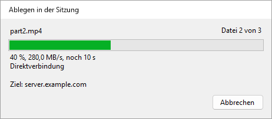

## Warum

Der Microsoft-Remotedesktopclient lehnt das Ablegen auf seinem Fenster ab, weil RDP keinen Kanal für Drag & Drop hat. Kopieren und Einfügen funktioniert, ebenso die Laufwerksumleitung, aber keines von beiden ist ein Ablegen. UltimateRDP fügt diese Geste zu dem hinzu, was RDP bereits bietet.

Während Sie über das Fenster des Clients ziehen, spielt der Agent denselben Ziehvorgang innerhalb der Sitzung als echtes OLE-Drag & Drop nach. Jede Remoteanwendung, die abgelegte Dateien annimmt, nimmt sie daher auch von UltimateRDP an und zeigt während der Bewegung ihre eigene Rückmeldung zum Ablegen. Wenn nichts unter dem Mauszeiger das Ablegen annimmt, wird es ignoriert: Nichts wird irgendwohin kopiert.

Kleine Dateien gehen über die Laufwerksumleitung. Große Dateien gehen vor dem Ablegen über den UltimateRDP-Kanal: siehe „Große Dateien“ unten.

## Voraussetzungen

- Ein Clientcomputer mit Windows 10 oder 11, 64 Bit.
- Ein Server mit Windows Server 2016 oder neuer, oder ein Computer mit Windows 10 oder 11 als Remotedesktophost.
- Eine .rdp-Datei, die Laufwerke umleitet. In den Einstellungen der Remotedesktopverbindung ist das Lokale Ressourcen, dann Weitere, dann Laufwerke.
- Die Möglichkeit, den Agent in Ihrer Benutzersitzung auf dem Server auszuführen.

Der Client ist eine einzige portable ausführbare Datei. Er läuft ohne Administratorrechte. Das Archiv des Agents enthält ebenfalls eine einzige ausführbare Datei.

UltimateRDP funktioniert über ein Remote Desktop Gateway. Die Direktverbindung für große Dateien funktioniert dort nicht, und die Dateien gehen dann über den Kanal: siehe „Direktverbindung für große Dateien“.

UltimateRDP hat bewusst einen engen Rahmen:

- Das Ablegen geht in eine Richtung, vom lokalen Computer in die Sitzung. Ab Version 0.9.0 sendet die Sitzung Dateien über ihr Menü Senden an statt durch Ablegen an Ihren Computer, nur über die Direktverbindung: siehe „Dateien aus der Sitzung an Ihren Computer senden“.
- Vollständige Desktopsitzungen und ab Version 0.8.0 RemoteApp-Programme: siehe „RemoteApp-Programme“.
- Die Sitzung startet immer in einem Fenster, auch wenn die .rdp-Datei Vollbild verlangt. Sie können danach zum Vollbild wechseln. Im Vollbild können Sie nur von einem Bildschirm aus ablegen, den die Sitzung nicht bedeckt.

## Installation

Jedes ZIP-Archiv enthält eine einzige `.exe`-Datei.

### Auf dem Server

1. Laden Sie das ZIP-Archiv `UltimateRDP.Agent` von der [Releases-Seite](https://github.com/freeKC/ultimaterdp/releases) herunter.
2. Entpacken Sie es in einen Ordner, den jeder Benutzer lesen kann, etwa `C:\Program Files\UltimateRDP`.
3. Führen Sie in einer Eingabeaufforderung mit erhöhten Rechten aus:

   ```
   "C:\Program Files\UltimateRDP\UltimateRDP.Agent.exe" --install-all-users
   ```

   Der Agent startet dann mit jeder Benutzersitzung. Bereits angemeldete Benutzer erhalten ihn bei ihrer nächsten Anmeldung. Ein erneutes Ausführen des Befehls ändert nichts. Wenn Sie den Agent mit `--install` für Ihr eigenes Konto installiert hatten, entfernt der Befehl auch diesen Eintrag und meldet das, damit der Agent in Ihrer Sitzung nicht zweimal startet. Er lehnt eine ausführbare Datei in einem Benutzerprofil ab, etwa in einem Downloads-Ordner, weil andere Benutzer sie möglicherweise nicht lesen können.

Um ihn nur für Ihr eigenes Konto zu installieren, führen Sie denselben Befehl mit `--install` in einer normalen Eingabeaufforderung aus. Dies startet den Agent auch sofort.

RemoteApp-Sitzungen verwenden den Eintrag `Run` nicht. Damit der Agent auch dort läuft, siehe „RemoteApp-Programme“ unten.

Weitere Optionen:

- `--uninstall` sorgt dafür, dass der Agent nicht mehr mit Ihrer Sitzung startet, und beendet die laufende Instanz. Führen Sie es in einer Eingabeaufforderung mit erhöhten Rechten aus, um auch den Eintrag für alle Benutzer zu entfernen.
- `--send <paths>` sendet Dateien und Ordner der Sitzung an den Computer des UltimateRDP-Clients, der mit ihr verbunden ist. Die Verknüpfung im Menü Senden an führt es aus; siehe „Dateien aus der Sitzung an Ihren Computer senden“.
- `--status` gibt die Version aus, die `Run`-Einträge unter `HKEY_CURRENT_USER` und `HKEY_LOCAL_MACHINE`, die Einstellungsdatei, die Einstellungsdatei des Computers und ob der Agent in Ihrer Sitzung läuft. Es sagt auch, ob die Sitzung eine RemoteApp-Sitzung ist und ob der Wert `SysProcs` und die geplante Aufgabe aus „RemoteApp-Programme“ vorhanden sind. Es ändert nichts.
- `--help` listet die Optionen auf.

Zum Aktualisieren auf einem Server beenden Sie jede Instanz des Agents in einer Eingabeaufforderung mit erhöhten Rechten mit `taskkill /im UltimateRDP.Agent.exe /f`, ersetzen die ausführbare Datei und lassen die Benutzer sich dann erneut anmelden. Um Ihre eigene Instanz zu aktualisieren, beenden Sie sie über ihr Menü im Infobereich oder mit `--uninstall`, ersetzen die ausführbare Datei und installieren sie dann erneut. Client und Agent müssen dieselbe Version haben.

### Mit dem Microsoft-Client geöffnete Sitzungen

Auf einem Server verbinden sich die meisten Benutzer möglicherweise mit dem Microsoft-Client (mstsc), der keinen UltimateRDP-Kanal hat. Für sie bleibt der Agent unsichtbar und tut nichts Sichtbares:

- Er zeigt kein Symbol, kein Fenster und keine Meldung. Sein Symbol im Infobereich erscheint nur, solange ein UltimateRDP-Client mit der Sitzung verbunden ist, und verschwindet, wenn dieser Client die Verbindung trennt; in einer RemoteApp-Sitzung erscheint es nie. Die Einstellung `trayIcon` unten ändert das.
- Während er wartet, verwendet er einige Megabyte Arbeitsspeicher und keine messbare Prozessorzeit. Er versucht alle zehn Sekunden, seinen Kanal zu öffnen, und sofort, wenn sich ein Client mit der Sitzung verbindet, sodass ein Benutzer, der sich mit dem UltimateRDP-Client erneut verbindet, den Agent bereit vorfindet.
- Sein Protokoll erhält eine Zeile beim Start und höchstens eine Zeile pro Stunde, während er wartet.
- Er übersteht Trennungen und erneute Verbindungen, mit beiden Clients. Bei der Abmeldung lässt er die Maustaste los, falls gerade ein Ablegen lief, schließt den Kanal und beendet sich, ohne die Abmeldung zu verzögern.
- Ein unerwarteter Fehler zeigt nie ein Dialogfeld: Er wird ins Protokoll geschrieben, und der Agent läuft entweder weiter oder beendet sich still.

### Auf Ihrem Computer

1. Laden Sie das ZIP-Archiv `UltimateRDP` von der [Releases-Seite](https://github.com/freeKC/ultimaterdp/releases) herunter.
2. Entpacken Sie es an einen beliebigen Ort. Es gibt nichts zu installieren. UltimateRDP schreibt nichts in die Registrierung.
3. Starten Sie es mit Ihrer Verbindungsdatei:

   ```
   UltimateRDP.exe path\to\connection.rdp
   ```

   Sie können auch auf `UltimateRDP.exe` doppelklicken und die .rdp-Datei im Dialogfeld auswählen.

## Verwendung

### Sitzungen und Tabs

Jede Sitzung öffnet sich in einem eigenen Tab. Die Statusleiste und die Menüs folgen dem aktiven Tab. Das Menü Datei enthält:

- **.rdp öffnen...** (Strg+O): öffnet eine Verbindungsdatei in einem neuen Tab.
- **Zuletzt verwendet**: die letzten zehn Verbindungsdateien. **Liste leeren** leert die Liste.
- **Startdatei erstellen (.bat)...**: ab Version 0.10.0 schreibt es eine .bat-Datei, die eine Verbindung öffnet. Siehe „Startdateien“.
- **In neuem Tab erneut öffnen**: öffnet die Datei des aktiven Tabs noch einmal, in einem zweiten Tab. Ab Version 0.10.0 bleibt stattdessen der Tab ausgewählt, solange seine Sitzung verbunden ist: Eine zweite Verbindung mit demselben Konto würde seine Sitzung übernehmen. Siehe „Eine Verbindung pro Server und Konto“.
- **Tab schließen** (Strg+W): trennt die aktive Sitzung und schließt ihren Tab.
- **Remotesitzung abmelden**: beendet Ihre Windows-Sitzung auf dem Server. Siehe „Die Sitzung beenden“ unten.
- **Gespeicherte Anmeldedaten vergessen**: siehe „Gespeicherte Anmeldedaten und das Kennwort“ unten.
- **Immer nach dem Kennwort fragen**: ab Version 0.9.0 fragt jede Verbindung nach dem Kennwort, statt gespeicherte Anmeldedaten zu verwenden. Siehe „Gespeicherte Anmeldedaten und das Kennwort“ unten.
- **Beenden**: trennt jede Sitzung und schließt das Fenster.

Das Menü Sitzung enthält Verbinden, Trennen, Erneut nach dem Agent suchen und Übertragung abbrechen. Siehe „Große Dateien“ unten.

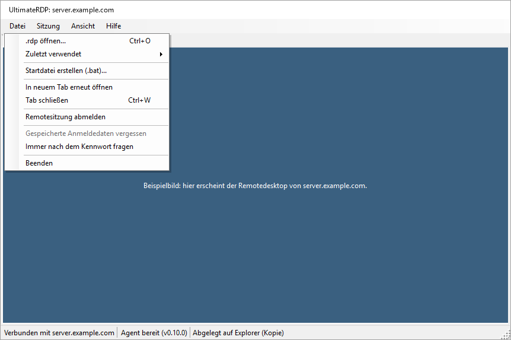

Das Menü Hilfe enthält Info zu UltimateRDP, das „UltimateRDP by Aprogsys“, die Version und die Adresse des Projekts zeigt, Projektseite und Protokollordner öffnen.

### Das Ladefenster

Ab Version 0.9.3 erscheint ein kleines Fenster, sobald UltimateRDP mit einer Verbindung startet, aus einer .bat-Datei, einer Verknüpfung oder der ausführbaren Datei, bis das Programm oder der Desktop da ist. Es zeigt „UltimateRDP by Aprogsys“, den Namen des Programms oder des Servers, einen laufenden Balken und den aktuellen Schritt: „Wird gestartet...“, „Verbindung mit server.example.com wird hergestellt...“, „Sitzung wird geöffnet...“, „Notepad wird gestartet...“. Nach 10 Sekunden meldet es, dass der Server länger als gewöhnlich braucht. Seine Schaltfläche Abbrechen bricht die Verbindung ab.

 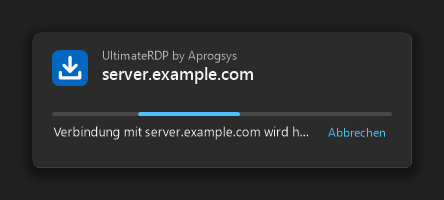

- Es schließt sich, wenn das Fenster des Programms erscheint, wenn der Desktop angemeldet ist, oder bei jedem vorherigen Ende.
- Es folgt dem hellen oder dunklen Design von Windows und der Skalierung seines Bildschirms, übernimmt nie die Tastatur und hat keine Schaltfläche in der Taskleiste.
- Es verbirgt sich, während die Zertifikatsfrage des Servers, die Kennwortabfrage, die Windows-Warnung zu einer RemoteApp-Verbindung oder eine Meldung von UltimateRDP auf eine Antwort wartet, und erscheint danach wieder über den anderen Fenstern, ohne die Tastatur zu übernehmen.
- Ein zweiter Start, der an das laufende UltimateRDP übergeben wird, zeigt das Ladefenster der neuen Sitzung sofort.
- `"loader": "off"` in client.json schaltet es aus.

### Die Sitzung beenden

Beenden, Tab schließen und Sitzung, Trennen trennen nur die Verbindung, wie es der Microsoft-Remotedesktopclient tut. Ihre Windows-Sitzung läuft auf dem Server mit ihren Anwendungen weiter, und Sie finden sie bei der nächsten Verbindung wieder.

Um die Sitzung wirklich zu beenden, verwenden Sie Datei, Remotesitzung abmelden. Der Eintrag ist verfügbar, sobald die Statusleiste „Agent bereit“ meldet. Der Client fragt nach einer Bestätigung, dann meldet der Agent die Sitzung ab, wie es der Befehl Abmelden im Startmenü tun würde. Anwendungen mit ungespeicherter Arbeit fragen in der Sitzung, was geschehen soll, bevor sie sich schließt. Die Statusleiste meldet „Remotesitzung wird abgemeldet...“ und zeigt dann die Trennung.

### In die Sitzung ziehen

1. Starten Sie den Client. Er verbindet sich mit den Einstellungen der .rdp-Datei. Melden Sie sich wie gewohnt an.
2. Beobachten Sie die Statusleiste unten im Fenster. Die Anzeige des Agents wechselt von „Agent: Warten auf Antwort“ zu „Agent bereit (v0.4.3)“.
3. Ziehen Sie Dateien oder Ordner aus dem Explorer auf die Sitzung. Ein blaues Banner oben in der Sitzung zeigt „Hier ablegen, um die Dateien in die Sitzung zu senden“.
4. Bewegen Sie den Mauszeiger über die gewünschte Remoteanwendung. Sie zeigt ihre eigene Rückmeldung zum Ablegen, zum Beispiel einen hervorgehobenen Ordner oder einen Bereich für Anlagen.
5. Lassen Sie die Maustaste über dem Ziel los. Die Remoteanwendung empfängt die Dateien wie bei einem normalen Ablegen.

Bei jedem Ablegen erscheint ein Fortschrittsfenster. Das Fenster „Ablegen in der Sitzung“ öffnet sich über der Sitzung, sobald Sie die Maustaste loslassen. Es zeigt die abgelegten Elemente, einen Balken ohne Wert, „Wird in der Sitzung abgelegt...“ und den Namen des Remotecomputers. Dann zeigt es das Ergebnis, etwa „Abgelegt auf Posteingang (Kopie)“ oder „Nichts unter dem Mauszeiger hat die Dateien angenommen.“, und schließt sich drei Sekunden später von selbst, außer wenn sich der Mauszeiger darüber befindet. Wenn das Ablegen fehlschlägt, zeigt es den Grund in Rot und bleibt geöffnet, bis Sie auf Schließen klicken. Bei großen Dateien zeigt dasselbe Fenster zuerst die Übertragung, siehe „Große Dateien“ unten. Das Fenster nimmt der Sitzung nie die Tastatur weg, bleibt über dem Hauptfenster und bleibt geöffnet, wenn Sie den Tab wechseln. Das Schließen des Tabs der Sitzung schließt es.

Wenn nichts unter dem Mauszeiger das Ablegen annimmt, wird es ignoriert, und die Statusleiste meldet „Nichts unter dem Mauszeiger hat die Dateien angenommen.“ Der Agent kopiert nie von sich aus Dateien.

Wenn das Ziel der Explorer ist, zeigt der Explorer in der Sitzung sein übliches Windows-Kopierdialogfeld. Es zeigt den Fortschritt und fragt, was geschehen soll, wenn eine Datei bereits existiert.

UltimateRDP bietet der Remoteanwendung nur Kopieren und Verknüpfen an. Es bietet nie Verschieben an. Strg, Umschalt und Alt werden während eines Ziehvorgangs nicht an die Sitzung weitergegeben.

### Große Dateien

Eine Remoteanwendung liest eine Datei über die Laufwerksumleitung in kleinen Blöcken, mit einem Hin und Zurück über das Netzwerk pro Block. Bei einer Verbindung mit etwas Latenz ist das langsam: bei einer Messung 3,6 MB/s auf einer Leitung, die 9,7 MB/s übertrug. Bei großen Dateien sendet UltimateRDP die Dateien daher vor dem Ablegen über seinen eigenen Kanal, in einem fortlaufenden Datenstrom.

Standardmäßig geschieht das, wenn die abgelegten Dateien und Ordner 10 MiB oder mehr umfassen. Die Einstellung „Schnelle Übertragung großer Dateien“ des Agents ändert das, siehe „Menü und Einstellungen des Agents“ unten.

Was Sie sehen:

1. Das Ziehen über die Sitzung funktioniert wie gewohnt: Die Remoteanwendung zeigt ihre Rückmeldung zum Ablegen.
2. Wenn Sie die Maustaste loslassen, endet der Ziehvorgang in der Sitzung ohne Ablegen, und das Fenster „Ablegen in der Sitzung“ zeigt die Übertragung. Auch die Statusleiste zeigt den Fortschritt: „Übertragung von 3 Datei(en): 42 % (12,3 MB/s, noch 1 min)“.
3. Sobald jede Datei in der Sitzung ist, legt der Agent die Kopien dort ab, wo Sie die Maustaste losgelassen haben, und die Statusleiste meldet wie gewohnt „Abgelegt auf ...“.

Während einer Übertragung zeigt das Fenster „Ablegen in der Sitzung“ den Namen der gerade gesendeten Datei mit „Datei 2 von 3“, einen Fortschrittsbalken, eine Zeile wie „42 %, 2,6 MB/s, noch 1 min 40 s“ und den Namen des Remotecomputers. Während der Client die Dateien auflistet, läuft der Balken ohne Wert, und die Zeile zeigt „Wird vorbereitet...“. Seine Schaltfläche Abbrechen bricht die Übertragung ab, wie Sitzung, Übertragung abbrechen. Nach einem Erfolg zeigt es „3 Datei(en) in 3 min 13 s mit 2,6 MB/s übertragen, wird in der Sitzung abgelegt...“, dann das Ergebnis des Ablegens, und schließt sich drei Sekunden später von selbst, außer wenn sich der Mauszeiger darüber befindet. Nach einem Fehler oder einem Abbruch zeigt es den Grund in Rot und bleibt geöffnet, bis Sie auf Schließen klicken. Das Schließen des Tabs der Sitzung bricht die Übertragung ab und schließt das Fenster.

 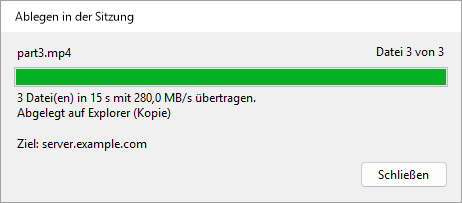

Die Kopien kommen in der Sitzung nach `%LOCALAPPDATA%\UltimateRDP\staging` und werden eine Stunde nach dem Ablegen gelöscht. Der Agent prüft die Größe und die SHA-256-Prüfsumme jeder Datei. Wenn etwas schiefgeht, wird nichts abgelegt, und die Statusleiste nennt den Grund. Sitzung, Übertragung abbrechen bricht sie ab; der Agent löscht dann, was er empfangen hat.

Gut zu wissen:

- Eine Übertragung nach der anderen. Während eine läuft, wird ein neuer Ziehvorgang über der Sitzung abgelehnt, und das Fortschrittsfenster zeigt fünf Sekunden lang „Warten Sie das Ende dieser Übertragung ab, bevor Sie weitere Dateien ablegen.“
- Die Laufwerksumleitung muss weiterhin eingeschaltet sein: Das Ziehen über die Sitzung verwendet sie.
- Wenn Sie die Maustaste sehr schnell loslassen, bevor der Agent auf den Beginn des Ziehvorgangs geantwortet hat, wartet der Client höchstens anderthalb Sekunden auf diese Antwort, mit „Wird vorbereitet...“ im Fortschrittsfenster, damit große Dateien trotzdem über den UltimateRDP-Kanal gehen. Ein neuer Ziehvorgang wird während dieser Wartezeit abgelehnt, wie während einer Übertragung.
- Leere Ordner innerhalb eines abgelegten Ordners werden in der Sitzung nicht angelegt.
- Der Agent muss Version 0.4.1 oder neuer ausführen, der Client ebenso. Das Fortschrittsfenster ist neu im Client 0.4.2 und funktioniert mit einem Agent 0.4.1. Mit einem älteren Client oder Agent geht jedes Ablegen über die Laufwerksumleitung.
- Ab Version 0.6.0 auf beiden Seiten gehen die Dateien über eine Direktverbindung, wenn der Server seine Ports dafür öffnet, und sonst über den Kanal. Ab 0.7.0 auf beiden Seiten verwendet die Direktverbindung mehrere TCP-Verbindungen gleichzeitig. Siehe „Direktverbindung für große Dateien“.

Ab Version 0.5.0 gehen die Dateien in einer dichteren Form, wenn Ihre Verbindung es erlaubt. Der Agent teilt dem Client mit, wie die Daten des Clients bei ihm ankommen. Wenn jedes Zeichen als zwei Bytes ankommt, wie auf einem Produktionsserver gemessen, packt der Client 15 Bits der Datei in jedes Zeichen statt Base64 zu verwenden, und ein Byte der Datei kostet auf dem Kanal etwa 1,07 Bytes statt 2,67. Auf einem Kanal, der 5,8 MB/s überträgt, steigt die Übertragung von etwa 2,1 MB/s auf etwa 5,4 MB/s. Wenn jedes Zeichen als ein Byte ankommt, bleibt der Client bei Base64, mit etwa drei Vierteln des Kanals. Für die dichtere Form müssen beide Seiten 0.5.0 ausführen; mit einem älteren Agent sendet der Client wie bisher Base64. Die Statusleiste und das Fortschrittsfenster ändern sich nicht; das Protokoll des Clients nennt die Form, die eine Übertragung verwendet.

Der Client sendet die Dateien in Blöcken von 32 KiB. Die Einstellung `transferChunkBytes` in `%LOCALAPPDATA%\UltimateRDP\client.json` ändert diese Größe, von 4096 (4 KiB) bis 262144 (256 KiB). Ein Wert außerhalb dieser Grenzen wird in sie zurückgeholt. Die Einstellung lässt sich nur in der Datei ändern und gilt nach einem Neustart des Clients. Ändern Sie sie nicht, außer wenn eine Übertragung an ihrem Anfang fehlschlägt.

```json
{
  "transferChunkBytes": 32768,
  "transferBatchCharacters": 200000,
  "transferWindowBytes": 4194304,
  "directTransfer": "auto",
  "directConnections": 8,
  "logLevel": "info"
}
```

Der Client sendet seine Nachrichten an den Agent gebündelt, höchstens `transferBatchCharacters` Zeichen in einem Aufruf des Remotedesktop-Steuerelements: standardmäßig 200000, von 50000 bis 1048576. Ein Wert außerhalb dieser Grenzen wird in sie zurückgeholt. Ändern Sie ihn nicht, außer wenn eine Übertragung an ihrem Anfang fehlschlägt.

Die Einstellung `logLevel` derselben Datei ist standardmäßig `info`. Setzen Sie sie auf `debug`, um jede Nachricht, die der Client an den Agent sendet, und jeden Aufruf des Remotedesktop-Steuerelements zu protokollieren, und starten Sie den Client dann neu.

Der Client hält höchstens `transferWindowBytes` Bytes einer Übertragung gesendet und vom Agent noch nicht bestätigt: standardmäßig 4194304 (4 MiB), von 1048576 (1 MiB) bis 33554432 (32 MiB). Ein Wert außerhalb dieser Grenzen wird in sie zurückgeholt. Der Agent bestätigt alle 2 MiB, daher wird ein Fenster unter 2 MiB plus einem Block auf diesen Wert angehoben; das Protokoll nennt am Anfang jeder Übertragung das verwendete Fenster. Ändern Sie es nur, um herauszufinden, was eine langsame Übertragung begrenzt, siehe unten.

#### Eine langsame Übertragung messen

Ab Version 0.4.4 beenden beide Protokolle jede Übertragung mit Zusammenfassungszeilen, die zeigen, wohin die Zeit ging. Installieren Sie 0.4.4 auf beiden Seiten für das vollständige Bild; mit einem älteren Client oder Agent protokolliert die andere Seite trotzdem ihre eigenen Zeilen.

Das Protokoll des Clients hat zwei Zeilen:

```
Transfer <id> channel calls: 2410 calls, 482000000 characters, 9100 ms inside SendOnVirtualChannel, 3.78 ms per call on average, 41.20 ms at most; 5 % of the 190000 ms from the first call to the last, 5 % of the 193000 ms of the transfer.
Transfer <id> acknowledgements: 237 matched a call, round trip 1480 ms on average, 20 ms at least, 1900 ms at most; 3700000 bytes in flight on average when one came, 4194304 at most, 88 % of the window of 4194304 bytes.
```

Das Protokoll des Agents hat eine Zeile pro Verbindung zur Verbindung und zwei Zeilen pro Übertragung:

```
Transfer <id> channel reads: 302000 reads with data and 12 empty, 482000000 bytes, 1596 bytes per read on average; 301000 of 1600 bytes, 1000 shorter, 0 longer; blocked in the read 178000 ms, processing 14000 ms (9000 ms handling messages), over 193000 ms; read mode wts.
Transfer <id> session counters: 0 bytes, 0 frames and 0 compressed bytes in, 0 bytes out, from WTSSessionInfoEx (zero when Windows does not count them).
```

So lesen Sie sie:

- **Der Client verbringt deutlich mehr als die Hälfte der Zeit in SendOnVirtualChannel.** Das Remotedesktop-Steuerelement begrenzt die Übertragung auf Ihrem Computer.
- **Der Agent verbringt fast die ganze Zeit mit der Verarbeitung und wenig blockiert im Lesen.** Der Agent begrenzt die Übertragung; die Zeit für die Behandlung der Nachrichten umfasst das JSON, die Dekodierung der Blöcke, die Prüfsumme und das Schreiben der Datei.
- **Die Aufrufe des Clients nehmen einen kleinen Anteil ein, und der Agent wartet fast die ganze Zeit im Lesen.** Die Daten warten zwischen beiden, in der Remotedesktopverbindung. Wenn die Bytes in Übertragung nahe am Fenster bleiben, versuchen Sie eine Übertragung mit `transferWindowBytes` auf 16777216. Wenn sich die Rate nicht ändert und das Hin und Zurück viermal so lang wird, ist die Flusskontrolle der Verbindung die Grenze. Wenn die Rate steigt, behalten Sie das größere Fenster.

Ob die Verbindung UDP verwendet, sehen Sie in der Verbindungsleiste der Remotedesktopsitzung: Klicken Sie auf das Signalsymbol, um die Verbindungsinformationen anzuzeigen.

### Dateien aus der Sitzung an Ihren Computer senden

Ab Version 0.9.0 gehen Dateien und Ordner der Sitzung über die Direktverbindung zu Ihrem Computer, mit derselben Rate wie große Dateien in der anderen Richtung. Beide Seiten müssen 0.9.0 ausführen, und die Direktverbindung muss funktionieren: siehe „Direktverbindung für große Dateien“.

In der Sitzung:

- **Senden an.** Klicken Sie im Explorer mit der rechten Maustaste auf Dateien oder Ordner, dann auf Senden an, **Mein PC (UltimateRDP)**. Die Verknüpfung existiert nur, solange ein UltimateRDP-Client verbunden ist, der Dateien empfängt, und verschwindet, wenn er die Verbindung trennt.
- **Das Menü des Agents im Infobereich**, Dateien an meinen PC senden..., wählt Dateien in einem Dialogfeld aus. Das Symbol im Infobereich erscheint nicht in RemoteApp-Sitzungen.

  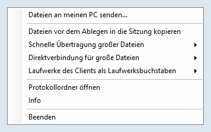

- **Die Befehlszeile**: `UltimateRDP.Agent.exe --send "C:\Users\me\Documents\report.pdf" "C:\Users\me\Pictures\Trip"`.

Wenn die Dateien nicht gesendet werden können, nennt eine Meldung in der Sitzung den Grund, zum Beispiel dass kein Client verbunden ist, der Dateien empfängt.

Auf Ihrem Computer:

- Die Dateien kommen in Ihren Downloads-Ordner. Während sie ankommen, liegen sie darin in einem versteckten Ordner `.ultimaterdp-<id>.part`, und sie erscheinen, sobald jede Datei mit ihrem SHA-256 geprüft wurde. Eine Datei ersetzt nie eine andere: Wenn `report.pdf` existiert, heißt die neue `report (2).pdf`, und ein Ordner wird zu `Photos (2)`.
- Ein Fenster „Dateien aus der Sitzung“ zeigt den Fortschritt, mit Abbrechen. Am Ende nennt es, wo die Dateien liegen, und Ordner öffnen zeigt sie im Explorer.

  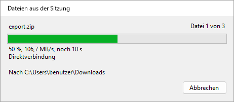 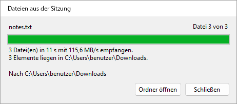

- Jede empfangene Datei erhält die Markierung, die Windows Downloads gibt, damit SmartScreen und Office sie als Datei aus dem Internet behandeln. UltimateRDP öffnet oder startet nie eine empfangene Datei.
- Wenn die Direktverbindung nicht verwendet werden kann, zum Beispiel über ein Remote Desktop Gateway oder bei Ports, die eine Firewall sperrt, wird nichts gesendet, und das Fenster meldet das. Es gibt keinen langsameren Weg; kopieren Sie die Dateien stattdessen in der Sitzung auf ein Laufwerk Ihres Computers unter `\\tsclient`.
- Namen, die Windows ablehnt, ein Pfad, der den Ordner verlassen würde, oder zu wenig freier Speicherplatz brechen die Übertragung ab, und nichts wird behalten.

Einstellungen in `%LOCALAPPDATA%\UltimateRDP\client.json`, nur in der Datei änderbar:

```json
{
  "receiveFiles": "auto",
  "receiveFolder": "%USERPROFILE%\\Desktop\\From the server"
}
```

| Einstellung | Werte | Wenn nicht vorhanden | Bedeutung |
| --- | --- | --- | --- |
| `receiveFiles` | `auto`, `never` | `auto` | `never` lehnt die Dateien der Sitzung ab. `directTransfer` auf `never` lehnt sie ebenfalls ab, da nur die Direktverbindung sie überträgt. |
| `receiveFolder` | ein vollständiger Pfad | Ihr Downloads-Ordner | Wohin die Dateien kommen. Umgebungsvariablen wie `%USERPROFILE%` werden aufgelöst; der Ordner wird angelegt, wenn er fehlt. |

Auf dem Server schaltet `sendToClient` in agent.json, standardmäßig `auto`, auf `never` gesetzt das Senden für einen Benutzer aus oder, in den Einstellungen des Computers, für alle. `directMaxMegabytesPerSecond` begrenzt auch, was der Agent sendet, und schützt so die ausgehende Leitung des Servers. Ab Version 0.9.2 begrenzt `sendMaxMegabytesPerSecond` nur das Senden, sodass Dateien der Clients die volle Rate behalten: zum Beispiel `"sendMaxMegabytesPerSecond": 85` in den Einstellungen des Computers, wenn die ausgehende Leitung des Servers etwa 1 Gbit/s überträgt.

### Meldungen der Statusleiste

Meldungen eines Ziehvorgangs:

- **„2 Element(e) werden in die Sitzung gezogen...“**: Der Agent spielt den Ziehvorgang nach.
- **„Ziehvorgang in der Sitzung wird gestartet...“**: Der Agent braucht einen Moment, um den Ziehvorgang zu starten.
- **„2 Element(e) werden vor dem Ziehvorgang in die Sitzung kopiert...“**: Der Agent kopiert die Dateien zuerst in die Sitzung, weil „Dateien vor dem Ablegen in die Sitzung kopieren“ eingeschaltet ist.
- **„Abgelegt auf Posteingang (Kopie)“**: Das Remotefenster hat das Ablegen angenommen. Die Meldung nennt das Fenster und sagt Kopie oder Verknüpfung.
- **„Nichts unter dem Mauszeiger hat die Dateien angenommen.“**: Das Fenster unter dem Mauszeiger hat das Ablegen nicht angenommen. Nichts wurde kopiert.
- **„Der Agent hat den Ziehvorgang nicht bestätigt“**: keine Antwort des Agents innerhalb einer Sekunde. Siehe „Fehlerbehebung“.
- **„Ablegen abgelehnt“**, gefolgt vom Grund des Agents. Zum Beispiel „Ablegen abgelehnt: Das vorherige Ablegen wird in der Sitzung noch ausgeführt. Versuchen Sie es erneut, sobald es abgeschlossen ist.“
- **„Ablegen abgelehnt: Der Ziehvorgang wurde in der Sitzung nicht gestartet. Ziehen Sie die Dateien erneut.“**: Der Client hat das Ablegen erhalten, ohne dass für dieselben Dateien ein Ziehvorgang lief.
- **„Abgebrochen“**, gefolgt vom Grund, zum Beispiel „Abgebrochen: Der Ziehvorgang wurde abgebrochen: in der Sitzung wurde Esc gedrückt.“

Das Fortschrittsfenster, das bei jedem Ablegen erscheint, zeigt ebenfalls das Ergebnis des Ablegens und den Fortschritt einer Übertragung ausführlicher, siehe „In die Sitzung ziehen“ und „Große Dateien“ oben. Die Statusleiste behält ihre Texte.

Meldungen einer Übertragung großer Dateien:

- **„Übertragung von 2 Element(en) wird vorbereitet...“**: Der Client listet die zu sendenden Dateien auf.
- **„Übertragung von 3 Datei(en): 42 % (12,3 MB/s, noch 1 min)“**: Die Dateien sind unterwegs. Die Rate bezieht sich auf die letzten fünf Sekunden; MB bedeutet eine Million Bytes.
- **„3 Datei(en) mit 12,3 MB/s übertragen, wird abgelegt...“**: Jede Datei ist in der Sitzung, und der Agent legt die Kopien ab.
- **„Übertragung abgebrochen.“**: Sie haben die Übertragung über das Menü Sitzung oder das Fortschrittsfenster abgebrochen.
- **„Eine Übertragung läuft. Warten Sie auf ihr Ende oder brechen Sie sie im Menü Sitzung ab.“**: Ein neuer Ziehvorgang wurde während einer Übertragung abgelehnt.
- **„Übertragung fehlgeschlagen“**, gefolgt vom Grund des Agents, zum Beispiel „Übertragung fehlgeschlagen: Daten gingen unterwegs verloren oder wurden beschädigt. Versuchen Sie es erneut.“
- **„Ablegen abgelehnt: In der Sitzung ist nicht genug Speicherplatz frei: 1.234 MB benötigt, 800 MB frei.“**: Der Datenträger der Sitzung kann die Dateien nicht aufnehmen.
- **„... kann nicht gelesen werden.“** mit einem Dateinamen und dem Grund von Windows: Der Client konnte eine Datei auf Ihrem Computer nicht lesen.
- **„Der Agent hat während der Übertragung nicht mehr geantwortet.“**: eine Minute lang keine Bestätigung.
- **„Die Übertragung wurde beendet: Die Sitzung wurde getrennt.“**: Die Verbindung endete während der Übertragung.

Meldungen der Verbindung:

- **„Kein Agent auf dem Remotecomputer“**: Der Client hat sechzig Sekunden lang Hallo-Nachrichten gesendet und keine Antwort erhalten. Starten Sie den Agent in der Sitzung und verwenden Sie dann Sitzung, Erneut nach dem Agent suchen.
- **„Diese .rdp-Datei leitet keine Laufwerke um: Ablegen funktioniert nicht.“**: Die .rdp-Datei gibt kein lokales Laufwerk frei. Schalten Sie Laufwerke in der .rdp-Datei ein und verbinden Sie sich erneut.
- **„Die Sitzung sieht kein umgeleitetes Laufwerk: Ablegen funktioniert nicht.“**: Der Agent hat geantwortet, aber aus der Sitzung ist kein `\\tsclient`-Laufwerk erreichbar. Der Server sperrt möglicherweise die Laufwerksumleitung.
- **„Ablegen abgelehnt: nicht verbunden.“**: Es gibt noch keine Sitzung.
- **„Ablegen abgelehnt: Der UltimateRDP-Agent hat noch nicht geantwortet.“**: Warten Sie auf „Agent bereit“.
- **„Ablegen abgelehnt: Der UltimateRDP-Agent läuft nicht in der Remotesitzung.“**: Starten Sie den Agent in der Sitzung.
- **„Ablegen abgelehnt“** mit einem Pfad: Nur Dateien und Ordner auf einem lokalen Laufwerksbuchstaben können abgelegt werden. Netzwerkpfade (UNC) werden abgelehnt, weil die Sitzung Ihre Dateien über die Laufwerksumleitung erreicht.
- **„Ablegen fehlgeschlagen“**: Der Agent konnte nicht abschließen. Der Rest der Meldung nennt seinen Grund.

Meldungen einer Abmeldung:

- **„Remotesitzung wird abgemeldet...“**: Der Agent hat die Anforderung angenommen. Die Trennung folgt, sobald die Sitzung geschlossen ist. Wenn eine Anwendung fragt, ob Ihre Arbeit gespeichert werden soll, antworten Sie in der Sitzung.
- **„Der Agent hat auf die Abmeldeanforderung nicht geantwortet.“**: keine Antwort innerhalb von fünf Sekunden. Die Sitzung ist noch geöffnet; versuchen Sie es erneut oder melden Sie sich über das Startmenü der Sitzung ab.
- **„Abmelden fehlgeschlagen“**: Windows hat die Abmeldung der Sitzung verweigert. Der Rest der Meldung nennt den Grund von Windows.

Diese Beispiele sind auf Deutsch. Die Statusleiste verwendet die Sprache des Clients, siehe „Sprache“ unten.

### Menü Ansicht

- **Sitzungsgröße an Fenster anpassen**: die Standardeinstellung. Die Auflösung der Sitzung folgt der Fenstergröße.
- **An Fenster skalieren**: Die Sitzung behält ihre Auflösung, und das Bild wird auf das Fenster skaliert.
- **Skalierungsfaktor**: Automatisch, oder 100 % bis 200 %. Automatisch folgt dem Bildschirm, auf dem sich das Fenster befindet. Eine Änderung gilt für eine neue Verbindung, und der Client bietet an, sich erneut zu verbinden.
- **Vollbild** (F11 oder Strg+Alt+Pause): schaltet das Vollbild ein und aus. Die Verbindungsleiste wird angezeigt und kann angeheftet werden.
- **Alle Monitore verwenden**: Die Sitzung bedeckt im Vollbild jeden Bildschirm. Es gilt für eine neue Verbindung.
- **Windows-Tasten**: wohin Tastenkombinationen wie Alt+Tab gehen. „Auf diesem Computer“, „In der Sitzung“ oder „In der Sitzung bei Vollbild“, die Standardeinstellung.
- **Sprache**: siehe unten.

Ihre Auswahl im Menü Ansicht wird für die Sitzungen gespeichert, die Sie später öffnen. Wenn die .rdp-Datei `desktopscalefactor`, `use multimon` oder `keyboardhook` festlegt, hat die Datei Vorrang.

### Sprache

Der Client und der Agent sprechen Englisch, Französisch, Deutsch, Spanisch, Italienisch, Portugiesisch und Niederländisch.

Das Untermenü Ansicht, Sprache listet „Automatisch (Windows-Sprache)“ und die sieben Sprachen auf, jede in ihrer eigenen Sprache benannt. Eine Auswahl gilt sofort für die Menüs, die Statusleiste und die Tabs, und der Client merkt sie sich. Automatisch, die Standardeinstellung, folgt der Anzeigesprache von Windows und verwendet Englisch, wenn Windows in einer anderen Sprache läuft.

Die Auswahl ist die Einstellung `language` in `%LOCALAPPDATA%\UltimateRDP\client.json`: `auto`, `en`, `fr`, `de`, `es`, `it`, `pt` oder `nl`.

```json
{
  "language": "fr"
}
```

Der Client teilt dem Agent seine Sprache mit, und der Agent schreibt die Meldungen, die er an die Statusleiste sendet, in dieser Sprache. Das Menü des Agents im Infobereich folgt der Anzeigesprache von Windows auf dem Server.

Einige Texte stammen von Windows und folgen dessen eigener Sprache: die Schaltflächen Ja und Nein der Fragen, der Grund einer Trennung und Windows-Fehlermeldungen. Die Protokolle sind immer auf Englisch.

### Gespeicherte Anmeldedaten und das Kennwort

Vor dem Verbinden liest der Client die generischen Anmeldeinformationen `TERMSRV/<host>` aus der Windows-Anmeldeinformationsverwaltung. Wenn sie existieren und ein Kennwort enthalten, verwendet der Client sie und schaltet die Abfrage für diese Verbindung aus. UltimateRDP schreibt nie Anmeldeinformationen. Sie können sie so anlegen:

```
cmdkey /generic:TERMSRV/<host> /user:<domain\user> /pass
```

`cmdkey` fragt dann nach dem Kennwort.

Ab Version 0.9.0 fragt der Client stattdessen nach dem Kennwort und liest keine gespeicherten Anmeldedaten, wenn eine dieser Angaben es verlangt:

- die Option `--ask-credentials` auf der Befehlszeile;
- Datei, **Immer nach dem Kennwort fragen**, was der Client als `"credentials": "ask"` in client.json speichert (standardmäßig `saved`);
- die Zeile `prompt for credentials:i:1` in der .rdp-Datei, wie beim Microsoft-Client.

Der Benutzername aus der .rdp-Datei bleibt ausgefüllt, und die Abfrage bietet nicht an, das Kennwort zu speichern. Das Protokoll des Clients nennt, welche der drei Angaben entschieden hat, und enthält nie ein Kennwort.

Das ändert das Verhalten bei einer .rdp-Datei, die bereits `prompt for credentials:i:1` enthält: Version 0.8.0 verwendete die gespeicherten Anmeldedaten und verband sich ohne Abfrage; Version 0.9.0 fragt nach dem Kennwort. Entfernen Sie die Zeile aus der Datei oder setzen Sie sie auf 0, um die gespeicherten Anmeldedaten wieder zu verwenden.

Das Kontrollkästchen „Anmeldedaten speichern“ der Windows-Anmeldeabfrage speichert eine andere Art von Anmeldeinformationen, ein Domänenkennwort. Windows behält dieses Kennwort für sich, daher kann UltimateRDP es nicht lesen. Die Windows-Abfrage selbst kann es trotzdem verwenden.

Datei, Gespeicherte Anmeldedaten vergessen löscht beide Arten von Anmeldeinformationen für den Host des aktiven Tabs. Die geöffnete Sitzung ist davon nicht betroffen, und die nächste Verbindung fragt erneut.

Keine Option der Befehlszeile und kein Feld des Startdatei-Generators nimmt ein Kennwort an: siehe „Startdateien“. Die Windows-Warnung zum Herausgeber einer RemoteApp-Verbindung ist eine andere Frage, und `--trusted` ist die einzige Möglichkeit, sie zu überspringen: siehe „Optionen der Befehlszeile“.

## Einstellungen des Clients

Der Client speichert seine Einstellungen in `%LOCALAPPDATA%\UltimateRDP\client.json`. Das Menü Ansicht, das Menü Sprache und Datei, Immer nach dem Kennwort fragen schreiben einige davon; die anderen lassen sich nur in der Datei ändern und gelten, wenn der Client erneut startet. Ein unbekannter Wert ergibt den Standardwert. Kommentare sind in der Datei erlaubt und gehen verloren, wenn der Client sie schreibt.

```json
{
  "displayMode": "resizeSession",
  "scaleFactor": null,
  "keyboardHookMode": 2,
  "useAllMonitors": false,
  "language": "auto",
  "transferChunkBytes": 32768,
  "transferBatchCharacters": 200000,
  "transferWindowBytes": 4194304,
  "directTransfer": "auto",
  "directConnections": 8,
  "receiveFiles": "auto",
  "receiveFolder": null,
  "credentials": "saved",
  "loader": "on",
  "logLevel": "info"
}
```

| Einstellung | Werte | Wenn nicht vorhanden | Bedeutung |
| --- | --- | --- | --- |
| `displayMode` | `resizeSession`, `scaleToWindow` | `resizeSession` | Ansicht, Sitzungsgröße an Fenster anpassen oder An Fenster skalieren. |
| `scaleFactor` | `null`, oder 100 bis 500 | `null` | Ansicht, Skalierungsfaktor; `null` folgt dem Bildschirm. |
| `keyboardHookMode` | 0, 1, 2 | 2 | Ansicht, Windows-Tasten: auf diesem Computer, in der Sitzung, in der Sitzung bei Vollbild. |
| `useAllMonitors` | `true`, `false` | `false` | Ansicht, Alle Monitore verwenden. |
| `language` | `auto`, `en`, `fr`, `de`, `es`, `it`, `nl`, `pt` | `auto` | Ansicht, Sprache. Siehe „Sprache“. |
| `recentFiles` | eine Liste von Pfaden | leer | Datei, Zuletzt verwendet. Der Client schreibt sie. |
| `transferChunkBytes` | 4096 bis 262144 | 32768 | Bytes pro Block einer Übertragung über den Kanal. Siehe „Große Dateien“. |
| `transferBatchCharacters` | 50000 bis 1048576 | 200000 | Zeichen pro Aufruf des Remotedesktop-Steuerelements. Siehe „Große Dateien“. |
| `transferWindowBytes` | 1048576 bis 33554432 | 4194304 | Bytes einer Übertragung über den Kanal, die gesendet und noch nicht bestätigt sind. Siehe „Große Dateien“. |
| `directTransfer` | `auto`, `never` | `auto` | `never` hält große Dateien im Kanal und lehnt Dateien der Sitzung ab. Siehe „Direktverbindung für große Dateien“. |
| `directConnections` | 1 bis 16 | 8 | Höchstzahl der Verbindungen einer direkten Übertragung. |
| `receiveFiles` | `auto`, `never` | `auto` | `never` lehnt die Dateien der Sitzung ab. Siehe „Dateien aus der Sitzung an Ihren Computer senden“. |
| `receiveFolder` | `null`, oder ein Pfad | Ihr Downloads-Ordner | Wohin Dateien der Sitzung kommen; Umgebungsvariablen werden aufgelöst. |
| `credentials` | `saved`, `ask` | `saved` | Datei, Immer nach dem Kennwort fragen. Siehe „Gespeicherte Anmeldedaten und das Kennwort“. |
| `loader` | `on`, `off` | `on` | Das Ladefenster. Siehe „Das Ladefenster“. |
| `logLevel` | `debug`, `info` | `info` | `debug` protokolliert jede Nachricht an den Agent und jeden Aufruf des Steuerelements. |

## Menü und Einstellungen des Agents

Standardmäßig ist das Symbol des Agents im Infobereich nur sichtbar, solange ein UltimateRDP-Client mit der Sitzung verbunden ist. Sein Menü enthält:

- **Dateien an meinen PC senden...**: ab Version 0.9.0 sendet es die ausgewählten Dateien an den Computer des Clients. Siehe „Dateien aus der Sitzung an Ihren Computer senden“.
- **Dateien vor dem Ablegen in die Sitzung kopieren**: standardmäßig aus. Wenn eingeschaltet, kopiert der Agent die Dateien in die Sitzung, bevor der Ziehvorgang beginnt, und die Remoteanwendung erhält lokale Pfade statt `\\tsclient`-Pfaden. Schalten Sie es für Anwendungen ein, die Netzwerkpfade ablehnen. Große Dateien brauchen Zeit zum Kopieren, bevor der Ziehvorgang beginnt. Wenn die Dateien über den Kanal kommen, siehe unten, kommen sie ohnehin als lokale Kopien an.
- **Schnelle Übertragung großer Dateien**: Automatisch, Immer oder Nie. Automatisch, die Standardeinstellung, sendet die Dateien vor dem Ablegen über den UltimateRDP-Kanal, wenn sie 10 MiB oder mehr umfassen. Immer tut das bei jedem Ablegen, Nie bei keinem: Die Remoteanwendung liest die Dateien dann über die Laufwerksumleitung, wie in Version 0.3.
- **Direktverbindung für große Dateien**: Automatisch oder Nie. Automatisch, die Standardeinstellung, bietet die Direktverbindung für eine schnelle Übertragung an, mit dem Kanal als Rückfall. Nie hält jede schnelle Übertragung im Kanal. Siehe „Direktverbindung für große Dateien“.
- **Laufwerke des Clients als Laufwerksbuchstaben**: Automatisch oder Nie. Nie, die Standardeinstellung, belässt die Laufwerke Ihres Computers als `\\tsclient\C` und so weiter. Automatisch gibt ihnen Laufwerksbuchstaben der Sitzung, solange ein UltimateRDP-Client verbunden ist. Siehe „Laufwerke des Clients als Laufwerksbuchstaben“ unten.
- **Protokollordner öffnen**, **Info** und **Beenden**.

Das Menü folgt der Anzeigesprache von Windows auf dem Server.

Bereitgestellte Kopien kommen in der Sitzung nach `%LOCALAPPDATA%\UltimateRDP\staging\<id>`. Jeder Ordner wird eine Stunde nach seinem Ablegen gelöscht, weil das Ziel die Dateien möglicherweise noch liest. Beim Start löscht der Agent die Ordner, die älter als eine Stunde sind.

Der Agent speichert seine Einstellungen auf dem Server in `%LOCALAPPDATA%\UltimateRDP\agent.json`:

```json
{
  "logLevel": "debug",
  "stageFiles": false,
  "fastTransfer": "auto",
  "fastTransferMinBytes": 10485760,
  "directTransfer": "auto",
  "directPortRange": "3400-3449",
  "directConnections": 8,
  "directMaxMegabytesPerSecond": 0,
  "sendMaxMegabytesPerSecond": 0,
  "trayIcon": "auto",
  "channelRead": "wts",
  "mapClientDrives": "never",
  "sendToClient": "auto"
}
```

| Einstellung | Werte | Wenn nicht vorhanden | Bedeutung |
| --- | --- | --- | --- |
| `stageFiles` | `true`, `false` | `false` | Der Menüeintrag „Dateien vor dem Ablegen in die Sitzung kopieren“. |
| `fastTransfer` | `auto`, `always`, `never` | `auto` | Der Menüeintrag „Schnelle Übertragung großer Dateien“. |
| `fastTransferMinBytes` | eine Anzahl Bytes | `10485760` (10 MiB) | Die Größe, ab der `auto` die Dateien über den Kanal sendet, gezählt über alle abgelegten Elemente. Nur in der Datei änderbar. |
| `directTransfer` | `auto`, `never` | `auto` | Der Menüeintrag „Direktverbindung für große Dateien“. |
| `directPortRange` | ein Bereich wie `3400-3449` oder ein einzelner Port | `3400-3449` | Die TCP-Ports der Direktverbindung, siehe „Direktverbindung für große Dateien“. Nur in der Datei änderbar. |
| `directConnections` | 1 bis 16 | `8` | Wie viele TCP-Verbindungen eine direkte Übertragung höchstens verwenden darf. Nur in der Datei änderbar. |
| `directMaxMegabytesPerSecond` | 0, oder eine Anzahl MB/s | `0` | Eine Grenze für die Rate einer direkten Übertragung, alle ihre Verbindungen zusammen; 0 bedeutet keine Grenze. Nur in der Datei änderbar. |
| `sendMaxMegabytesPerSecond` | 0, oder eine Anzahl MB/s | `0` | Ab Version 0.9.2 eine Grenze für das, was der Agent an den Computer des Clients sendet, alle Verbindungen eines Sendevorgangs zusammen. 0 lässt `directMaxMegabytesPerSecond` auch als Grenze eines Sendevorgangs gelten. Nur in der Datei änderbar. |
| `logLevel` | `debug`, `info`, `warn`, `error` | `info` | Die niedrigste Stufe, die ins Protokoll geschrieben wird. Nur in der Datei änderbar. |
| `trayIcon` | `auto`, `always`, `never` | `auto` | `auto` zeigt das Symbol im Infobereich nur, solange ein UltimateRDP-Client mit der Sitzung verbunden ist. `always` zeigt es ab dem Start des Agents. `never` zeigt es nie: Der Agent wird dann nur mit `--uninstall` und seinem `Run`-Eintrag gesteuert. Nur in der Datei änderbar. |
| `mapClientDrives` | `never`, `auto` | `never` | Der Menüeintrag „Laufwerke des Clients als Laufwerksbuchstaben“. |
| `sendToClient` | `auto`, `never` | `auto` | Ob Dateien der Sitzung an den Computer eines Clients gesendet werden dürfen, der sie empfängt. Nur in der Datei änderbar. |
| `channelRead` | `wts`, `file` | `wts` | Wie der Agent den Kanal liest. `wts` liest ihn mit WTSVirtualChannelRead, 1600 Bytes auf einmal. `file` ist ein Experiment: Der Agent liest das Dateihandle des Kanals mit einem Puffer von 64 KiB, entfernt die Kanalheader, die er dabei findet, protokolliert, welche Rahmung er gefunden hat, und kehrt bei der ersten Unstimmigkeit für die Verbindung zu `wts` zurück, mit einer Warnung. Nur in der Datei änderbar. |

Ein unbekannter Wert ergibt den Standardwert und eine Warnung im Protokoll. Starten Sie den Agent neu, nachdem Sie die Datei von Hand bearbeitet haben. Wenn das Menü im Infobereich eine Einstellung ändert, schreibt es diesen Schlüssel in Ihre agent.json und behält Ihre anderen Schlüssel; Kommentare in der Datei gehen verloren.

### Einstellungen für den ganzen Computer

Ein Administrator kann in `%ProgramData%\UltimateRDP\agent.json` mit denselben Schlüsseln Standardwerte für jeden Benutzer des Servers festlegen. Der Agent liest diese Datei zuerst, wenn sie existiert, dann die agent.json des Benutzers, deren Schlüssel einzeln Vorrang haben. Ein Schlüssel, den der Benutzer nicht festlegt oder auf `null` setzt, kommt aus der Datei des Computers. Der Agent schreibt nie in die Datei des Computers; das Menü im Infobereich schreibt nur in die Datei des Benutzers. Um zum Beispiel die Laufwerksbuchstaben für alle einzuschalten:

```json
{
  "mapClientDrives": "auto"
}
```

Da ein Benutzer Dateien in `%ProgramData%` anlegen kann, liest der Agent die Datei des Computers nur, wenn ihr Besitzer die Gruppe Administratoren, SYSTEM oder TrustedInstaller ist, wie bei einer Datei, die in einer Eingabeaufforderung mit erhöhten Rechten angelegt wurde. Eine Datei mit einem anderen Besitzer wird übergangen, mit einer Warnung im Protokoll, die den `icacls`-Befehl zur Korrektur nennt. Die Startzeile des Agentprotokolls listet die Schlüssel auf, die aus der Datei des Computers kommen, und `--status` sagt, ob die Datei existiert. Starten Sie die Agents nach einer Änderung neu, oder lassen Sie die Benutzer sich erneut anmelden.

### Laufwerke des Clients als Laufwerksbuchstaben

Mit `mapClientDrives` auf `auto` verbindet der Agent jedes Laufwerk, das Ihr Computer umleitet, `\\tsclient\C`, `\\tsclient\D` und so weiter, mit einem Laufwerksbuchstaben der Sitzung, sobald ein UltimateRDP-Client verbunden ist, damit Programme, die einen Laufwerksbuchstaben verlangen, Ihre Dateien verwenden können.

- Ein Laufwerk behält seinen eigenen Buchstaben, wenn dieser in der Sitzung frei ist, und erhält sonst den ersten freien Buchstaben von Z abwärts. C, das Systemlaufwerk der Sitzung, ist meist belegt, daher wird Ihr Laufwerk C: oft zu Z:.
- Der Agent ersetzt nie einen belegten Buchstaben, weder ein lokales Laufwerk noch eine Zuordnung, und verbindet kein Laufwerk, das eine Zuordnung der Sitzung bereits erreicht. Er verbindet nur die Laufwerke, die Ihr Computer umleitet, und nie A: oder B:.
- Die Buchstaben sind nur für Sie sichtbar, in Ihrer eigenen Sitzung, und werden für die nächste Anmeldung nicht gespeichert.
- Sie verschwinden, wenn der Client die Verbindung trennt, wenn Sie im Menü im Infobereich Nie wählen und wenn der Agent sich beendet. Wenn auf einem Laufwerk eine Datei geöffnet ist, entfernt der Agent den Buchstaben trotzdem, aber nur einen Buchstaben, den er selbst angelegt hat. Ein Buchstabe, den ein fehlerhaft beendeter Agent hinterlassen hat, wird bei seinem nächsten Start entfernt, wenn er noch auf dasselbe Laufwerk zeigt.
- Dokumente, Desktop und die anderen Ordner des Profils werden nicht umgeleitet.
- Jeder Fehler wird als Warnung ins Protokoll geschrieben, und nichts wird angezeigt. Das Protokoll hat eine Zeile mit den vergebenen Buchstaben, wenn sich der Client verbindet.

## Direktverbindung für große Dateien

Ab Version 0.6.0 gehen die Dateien einer schnellen Übertragung über eine direkte TLS-Verbindung zwischen dem Client und dem Agent, außerhalb der Remotedesktopverbindung, wenn das Netzwerk es erlaubt. Über den UltimateRDP-Kanal erreichten in der Produktion gemessene Übertragungen 2 bis 4 MB/s, unabhängig von der Leitung; die Direktverbindung überträgt sie mit der Rate des Netzwerks. Wenn sie nicht verwendet werden kann, gehen die Dateien wie bisher über den Kanal, ohne dass der Benutzer etwas tun muss.

Ab Version 0.7.0 verwendet eine Übertragung mehrere TCP-Verbindungen gleichzeitig, standardmäßig höchstens acht. Auf dem Produktionspfad begann eine einzelne TCP-Verbindung mit 90 bis 180 MB/s und fiel innerhalb von Sekunden auf etwa 20 MB/s, während vier Verbindungen zusammen viermal so viel übertrugen: Die Grenze gilt pro Verbindung, irgendwo auf dem Pfad, und mehrere Verbindungen addieren sich.

So funktioniert es:

1. Wenn der Agent eine schnelle Übertragung beschließt, lauscht er auf dem ersten freien TCP-Port eines Bereichs, standardmäßig 3400 bis 3449, nur für diese Übertragung. Jede Sitzung verwendet ihren eigenen Port, daher braucht ein Server mit vielen Sitzungen einen Bereich.
2. Seine Antwort auf den Ziehvorgang, über den Kanal, nennt den Port, ein zufälliges Einmal-Token, den SHA-256 seines TLS-Zertifikats, die Version des Protokolls und die Anzahl der Verbindungen, die er annimmt.
3. Nach dem Ablegen verbindet sich der Client innerhalb von 3 Sekunden mit dem Host der .rdp-Datei auf diesem Port. Er akzeptiert nur das Zertifikat, dessen SHA-256 der Agent genannt hat, weist nach, dass er das Token kennt, und sendet die Liste der Dateien.
4. Sobald der Agent diese erste Verbindung angenommen hat, öffnet der Client die anderen zur selben Adresse, eine pro angefangene 32 MiB der Übertragung, bis zu der Anzahl, die der Agent annimmt, und seiner eigenen Einstellung. Eine Verbindung, die sich nicht öffnen lässt, ist kein Fehler: Die anderen übertragen die Dateien.
5. Die Dateien gehen in Blöcken von 1 MiB über alle Verbindungen. Der Agent schreibt jeden Block an seine Stelle in seiner Datei, prüft den SHA-256 jeder Datei wie beim Kanal und legt die Kopien ab.

Der Listener existiert nur, solange eine Übertragung angeboten wird oder läuft. Er nimmt höchstens vier Sockets mehr an als die Verbindungen, die er anbietet, und verwirft jeden Socket, der seinen TLS-Handshake nicht beendet und sein Token nicht innerhalb von 5 Sekunden vorlegt. Er schließt sich 10 Sekunden nach dem Ablegen, wenn die erste Verbindung nicht kam. Das Zertifikat wird vom Agent bei seiner ersten direkten Übertragung im Arbeitsspeicher erzeugt; sein privater Schlüssel ist ein nicht exportierbarer Schlüssel des Schlüsselspeichers des Benutzers, den der Agent löscht, wenn er sich beendet. Der Agent läuft weiterhin mit den Rechten des Benutzers: Ein Port über 1024 braucht kein Administratorrecht.

### Firewallregeln

Der Administrator öffnet den Bereich, eingehendes TCP zum Server, beschränkt auf die Clientadressen, die für RDP zugelassen sind. In der Windows-Firewall des Servers, in einer PowerShell mit erhöhten Rechten:

```
New-NetFirewallRule -DisplayName "UltimateRDP direct transfer" -Direction Inbound -Action Allow -Protocol TCP -LocalPort 3400-3449 -RemoteAddress <allowed client addresses> -Program "C:\Program Files\UltimateRDP\UltimateRDP.Agent.exe" -Profile Any
```

Ersetzen Sie `<allowed client addresses>` durch dieselbe Liste wie in der Regel, die RDP erlaubt, durch Kommas getrennt, und den Programmpfad durch den Ort des Agents. Mit `-Program` hat Windows eine Regel für den Agent und fragt die Benutzer nicht, wenn er zu lauschen beginnt. Um sicherzustellen, dass Benutzer auf dem Server nie eine solche Frage sehen, führen Sie `Set-NetFirewallProfile -Profile Domain,Private,Public -NotifyOnListen False` aus.

Fügen Sie beim Hoster dieselbe Regel in die Firewall vor dem Server ein: TCP, Zielports 3400 bis 3449, als Quelle nur die zugelassenen Clientadressen.

Wenn ein Clientcomputer eine neue öffentliche Adresse erhält, zum Beispiel in einem anderen Netzwerk, fügen Sie sie der Regel, die RDP erlaubt, und dieser Regel hinzu, auf dem Server und beim Hoster. Mit der RDP-Regel allein öffnet sich die Sitzung, aber große Dateien gehen mit etwa 2 MB/s über den Kanal, und Dateien der Sitzung können nicht an diesen Computer gesendet werden.

Wenn Sie den Bereich in den Einstellungen des Agents ändern, ändern Sie beide Regeln mit. Die Verbindungen einer Übertragung verwenden alle ihren einen Port, daher sind die Regeln dieselben wie für 0.6.0.

### Rückfall auf den Kanal

Der Kanal übernimmt die Dateien, wie in Version 0.5.2, wenn:

- der Client sich über ein Remote Desktop Gateway verbindet oder eine Firewall die Ports nicht öffnet: Die erste Verbindung schlägt innerhalb von 3 Sekunden fehl;
- der TLS-Handshake fehlschlägt, das Zertifikat nicht das vom Agent genannte ist oder der Agent das Token ablehnt;
- eine Verbindung abbricht, bevor der Agent die ersten 8 MiB bestätigt hat;
- der Client oder der Agent eine Version vor 0.6.0 ausführt, eine Seite 0.6.0 und die andere 0.7.0 ausführt oder eine von beiden die Einstellung `directTransfer` auf `never` hat;
- kein Port des Bereichs auf dem Server frei ist.

Wenn eine Verbindung später abbricht, endet die Übertragung mit „Die Direktverbindung wurde unterbrochen. Versuchen Sie es erneut.“, und nichts wird abgelegt. Das Protokoll des Clients nennt auf der Stufe info, welchen Weg eine Übertragung genommen hat und warum die Direktverbindung nicht verwendet wurde. Die Statusleiste und das Fortschrittsfenster zeigen „Direktverbindung“, während die Dateien über sie gehen, und bleiben bei der Vorbereitung, bis der Agent die ersten Daten bestätigt hat; wenn das Öffnen einer Datei länger als 2 Sekunden dauert, zeigen sie „... wird geöffnet... Windows prüft die Datei möglicherweise.“, bis sie gelesen ist.

Wenn Sie abbrechen, teilt der Client das dem Agent mit, wartet höchstens eine Sekunde auf seine Antwort und schließt dann jede Verbindung, auch wenn eine Verbindung oder das Lesen einer Datei hängt. Der Agent löscht, was er empfangen hat, und protokolliert die Übertragung als abgebrochen.

### Einstellungen

| Ort | Einstellung | Werte | Wenn nicht vorhanden | Bedeutung |
| --- | --- | --- | --- | --- |
| agent.json | `directTransfer` | `auto`, `never` | `auto` | Der Menüeintrag „Direktverbindung für große Dateien“. `never` sendet jede schnelle Übertragung über den Kanal. |
| agent.json | `directPortRange` | ein Bereich wie `3400-3449` oder ein einzelner Port | `3400-3449` | Die Ports, auf denen der Agent lauschen darf, von 1025 bis 65535, höchstens 1000 Ports. Nur in der Datei änderbar; starten Sie den Agent nach einer Änderung neu. |
| agent.json | `directConnections` | 1 bis 16 | `8` | Wie viele Verbindungen der Agent für eine Übertragung höchstens annimmt. Nur in der Datei änderbar; starten Sie den Agent nach einer Änderung neu. |
| agent.json | `directMaxMegabytesPerSecond` | 0, oder 1 bis 100000 | `0` | Schützt den Server: Der Agent liest alle Verbindungen einer Übertragung zusammen mit höchstens so vielen MB/s, und TCP bremst den Client. 0 bedeutet keine Grenze. Nur in der Datei änderbar; starten Sie den Agent nach einer Änderung neu. |
| client.json | `directTransfer` | `auto`, `never` | `auto` | `never` lässt den Client das Angebot des Agents ignorieren und den Kanal verwenden. Nur in der Datei änderbar. |
| client.json | `directConnections` | 1 bis 16 | `8` | Wie viele Verbindungen der Client für eine Übertragung höchstens öffnet, im Rahmen dessen, was der Agent annimmt. Nur in der Datei änderbar. |

Die Direktverbindung braucht beide Seiten in derselben Version, 0.6.0 oder 0.7.0. Ein Client 0.7.0 ignoriert das Angebot eines Agents 0.6.0 und verwendet den Kanal; ein Client 0.6.0 versucht die Direktverbindung eines Agents 0.7.0, der sein Token sofort ablehnt, und verwendet dann den Kanal. Ein Client oder ein Agent 0.5.2 verwendet den Kanal.

### Die Zusammenfassungszeilen lesen

Am Ende einer direkten Übertragung hat jedes Protokoll eine Zeile, die mit `direct connection statistics` beginnt. Die Zeile des Clients nennt die verwendeten Verbindungen, die Bytes, die jede übertragen hat, die Sekunden ab dem Beginn der Daten, die Zeit, die der Leser mit dem Öffnen und Lesen der Dateien verbracht hat, und die Zeit, die er auf Platz in seiner Warteschlange gewartet hat, die Zeit, die die Schreiber mit Socket-Schreibvorgängen verbracht haben, und die Zeit, die sie auf Blöcke gewartet haben, sowie die Raten: den Durchschnitt, die ersten 5 Sekunden und die letzten 5 Sekunden. Die Zeile des Agents nennt die Verbindungen, die Bytes jeder Verbindung, die Zeit für Socket-Lesevorgänge, für Dateischreibvorgänge und für das erneute Lesen der Dateien zum Berechnen des Hashs, sowie dieselben Raten. Die Zeiten mehrerer Threads werden addiert, daher können sie die Dauer der Übertragung übersteigen.

- **Der Leser des Clients braucht die meiste Zeit, und die Schreiber warten auf Blöcke.** Das Lesen der Dateien auf Ihrem Computer begrenzt die Übertragung, zum Beispiel ein Virenscanner, der eine große Datei prüft. Der Client protokolliert außerdem auf der Stufe info jede Datei, deren Öffnen oder erstes Lesen länger als eine halbe Sekunde dauert.
- **Die Schreiber des Clients verbringen die meiste Zeit mit Socket-Schreibvorgängen, und der Leser wartet auf Platz.** Das Netzwerk begrenzt die Übertragung. Wenn die ersten 5 Sekunden viel schneller sind als die letzten 5 Sekunden, ist das die oben beschriebene Grenze pro Verbindung: Mehr Verbindungen helfen, bis zu 16.
- **Der Agent verbringt viel Zeit mit Dateischreibvorgängen oder mit dem Hashing.** Der Server begrenzt die Übertragung: sein Datenträger oder sein Prozessor.

Mit `logLevel` auf `debug` in client.json oder agent.json protokollieren beide Seiten außerdem die Rate jeder Sekunde.

## RemoteApp-Programme

Ab Version 0.8.0 öffnet UltimateRDP auch RemoteApp-Programme: ein auf dem Server veröffentlichtes Programm, das in eigenen Fenstern auf Ihrem Desktop erscheint, ohne den Remotedesktop darum herum. Öffnen Sie seine .rdp-Datei wie jede andere, zum Beispiel die, die Ihr Administrator Ihnen gibt, oder die aus dem Webfeed. Eine Datei mit `remoteapplicationmode:i:1` öffnet einen RemoteApp-Tab. Version 0.8.0 wurde einmal mit Notepad gegen einen echten Server getestet; Version 0.9.0 behebt, was dieser Test gezeigt hat, und ihre Änderungen wurden zum Zeitpunkt der Veröffentlichung nicht gegen einen echten Server getestet: Bitte melden Sie, was Sie sehen, mit beiden Protokollen.

### Über eine Verknüpfung oder eine .bat-Datei

Ab Version 0.9.0 zeigt `UltimateRDP.exe`, mit einer RemoteApp-Datei gestartet, nur die Fenster des Programms, wie der Microsoft-Client. Zum Beispiel in einer Datei `Notepad on the server.bat`:

```bat
@echo off
start "" "C:\Tools\UltimateRDP\UltimateRDP.exe" "C:\Users\me\Documents\notepad-server.example.com.rdp"
```

oder eine Verknüpfung mit dem Ziel `"C:\Tools\UltimateRDP\UltimateRDP.exe" "C:\Users\me\Documents\notepad-server.example.com.rdp"`.

- Ab Version 0.9.3 erscheint sofort ein Ladefenster, mit dem Namen des Programms, einem laufenden Balken und dem aktuellen Schritt des Starts, „Verbindung mit server.example.com wird hergestellt...“, „Sitzung wird geöffnet...“, dann „Notepad wird gestartet...“, bis das Fenster des Programms erscheint. Seine Schaltfläche Abbrechen bricht die Verbindung ab. Es verbirgt sich, während die Zertifikatsfrage des Servers oder die Kennwortabfrage auf eine Antwort wartet. Eine Desktopdatei zeigt es ebenfalls, über dem Fenster von UltimateRDP, bis der Desktop angemeldet ist. `"loader": "off"` in `%LOCALAPPDATA%\UltimateRDP\client.json` schaltet es aus.
- Das Fenster von UltimateRDP bleibt unsichtbar. Ein Symbol im Infobereich nennt das Programm und seinen Server, und sein Menü enthält UltimateRDP anzeigen, Trennen und Beenden. Außer den Schaltflächen der Fenster des Programms erscheint keine Schaltfläche in der Taskleiste.
- Wenn Sie das letzte Fenster des Programms schließen, behält der Server die Sitzung etwa 20 Sekunden und beendet sie dann, und UltimateRDP beendet sich von selbst ohne Meldung. Bis dahin bleibt nur das Symbol im Infobereich.
- Wenn die Verbindung fehlschlägt oder aus einem anderen Grund endet, nennt eine Meldung den Grund; wenn sie vor der Anmeldung fehlgeschlagen ist, erscheint auch das Fenster von UltimateRDP, mit dem Grund in seinem Tab und Sitzung, Verbinden.
- Ein erneuter Start von UltimateRDP mit einer anderen Datei übergibt diese an die laufende Instanz: Pro Benutzer läuft immer nur eine Instanz.
- Ab Version 0.10.0 startet ein RemoteApp-Start zu einem Server, auf dem bereits ein RemoteApp-Tab mit demselben Konto läuft, sein Programm über diese Verbindung, wie der Microsoft-Client: siehe „Eine Verbindung pro Server und Konto“.
- `--show` zeigt das Fenster von UltimateRDP trotzdem, und `--hidden` hält es auch bei einer Desktopdatei unsichtbar. Eine Desktopdatei zeigt das Fenster standardmäßig.
- `--ask-credentials` fragt nach dem Kennwort, siehe „Gespeicherte Anmeldedaten und das Kennwort“.

Die Befehlszeile lautet `UltimateRDP.exe [options] [file.rdp]`. Ab Version 0.10.0 können die Optionen auch die ganze Verbindung angeben, ohne .rdp-Datei: siehe „Startdateien“.

### Auf Ihrem Computer

- Der Tab zeigt die Namen der Programme der Verbindung, wie viele ihrer Fenster geöffnet sind, den Zustand der Verbindung und des Agents, das Ergebnis des letzten Ablegens und eine Schaltfläche Trennen. Das Programm selbst öffnet sich in eigenen Fenstern, außerhalb des Fensters von UltimateRDP, das Sie nach der Anmeldung minimieren können.
- Legen Sie Dateien auf einem Fenster des Programms ab. Während Sie darüber ziehen, geschieht nichts: Das Ablegen geschieht dort, wo Sie die Maustaste loslassen. Das Fortschrittsfenster „Ablegen in der Sitzung“ öffnet sich über dem Fenster, auf dem Sie abgelegt haben, wie bei einer Desktopsitzung, und große Dateien gehen wie oben beschrieben über den Kanal oder die Direktverbindung.
- Die Remoteanwendung zeigt während der Bewegung keine Rückmeldung zum Ablegen, da der Ziehvorgang in der Sitzung erst beginnt, wenn Sie die Maustaste loslassen.
- Ansicht, Sitzungsgröße an Fenster anpassen, An Fenster skalieren, Skalierungsfaktor, Vollbild und Alle Monitore verwenden gelten nicht für einen RemoteApp-Tab und sind dort deaktiviert. Die Sitzung bedeckt immer alle Ihre Bildschirme.
- Wenn das Programm sein letztes Fenster schließt, beendet oder trennt der Server die Sitzung etwa 20 Sekunden später, und der Tab schließt sich. Die Statusleiste nennt das ein normales Ende.
- Das Schließen des Tabs oder das Beenden von UltimateRDP, während Fenster des Programms geöffnet sind, fragt zuerst nach: Das Programm läuft auf dem Server weiter und erscheint bei der nächsten Verbindung mit derselben Datei wieder. Um es zu beenden, schließen Sie es in seinem eigenen Fenster oder verwenden Sie Datei, Remotesitzung abmelden.
- Mehrere Tabs, Desktop und RemoteApp, arbeiten nebeneinander. Ein Ablegen auf einem Fenster eines Programms geht an die Sitzung dieses Programms.

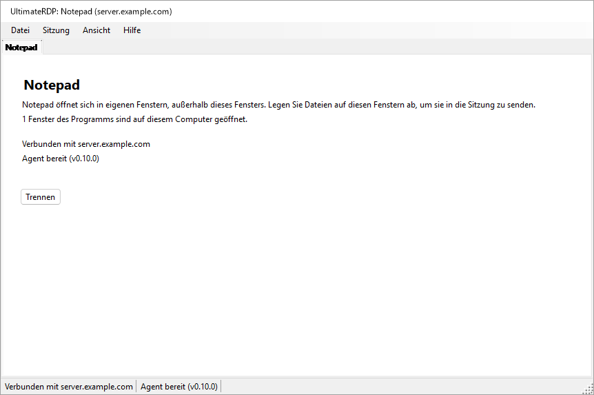

Während das Hauptfenster unsichtbar ist, nennt das Symbol von UltimateRDP im Infobereich die Programme und ihren Server; seine QuickInfo lautet „UltimateRDP by Aprogsys“, gefolgt von den Programmen.

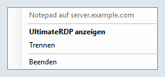

Der Client liest `remoteapplicationprogram`, `remoteapplicationname`, `remoteapplicationcmdline`, `remoteapplicationexpandcmdline`, `remoteapplicationexpandworkingdir` und `remoteapplicationfile`. Eine Datei, die RemoteApp ohne Programm verlangt, wird beim Öffnen abgelehnt.

### Auf dem Server

Eine RemoteApp-Sitzung führt den Explorer nicht aus, daher ignoriert sie den `Run`-Eintrag, den `--install-all-users` schreibt: Der Agent startet dort nicht von selbst. Der Administrator startet ihn mit einer geplanten Aufgabe bei der Anmeldung. Eine RemoteApp-Sitzung endet außerdem, wenn kein Programm des Benutzers mehr in ihr läuft, und ein Agent, der weiterläuft, würde sie offen halten. Der Agent kümmert sich daher auf zwei Arten darum:

- In einer RemoteApp-Sitzung listet er alle 15 Sekunden die Prozesse seiner Sitzung auf. Sobald nur noch die Prozesse übrig sind, die jede RemoteApp-Sitzung ausführt, und die Namen aus dem Schlüssel `SysProcs` des Servers, bei zwei Prüfungen hintereinander, und kein Ablegen und keine Übertragung läuft, beendet er sich. Während seiner ersten 90 Sekunden zählen die Prüfungen nicht, solange kein Programm gesehen wurde, damit ein langsam startendes Programm ihn nicht zum Beenden bringt. Er beendet sich auch, wenn die Sitzung getrennt wird und kein Programm mehr übrig ist. In einer Desktopsitzung prüft er einmal beim Start und tut danach nichts mehr.
- Sein Symbol im Infobereich erscheint in einer RemoteApp-Sitzung nie, solange `trayIcon` auf `auto` steht. Setzen Sie `trayIcon` für RemoteApp-Benutzer nicht auf `always`.

Der Administrator trägt den Agent außerdem in `SysProcs` ein, damit Windows selbst ihn nicht mitzählt. UltimateRDP schreibt nie in die Registrierung und legt keine Aufgabe an: Hier sind die Befehle, für eine PowerShell mit erhöhten Rechten auf dem Server. Ersetzen Sie den Pfad des Agents durch Ihren.

1. Lesen Sie zuerst den aktuellen Zustand und bewahren Sie die Ausgabe auf:

   ```powershell
   Get-ItemProperty 'HKLM:\SYSTEM\CurrentControlSet\Control\Terminal Server\SysProcs'
   Get-ScheduledTask -TaskPath '\UltimateRDP\' -ErrorAction SilentlyContinue
   quser
   ```

2. Tragen Sie den Agent in `SysProcs` ein. Für sich allein ändert das nichts, da der Agent noch nicht in RemoteApp-Sitzungen läuft. Es gilt für neue Sitzungen; starten Sie dafür nicht die Remotedesktopdienste neu, das würde jeden Benutzer trennen.

   ```powershell
   New-ItemProperty -Path 'HKLM:\SYSTEM\CurrentControlSet\Control\Terminal Server\SysProcs' -Name 'UltimateRDP.Agent.exe' -PropertyType DWord -Value 0
   ```

3. Legen Sie die Aufgabe nur für ein Testkonto an:

   ```powershell
   $exe       = 'C:\Program Files\UltimateRDP\UltimateRDP.Agent.exe'
   $action    = New-ScheduledTaskAction -Execute $exe
   $trigger   = New-ScheduledTaskTrigger -AtLogOn -User '<DOMAIN\test account>'
   $principal = New-ScheduledTaskPrincipal -UserId '<DOMAIN\test account>' -LogonType Interactive -RunLevel Limited
   $settings  = New-ScheduledTaskSettingsSet -ExecutionTimeLimit ([TimeSpan]::Zero) -AllowStartIfOnBatteries -DontStopIfGoingOnBatteries -MultipleInstances Parallel -Priority 5 -Compatibility Win8
   Register-ScheduledTask -TaskPath '\UltimateRDP\' -TaskName 'Agent' -Action $action -Trigger $trigger -Principal $principal -Settings $settings -Description 'Starts the UltimateRDP agent in each user session, RemoteApp sessions included.'
   ```

   `-LogonType Interactive` führt den Agent in der Sitzung des Benutzers mit den Rechten des Benutzers aus, und es wird kein Kennwort gespeichert. `-RunLevel Limited` verhindert, dass er je mit erhöhten Rechten läuft. `-ExecutionTimeLimit` mit null hebt die Grenze von 72 Stunden einer Aufgabe auf. In einer Desktopsitzung starten der `Run`-Eintrag und die Aufgabe beide den Agent; die zweite Instanz sieht die erste und beendet sich sofort.

4. Testen Sie mit dem Testkonto, wie unten beschrieben.

5. Erst dann starten Sie ihn für jeden Benutzer. Ändern Sie das Aufgabenobjekt und schreiben Sie es vollständig zurück:

   ```powershell
   $users = (New-Object System.Security.Principal.SecurityIdentifier 'S-1-5-32-545').Translate([System.Security.Principal.NTAccount]).Value
   $task = Get-ScheduledTask -TaskPath '\UltimateRDP\' -TaskName 'Agent'
   $task.Triggers = @(New-ScheduledTaskTrigger -AtLogOn)
   $task.Principal = New-ScheduledTaskPrincipal -GroupId $users -RunLevel Limited
   $task | Set-ScheduledTask
   ```

   Die erste Zeile ergibt den lokalen Namen der Gruppe Benutzer, der von der Sprache von Windows abhängt. `Set-ScheduledTask -Trigger ... -Principal ...` mit diesen Werten kehrte auf einem französischen Windows Server ohne Fehler zurück und ließ den Trigger und den Prinzipal des Testkontos bestehen, prüfen Sie daher, was die Aufgabenplanung gespeichert hat:

   ```powershell
   Export-ScheduledTask -TaskPath '\UltimateRDP\' -TaskName 'Agent'
   ```

   Das XML muss `<GroupId>S-1-5-32-545</GroupId>` und `<LogonTrigger />` ohne Benutzer zeigen. `Get-ScheduledTask` allein kann Werte zeigen, die nicht die gespeicherten sind.

Nach einer Aktualisierung des Agents in einem anderen Ordner richten Sie die Aufgabe darauf aus:

```powershell
Set-ScheduledTask -TaskPath '\UltimateRDP\' -TaskName 'Agent' -Action (New-ScheduledTaskAction -Execute 'C:\Program Files\UltimateRDP\<version>\UltimateRDP.Agent.exe')
```

Verwenden Sie für diese Aufgabe nie `Stop-ScheduledTask` oder Beenden in der Aufgabenplanung: Das würde die Agents aller Sitzungen beenden, die die Aufgabe gestartet hat.

Um alles zu entfernen, in dieser Reihenfolge:

```powershell
Unregister-ScheduledTask -TaskPath '\UltimateRDP\' -TaskName 'Agent' -Confirm:$false
Remove-ItemProperty -Path 'HKLM:\SYSTEM\CurrentControlSet\Control\Terminal Server\SysProcs' -Name 'UltimateRDP.Agent.exe'
```

Das Entfernen der Aufgabe beendet die bereits laufenden Agents nicht; sie enden mit ihrer Sitzung oder in RemoteApp-Sitzungen von selbst. Entfernen Sie den Wert `SysProcs` zuletzt, sobald kein Agent mehr in einer RemoteApp-Sitzung läuft.

`UltimateRDP.Agent.exe --status`, in einer Sitzung ausgeführt, sagt, ob es eine RemoteApp-Sitzung ist, ob der Wert `SysProcs` des Agents existiert und ob die Aufgabe `\UltimateRDP\Agent` existiert. Es liest nur.

In der Produktion mit dem Windows-Client (mstsc) in einer RemoteApp-Sitzung beobachtet: Der Agent startet, findet keinen UltimateRDP-Kanal (Fehler 50, den sein Protokoll einmal als Information vermerkt: Der Client der Sitzung ist wahrscheinlich nicht UltimateRDP), bleibt untätig, und die Sitzung endet wie gewohnt: Der Server trennt sie 19 Sekunden nach dem Schließen des letzten Fensters, der Agent beendet sich sofort, und die Sitzung ist 8 Sekunden später verschwunden.

### Test mit einem Konto

Bevor die Aufgabe für alle existiert, nur mit dem Testkonto:

1. Öffnen Sie ohne jede Änderung das Programm mit dem Microsoft-Client, schließen Sie es und beobachten Sie mit `quser`, was mit der Sitzung geschieht: Sie sollte etwa 20 Sekunden nach dem Schließen des letzten Fensters enden oder getrennt werden. Dieses Verhalten soll erhalten bleiben.
2. Öffnen Sie nach den Schritten 2 und 3 oben das Programm erneut mit dem Microsoft-Client. Der Agent muss in der Sitzung laufen (`Get-CimInstance Win32_Process -Filter "Name='UltimateRDP.Agent.exe'"`, mit seiner `SessionId`), ohne Symbol oder Fenster für den Benutzer, und sein Protokoll muss `RemoteApp session detected` enthalten. Schließen Sie das Programm: Die Sitzung muss wie in Schritt 1 enden, und das Protokoll des Agents muss mit `the agent exits so that the session can end` oder mit dem Ende der Sitzung schließen.
3. Öffnen Sie das Programm mit UltimateRDP und legen Sie eine kleine Datei, dann eine große auf einem Fenster des Programms ab.
4. Vergleichen Sie am Tag nach Schritt 5 von „Auf dem Server“ die Anzahl der Sitzungen und der getrennten Sitzungen mit der Ausgabe von dessen Schritt 1.

Wenn eine Sitzung nach dem Schließen ihres Programms geöffnet bleibt, entfernen Sie zuerst die Aufgabe, siehe oben, und melden Sie es dann mit dem Protokoll des Agents dieser Sitzung.

### Eine Verbindung pro Server und Konto

Windows gibt einem Benutzer eine Sitzung pro Server. Eine zweite Verbindung mit demselben Konto übernimmt diese Sitzung von der ersten, die mit „Die Verbindung wurde getrennt, weil eine andere Verbindung mit dem Remotecomputer hergestellt wurde“ endet; mit Version 0.9.3 beendete eine RemoteApp-Startdatei, die ein zweites Mal angeklickt wurde, während ihr Programm lief, beide Verbindungen, ohne das Programm zu starten. Ab Version 0.10.0:

- Ein RemoteApp-Start zu demselben Server, Port und Gateway wie ein laufender RemoteApp-Tab, mit demselben Konto, startet sein Programm über diese Verbindung: sofort, wenn die Sitzung angemeldet ist, auch wenn in ihren letzten Sekunden kein Fenster eines Programms mehr übrig ist; nach der Anmeldung und nach dem Programm des Tabs, solange sie noch verbindet, anmeldet oder auf die Windows-Warnung oder die Zertifikatsfrage wartet. Ein Start ohne Benutzernamen übernimmt das Konto des Tabs; zwei verschiedene Benutzernamen öffnen jeweils eigene Verbindungen.
- Das Ladefenster dieses Starts zeigt „{program} wird gestartet...“, bis ein neues Fenster eines Programms erscheint, der Server einen Fehler meldet, einige Sekunden nachdem der Server ohne neues Fenster geantwortet hat (ein Programm bringt möglicherweise nur sein Fenster in den Vordergrund) oder höchstens 30 Sekunden lang. Es hat kein Abbrechen, das die Verbindung der anderen Programme schließen würde.
- Wenn die Verbindung endet, bevor das Programm eines Starts erschienen ist, öffnet dieser Start seine eigene Verbindung, außer wenn Sie den Tab geschlossen haben.
- Der Tab und die QuickInfo des Symbols im Infobereich nennen jedes Programm der Verbindung.
- Ein erneutes Öffnen eines Desktops, während ein Desktop-Tab zum selben Ziel und mit demselben Konto läuft, wählt diesen Tab aus, mit einem Hinweis in seiner Statuszeile, statt einer zweiten Verbindung, die seine Sitzung übernehmen würde.
- Wenn eine andere Verbindung trotzdem eine Sitzung übernimmt, zum Beispiel von einem anderen Computer aus, zeigt der Tab „Diese Sitzung wurde von einer anderen Verbindung mit demselben Konto übernommen.“, und es erscheint immer nur eine Meldung auf einmal.

## Startdateien

Ab Version 0.10.0 genügt eine einzige .bat-Datei, um den Personen, die sie verwenden, eine Verbindung zu geben: `UltimateRDP.exe` nimmt die Verbindung auf seiner Befehlszeile entgegen, und Datei, **Startdatei erstellen (.bat)...** schreibt die .bat-Datei für Sie.

### Optionen der Befehlszeile

`UltimateRDP.exe [options] [file.rdp]`. Die Optionen stehen in beliebiger Reihenfolge, und Groß- und Kleinschreibung spielt keine Rolle. Eine Option, die einen Wert erwartet, nimmt das nächste Argument. `UltimateRDP.exe --help` (oder `/?`) zeigt diese Liste in der Sprache des Clients.

| Option | Wert | Gesetzte .rdp-Schlüssel |
| --- | --- | --- |
| `--server` | Hostname, IPv4-Adresse oder IPv6-Adresse mit oder ohne eckige Klammern; kein Port | `full address` |
| `--port` | 1 bis 65535, 3389 wenn nicht angegeben | `server port` |
| `--user` | Benutzername | `username` |
| `--domain` | Domäne | `domain` |
| `--remoteapp` | `\|\|Name` oder `Name` für ein veröffentlichtes Programm, oder ein Pfad auf dem Server | `remoteapplicationmode`, `remoteapplicationprogram` |
| `--remoteapp-name` | dem Benutzer angezeigter Name | `remoteapplicationname` |
| `--remoteapp-args` | Argumente des Programms, Anführungszeichen erlaubt | `remoteapplicationcmdline` |
| `--gateway` | Host eines Remote Desktop Gateway | `gatewayhostname`, `gatewayusagemethod:i:1`, `gatewayprofileusagemethod:i:1` |
| `--multimon` | `on` oder `off`: jeder Bildschirm im Vollbild | `use multimon` |
| `--scale` | 100 bis 500, in Prozent | `desktopscalefactor` |
| `--windows-keys` | `local`, `remote` oder `fullscreen` | `keyboardhook` 0, 1 oder 2 |
| `--clipboard` | `on` oder `off` | `redirectclipboard` |
| `--drives` | `on` (jedes Laufwerk) oder `off` | `redirectdrives`, `drivestoredirect` |
| `--printers` | `on` oder `off` | `redirectprinters` |
| `--audio` | `local`, `remote` oder `off` | `audiomode` 0, 1 oder 2 |
| `--ask-credentials` | | fragt nach dem Kennwort, siehe „Gespeicherte Anmeldedaten und das Kennwort“ |
| `--trusted` | | keine Windows-Warnung zum Herausgeber und zu den freigegebenen Ressourcen bei diesem Start, siehe unten |
| `--show`, `--hidden` | | das Hauptfenster, siehe „Über eine Verknüpfung oder eine .bat-Datei“ |
| `--help`, `/?` | | zeigt diese Liste und öffnet nichts |

Die Regeln:

- Ohne .rdp-Datei ist `--server` nötig. Mit einer .rdp-Datei kommen die Optionen zu ihr hinzu und haben Vorrang vor ihren Schlüsseln.
- `--server` ersetzt die Adresse der Datei, und der Port ist dann `--port` oder 3389. `--port` allein behält den Host der Datei.
- `--remoteapp`: Ein Wert, der mit `||` beginnt, ist ein veröffentlichter Alias; sonst ist ein Wert mit `\`, `/` oder `:` ein Pfad auf dem Server, und alles andere ist ein veröffentlichter Alias, der für den Server als `||Name` geschrieben wird. `--remoteapp Notepad` und `--remoteapp "||Notepad"` sind gleichwertig.
- Jeder Wert wird geprüft, bevor sich etwas öffnet: ein Hostname oder eine IP-Adresse für `--server` und `--gateway`, eine Zahl im zulässigen Bereich, höchstens 256 Zeichen für Namen (1024 für ein Programm, 2048 für Argumente), keine Steuerzeichen, keine Anführungszeichen außer in `--remoteapp-args` und kein Wert, der mit `--` beginnt, außer bei den Argumenten. Eine falsche Option zeigt eine Meldung, die nennt, welche und warum, und es wird keine Verbindung hergestellt.
- Es gibt absichtlich keine Option für ein Kennwort: Eine Befehlszeile kann von anderen Programmen des Computers gelesen werden, und sie bleibt in der .bat-Datei, in Verknüpfungen und in Protokollen erhalten. Windows verwendet die für den Server gespeicherten Anmeldeinformationen (siehe „Gespeicherte Anmeldedaten und das Kennwort“) oder fragt nach dem Kennwort. `--password` wird mit einer Meldung abgelehnt, die das erklärt.
- Ein zweiter Start übergibt seine Optionen an das bereits laufende UltimateRDP, wie bei einer Datei.
- `--trusted`: Vor einer RemoteApp-Verbindung zeigt Windows bei einer nicht signierten .rdp-Datei eine Warnung zum Herausgeber der Verbindung und zu den Ressourcen, die sie freigibt, mit einer Schaltfläche Verbinden. `--trusted` schaltet sie für diesen Start aus (die Eigenschaften `ShowRedirectionWarningDialog` und `RedirectionWarningType` des Steuerelements). Eine .bat-Datei oder eine Verknüpfung ist Code, den der Benutzer bewusst ausführt, daher gibt der Schalter ihrem Autor nichts, was die .bat-Datei nicht schon gab; eine .rdp-Datei sind Daten, die per E-Mail kommen können, daher schaltet kein Schlüssel einer .rdp-Datei die Warnung aus, und ein Start ohne `--trusted` behält die Windows-Warnung wie bisher. Die Frage zum Zertifikat des Servers ist ein anderes Dialogfeld und erscheint immer, wenn Windows sie stellt. Das Protokoll des Clients nennt für jede Verbindung, ob die Warnung Windows überlassen oder ausgeschaltet wird, und warum.
- Eine mit Optionen geöffnete Sitzung kommt nicht in Datei, Zuletzt verwendet, da die Optionen dort verloren gingen; Datei, In neuem Tab erneut öffnen öffnet sie erneut mit denselben Optionen.
- Vollbild beim Start und eine feste Desktopgröße werden nicht angeboten: Der Client startet jede Sitzung in seinem Fenster und passt die Größe des Desktops an das Fenster an, was auch immer die Datei angibt (`screen mode id`, `desktopwidth`, `desktopheight`).

Der Client baut aus den Optionen den Text einer .rdp-Datei im Arbeitsspeicher auf, nach dem Text der Datei, wenn es eine gibt, und liest ihn mit demselben Parser wie jede Datei: Eine Verbindung von der Befehlszeile und eine aus einer Datei durchlaufen denselben Code. Nichts wird auf den Datenträger geschrieben.

Beispiele:

```bat
@echo off
start "" "%LOCALAPPDATA%\UltimateRDP\client-0.10.0\UltimateRDP.exe" --server "server.example.com" --user "jdoe"
```

```bat
@echo off
start "" "%LOCALAPPDATA%\UltimateRDP\client-0.10.0\UltimateRDP.exe" --server "server.example.com" --remoteapp "||Notepad" --remoteapp-name "Notepad" --ask-credentials
```

### Der Startdatei-Generator

Datei, **Startdatei erstellen (.bat)...** öffnet ein Dialogfeld, das aus dem aktiven Tab ausgefüllt wird, falls es einen gibt. Die erste Ansicht enthält den Namen der Startdatei, den Server, den Port (3389), den Benutzer, was sie öffnet (den Remotedesktop oder ein RemoteApp-Programm) und das Programm. **Erweiterte Optionen** zeigt den Namen und die Argumente des Programms, die Domäne, das Gateway, das Hauptfenster, „Immer nach dem Kennwort fragen“, „Die Windows-Warnung nicht anzeigen (vertrauenswürdiger Server)“ (standardmäßig aus, fügt `--trusted` hinzu), die Anzeige- und Umleitungsoptionen aus der Tabelle oben („Standard“ überlässt die Wahl dem Client und der .rdp-Datei), wo die Startdatei UltimateRDP.exe findet und was geschrieben werden soll:

- UltimateRDP.exe: dieses Programm (der Pfad des laufenden UltimateRDP.exe, die Standardeinstellung), neben der Startdatei (`%~dp0UltimateRDP.exe`) oder ein Pfad, den Sie eingeben, wobei Variablen wie `%LOCALAPPDATA%` oder `%ProgramFiles%` so bleiben, wie sie geschrieben sind, und ihren Wert auf dem Computer erhalten, der die Startdatei ausführt.
- Eine einzige .bat-Datei mit allen Optionen (die Standardeinstellung) oder eine .bat-Datei und daneben eine .rdp-Datei, benannt nach der .bat-Datei; die .bat-Datei öffnet dann `%~dp0<name>.rdp`. Die .rdp-Datei wird in UTF-16 geschrieben, wie der Microsoft-Client sie schreibt.

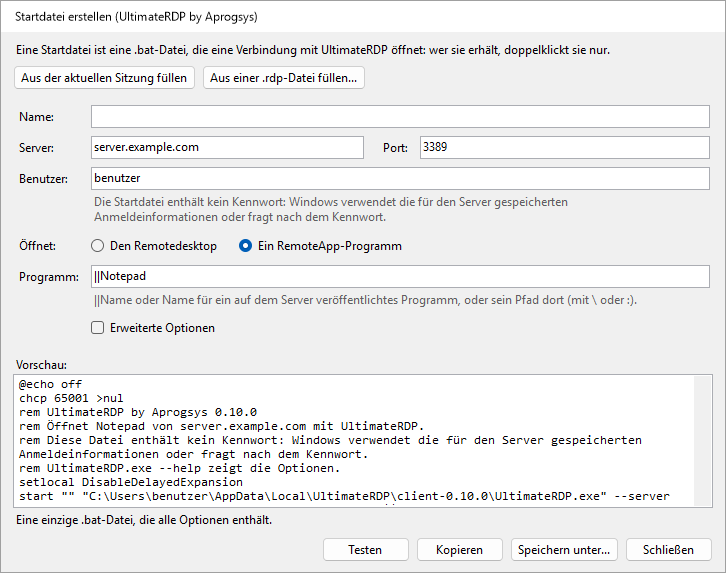

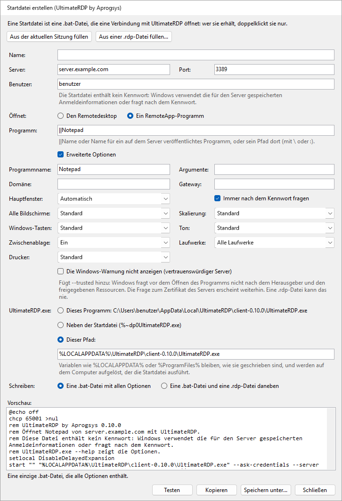

Das Dialogfeld zeigt den Text der .bat-Datei während der Eingabe, oder welches Feld falsch ist. **Aus der aktuellen Sitzung füllen** und **Aus einer .rdp-Datei füllen...** füllen die Felder aus den Einstellungen des aktiven Tabs oder einer Datei. **Speichern unter...** schreibt die Datei, **Kopieren** legt ihren Text in die Zwischenablage, und **Testen** startet dieses UltimateRDP mit den Optionen der Startdatei, was die Verbindung im laufenden Client öffnet. Die Startdatei enthält kein Kennwort, und das Dialogfeld hat kein Feld dafür.

Die .bat-Datei beginnt mit `@echo off`, mit `chcp 65001 >nul`, wenn ein Zeichen der Datei außerhalb von ASCII liegt, mit einem Kommentar, der mit „UltimateRDP by Aprogsys“ und seiner Version beginnt und in der Sprache des Clients sagt, was sie öffnet und dass sie kein Kennwort enthält, mit `setlocal DisableDelayedExpansion` und mit `start "" "<UltimateRDP.exe>" <options>`. Sie wird in UTF-8 ohne Byte Order Mark geschrieben, mit CRLF-Zeilenenden. Jeder Wert ist so in Anführungszeichen gesetzt, dass cmd.exe ihn genau wie eingegeben an UltimateRDP übergibt und nichts anderes ausführen kann: siehe „Sicherheitshinweise“.

## Funktionsweise

Der Client enthält das ActiveX-Steuerelement von Microsoft Remotedesktop und registriert sich als Ablageziel auf dessen Fenstern. Der Agent läuft in Ihrer Sitzung und lauscht auf einem statischen virtuellen Kanal namens `ULTRDP`. Bei kleinen Dateien sendet der Client die lokalen Pfade und die Position des Mauszeigers, und die Sitzung liest die Dateien von den umgeleiteten Laufwerken. Große Dateien werden über den Kanal gesendet, wie nach den folgenden Schritten beschrieben.

1. Wenn der Ziehvorgang zum ersten Mal über die Sitzung geht, rechnet der Client die Position des Mauszeigers in Koordinaten des Remotedesktops um und sendet `dragEnter` mit den Pfaden.
2. Der Agent öffnet ein unsichtbares Proxyfenster über dem ganzen Remotebildschirm. Er bewegt den Remotemauszeiger an die Stelle und simuliert auf diesem Fenster ein Drücken der linken Maustaste. Das Drücken startet ein echtes OLE-Ziehen innerhalb der Sitzung, mit den Dateien als `\\tsclient\<drive>\...`-Pfade oder als bereitgestellte Kopien.
3. Der Agent antwortet `dragAck`. Ohne diese Antwort innerhalb einer Sekunde bricht der Client den Ziehvorgang ab.
4. Während Sie den Mauszeiger bewegen, sendet der Client `dragMove`. Der Agent bewegt den Remotemauszeiger, sodass die Anwendung darunter den Ziehvorgang sieht und ihre Rückmeldung zeigt.
5. Wenn Sie die Maustaste loslassen, sendet der Client `drop`. Der Agent bewegt den Mauszeiger an die endgültige Stelle und lässt dort die simulierte Maustaste los. Wenn Sie die Sitzung stattdessen verlassen, sendet der Client `dragLeave`, und der Agent bricht den Ziehvorgang ab.
6. Der Agent meldet `dropResult` mit dem Effekt: `copy` oder `link`, wenn das Ziel angenommen hat, oder `none`, wenn nichts unter dem Mauszeiger die Dateien angenommen hat. Bei `none` wird das Ablegen ignoriert. Der Client zeigt das Ergebnis in der Statusleiste.

Der Ziehvorgang bietet nur Kopieren und Verknüpfen an, nie Verschieben. Zusatztasten werden in den Protokollen festgehalten, aber nicht eingespeist.

In einer RemoteApp-Sitzung sind die Fenster des Servers Fenster des Clients, und alles, was der Agent anzeigt, würde auch auf Ihrem Desktop erscheinen, einschließlich seines Proxyfensters. Daher sendet der Client nichts, während Sie den Mauszeiger bewegen: Beim Ablegen sendet er `dragEnter` und dann `drop` an derselben Stelle und hält das Ablegen auf Ihrer Seite offen, bis der Agent geantwortet hat. Der Agent spielt den Ziehvorgang genau dort nach, mit einem Proxyfenster von 32 mal 32 Pixeln unter der Stelle statt einem über dem ganzen Bildschirm.

Bei großen Dateien enthält `dragEnter` die Größe jedes Elements, und der Agent antwortet `dragAck` mit `transfer: true`, wenn sie über den Kanal kommen müssen. In Schritt 5 sendet der Client dann `drop` mit `deferred: true`: Der Agent bricht den Ziehvorgang in der Sitzung ab und merkt sich die Stelle. Der Client sendet die Dateien standardmäßig in Blöcken von 32 KiB, in Base64 oder in der dichteren Form `u15`, wenn der Agent meldet, dass die Daten des Clients bei ihm als UTF-16 ankommen, mit höchstens 4 MiB noch nicht bestätigt; der Agent schreibt sie in seinen Bereitstellungsordner und prüft die Größe und den SHA-256 jeder Datei, antwortet `transferResult`, legt die Kopien dann mit einem kurzen Ziehvorgang an der gemerkten Stelle ab und meldet `dropResult` wie in Schritt 6.

Zum Abmelden sendet der Client `logoff`. Der Agent antwortet `logoffResult`, wartet eine halbe Sekunde, damit die Antwort den Client erreicht, und bittet dann Windows, die Sitzung abzumelden. Er erzwingt nie das Schließen von Anwendungen mit ungespeicherter Arbeit.

Nachrichten sind JSON-Objekte, die als ASCII-Zeilen gesendet werden, außer den `u15`-Blöcken, und jede Seite erkennt zur Laufzeit, wie das Steuerelement Bytes des Kanals auf Zeichen abbildet. Einzelheiten finden Sie in [docs/design.md](docs/design.md).

## Fehlerbehebung

- **Der erste Start einer neuen Version dauert mehrere Sekunden, bevor etwas erscheint.** Diese Zeit vergeht, bevor der Prozess existiert: Ein Virenscanner analysiert beim ersten Start eine neue ausführbare Datei von etwa 120 MB. Die folgenden Starts zeigen das Ladefenster in etwa 0,1 s.
- **Eine Startdatei wurde zweimal angeklickt.** Ab Version 0.10.0 startet der zweite Klick das Programm über die laufende Verbindung; siehe „Eine Verbindung pro Server und Konto“.
- **Der Agent wird nie bereit.** Führen Sie `UltimateRDP.Agent.exe --status` in der Sitzung aus: Es sagt, ob der Agent dort läuft und von wo aus er starten soll. Das Symbol im Infobereich erscheint erst, wenn der Client verbunden ist, daher ist es normal, dass es vorher fehlt. Eine Richtlinie des Servers kann auch virtuelle Kanäle sperren: Das Protokoll des Agents enthält dann eine Warnung, dass er den Kanal nicht öffnen kann.
- **„Der Agent hat den Ziehvorgang nicht bestätigt“.** Der Agent hat nicht innerhalb einer Sekunde auf den Beginn des Ziehvorgangs geantwortet. Eine langsame Verbindung oder ein ausgelasteter Agent kann die Ursache sein, ebenso ein Agent, der sich in der Sitzung beendet oder neu gestartet hat, was der Client sonst nicht erkennen kann. Der Client sucht dann erneut nach dem Agent: Die Anzeige des Agents wechselt zu „Agent: Warten auf Antwort“ und zurück zu „Agent bereit“, wenn der Agent antwortet. Wenn die Statusleiste „Die Sitzung nimmt keine simulierten Eingaben an“ meldet, ist die Sitzung möglicherweise gesperrt, oder eine Richtlinie sperrt simulierte Eingaben. Bitte melden Sie es mit beiden Protokollen.
- **Das Ziel zeigt keine Rückmeldung zum Ablegen, oder die Statusleiste meldet „Nichts unter dem Mauszeiger hat die Dateien angenommen.“** Die Anwendung unter dem Mauszeiger nimmt an dieser Stelle möglicherweise keine Dateien an. Manche Anwendungen lehnen auch Netzwerkpfade wie `\\tsclient\C\...` ab. Schalten Sie für diese „Dateien vor dem Ablegen in die Sitzung kopieren“ im Menü des Agents im Infobereich ein.
- **Das erste Ablegen auf dem Explorer dauert mehrere Sekunden.** Der Explorer liest das umgeleitete Laufwerk zum ersten Mal, was langsam sein kann. Spätere Ablegevorgänge sind meist schneller.
- **Strg+W oder Strg+O bewirkt nichts.** Wenn die Sitzung die Tastatur hat, gehen diese Tasten an den Remotecomputer, wie jede andere Taste. Verwenden Sie stattdessen das Menü Datei.
- **Meine Anwendungen sind nach Beenden auf dem Server noch geöffnet.** Das ist so vorgesehen: Beenden und Tab schließen trennen die Verbindung, ohne die Sitzung zu beenden. Verwenden Sie Datei, Remotesitzung abmelden.
- **Die Texte sind in der falschen Sprache.** Wählen Sie die Sprache unter Ansicht, Sprache. Eine Meldung des Agents folgt der Sprache, die der Client beim Verbinden mitgeteilt hat; nach einem Sprachwechsel verwendet die nächste Meldung die neue.
- **Das Ablegen wird wegen der Laufwerke abgelehnt.** Schalten Sie die Laufwerksumleitung in der .rdp-Datei ein, unter Lokale Ressourcen, Weitere, Laufwerke. Prüfen Sie auf dem Server die Richtlinie „Umleitung von Laufwerken nicht zulassen“.
- **Ein RemoteApp-Programm öffnet sich, aber das Ablegen auf seinen Fenstern wird abgelehnt oder bewirkt nichts.** Das Protokoll des Clients hat pro Fenster des Programms eine Zeile, die mit `RemoteApp window` beginnt, mit dem Ergebnis der Registrierung des Ablageziels, und eine Warnung, wenn sie fehlgeschlagen ist. Die Zeilen `RemoteApp monitors` und `the target is at` zeigen, ob die Fenster auf dem Server dort sind, wo sie auf Ihrem Bildschirm sind; eine Warnung dort bedeutet, dass sich die Bildschirme seit dem Verbinden geändert haben, und eine neue Verbindung behebt das.
- **Eine RemoteApp-Sitzung bleibt nach dem Schließen ihres Programms geöffnet.** Prüfen Sie, ob das Protokoll des Agents der Sitzung `RemoteApp session detected` enthält und was die Zeilen `RemoteApp session:` sagen: Ein Programm, das dort noch aufgeführt ist, hält die Sitzung offen, mit oder ohne Agent. Siehe „RemoteApp-Programme“.
- **Das Ablegen landet im falschen Fenster.** Die Umrechnung der Koordinaten nach einer Größenänderung des Fensters oder ein Vollbild über mehrere Bildschirme kann die Ursache sein. Bitte melden Sie es mit beiden Protokollen.
- **Eine Übertragung großer Dateien schlägt fehl oder ist langsam.** Die Statusleiste nennt den Grund. Beide Protokolle beenden jede Übertragung mit einer Zusammenfassungszeile: Dateien, Bytes, Sekunden und MB/s, dann mit den unter „Eine langsame Übertragung messen“ beschriebenen Zeilen. Das Protokoll des Clients nennt auch die Länge der ersten gesendeten Blockzeile, und das Protokoll des Agents hat eine Zeile für den ersten empfangenen Block jeder Datei. Wenn die Statusleiste „Der Agent hat die ersten Daten der Übertragung nicht bestätigt.“ meldet, sind die Daten nicht durchgekommen: Das Protokoll des Clients nennt dann das Bytemodell, die Blockgröße, die Länge der Zeilen und die Anzahl der gesendeten Zeilen. Ein kleinerer Wert für `transferChunkBytes` kann helfen, siehe „Große Dateien“. Um zur Laufwerksumleitung zurückzukehren, wählen Sie im Menü des Agents im Infobereich Schnelle Übertragung großer Dateien, Nie.
- **Eine Übertragung schlägt mit „Eine Nachricht der Übertragung ging unterwegs verloren“ fehl.** Das Remotedesktop-Steuerelement verliert manchmal eine kurze Nachricht, die direkt vor einer großen gesendet wird. Ab 0.5.1 auf beiden Seiten sollte das nicht mehr vorkommen: Der Agent bittet den Client, die fehlenden Zeilen erneut zu senden, und die Zusammenfassung der Übertragung in beiden Protokollen zählt die erneut gesendeten Zeilen. Wenn es trotzdem vorkommt, führt eine Seite eine ältere Version aus; wenn eine Übertragung mit „Zeilen der Übertragung gingen unterwegs verloren und konnten nicht wiederhergestellt werden“ fehlschlägt, melden Sie es mit beiden Protokollen, aufgenommen mit `logLevel` auf `debug`.
- **Eine Übertragung schlägt sofort mit „Daten gingen unterwegs verloren oder wurden beschädigt“ fehl.** Der Kanal beschädigt unterwegs manchmal die Daten einer Zeile. Ab 0.5.2 auf beiden Seiten fordert der Agent diese Zeile erneut an, wie eine verlorene, und sein Protokoll beschreibt die Beschädigung in einer Zeile, die „arrived damaged“ enthält; ein Agent 0.5.1 lässt die Übertragung weiterhin fehlschlagen.
- **Große Dateien verwenden nie die Direktverbindung, oder Dateien der Sitzung können nicht gesendet werden.** Prüfen Sie zuerst, ob die öffentliche Adresse Ihres Computers in der Firewallregel der Direktverbindung steht, auf dem Server und beim Hoster, so wie in der Regel, die RDP erlaubt; ein neues Netzwerk ergibt eine neue Adresse. Das Protokoll des Clients nennt den Grund am Anfang jeder Übertragung: „the direct connection cannot be used“ mit dem Grund, etwa einem Port, der nicht innerhalb von 3 Sekunden geantwortet hat. Prüfen Sie die Firewallregeln aus „Direktverbindung für große Dateien“, auf dem Server und beim Hoster, und dass beide Seiten 0.7.0 ausführen. Das Protokoll des Agents nennt den Port, auf dem er gelauscht hat, und warnt, wenn kein Port des Bereichs frei war.
- **Eine direkte Übertragung ist langsamer als die Leitung.** Lesen Sie die Zeilen `direct connection statistics` beider Protokolle, siehe „Die Zusammenfassungszeilen lesen“.
- **Aus der Sitzung gesendete Dateien kommen nicht an.** Das Protokoll des Clients hat für jedes Angebot eine Zeile `Send offer`, dann Zeilen `Receive <id>:`, die sagen, ob die Direktverbindung hergestellt werden konnte, und warum nicht. Das Protokoll des Agents hat dieselben Zeilen `Send <id>:`. Wenn das Protokoll des Clients keine Zeile `Send offer` hat, prüfen Sie, ob beide Seiten 0.9.0 ausführen und ob `receiveFiles` und `directTransfer` in client.json nicht auf `never` stehen; die Zeile `Hello from client` im Protokoll des Agents zeigt `receives files of the session: True`, wenn sie es nicht sind.
- **Wo die Protokolle liegen.** Der Client schreibt `%LOCALAPPDATA%\UltimateRDP\logs\client-yyyyMMdd.log` auf Ihrem Computer. Der Agent schreibt `agent-yyyyMMdd.log` in denselben Ordner auf dem Server; ab Version 0.9.0 nennt jede seiner Zeilen die Sitzung und den Thread, etwa `[S3 12]`, da die Agents eines Benutzers in mehreren Sitzungen in dieselbe Datei schreiben. Beide bewahren die Protokolle von vierzehn Tagen auf. Der Client öffnet seinen Ordner über Hilfe, Protokollordner öffnen, und der Agent über sein Menü im Infobereich, Protokollordner öffnen.

## Aus dem Quellcode erstellen

Sie brauchen das .NET 10 SDK unter Windows.

```
dotnet build UltimateRDP.sln -c Release
dotnet test UltimateRDP.sln
```

Um eine eigenständige ausführbare Einzeldatei ohne Symbole zu veröffentlichen:

```
dotnet publish src/UltimateRDP.Client -c Release -r win-x64 --self-contained true -p:PublishSingleFile=true -p:IncludeNativeLibrariesForSelfExtract=true -p:DebugType=none -p:DebugSymbols=false
dotnet publish src/UltimateRDP.Agent -c Release -r win-x64 --self-contained true -p:PublishSingleFile=true -p:IncludeNativeLibrariesForSelfExtract=true -p:DebugType=none -p:DebugSymbols=false
```

Releases werden von GitHub Actions erstellt, wenn ein Tag `v*` gepusht wird. Der Workflow erstellt und testet beide Anwendungen, veröffentlicht sie und hängt die beiden ZIP-Archive an das Release an.

Die ausführbaren Dateien eines Release sind von APROGSYS signiert, und Windows zeigt diesen Herausgeber in seinen Abfragen. Eine ausführbare Datei, die Sie selbst erstellen, ist nicht signiert.

## Sicherheitshinweise

- Der Agent liest nur aus `\\tsclient\`, also von den Laufwerken, die Sie freigeben wollten. Der Agent selbst schreibt nur in seinen Bereitstellungsordner in Ihrer Sitzung, wenn das Kopieren vor dem Ablegen eingeschaltet ist oder wenn Dateien über den Kanal kommen. Er lehnt jeden Dateinamen ab, der diesen Ordner verlassen würde. Die Anwendung, auf der Sie ablegen, entscheidet, wohin die Dateien gehen. Der Agent läuft nicht als Dienst und hat keine Rechte über Ihre eigenen hinaus.
- Der Agent simuliert Eingaben nur innerhalb Ihrer eigenen Sitzung und nur zwischen Beginn und Ende eines Ziehvorgangs. Er verwendet nur die linke Maustaste. Er speist das Drücken erst ein, wenn sein eigenes Proxyfenster unter dem Mauszeiger liegt, sodass das Drücken nie eine andere Anwendung erreicht. Zum Abbrechen sendet er Esc an sein Proxyfenster, statt einen Tastendruck zu simulieren.
- Der Agent bietet nie Verschieben an. Ein in der Sitzung angenommenes Verschieben könnte die Datei über das umgeleitete Laufwerk auf Ihrem lokalen Datenträger löschen.
- Nachrichten enthalten Dateipfade, Koordinaten, Kennzeichen für Zusatztasten und Fensternamen. Dateiinhalte gehen nur bei einer Übertragung großer Dateien über den Kanal, innerhalb der verschlüsselten Remotedesktopverbindung.
- Ab Version 0.6.0 können die Dateien einer Übertragung großer Dateien stattdessen über eine direkte TLS-Verbindung gehen. Der Agent lauscht nur, solange eine Übertragung angeboten wird, und nimmt eine Verbindung nur mit einem Nachweis des Einmal-Tokens an, das er über die verschlüsselte Remotedesktopverbindung übermittelt hat, jede Verbindung des Angebots einmal, höchstens 16. Der Client akzeptiert nur das Zertifikat, dessen SHA-256 der Agent dort genannt hat. Die Dateien kommen in denselben Bereitstellungsordner, mit denselben Prüfungen. Öffnen Sie die Ports nur für die Clientadressen, die für RDP zugelassen sind.
- Ab Version 0.9.0 kann die Sitzung Dateien an Ihren Computer senden. Nur der Benutzer der Sitzung kann das starten, über den Agent dieser Sitzung: `--send` erreicht diesen Agent über eine Pipe, die nur Prozesse desselben Benutzers in derselben Sitzung annimmt. Der Client nimmt Dateien nur an, nachdem er auf ein Angebot geantwortet hat, das über die verschlüsselte Remotedesktopverbindung seiner eigenen Sitzung kam, nur über die Direktverbindung, deren Zertifikat und Token dieses Angebot genannt hat, und nur in seinen Ordner für empfangene Dateien. Er ersetzt nie eine Datei, startet nie eine und markiert jede als Download.
- Ab Version 0.10.0 kann die Befehlszeile eine Verbindung angeben, und der Client kann Startdateien schreiben. Keine Option nimmt ein Kennwort an. Jeder Wert der Befehlszeile wird geprüft, bevor sich etwas öffnet, und kann den .rdp-Einstellungen, zu denen er wird, keinen Schlüssel hinzufügen. In einer Startdatei steht jeder Wert in doppelten Anführungszeichen nach den Quoting-Regeln der Windows-Befehlszeile, jedes `%` wird verdoppelt, ein `^` steht vor `& | < > ^ ( )` überall dort, wo cmd.exe außerhalb von Anführungszeichen liest, und die verzögerte Erweiterung ist ausgeschaltet, sodass kein Wert einen Befehl hinzufügen oder eine Variable erweitern kann. Die Tests prüfen das mit einem Modell von cmd.exe und mit cmd.exe selbst.
- Der Client schreibt nie Anmeldeinformationen und protokolliert sie nie. Er liest die generischen Anmeldeinformationen `TERMSRV/<host>`, wenn sie existieren, und übergibt sie an das Microsoft-Steuerelement. Andere Anmeldeabfragen kommen vom Microsoft-Steuerelement.

## Stand

Version 0.10.0 bringt die Optionen einer Verbindung auf der Befehlszeile, den Startdatei-Generator, eine Verbindung pro Server und Konto für RemoteApp-Programme und `--trusted`. Ihre Startdateien wurden mit cmd.exe auf dem Testcomputer geprüft; die gemeinsame RemoteApp-Verbindung und `--trusted` wurden zum Zeitpunkt der Veröffentlichung nicht gegen einen echten Server getestet. Version 0.9.0 ist eine Testversion. Die aus der Sitzung an Ihren Computer gesendeten Dateien, der Start eines RemoteApp-Programms über eine Verknüpfung, dessen Korrekturen an den Fenstern und die Kennwortoption wurden zum Zeitpunkt der Veröffentlichung nicht gegen einen echten Server getestet; die Laufwerksbuchstaben von 0.8.0 ebenfalls nicht.

In einer echten Remotedesktopsitzung mit Version 0.2.1 überprüft:

- Der virtuelle Kanal zwischen dem Client und dem Agent, mit einem Byte pro Zeichen in beiden Richtungen.
- Die Übertragung über die Laufwerksumleitung zum Remotedesktop.
- Das direkte Ziehen in eine Remoteanwendung.

Der Befehl zum Abmelden und die Übersetzungen sind neu in 0.3.0. Die schnelle Übertragung großer Dateien ist neu in 0.4.0. Ihr erster Test gegen einen echten Server schlug fehl. Version 0.4.1 behebt die beiden dort gefundenen Fehler; damit erreichte eine Datei von 496 MB eine echte Sitzung in 193 Sekunden. Version 0.4.2 fügt bei jedem Ablegen ein Fortschrittsfenster hinzu und ändert nur den Client. Version 0.4.3 behebt kurze Nachrichten, die das Remotedesktop-Steuerelement manchmal direkt vor einer großen verlor, wodurch einige Übertragungen an ihrem Anfang fehlschlugen. Version 0.4.4 misst auf beiden Seiten, wohin die Zeit einer Übertragung geht, und fügt die Einstellungen `transferWindowBytes` und `channelRead` hinzu, um zu testen, was sie begrenzt.

Ihre Messungen zeigten, dass keine Seite die Übertragung begrenzt: Der Kanal ist voll, und die Kodierung der Daten nahm den größeren Teil davon ein. Version 0.5.0 sendet die Dateien in einer dichteren Form, wenn die Daten des Clients beim Agent als UTF-16 ankommen, was die Rate voraussichtlich etwa um das 2,5-Fache erhöht, von 2,1 MB/s auf etwa 5,4 MB/s auf einem Kanal von 5,8 MB/s. Sie behält auch die schnelle Übertragung bei, wenn Sie die Maustaste schnell loslassen, bevor der Agent auf den Beginn des Ziehvorgangs geantwortet hat, auch wenn diese Antwort in zwei Schritten kommt. Version 0.5.1 nummeriert die Nachrichten einer Übertragung, sodass der Agent diejenigen anfordert, die das Remotedesktop-Steuerelement verloren hat, und die Übertragung weiterläuft. Version 0.5.2 tut dasselbe für eine Nachricht, die beschädigt ankommt. Version 0.6.0 sendet große Dateien über eine direkte TLS-Verbindung, wenn der Server seine Ports dafür öffnet, da der Kanal bei 2 bis 4 MB/s blieb. Ihr erster Produktionstest erreichte einige Sekunden lang 135 bis 180 MB/s, dann etwa 20 MB/s, die Grenze einer einzelnen TCP-Verbindung auf diesem Pfad; Version 0.7.0 verwendet daher mehrere Verbindungen gleichzeitig und protokolliert, wohin die Zeit einer Übertragung geht. Version 0.8.0 öffnet RemoteApp-Programme und nimmt Ablegevorgänge auf ihren Fenstern an, verhindert, dass der Agent eine RemoteApp-Sitzung offen hält, kann den Laufwerken des Clients Laufwerksbuchstaben der Sitzung geben und liest Einstellungen für den ganzen Computer. Ihr erster echter Test mit Notepad funktionierte und zeigte ein leeres Fenster des Steuerelements über einem Bildschirm, ein immer angezeigtes Hauptfenster, zehn verlorene Sekunden vor dem Start des Programms und ein normales Ende, das als Fehler angezeigt wurde. Version 0.9.0 behebt diese Punkte, öffnet RemoteApp-Programme über eine Verknüpfung mit nur ihren eigenen Fenstern auf dem Bildschirm, sendet Dateien aus der Sitzung an Ihren Computer und kann jedes Mal nach dem Kennwort fragen.

Hilfreiche Rückmeldungen:

- Ob das direkte Ziehen in Ihrer Sitzung funktioniert, und mit welchen Anwendungen.
- Ob das Abmelden bei Ihnen funktioniert, und die Formulierungen in Ihrer Sprache.
- Die Rate einer Übertragung großer Dateien über Ihre Verbindung, aus der Zusammenfassungszeile beider Protokolle.

- Wie lange das erste Ablegen auf dem Explorer dauert.
- Ob das Ablegen im Vollbild an der richtigen Stelle landet, mit einem Bildschirm oder mit allen Bildschirmen.
- Ob gespeicherte Anmeldedaten funktionieren, und welche Art Sie in der Anmeldeinformationsverwaltung haben.
- Mit RemoteApp: ob sich das Programm öffnet, ob ein Ablegen auf seinen Fenstern dort landet, wo Sie die Maustaste losgelassen haben, und ob die Sitzung wie bisher endet, wenn das Programm geschlossen wird, mit beiden Protokollen.

Bitte senden Sie sie über [GitHub Issues](https://github.com/freeKC/ultimaterdp/issues), mit beiden Protokollen.

## Herausgeber

UltimateRDP by Aprogsys wird von [APROGSYS](https://www.aprogsys.com/) entwickelt und veröffentlicht. Der Quellcode liegt auf [GitHub](https://github.com/freeKC/ultimaterdp), unter der MIT-Lizenz.

## Lizenz

MIT. Siehe [LICENSE](LICENSE).
