# UltimateRDP

[](https://github.com/freeKC/ultimaterdp/actions/workflows/ci.yml)

[English](README.md) | [Français](README.fr.md) | [Deutsch](README.de.md) | **Español** | [Italiano](README.it.md) | [Nederlands](README.nl.md) | [Português](README.pt.md)

El README en inglés es la referencia; esta traducción lo sigue.

UltimateRDP by Aprogsys mueve archivos grandes entre su equipo y una sesión de Escritorio remoto a través de varias conexiones TLS en paralelo, fuera del flujo RDP. En una instalación de producción transportó de 255 a 296 MB/s del PC al servidor y de 115 a 134 MB/s del servidor al PC, mientras que el canal virtual RDP transporta unos 2 MB/s y una sola conexión TCP se estabilizó en 20 a 22 MB/s: consulte «Transferencias rápidas mediante conexiones en paralelo».

UltimateRDP le permite arrastrar archivos o carpetas desde su escritorio y soltarlos en una sesión de Escritorio remoto, sobre la aplicación que está bajo el cursor. El Explorador, un cliente de correo, un navegador o una aplicación de gestión los reciben como si los hubiera soltado dentro de la sesión. Cuando nada bajo el cursor los acepta, la colocación se ignora. Los archivos también van en el otro sentido, de la sesión a su equipo. UltimateRDP abre escritorios y programas RemoteApp, desde un archivo .rdp o desde un lanzador .bat que escribe por usted. Se compone de un cliente que aloja el control de Escritorio remoto de Microsoft, un pequeño agente en la sesión, un canal virtual entre ambos, la redirección de unidades estándar y las conexiones directas para los archivos grandes.

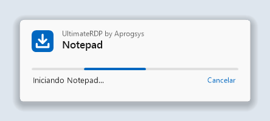

## Contenido

<!-- toc -->
- [Transferencias rápidas mediante conexiones en paralelo](#transferencias-rápidas-mediante-conexiones-en-paralelo)
- [Por qué](#por-qué)
- [Requisitos](#requisitos)
- [Instalación](#instalación)
  - [En el servidor](#en-el-servidor)
  - [Sesiones abiertas con el cliente de Microsoft](#sesiones-abiertas-con-el-cliente-de-microsoft)
  - [En su equipo](#en-su-equipo)
- [Uso](#uso)
  - [Sesiones y pestañas](#sesiones-y-pestañas)
  - [La ventana de carga](#la-ventana-de-carga)
  - [Finalizar la sesión](#finalizar-la-sesión)
  - [Arrastrar a la sesión](#arrastrar-a-la-sesión)
  - [Archivos grandes](#archivos-grandes)
  - [Enviar archivos de la sesión a su equipo](#enviar-archivos-de-la-sesión-a-su-equipo)
  - [Mensajes de la barra de estado](#mensajes-de-la-barra-de-estado)
  - [Menú Ver](#menú-ver)
  - [Idioma](#idioma)
  - [Credenciales guardadas y contraseña](#credenciales-guardadas-y-contraseña)
- [Configuración del cliente](#configuración-del-cliente)
- [Menú del área de notificación y configuración del agente](#menú-del-área-de-notificación-y-configuración-del-agente)
  - [Configuración para todo el equipo](#configuración-para-todo-el-equipo)
  - [Unidades del cliente en letras de unidad](#unidades-del-cliente-en-letras-de-unidad)
- [Conexión directa para archivos grandes](#conexión-directa-para-archivos-grandes)
  - [Reglas del firewall](#reglas-del-firewall)
  - [Vía alternativa](#vía-alternativa)
  - [Configuración](#configuración)
  - [Interpretar las líneas de resumen](#interpretar-las-líneas-de-resumen)
- [Programas RemoteApp](#programas-remoteapp)
  - [Desde un acceso directo o un archivo .bat](#desde-un-acceso-directo-o-un-archivo-bat)
  - [En su equipo](#en-su-equipo-1)
  - [En el servidor](#en-el-servidor-1)
  - [Prueba con una sola cuenta](#prueba-con-una-sola-cuenta)
  - [Una conexión por servidor y cuenta](#una-conexión-por-servidor-y-cuenta)
- [Lanzadores](#lanzadores)
  - [Opciones de la línea de comandos](#opciones-de-la-línea-de-comandos)
  - [El generador de lanzadores](#el-generador-de-lanzadores)
- [Cómo funciona](#cómo-funciona)
- [Solución de problemas](#solución-de-problemas)
- [Compilar desde el código fuente](#compilar-desde-el-código-fuente)
- [Notas de seguridad](#notas-de-seguridad)
- [Estado](#estado)
- [Créditos](#créditos)
- [Licencia](#licencia)
<!-- /toc -->

## Transferencias rápidas mediante conexiones en paralelo

Qué es:

- Desde la versión 0.6.0, los archivos grandes pasan por una conexión TLS directa entre el cliente y el agente, fuera de la conexión de Escritorio remoto, y desde la versión 0.7.0 por varias conexiones en paralelo, ocho por defecto y dieciséis como máximo. Las conexiones usan TLS 1.3 cuando ambas versiones de Windows lo ofrecen, como Windows 11 y Windows Server 2022, y TLS 1.2 en caso contrario.
- El agente crea su certificado en memoria y comunica su SHA-256 y un token de un solo uso a través del canal virtual RDP, que ya está autenticado y cifrado. El cliente solo acepta ese certificado, y el agente solo acepta conexiones que demuestren que conocen el token.
- Cada archivo se comprueba al final con su SHA-256. Un archivo que no coincide no se conserva.
- Cuando no se puede usar la conexión directa, por ejemplo a través de una puerta de enlace de Escritorio remoto o con puertos cerrados, los archivos pasan por el canal virtual RDP sin que el usuario tenga que hacer nada, y el registro del cliente indica el motivo.

Por qué importa:

- El canal virtual RDP transportaba unos 2 MB/s en producción, fuera cual fuera el enlace.
- La redirección de unidades lee un archivo en bloques pequeños, con un viaje de ida y vuelta por bloque: 3,6 MB/s en una medición sobre un enlace que transportaba 9,7 MB/s.
- Una sola conexión TCP en la ruta de producción empezaba a 90 a 180 MB/s y se estabilizaba en 20 a 22 MB/s pasados los primeros segundos. El límite es por conexión, en algún punto de la ruta, y varias conexiones se suman.

Medido en una instalación de producción, con un servidor en un proveedor de alojamiento y un PC en una línea de 2,3 Gbit/s:

| Ruta | Velocidad |
| --- | --- |
| Del PC al servidor, 8 conexiones directas | de 255 a 296 MB/s |
| Del servidor al PC, 8 conexiones directas | de 115 a 134 MB/s, el techo del enlace de salida de ese servidor |
| Una sola conexión directa, pasados los primeros segundos | de 20 a 22 MB/s |
| Los mismos archivos por el canal virtual RDP | unos 2 MB/s |

Son mediciones en una sola instalación; las velocidades dependen del enlace, del servidor y de los discos. El servidor necesita una regla de firewall para un rango de puertos: consulte «Conexión directa para archivos grandes».

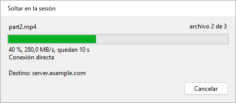

## Por qué

El cliente de Escritorio remoto de Microsoft rechaza lo que se suelta en su ventana, porque RDP no tiene ningún canal de arrastrar y soltar. Copiar y pegar funciona, y la redirección de unidades también, pero ninguno de los dos es soltar. UltimateRDP añade el gesto sobre lo que RDP ya ofrece.

Mientras arrastra sobre la ventana del cliente, el agente reproduce el mismo arrastre dentro de la sesión como un verdadero arrastrar y soltar OLE. Por tanto, cualquier aplicación remota que acepte archivos soltados los acepta desde UltimateRDP, y muestra su propia indicación de colocación mientras usted se mueve. Cuando nada bajo el cursor acepta la colocación, esta se ignora: no se copia nada en ninguna parte.

Los archivos pequeños viajan por la redirección de unidades. Los archivos grandes viajan por el canal de UltimateRDP antes de la colocación: consulte «Archivos grandes» más abajo.

## Requisitos

- Un equipo cliente con Windows 10 u 11 de 64 bits.
- Un servidor con Windows Server 2016 o posterior, o un equipo con Windows 10 u 11 que actúe como host de Escritorio remoto.
- Un archivo .rdp que redirija las unidades. En la configuración de Conexión a Escritorio remoto, es Recursos locales, luego Más, luego Unidades.
- Poder ejecutar el agente en su sesión de usuario en el servidor.

El cliente es un único ejecutable portátil. Se ejecuta sin derechos de administrador. El archivo comprimido del agente también contiene un único ejecutable.

UltimateRDP funciona a través de una puerta de enlace de Escritorio remoto. La conexión directa para archivos grandes no, y entonces los archivos pasan por el canal: consulte «Conexión directa para archivos grandes».

UltimateRDP tiene un alcance deliberadamente limitado:

- Las colocaciones van en un solo sentido, del equipo local a la sesión. Desde la versión 0.9.0, la sesión envía archivos a su equipo con su menú Enviar a en lugar de una colocación, solo por la conexión directa: consulte «Enviar archivos de la sesión a su equipo».
- Sesiones de escritorio completo y, desde la versión 0.8.0, programas RemoteApp: consulte «Programas RemoteApp».
- La sesión siempre empieza en una ventana, aunque el archivo .rdp pida pantalla completa. Después puede pasar a pantalla completa. En pantalla completa, solo puede soltar desde un monitor que la sesión no cubra.

## Instalación

Cada archivo zip contiene un único archivo `.exe`.

### En el servidor

1. Descargue el zip `UltimateRDP.Agent` de la [página de versiones](https://github.com/freeKC/ultimaterdp/releases).
2. Descomprímalo en una carpeta que todos los usuarios puedan leer, como `C:\Program Files\UltimateRDP`.
3. Desde un símbolo del sistema con privilegios elevados, ejecute:

   ```
   "C:\Program Files\UltimateRDP\UltimateRDP.Agent.exe" --install-all-users
   ```

   A partir de entonces, el agente se inicia con cada sesión de usuario. Los usuarios que ya han iniciado sesión lo tendrán en su próximo inicio de sesión. Volver a ejecutar el comando no cambia nada. Si había instalado el agente para su propia cuenta con `--install`, el comando también quita esa entrada y lo indica, para que el agente no se inicie dos veces en su sesión. Rechaza un ejecutable situado dentro de un perfil de usuario, como una carpeta Descargas, porque es posible que los demás usuarios no puedan leerlo.

Para instalarlo solo para su propia cuenta, ejecute el mismo comando con `--install` desde un símbolo del sistema normal. Esto también inicia el agente de inmediato.

Las sesiones RemoteApp no usan la entrada `Run`. Para tener el agente también en ellas, consulte «Programas RemoteApp» más abajo.

Otras opciones:

- `--uninstall` hace que el agente deje de iniciarse con su sesión y detiene la copia en ejecución. Ejecútelo desde un símbolo del sistema con privilegios elevados para quitar también la entrada para todos los usuarios.
- `--send <paths>` envía archivos y carpetas de la sesión al equipo del cliente UltimateRDP conectado a ella. El acceso directo de Enviar a lo ejecuta; consulte «Enviar archivos de la sesión a su equipo».
- `--status` muestra la versión, las entradas `Run` en `HKEY_CURRENT_USER` y `HKEY_LOCAL_MACHINE`, el archivo de configuración, el archivo de configuración del equipo y si el agente se ejecuta en su sesión. También indica si la sesión es una sesión RemoteApp, y si existen el valor `SysProcs` y la tarea programada de «Programas RemoteApp». No cambia nada.
- `--help` muestra las opciones.

Para actualizar en un servidor, detenga todas las copias del agente desde un símbolo del sistema con privilegios elevados con `taskkill /im UltimateRDP.Agent.exe /f`, reemplace el ejecutable y deje que los usuarios vuelvan a iniciar sesión. Para actualizar su propia copia, ciérrela desde su menú del área de notificación o con `--uninstall`, reemplace el ejecutable y vuelva a instalarla. El cliente y el agente deben tener la misma versión.

### Sesiones abiertas con el cliente de Microsoft

En un servidor, la mayoría de los usuarios pueden conectarse con el cliente de Microsoft (mstsc), que no tiene canal de UltimateRDP. Para ellos, el agente permanece oculto y no hace nada visible:

- No muestra ningún icono, ninguna ventana ni ningún mensaje. Su icono del área de notificación solo aparece mientras hay un cliente UltimateRDP conectado a la sesión, y desaparece cuando ese cliente se desconecta; en una sesión RemoteApp no aparece nunca. La opción `trayIcon` que se describe más abajo cambia esto.
- Mientras espera, usa unos pocos megabytes de memoria y ningún tiempo de procesador medible. Intenta abrir su canal cada diez segundos, y de inmediato cuando un cliente se conecta a la sesión, para que un usuario que vuelve a conectarse con el cliente UltimateRDP encuentre el agente listo.
- Su registro recibe una línea cuando se inicia y como máximo una línea por hora mientras espera.
- Sobrevive a las desconexiones y reconexiones, con cualquiera de los dos clientes. Al cerrar la sesión, suelta el botón del ratón si había una colocación en curso, cierra el canal y termina, sin retrasar el cierre de sesión.
- Un error inesperado nunca muestra un cuadro de diálogo: se escribe en el registro, y el agente continúa o termina sin hacer ruido.

### En su equipo

1. Descargue el zip `UltimateRDP` de la [página de versiones](https://github.com/freeKC/ultimaterdp/releases).
2. Descomprímalo en cualquier lugar. No hay nada que instalar. UltimateRDP no escribe nada en el registro de Windows.
3. Inícielo con su archivo de conexión:

   ```
   UltimateRDP.exe path\to\connection.rdp
   ```

   También puede hacer doble clic en `UltimateRDP.exe` y elegir el archivo .rdp en el cuadro de diálogo.

## Uso

### Sesiones y pestañas

Cada sesión se abre en su propia pestaña. La barra de estado y los menús siguen a la pestaña activa. El menú Archivo contiene:

- **Abrir .rdp...** (Ctrl+O): abre un archivo de conexión en una nueva pestaña.
- **Recientes**: los diez últimos archivos de conexión. **Borrar recientes** vacía la lista.
- **Crear un lanzador (.bat)...**: desde la versión 0.10.0, escribe un archivo .bat que abre una conexión. Consulte «Lanzadores».
- **Volver a abrir en una nueva pestaña**: abre una vez más el archivo de la pestaña activa, en una segunda pestaña. Desde la versión 0.10.0, mientras la sesión de la pestaña está conectada, se selecciona esa pestaña en su lugar: una segunda conexión con la misma cuenta tomaría su sesión. Consulte «Una conexión por servidor y cuenta».
- **Cerrar pestaña** (Ctrl+W): desconecta la sesión activa y cierra su pestaña.
- **Cerrar la sesión remota**: finaliza su sesión de Windows en el servidor. Consulte «Finalizar la sesión» más abajo.
- **Olvidar credenciales guardadas**: consulte «Credenciales guardadas y contraseña» más abajo.
- **Pedir siempre la contraseña**: desde la versión 0.9.0, cada conexión pide la contraseña en lugar de usar una credencial guardada. Consulte «Credenciales guardadas y contraseña» más abajo.
- **Salir**: desconecta todas las sesiones y cierra la ventana.

El menú Sesión contiene Conectar, Desconectar, Buscar de nuevo el agente y Cancelar la transferencia. Consulte «Archivos grandes» más abajo.

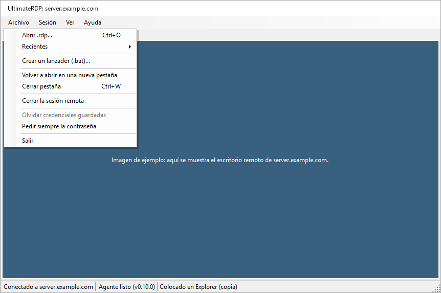

El menú Ayuda contiene Acerca de, que muestra «UltimateRDP by Aprogsys», la versión y la dirección del proyecto, Página del proyecto y Abrir la carpeta de registros.

### La ventana de carga

Desde la versión 0.9.3, una pequeña ventana aparece en cuanto UltimateRDP se inicia con una conexión, desde un archivo .bat, un acceso directo o el ejecutable, hasta que el programa o el escritorio están ahí. Muestra «UltimateRDP by Aprogsys», el nombre del programa o del servidor, una barra en movimiento y la etapa: «Iniciando...», «Conectando con server.example.com...», «Abriendo la sesión...», «Iniciando Notepad...». Pasados 10 segundos, indica que el servidor tarda más de lo habitual. Su botón Cancelar detiene la conexión.

 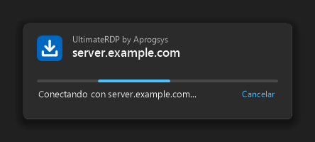

- Se cierra cuando aparece la ventana del programa, cuando se ha iniciado sesión en el escritorio, o ante cualquier final anterior.
- Sigue el tema claro u oscuro de Windows y la escala de su monitor, nunca toma el teclado y no tiene botón en la barra de tareas.
- Se oculta mientras la pregunta sobre el certificado del servidor, la solicitud de contraseña, la advertencia de Windows sobre una conexión RemoteApp o un mensaje de UltimateRDP esperan una respuesta, y después vuelve por encima de las demás ventanas, sin tomar el teclado.
- Un segundo inicio que se entrega al UltimateRDP en ejecución muestra de inmediato la ventana de carga de la nueva sesión.
- `"loader": "off"` en client.json la desactiva.

### Finalizar la sesión

Salir, Cerrar pestaña y Sesión, Desconectar solo desconectan, como hace el cliente de Escritorio remoto de Microsoft. Su sesión de Windows sigue ejecutándose en el servidor, con sus aplicaciones, y la vuelve a encontrar en la próxima conexión.

Para finalizar realmente la sesión, use Archivo, Cerrar la sesión remota. La entrada está disponible en cuanto la barra de estado indica «Agente listo». El cliente pide una confirmación y luego el agente cierra la sesión, como lo haría el comando Cerrar sesión del menú Inicio. Las aplicaciones con trabajo sin guardar preguntan qué hacer, en la sesión, antes de que se cierre. La barra de estado indica «Cerrando la sesión remota...» y luego muestra la desconexión.

### Arrastrar a la sesión

1. Inicie el cliente. Se conecta con la configuración del archivo .rdp. Inicie sesión como de costumbre.
2. Observe la barra de estado en la parte inferior de la ventana. La etiqueta del agente pasa de «Agente: en espera» a «Agente listo (v0.4.3)».
3. Arrastre archivos o carpetas desde el Explorador sobre la sesión. Un banner azul en la parte superior de la sesión indica «Suelte aquí para enviar los archivos a la sesión».
4. Muévase sobre la aplicación remota que desee. Esta muestra su propia indicación de colocación, por ejemplo una carpeta resaltada o una zona de datos adjuntos.
5. Suelte el botón sobre el destino. La aplicación remota recibe los archivos como una colocación normal.

Una ventana de progreso aparece en cada colocación. La ventana «Soltar en la sesión» se abre sobre la sesión en cuanto suelta el botón. Muestra los elementos soltados, una barra que avanza sin valor, «Colocando en la sesión...» y el nombre del equipo remoto. Luego muestra el resultado, como «Colocado en Bandeja de entrada (copia)» o «Nada bajo el cursor aceptó los archivos.», y se cierra sola tres segundos después, salvo que el ratón esté encima. Cuando la colocación falla, muestra el motivo en rojo y permanece abierta hasta que hace clic en Cerrar. Para los archivos grandes, la misma ventana muestra primero la transferencia; consulte «Archivos grandes» más abajo. La ventana nunca le quita el teclado a la sesión, permanece por encima de la ventana principal y sigue abierta cuando cambia de pestaña. Cerrar la pestaña de la sesión la cierra.

Si nada bajo el cursor acepta la colocación, esta se ignora y la barra de estado indica «Nada bajo el cursor aceptó los archivos.» El agente nunca copia archivos por su cuenta.

Cuando el destino es el Explorador, este muestra su cuadro de diálogo de copia habitual de Windows en la sesión. Muestra el progreso y pregunta qué hacer cuando un archivo ya existe.

UltimateRDP solo ofrece copiar y vincular a la aplicación remota. Nunca ofrece mover. Ctrl, Mayús y Alt no se transmiten a la sesión durante un arrastre.

### Archivos grandes

Una aplicación remota lee un archivo a través de la redirección de unidades en bloques pequeños, con un viaje de ida y vuelta por la red por bloque. En una conexión con algo de latencia, esto es lento: en una medición, 3,6 MB/s sobre un enlace que transportaba 9,7 MB/s. Por eso, para los archivos grandes, UltimateRDP envía los archivos por su propio canal, en un flujo continuo, antes de la colocación.

Por defecto, esto ocurre cuando los archivos y carpetas soltados suman 10 MiB o más. La opción del agente «Transferencia rápida de archivos grandes» lo cambia; consulte «Menú del área de notificación y configuración del agente» más abajo.

Lo que ve:

1. El arrastre sobre la sesión funciona como de costumbre: la aplicación remota muestra su indicación de colocación.
2. Cuando suelta el botón, el arrastre termina en la sesión sin colocación, y la ventana «Soltar en la sesión» muestra la transferencia. La barra de estado también muestra el progreso: «Transfiriendo 3 archivo(s): 42 % (12,3 MB/s, quedan 1 min)».
3. Una vez que todos los archivos están en la sesión, el agente coloca las copias donde soltó el botón, y la barra de estado indica «Colocado en ...» como de costumbre.

Durante una transferencia, la ventana «Soltar en la sesión» muestra el nombre del archivo que se está enviando con «archivo 2 de 3», una barra de progreso, una línea como «42 %, 2,6 MB/s, quedan 1 min 40 s» y el nombre del equipo remoto. Mientras el cliente enumera los archivos, la barra avanza sin valor y la línea indica «Preparando...». Su botón Cancelar detiene la transferencia, como lo hace Sesión, Cancelar la transferencia. Tras un éxito, indica «3 archivo(s) transferido(s) en 3 min 13 s a 2,6 MB/s, colocando en la sesión...», luego muestra el resultado de la colocación y se cierra sola tres segundos después, salvo que el ratón esté encima. Tras un error o una cancelación, muestra el motivo en rojo y permanece abierta hasta que hace clic en Cerrar. Cerrar la pestaña de la sesión cancela la transferencia y cierra la ventana.

 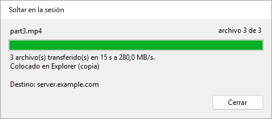

Las copias van a `%LOCALAPPDATA%\UltimateRDP\staging` en la sesión y se eliminan una hora después de la colocación. El agente comprueba el tamaño y la suma de comprobación SHA-256 de cada archivo. Si algo sale mal, no se coloca nada y la barra de estado indica el motivo. Sesión, Cancelar la transferencia la detiene; el agente elimina entonces lo que recibió.

Conviene saber:

- Una transferencia a la vez. Mientras hay una en curso, se rechaza un nuevo arrastre sobre la sesión, y la ventana de progreso indica «Espere a que termine esta transferencia antes de colocar más archivos.» durante cinco segundos.
- La redirección de unidades debe seguir activada: el arrastre sobre la sesión la usa.
- Si suelta el botón muy deprisa, antes de que el agente haya respondido al inicio del arrastre, el cliente espera esa respuesta, como máximo un segundo y medio, con «Preparando...» en la ventana de progreso, para que los archivos grandes sigan pasando por el canal de UltimateRDP. Durante esa espera se rechaza un nuevo arrastre, como durante una transferencia.
- Las carpetas vacías dentro de una carpeta soltada no se crean en la sesión.
- El agente debe ejecutar la versión 0.4.1 o posterior, y el cliente también. La ventana de progreso es nueva en el cliente 0.4.2 y funciona con un agente 0.4.1. Con un cliente o un agente más antiguo, todas las colocaciones pasan por la redirección de unidades.
- Desde la versión 0.6.0 en ambos lados, los archivos pasan por una conexión directa cuando el servidor abre sus puertos para ello, y por el canal en caso contrario. Desde la 0.7.0 en ambos lados, la conexión directa usa varias conexiones TCP a la vez. Consulte «Conexión directa para archivos grandes».

Desde la versión 0.5.0, los archivos viajan en una forma más densa cuando su conexión lo permite. El agente indica al cliente cómo le llegan los datos del cliente. Cuando cada carácter llega como dos bytes, como se midió en un servidor de producción, el cliente empaqueta 15 bits del archivo en cada carácter en lugar de base64, y un byte del archivo cuesta unos 1,07 bytes en el canal en lugar de 2,67. En un canal que transporta 5,8 MB/s, la transferencia pasa de unos 2,1 MB/s a unos 5,4 MB/s. Cuando cada carácter llega como un byte, el cliente mantiene base64, a unas tres cuartas partes del canal. Ambos lados deben ejecutar la 0.5.0 para la forma más densa; con un agente más antiguo, el cliente envía base64 como antes. La barra de estado y la ventana de progreso no cambian; el registro del cliente indica qué forma usa una transferencia.

El cliente envía los archivos en fragmentos de 32 KiB. La opción `transferChunkBytes` de `%LOCALAPPDATA%\UltimateRDP\client.json` cambia ese tamaño, de 4096 (4 KiB) a 262144 (256 KiB). Un valor fuera de estos límites se devuelve dentro de ellos. La opción solo se puede editar en el archivo, y se aplica cuando el cliente se reinicia. No la toque salvo que una transferencia falle al empezar.

```json
{
  "transferChunkBytes": 32768,
  "transferBatchCharacters": 200000,
  "transferWindowBytes": 4194304,
  "directTransfer": "auto",
  "directConnections": 8,
  "logLevel": "info"
}
```

El cliente envía sus mensajes al agente agrupados, como máximo `transferBatchCharacters` caracteres en una llamada al control de Escritorio remoto: 200000 por defecto, de 50000 a 1048576. Un valor fuera de estos límites se devuelve dentro de ellos. No la toque salvo que una transferencia falle al empezar.

La opción `logLevel` del mismo archivo vale `info` por defecto. Póngala en `debug` para registrar cada mensaje que el cliente envía al agente y cada llamada que hace al control de Escritorio remoto, y luego reinicie el cliente.

El cliente mantiene como máximo `transferWindowBytes` bytes de una transferencia enviados y aún no confirmados por el agente: 4194304 (4 MiB) por defecto, de 1048576 (1 MiB) a 33554432 (32 MiB). Un valor fuera de estos límites se devuelve dentro de ellos. El agente confirma cada 2 MiB, así que una ventana inferior a 2 MiB más un fragmento se eleva hasta ese valor; el registro indica la ventana usada al inicio de cada transferencia. Cámbiela solo para averiguar qué limita una transferencia lenta; consulte más abajo.

#### Medir una transferencia lenta

Desde la versión 0.4.4, ambos registros terminan cada transferencia con líneas de resumen que indican en qué se fue el tiempo. Instale la 0.4.4 en ambos lados para tener la imagen completa; con un cliente o un agente más antiguo, el otro lado sigue registrando sus propias líneas.

El registro del cliente tiene dos líneas:

```
Transfer <id> channel calls: 2410 calls, 482000000 characters, 9100 ms inside SendOnVirtualChannel, 3.78 ms per call on average, 41.20 ms at most; 5 % of the 190000 ms from the first call to the last, 5 % of the 193000 ms of the transfer.
Transfer <id> acknowledgements: 237 matched a call, round trip 1480 ms on average, 20 ms at least, 1900 ms at most; 3700000 bytes in flight on average when one came, 4194304 at most, 88 % of the window of 4194304 bytes.
```

El registro del agente tiene una línea por conexión sobre la conexión, y dos líneas por transferencia:

```
Transfer <id> channel reads: 302000 reads with data and 12 empty, 482000000 bytes, 1596 bytes per read on average; 301000 of 1600 bytes, 1000 shorter, 0 longer; blocked in the read 178000 ms, processing 14000 ms (9000 ms handling messages), over 193000 ms; read mode wts.
Transfer <id> session counters: 0 bytes, 0 frames and 0 compressed bytes in, 0 bytes out, from WTSSessionInfoEx (zero when Windows does not count them).
```

Cómo interpretarlas:

- **El cliente pasa bastante más de la mitad del tiempo dentro de SendOnVirtualChannel.** El control de Escritorio remoto limita la transferencia en su equipo.
- **El agente pasa casi todo el tiempo procesando, y poco bloqueado en la lectura.** El agente limita la transferencia; el tiempo de tratamiento de los mensajes incluye el JSON, la decodificación de los fragmentos, la suma de comprobación y la escritura del archivo.
- **Las llamadas del cliente ocupan una parte pequeña y el agente espera en la lectura casi todo el tiempo.** Los datos esperan entre ambos, en la conexión de Escritorio remoto. Cuando los bytes en tránsito se mantienen cerca de la ventana, pruebe una transferencia con `transferWindowBytes` en 16777216. Si la velocidad no cambia y el viaje de ida y vuelta se multiplica por cuatro, el límite es el control de flujo de la conexión. Si la velocidad aumenta, conserve la ventana más grande.

Si la conexión usa UDP se ve en la barra de conexión de la sesión de Escritorio remoto: haga clic en el icono de señal para ver la información de la conexión.

### Enviar archivos de la sesión a su equipo

Desde la versión 0.9.0, los archivos y carpetas de la sesión llegan a su equipo por la conexión directa, a la misma velocidad que los archivos grandes en el otro sentido. Ambos lados deben ejecutar la 0.9.0, y la conexión directa debe funcionar: consulte «Conexión directa para archivos grandes».

En la sesión:

- **Enviar a.** Haga clic con el botón derecho en archivos o carpetas en el Explorador, luego Enviar a, **Mi PC (UltimateRDP)**. El acceso directo solo existe mientras hay conectado un cliente UltimateRDP que recibe archivos, y desaparece cuando se desconecta.
- **El menú del área de notificación del agente**, Enviar archivos a mi PC..., elige los archivos en un cuadro de diálogo. El icono del área de notificación no aparece en las sesiones RemoteApp.

  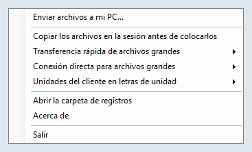

- **La línea de comandos**: `UltimateRDP.Agent.exe --send "C:\Users\me\Documents\report.pdf" "C:\Users\me\Pictures\Trip"`.

Si no se pueden enviar los archivos, un mensaje en la sesión indica el motivo, por ejemplo que no hay conectado ningún cliente que reciba archivos.

En su equipo:

- Los archivos van a su carpeta Descargas. Mientras llegan, están en una carpeta oculta `.ultimaterdp-<id>.part` dentro de ella, y aparecen una vez que cada archivo se ha comprobado con su SHA-256. Un archivo nunca reemplaza a otro: cuando `report.pdf` existe, el nuevo es `report (2).pdf`, y una carpeta pasa a ser `Photos (2)`.
- Una ventana «Archivos de la sesión» muestra el progreso, con Cancelar. Al final indica dónde están los archivos, y Abrir carpeta los muestra en el Explorador.

  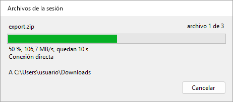 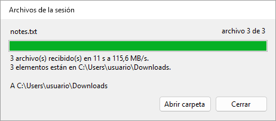

- Cada archivo recibido lleva la marca que Windows pone a las descargas, para que SmartScreen y Office lo traten como un archivo procedente de Internet. UltimateRDP nunca abre ni ejecuta un archivo recibido.
- Cuando no se puede usar la conexión directa, por ejemplo a través de una puerta de enlace de Escritorio remoto o con puertos cerrados por un firewall, no se envía nada y la ventana lo indica. No hay ninguna ruta más lenta; en su lugar, copie los archivos en la sesión a una unidad de su equipo en `\\tsclient`.
- Los nombres que Windows rechaza, una ruta que saldría de la carpeta o la falta de espacio libre detienen la transferencia, y no se conserva nada.

Opciones de `%LOCALAPPDATA%\UltimateRDP\client.json`, que solo se pueden editar en el archivo:

```json
{
  "receiveFiles": "auto",
  "receiveFolder": "%USERPROFILE%\\Desktop\\From the server"
}
```

| Opción | Valores | Si no existe | Significado |
| --- | --- | --- | --- |
| `receiveFiles` | `auto`, `never` | `auto` | `never` rechaza los archivos de la sesión. `directTransfer` en `never` también los rechaza, ya que solo la conexión directa los transporta. |
| `receiveFolder` | una ruta completa | su carpeta Descargas | Adónde van los archivos. Las variables de entorno como `%USERPROFILE%` se expanden; la carpeta se crea si no existe. |

En el servidor, `sendToClient` en agent.json, `auto` por defecto, puesto en `never` desactiva el envío para un usuario o, en la configuración del equipo, para todos. `directMaxMegabytesPerSecond` también limita lo que envía el agente, lo que protege el enlace de salida del servidor. Desde la versión 0.9.2, `sendMaxMegabytesPerSecond` limita solo el envío, para que los archivos procedentes de los clientes conserven la velocidad completa: por ejemplo `"sendMaxMegabytesPerSecond": 85` en la configuración del equipo cuando el enlace de salida del servidor transporta alrededor de 1 Gbit/s.

### Mensajes de la barra de estado

Mensajes de un arrastre:

- **«Arrastrando 2 elemento(s) a la sesión...»**: el agente está reproduciendo el arrastre.
- **«Iniciando el arrastre en la sesión...»**: el agente necesita un momento para iniciar el arrastre.
- **«Copiando 2 elemento(s) en la sesión antes de que empiece el arrastre...»**: el agente copia primero los archivos en la sesión, porque «Copiar los archivos en la sesión antes de colocarlos» está activado.
- **«Colocado en Bandeja de entrada (copia)»**: la ventana remota aceptó la colocación. Nombra la ventana e indica copia o vínculo.
- **«Nada bajo el cursor aceptó los archivos.»**: la ventana bajo el cursor no aceptó la colocación. No se copió nada.
- **«El agente no confirmó el arrastre»**: ninguna respuesta del agente en un segundo. Consulte «Solución de problemas».
- **«Colocación rechazada»** seguido del motivo indicado por el agente. Por ejemplo «Colocación rechazada: La colocación anterior todavía se está entregando en la sesión. Inténtelo de nuevo cuando termine.»
- **«Colocación rechazada: el arrastre no empezó en la sesión. Vuelva a arrastrar los archivos.»**: el cliente recibió la colocación sin ningún arrastre en curso para los mismos archivos.
- **«Cancelado»** seguido del motivo, por ejemplo «Cancelado: Se canceló el arrastre: se presionó Esc en la sesión.»

La ventana de progreso que aparece en cada colocación también muestra el resultado de la colocación, y el progreso de una transferencia con más detalle; consulte «Arrastrar a la sesión» y «Archivos grandes» más arriba. La barra de estado conserva sus textos.

Mensajes de una transferencia de archivos grandes:

- **«Preparando la transferencia de 2 elemento(s)...»**: el cliente enumera los archivos que va a enviar.
- **«Transfiriendo 3 archivo(s): 42 % (12,3 MB/s, quedan 1 min)»**: los archivos están en camino. La velocidad corresponde a los últimos cinco segundos; MB significa un millón de bytes.
- **«3 archivo(s) transferido(s) a 12,3 MB/s, colocando...»**: todos los archivos están en la sesión, y el agente coloca las copias.
- **«Transferencia cancelada.»**: usted canceló la transferencia desde el menú Sesión o desde la ventana de progreso.
- **«Hay una transferencia en curso. Espere a que termine o cancélela desde el menú Sesión.»**: se rechazó un nuevo arrastre durante una transferencia.
- **«Error en la transferencia»** seguido del motivo indicado por el agente, por ejemplo «Error en la transferencia: Se perdieron o dañaron datos por el camino. Vuelva a intentarlo.»
- **«Colocación rechazada: No hay suficiente espacio libre en la sesión: se necesitan 1.234 MB y hay 800 MB libres.»**: el disco de la sesión no puede contener los archivos.
- **«No se puede leer»** seguido de un nombre de archivo y del motivo de Windows: el cliente no pudo leer un archivo de su equipo.
- **«El agente dejó de responder durante la transferencia.»**: ninguna confirmación durante un minuto.
- **«La transferencia se detuvo: la sesión se desconectó.»**: la conexión terminó durante la transferencia.

Mensajes de la conexión:

- **«No hay ningún agente en el equipo remoto»**: el cliente envió mensajes de saludo durante sesenta segundos y no obtuvo respuesta. Inicie el agente en la sesión y luego use Sesión, Buscar de nuevo el agente.
- **«Este archivo .rdp no redirige las unidades: no se podrán colocar archivos.»**: el archivo .rdp no comparte ninguna unidad local. Active las unidades en el archivo .rdp y vuelva a conectarse.
- **«La sesión no ve ninguna unidad redirigida: no se podrán colocar archivos.»**: el agente respondió, pero no se puede acceder a ninguna unidad `\\tsclient` desde la sesión. Es posible que el servidor bloquee la redirección de unidades.
- **«Colocación rechazada: sin conexión.»**: todavía no hay ninguna sesión.
- **«Colocación rechazada: el agente de UltimateRDP aún no ha respondido.»**: espere a «Agente listo».
- **«Colocación rechazada: el agente de UltimateRDP no se está ejecutando en la sesión remota.»**: inicie el agente en la sesión.
- **«Colocación rechazada»** con una ruta: solo se pueden colocar archivos y carpetas de una letra de unidad local. Las rutas de red (UNC) se rechazan, porque la sesión llega a sus archivos mediante la redirección de unidades.
- **«Error al colocar»**: el agente no pudo terminar. El resto del mensaje da su motivo.

Mensajes de un cierre de sesión:

- **«Cerrando la sesión remota...»**: el agente aceptó la solicitud. La desconexión sigue una vez cerrada la sesión. Si una aplicación pide guardar su trabajo, respóndale en la sesión.
- **«El agente no respondió a la solicitud de cierre de sesión.»**: ninguna respuesta en cinco segundos. La sesión sigue abierta; vuelva a intentarlo, o cierre la sesión desde el menú Inicio de la sesión.
- **«No se pudo cerrar la sesión»**: Windows se negó a cerrar la sesión. El resto del mensaje da el motivo de Windows.

Estos ejemplos están en español. La barra de estado usa el idioma del cliente; consulte «Idioma» más abajo.

### Menú Ver

- **Redimensionar la sesión a la ventana**: la opción predeterminada. La resolución de la sesión sigue el tamaño de la ventana.
- **Escalar a la ventana**: la sesión conserva su resolución y la imagen se escala a la ventana.
- **Factor de escala**: Automático, o de 100 % a 200 %. Automático sigue el monitor que contiene la ventana. Un cambio se aplica a una nueva conexión, y el cliente ofrece volver a conectarse.
- **Pantalla completa** (F11, o Ctrl+Alt+Pausa): activa o desactiva la pantalla completa. La barra de conexión se muestra y se puede fijar.
- **Usar todos los monitores**: la sesión cubre todos los monitores en pantalla completa. Se aplica a una nueva conexión.
- **Teclas de Windows**: adónde van las combinaciones de teclas como Alt+Tab. «En este equipo», «En la sesión» o «En la sesión en pantalla completa», que es la opción predeterminada.
- **Idioma**: consulte más abajo.

Sus elecciones del menú Ver se guardan para las sesiones que abra más adelante. Cuando el archivo .rdp define `desktopscalefactor`, `use multimon` o `keyboardhook`, prevalece el archivo.

### Idioma

El cliente y el agente hablan inglés, francés, alemán, español, italiano, portugués y neerlandés.

El submenú Ver, Idioma muestra «Automático (idioma de Windows)» y los siete idiomas, cada uno con su nombre en su propio idioma. Una elección se aplica de inmediato a los menús, la barra de estado y las pestañas, y el cliente la recuerda. Automático, la opción predeterminada, sigue el idioma de visualización de Windows, y usa el inglés cuando Windows funciona en otro idioma.

La elección es la opción `language` de `%LOCALAPPDATA%\UltimateRDP\client.json`: `auto`, `en`, `fr`, `de`, `es`, `it`, `pt` o `nl`.

```json
{
  "language": "fr"
}
```

El cliente comunica su idioma al agente, y el agente escribe en ese idioma los mensajes que envía a la barra de estado. El menú del área de notificación del agente sigue el idioma de visualización de Windows en el servidor.

Algunos textos proceden de Windows y siguen su propio idioma: los botones Sí y No de las preguntas, el motivo de una desconexión y los mensajes de error de Windows. Los registros siempre están en inglés.

### Credenciales guardadas y contraseña

Antes de conectarse, el cliente lee la credencial genérica `TERMSRV/<host>` del Administrador de credenciales de Windows. Cuando existe y contiene una contraseña, el cliente la aplica y desactiva la solicitud para esa conexión. UltimateRDP nunca escribe una credencial. Puede crear una con:

```
cmdkey /generic:TERMSRV/<host> /user:<domain\user> /pass
```

`cmdkey` pide entonces la contraseña.

Desde la versión 0.9.0, el cliente pide la contraseña en su lugar, y no lee ninguna credencial guardada, cuando cualquiera de estos elementos lo indica:

- la opción `--ask-credentials` en la línea de comandos;
- Archivo, **Pedir siempre la contraseña**, que el cliente recuerda como `"credentials": "ask"` en client.json (`saved` por defecto);
- la línea `prompt for credentials:i:1` en el archivo .rdp, como hace el cliente de Microsoft.

El nombre de usuario del archivo .rdp sigue rellenado, y la solicitud no ofrece guardar la contraseña. El registro del cliente indica cuál de los tres decidió, y nunca contiene una contraseña.

Esto cambia lo que ocurre con un archivo .rdp que ya contiene `prompt for credentials:i:1`: la versión 0.8.0 usaba la credencial guardada y se conectaba sin solicitud; la versión 0.9.0 pide la contraseña. Quite la línea del archivo, o póngala en 0, para recuperar la credencial guardada.

La casilla «Recordarme» de la solicitud de credenciales de Windows guarda otro tipo de credencial, una contraseña de dominio. Windows guarda esa contraseña para sí mismo, así que UltimateRDP no puede leerla. La propia solicitud de Windows puede seguir usándola.

Archivo, Olvidar credenciales guardadas elimina ambos tipos de credencial para el host de la pestaña activa. La sesión abierta no se ve afectada, y la próxima conexión vuelve a pedirlas.

Ninguna opción de la línea de comandos ni ningún campo del generador de lanzadores acepta una contraseña: consulte «Lanzadores». La advertencia de Windows sobre el editor de una conexión RemoteApp es otra pregunta, y `--trusted` es la única forma de omitirla: consulte «Opciones de la línea de comandos».

## Configuración del cliente

El cliente guarda su configuración en `%LOCALAPPDATA%\UltimateRDP\client.json`. El menú Ver, el menú Idioma y Archivo, Pedir siempre la contraseña escriben algunas de las opciones; las demás solo se pueden editar en el archivo, y se aplican cuando el cliente se vuelve a iniciar. Un valor desconocido da el valor predeterminado. Se permiten comentarios en el archivo, y no se conservan cuando el cliente lo escribe.

```json
{
  "displayMode": "resizeSession",
  "scaleFactor": null,
  "keyboardHookMode": 2,
  "useAllMonitors": false,
  "language": "auto",
  "transferChunkBytes": 32768,
  "transferBatchCharacters": 200000,
  "transferWindowBytes": 4194304,
  "directTransfer": "auto",
  "directConnections": 8,
  "receiveFiles": "auto",
  "receiveFolder": null,
  "credentials": "saved",
  "loader": "on",
  "logLevel": "info"
}
```

| Opción | Valores | Si no existe | Significado |
| --- | --- | --- | --- |
| `displayMode` | `resizeSession`, `scaleToWindow` | `resizeSession` | Ver, Redimensionar la sesión a la ventana o Escalar a la ventana. |
| `scaleFactor` | `null`, o de 100 a 500 | `null` | Ver, Factor de escala; `null` sigue el monitor. |
| `keyboardHookMode` | 0, 1, 2 | 2 | Ver, Teclas de Windows: en este equipo, en la sesión, en la sesión en pantalla completa. |
| `useAllMonitors` | `true`, `false` | `false` | Ver, Usar todos los monitores. |
| `language` | `auto`, `en`, `fr`, `de`, `es`, `it`, `nl`, `pt` | `auto` | Ver, Idioma. Consulte «Idioma». |
| `recentFiles` | una lista de rutas | vacía | Archivo, Recientes. El cliente la escribe. |
| `transferChunkBytes` | de 4096 a 262144 | 32768 | Bytes por fragmento de una transferencia por el canal. Consulte «Archivos grandes». |
| `transferBatchCharacters` | de 50000 a 1048576 | 200000 | Caracteres por llamada al control de Escritorio remoto. Consulte «Archivos grandes». |
| `transferWindowBytes` | de 1048576 a 33554432 | 4194304 | Bytes de una transferencia por el canal enviados y aún no confirmados. Consulte «Archivos grandes». |
| `directTransfer` | `auto`, `never` | `auto` | `never` mantiene los archivos grandes en el canal y rechaza los archivos de la sesión. Consulte «Conexión directa para archivos grandes». |
| `directConnections` | de 1 a 16 | 8 | Número máximo de conexiones de una transferencia directa. |
| `receiveFiles` | `auto`, `never` | `auto` | `never` rechaza los archivos de la sesión. Consulte «Enviar archivos de la sesión a su equipo». |
| `receiveFolder` | `null`, o una ruta | su carpeta Descargas | Adónde van los archivos de la sesión; las variables de entorno se expanden. |
| `credentials` | `saved`, `ask` | `saved` | Archivo, Pedir siempre la contraseña. Consulte «Credenciales guardadas y contraseña». |
| `loader` | `on`, `off` | `on` | La ventana de carga. Consulte «La ventana de carga». |
| `logLevel` | `debug`, `info` | `info` | `debug` registra cada mensaje al agente y cada llamada al control. |

## Menú del área de notificación y configuración del agente

Por defecto, el icono del área de notificación del agente solo es visible mientras hay un cliente UltimateRDP conectado a la sesión. Su menú contiene:

- **Enviar archivos a mi PC...**: desde la versión 0.9.0, envía los archivos elegidos al equipo del cliente. Consulte «Enviar archivos de la sesión a su equipo».
- **Copiar los archivos en la sesión antes de colocarlos**: desactivado por defecto. Cuando está activado, el agente copia los archivos en la sesión antes de que empiece el arrastre, y la aplicación remota recibe rutas locales en lugar de rutas `\\tsclient`. Actívelo para las aplicaciones que rechazan las rutas de red. Los archivos grandes tardan en copiarse antes de que empiece el arrastre. Cuando los archivos llegan por el canal, consulte más abajo, llegan de todos modos como copias locales.
- **Transferencia rápida de archivos grandes**: Automático, Siempre o Nunca. Automático, la opción predeterminada, envía los archivos por el canal de UltimateRDP antes de la colocación cuando suman 10 MiB o más. Siempre lo hace en cada colocación, Nunca en ninguna: la aplicación remota lee entonces los archivos a través de la redirección de unidades, como en la versión 0.3.
- **Conexión directa para archivos grandes**: Automático o Nunca. Automático, la opción predeterminada, ofrece la conexión directa para una transferencia rápida, con el canal como alternativa. Nunca mantiene todas las transferencias rápidas en el canal. Consulte «Conexión directa para archivos grandes».
- **Unidades del cliente en letras de unidad**: Automático o Nunca. Nunca, la opción predeterminada, deja las unidades de su equipo como `\\tsclient\C`, etc. Automático les asigna letras de unidad de la sesión mientras hay un cliente UltimateRDP conectado. Consulte «Unidades del cliente en letras de unidad» más abajo.
- **Abrir la carpeta de registros**, **Acerca de** y **Salir**.

El menú sigue el idioma de visualización de Windows en el servidor.

Las copias preparadas van a `%LOCALAPPDATA%\UltimateRDP\staging\<id>` en la sesión. Cada carpeta se elimina una hora después de su colocación, porque es posible que el destino siga leyendo los archivos. Cuando el agente se inicia, elimina las carpetas de más de una hora.

El agente guarda su configuración en `%LOCALAPPDATA%\UltimateRDP\agent.json` en el servidor:

```json
{
  "logLevel": "debug",
  "stageFiles": false,
  "fastTransfer": "auto",
  "fastTransferMinBytes": 10485760,
  "directTransfer": "auto",
  "directPortRange": "3400-3449",
  "directConnections": 8,
  "directMaxMegabytesPerSecond": 0,
  "sendMaxMegabytesPerSecond": 0,
  "trayIcon": "auto",
  "channelRead": "wts",
  "mapClientDrives": "never",
  "sendToClient": "auto"
}
```

| Opción | Valores | Si no existe | Significado |
| --- | --- | --- | --- |
| `stageFiles` | `true`, `false` | `false` | La entrada del menú del área de notificación «Copiar los archivos en la sesión antes de colocarlos». |
| `fastTransfer` | `auto`, `always`, `never` | `auto` | La entrada del menú del área de notificación «Transferencia rápida de archivos grandes». |
| `fastTransferMinBytes` | un número de bytes | `10485760` (10 MiB) | El tamaño a partir del cual `auto` envía los archivos por el canal, contado sobre todos los elementos soltados. Solo se puede editar en el archivo. |
| `directTransfer` | `auto`, `never` | `auto` | La entrada del menú del área de notificación «Conexión directa para archivos grandes». |
| `directPortRange` | un rango como `3400-3449`, o un solo puerto | `3400-3449` | Los puertos TCP de la conexión directa; consulte «Conexión directa para archivos grandes». Solo se puede editar en el archivo. |
| `directConnections` | de 1 a 16 | `8` | Cuántas conexiones TCP puede usar como máximo una transferencia directa. Solo se puede editar en el archivo. |
| `directMaxMegabytesPerSecond` | 0, o un número de MB/s | `0` | Un límite de la velocidad de una transferencia directa, con todas sus conexiones juntas; 0 significa sin límite. Solo se puede editar en el archivo. |
| `sendMaxMegabytesPerSecond` | 0, o un número de MB/s | `0` | Desde la versión 0.9.2, un límite de lo que el agente envía al equipo del cliente, con todas las conexiones de un envío juntas. 0 deja `directMaxMegabytesPerSecond` como límite también de un envío. Solo se puede editar en el archivo. |
| `logLevel` | `debug`, `info`, `warn`, `error` | `info` | El nivel más bajo que se escribe en el registro. Solo se puede editar en el archivo. |
| `trayIcon` | `auto`, `always`, `never` | `auto` | `auto` muestra el icono del área de notificación solo mientras hay un cliente UltimateRDP conectado a la sesión. `always` lo muestra desde el inicio del agente. `never` no lo muestra nunca: el agente se controla entonces solo con `--uninstall` y su entrada `Run`. Solo se puede editar en el archivo. |
| `mapClientDrives` | `never`, `auto` | `never` | La entrada del menú del área de notificación «Unidades del cliente en letras de unidad». |
| `sendToClient` | `auto`, `never` | `auto` | Si los archivos de la sesión se pueden enviar al equipo de un cliente que los recibe. Solo se puede editar en el archivo. |
| `channelRead` | `wts`, `file` | `wts` | Cómo lee el agente el canal. `wts` lo lee con WTSVirtualChannelRead, 1600 bytes cada vez. `file` es un experimento: el agente lee el identificador de archivo del canal con un búfer de 64 KiB, quita los encabezados de canal que pueda encontrar, registra qué formato de trama encontró y vuelve a `wts` para la conexión a la primera incoherencia, con una advertencia. Solo se puede editar en el archivo. |

Un valor desconocido da el valor predeterminado y una advertencia en el registro. Reinicie el agente después de editar el archivo a mano. Cuando el menú del área de notificación cambia una opción, escribe esa clave en su agent.json y conserva sus demás claves; los comentarios del archivo no se conservan.

### Configuración para todo el equipo

Un administrador puede definir valores predeterminados para todos los usuarios del servidor en `%ProgramData%\UltimateRDP\agent.json`, con las mismas claves. El agente lee primero ese archivo cuando existe, y luego el agent.json del usuario, cuyas claves prevalecen una por una. Una clave que el usuario no define, o que pone en `null`, procede del archivo del equipo. El agente nunca escribe el archivo del equipo; el menú del área de notificación solo escribe el archivo del usuario. Por ejemplo, para activar las letras de unidad para todos:

```json
{
  "mapClientDrives": "auto"
}
```

Como un usuario puede crear archivos en `%ProgramData%`, el agente solo lee el archivo del equipo cuando su propietario es el grupo Administradores, SYSTEM o TrustedInstaller, como ocurre con un archivo creado desde un símbolo del sistema con privilegios elevados. Un archivo con otro propietario se ignora, con una advertencia en el registro que da el comando `icacls` para corregirlo. La línea de inicio del registro del agente enumera las claves que proceden del archivo del equipo, y `--status` indica si el archivo existe. Después de un cambio, reinicie los agentes o deje que los usuarios vuelvan a iniciar sesión.

### Unidades del cliente en letras de unidad

Con `mapClientDrives` en `auto`, el agente asigna cada unidad que su equipo redirige, `\\tsclient\C`, `\\tsclient\D`, etc., a una letra de unidad de la sesión en cuanto hay un cliente UltimateRDP conectado, para que los programas que quieren una letra de unidad puedan usar sus archivos.

- Una unidad conserva su propia letra cuando esa letra está libre en la sesión, y en caso contrario recibe la primera letra libre empezando por Z hacia abajo. C, la unidad del sistema de la sesión, suele estar ocupada, así que su unidad C: se convierte a menudo en Z:.
- El agente nunca reemplaza una letra en uso, ya sea una unidad local o una asignación, y no asigna una unidad a la que ya llega una asignación de la sesión. Solo asigna las unidades que su equipo redirige, y nunca A: ni B:.
- Las letras solo son visibles para usted, en su propia sesión, y no se recuerdan para el próximo inicio de sesión.
- Desaparecen cuando el cliente se desconecta, cuando elige Nunca en el menú del área de notificación y cuando el agente termina. Si hay un archivo abierto en una unidad, el agente quita la letra igualmente, pero solo una letra que haya creado él mismo. Una letra que dejó un agente que terminó mal se quita en su siguiente inicio, si sigue apuntando a la misma unidad.
- Documentos, Escritorio y las demás carpetas del perfil no se redirigen.
- Cada error se escribe en el registro como advertencia, y no se muestra nada. El registro tiene una línea con las letras asignadas cuando el cliente se conecta.

## Conexión directa para archivos grandes

Desde la versión 0.6.0, los archivos de una transferencia rápida pasan por una conexión TLS directa entre el cliente y el agente, fuera de la conexión de Escritorio remoto, cuando la red lo permite. Por el canal de UltimateRDP, las transferencias medidas en producción alcanzaban de 2 a 4 MB/s, fuera cual fuera el enlace; la conexión directa las transporta a la velocidad de la red. Cuando no se puede usar, los archivos pasan por el canal como antes, sin que el usuario tenga que hacer nada.

Desde la versión 0.7.0, una transferencia usa varias conexiones TCP a la vez, ocho como máximo por defecto. En la ruta de producción, una sola conexión TCP empezaba a 90 a 180 MB/s y caía a unos 20 MB/s en pocos segundos, mientras que cuatro conexiones juntas transportaban cuatro veces más: el límite es por conexión, en algún punto de la ruta, y varias conexiones se suman.

Cómo funciona:

1. Cuando el agente decide una transferencia rápida, escucha en el primer puerto TCP libre de un rango, de 3400 a 3449 por defecto, solo para esta transferencia. Cada sesión usa su propio puerto, por lo que hace falta un rango en un servidor con muchas sesiones.
2. Su respuesta al arrastre, por el canal, indica el puerto, un token aleatorio de un solo uso, el SHA-256 de su certificado TLS, la versión del protocolo y el número de conexiones que acepta.
3. Tras la colocación, el cliente se conecta al host del archivo .rdp en ese puerto, en un plazo de 3 segundos. Solo acepta el certificado cuyo SHA-256 dio el agente, demuestra que conoce el token y envía la lista de los archivos.
4. Una vez que el agente ha aceptado esa primera conexión, el cliente abre las demás hacia la misma dirección, una por cada 32 MiB empezados de la transferencia, hasta el número que acepta el agente y su propia opción. Una conexión que no se puede abrir no es un error: las demás transportan los archivos.
5. Los archivos van en bloques de 1 MiB por todas las conexiones. El agente escribe cada bloque en su lugar dentro de su archivo, comprueba el SHA-256 de cada archivo como por el canal y coloca las copias.

El socket de escucha solo existe mientras se ofrece o se ejecuta una transferencia. Acepta como máximo cuatro sockets más que las conexiones que ofrece, y descarta cualquier socket que no termine su negociación TLS y presente su token en 5 segundos. Se cierra 10 segundos después de la colocación si la primera conexión no llegó. El agente crea el certificado en memoria en su primera transferencia directa; su clave privada es una clave no exportable del almacén de claves del usuario, que el agente elimina cuando termina. El agente sigue ejecutándose con los derechos del usuario: un puerto superior a 1024 no necesita ningún derecho de administrador.

### Reglas del firewall

El administrador abre el rango, TCP entrante hacia el servidor, restringido a las direcciones de cliente autorizadas para RDP. En el firewall de Windows del servidor, desde un PowerShell con privilegios elevados:

```
New-NetFirewallRule -DisplayName "UltimateRDP direct transfer" -Direction Inbound -Action Allow -Protocol TCP -LocalPort 3400-3449 -RemoteAddress <allowed client addresses> -Program "C:\Program Files\UltimateRDP\UltimateRDP.Agent.exe" -Profile Any
```

Reemplace `<allowed client addresses>` por la misma lista que la regla que autoriza RDP, separada por comas, y la ruta del programa por la ubicación del agente. Con `-Program`, Windows tiene una regla para el agente y no pregunta a los usuarios cuando empieza a escuchar. Para asegurarse de que los usuarios nunca vean esa pregunta en el servidor, ejecute `Set-NetFirewallProfile -Profile Domain,Private,Public -NotifyOnListen False`.

En el proveedor de alojamiento, añada la misma regla al firewall situado delante del servidor: TCP, puertos de destino de 3400 a 3449, origen solo las direcciones de cliente autorizadas.

Cuando un equipo cliente obtiene una nueva dirección pública, por ejemplo en otra red, añádala a la regla que autoriza RDP y a esta regla, en el servidor y en el proveedor de alojamiento. Con solo la regla de RDP, la sesión se abre, pero los archivos grandes pasan por el canal a unos 2 MB/s y no se pueden enviar archivos de la sesión a ese equipo.

Si cambia el rango en la configuración del agente, cambie ambas reglas con él. Todas las conexiones de una transferencia usan su único puerto, así que las reglas son las mismas que para la 0.6.0.

### Vía alternativa

El canal transporta los archivos, como en la versión 0.5.2, cuando:

- el cliente se conecta a través de una puerta de enlace de Escritorio remoto, o un firewall no abre los puertos: la primera conexión falla en un plazo de 3 segundos;
- la negociación TLS falla, el certificado no es el que dio el agente, o el agente rechaza el token;
- una conexión se interrumpe antes de que el agente haya confirmado los primeros 8 MiB;
- el cliente o el agente ejecutan una versión anterior a la 0.6.0, un lado ejecuta la 0.6.0 y el otro la 0.7.0, o uno de ellos tiene la opción `directTransfer` en `never`;
- ningún puerto del rango está libre en el servidor.

Cuando una conexión se interrumpe más tarde, la transferencia se detiene con «Se perdió la conexión directa. Vuelva a intentarlo.» y no se coloca nada. El registro del cliente indica en el nivel info qué ruta tomó una transferencia y por qué no se usó la conexión directa. La barra de estado y la ventana de progreso muestran «Conexión directa» mientras los archivos pasan por ella, y mantienen la etapa de preparación hasta que el agente confirma los primeros datos; cuando un archivo tarda más de 2 segundos en abrirse, indican «Abriendo ... Es posible que Windows esté comprobando el archivo.» hasta que se lee.

Cuando cancela, el cliente avisa al agente, espera como máximo un segundo su respuesta y luego cierra todas las conexiones, aunque una conexión o la lectura de un archivo estén bloqueadas. El agente elimina lo que recibió y registra la transferencia como cancelada.

### Configuración

| Dónde | Opción | Valores | Si no existe | Significado |
| --- | --- | --- | --- | --- |
| agent.json | `directTransfer` | `auto`, `never` | `auto` | La entrada del menú del área de notificación «Conexión directa para archivos grandes». `never` envía todas las transferencias rápidas por el canal. |
| agent.json | `directPortRange` | un rango como `3400-3449`, o un solo puerto | `3400-3449` | Los puertos en los que puede escuchar el agente, de 1025 a 65535, 1000 puertos como máximo. Solo se puede editar en el archivo; reinicie el agente después de un cambio. |
| agent.json | `directConnections` | de 1 a 16 | `8` | Cuántas conexiones acepta como máximo el agente para una transferencia. Solo se puede editar en el archivo; reinicie el agente después de un cambio. |
| agent.json | `directMaxMegabytesPerSecond` | 0, o de 1 a 100000 | `0` | Protege el servidor: el agente lee todas las conexiones de una transferencia juntas como máximo a este número de MB/s, y TCP ralentiza el cliente. 0 significa sin límite. Solo se puede editar en el archivo; reinicie el agente después de un cambio. |
| client.json | `directTransfer` | `auto`, `never` | `auto` | `never` hace que el cliente ignore la oferta del agente y use el canal. Solo se puede editar en el archivo. |
| client.json | `directConnections` | de 1 a 16 | `8` | Cuántas conexiones abre como máximo el cliente para una transferencia, dentro de lo que acepta el agente. Solo se puede editar en el archivo. |

La conexión directa necesita ambos lados en la misma versión, 0.6.0 o 0.7.0. Un cliente 0.7.0 ignora la oferta de un agente 0.6.0 y usa el canal; un cliente 0.6.0 intenta la conexión directa de un agente 0.7.0, que rechaza su token de inmediato, y luego usa el canal. Un cliente o un agente 0.5.2 usa el canal.

### Interpretar las líneas de resumen

Al final de una transferencia directa, cada registro tiene una línea que empieza por `direct connection statistics`. La línea del cliente indica las conexiones usadas, los bytes que transportó cada una, los segundos desde el inicio de los datos, el tiempo que el lector pasó abriendo y leyendo los archivos y el tiempo que esperó a tener sitio en su cola, el tiempo que los escritores pasaron en escrituras en el socket y el tiempo que esperaron bloques, y las velocidades: la media, la de los 5 primeros segundos y la de los 5 últimos segundos. La línea del agente indica las conexiones, los bytes de cada una, el tiempo pasado en lecturas del socket, en escrituras de archivos y en volver a leer los archivos para calcular su hash, y las mismas velocidades. Los tiempos de varios subprocesos se suman, así que pueden superar la duración de la transferencia.

- **El lector del cliente ocupa la mayor parte del tiempo y los escritores esperan bloques.** La lectura de los archivos en su equipo limita la transferencia, por ejemplo un antivirus que analiza un archivo grande. El cliente también registra en el nivel info cualquier archivo cuya apertura o primera lectura tarde más de medio segundo.
- **Los escritores del cliente pasan la mayor parte del tiempo en escrituras en el socket y el lector espera sitio.** La red limita la transferencia. Unos 5 primeros segundos mucho más rápidos que los 5 últimos corresponden al límite por conexión descrito más arriba: más conexiones ayudan, hasta 16.
- **El agente pasa mucho tiempo en escrituras de archivos o en el cálculo del hash.** El servidor limita la transferencia: su disco o su procesador.

Con `logLevel` en `debug` en client.json o agent.json, ambos lados registran además la velocidad de cada segundo.

## Programas RemoteApp

Desde la versión 0.8.0, UltimateRDP también abre programas RemoteApp: un programa publicado en el servidor que se muestra en sus propias ventanas en su escritorio, sin el escritorio remoto alrededor. Abra su archivo .rdp como cualquier otro, por ejemplo el que le da su administrador o el de la fuente web. Un archivo con `remoteapplicationmode:i:1` abre una pestaña RemoteApp. La versión 0.8.0 se probó una vez con un servidor real con Notepad; la versión 0.9.0 corrige lo que mostró esa prueba, y sus cambios no se habían probado con un servidor real en el momento de la publicación: comunique lo que observe, con ambos registros.

### Desde un acceso directo o un archivo .bat

Desde la versión 0.9.0, `UltimateRDP.exe` iniciado con un archivo RemoteApp solo muestra las ventanas del programa, como hace el cliente de Microsoft. Por ejemplo, en un archivo `Notepad on the server.bat`:

```bat
@echo off
start "" "C:\Tools\UltimateRDP\UltimateRDP.exe" "C:\Users\me\Documents\notepad-server.example.com.rdp"
```

o un acceso directo cuyo destino sea `"C:\Tools\UltimateRDP\UltimateRDP.exe" "C:\Users\me\Documents\notepad-server.example.com.rdp"`.

- Desde la versión 0.9.3, aparece de inmediato una ventana de carga, con el nombre del programa, una barra en movimiento y la etapa del inicio, «Conectando con server.example.com...», «Abriendo la sesión...» y luego «Iniciando Notepad...», hasta que aparece la ventana del programa. Su botón Cancelar detiene la conexión. Se oculta mientras la pregunta sobre el certificado del servidor o la solicitud de contraseña esperan una respuesta. Un archivo de escritorio también la muestra, sobre la ventana de UltimateRDP, hasta que se ha iniciado sesión en el escritorio. `"loader": "off"` en `%LOCALAPPDATA%\UltimateRDP\client.json` la desactiva.
- La ventana de UltimateRDP permanece oculta. Un icono del área de notificación indica el programa y su servidor, y su menú contiene Mostrar UltimateRDP, Desconectar y Salir. No aparece ningún botón en la barra de tareas aparte de los de las ventanas del programa.
- Cuando cierra la última ventana del programa, el servidor mantiene la sesión unos 20 segundos y luego la finaliza, y UltimateRDP termina por sí solo sin ningún mensaje. Hasta entonces solo queda el icono del área de notificación.
- Cuando la conexión falla, o termina por otro motivo, un mensaje indica el motivo; cuando falló antes del inicio de sesión, la ventana de UltimateRDP también aparece, con el motivo en su pestaña y Sesión, Conectar.
- Iniciar UltimateRDP de nuevo con otro archivo lo entrega a la copia en ejecución: se ejecuta una sola copia por usuario a la vez.
- Desde la versión 0.10.0, un inicio RemoteApp hacia un servidor en el que ya se ejecuta una pestaña RemoteApp, con la misma cuenta, inicia su programa en esa conexión, como hace el cliente de Microsoft: consulte «Una conexión por servidor y cuenta».
- `--show` muestra la ventana de UltimateRDP de todos modos, y `--hidden` la mantiene oculta también para un archivo de escritorio. Un archivo de escritorio muestra la ventana por defecto.
- `--ask-credentials` pide la contraseña; consulte «Credenciales guardadas y contraseña».

La línea de comandos es `UltimateRDP.exe [options] [file.rdp]`. Desde la versión 0.10.0, las opciones también pueden dar la conexión completa, sin archivo .rdp: consulte «Lanzadores».

### En su equipo

- La pestaña muestra los nombres de los programas de la conexión, cuántas de sus ventanas están abiertas, el estado de la conexión y del agente, el resultado de la última colocación y un botón Desconectar. El propio programa se abre en sus propias ventanas, fuera de la ventana de UltimateRDP, que puede minimizar una vez iniciada la sesión.
- Suelte los archivos sobre una ventana del programa. No ocurre nada mientras se mueve por encima: la colocación se produce donde suelta el botón. La ventana de progreso «Soltar en la sesión» se abre sobre la ventana en la que soltó, como en una sesión de escritorio, y los archivos grandes pasan por el canal o por la conexión directa como se describe más arriba.
- La aplicación remota no muestra ninguna indicación de colocación mientras se mueve, ya que el arrastre solo empieza en la sesión cuando suelta el botón.
- Ver, Redimensionar la sesión a la ventana, Escalar a la ventana, Factor de escala, Pantalla completa y Usar todos los monitores no se aplican a una pestaña RemoteApp y están desactivados en ella. La sesión siempre cubre todos sus monitores.
- Cuando el programa cierra su última ventana, el servidor finaliza o desconecta la sesión unos 20 segundos después, y la pestaña se cierra. La barra de estado lo presenta como un final normal.
- Cerrar la pestaña, o salir de UltimateRDP, mientras hay ventanas del programa abiertas pide confirmación primero: el programa sigue ejecutándose en el servidor y vuelve en la próxima conexión con el mismo archivo. Para terminarlo, ciérrelo en su propia ventana o use Archivo, Cerrar la sesión remota.
- Varias pestañas, de escritorio y RemoteApp, funcionan una al lado de otra. Una colocación sobre una ventana de un programa va a la sesión de ese programa.

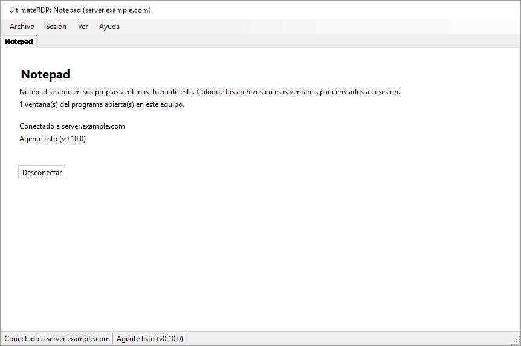

Mientras la ventana principal está oculta, el icono del área de notificación de UltimateRDP indica los programas y su servidor; su información sobre herramientas muestra «UltimateRDP by Aprogsys» seguido de los programas.

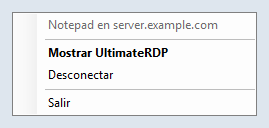

El cliente lee `remoteapplicationprogram`, `remoteapplicationname`, `remoteapplicationcmdline`, `remoteapplicationexpandcmdline`, `remoteapplicationexpandworkingdir` y `remoteapplicationfile`. Un archivo que pide RemoteApp sin programa se rechaza al abrirlo.

### En el servidor

Una sesión RemoteApp no ejecuta el Explorador, así que ignora la entrada `Run` que escribe `--install-all-users`: el agente no se inicia ahí por sí solo. El administrador lo inicia con una tarea programada al iniciar sesión. Una sesión RemoteApp también termina cuando no le queda ningún programa del usuario, y un agente que siguiera ejecutándose la mantendría abierta. Por eso el agente se ocupa de ello de dos maneras:

- En una sesión RemoteApp, enumera los procesos de su sesión cada 15 segundos. Cuando ya no quedan más que los procesos que ejecuta toda sesión RemoteApp y los nombres de la clave `SysProcs` del servidor, durante dos comprobaciones seguidas, y no hay ninguna colocación ni transferencia en curso, termina. Durante sus primeros 90 segundos, mientras no se haya visto ningún programa, las comprobaciones no cuentan, para que un programa lento en iniciarse no lo haga salir. También termina cuando la sesión se desconecta y no queda ningún programa. En una sesión de escritorio, mira una vez, al iniciarse, y no hace nada más.
- Su icono del área de notificación nunca aparece en una sesión RemoteApp mientras `trayIcon` vale `auto`. No ponga `trayIcon` en `always` para los usuarios de RemoteApp.

El administrador añade también el agente a `SysProcs`, para que el propio Windows no lo cuente. UltimateRDP nunca escribe en el registro de Windows ni crea tareas: estos son los comandos, para un PowerShell con privilegios elevados en el servidor. Reemplace la ruta del agente por la suya.

1. Lea primero el estado actual y conserve la salida:

   ```powershell
   Get-ItemProperty 'HKLM:\SYSTEM\CurrentControlSet\Control\Terminal Server\SysProcs'
   Get-ScheduledTask -TaskPath '\UltimateRDP\' -ErrorAction SilentlyContinue
   quser
   ```

2. Añada el agente a `SysProcs`. Por sí solo, esto no cambia nada, ya que el agente todavía no se ejecuta en las sesiones RemoteApp. Se aplica a las nuevas sesiones; no reinicie los Servicios de Escritorio remoto para ello, porque desconectaría a todos los usuarios.

   ```powershell
   New-ItemProperty -Path 'HKLM:\SYSTEM\CurrentControlSet\Control\Terminal Server\SysProcs' -Name 'UltimateRDP.Agent.exe' -PropertyType DWord -Value 0
   ```

3. Cree la tarea solo para una cuenta de prueba:

   ```powershell
   $exe       = 'C:\Program Files\UltimateRDP\UltimateRDP.Agent.exe'
   $action    = New-ScheduledTaskAction -Execute $exe
   $trigger   = New-ScheduledTaskTrigger -AtLogOn -User '<DOMAIN\test account>'
   $principal = New-ScheduledTaskPrincipal -UserId '<DOMAIN\test account>' -LogonType Interactive -RunLevel Limited
   $settings  = New-ScheduledTaskSettingsSet -ExecutionTimeLimit ([TimeSpan]::Zero) -AllowStartIfOnBatteries -DontStopIfGoingOnBatteries -MultipleInstances Parallel -Priority 5 -Compatibility Win8
   Register-ScheduledTask -TaskPath '\UltimateRDP\' -TaskName 'Agent' -Action $action -Trigger $trigger -Principal $principal -Settings $settings -Description 'Starts the UltimateRDP agent in each user session, RemoteApp sessions included.'
   ```

   `-LogonType Interactive` ejecuta el agente en la sesión del usuario con los derechos del usuario, y no se almacena ninguna contraseña. `-RunLevel Limited` impide que se ejecute nunca con privilegios elevados. `-ExecutionTimeLimit` a cero quita el límite de 72 horas de una tarea. En una sesión de escritorio, la entrada `Run` y la tarea inician ambas el agente; la segunda copia ve la primera y termina de inmediato.

4. Pruebe con la cuenta de prueba, como se describe más abajo.

5. Solo entonces, inícielo para todos los usuarios. Modifique el objeto de la tarea y vuelva a escribirlo entero:

   ```powershell
   $users = (New-Object System.Security.Principal.SecurityIdentifier 'S-1-5-32-545').Translate([System.Security.Principal.NTAccount]).Value
   $task = Get-ScheduledTask -TaskPath '\UltimateRDP\' -TaskName 'Agent'
   $task.Triggers = @(New-ScheduledTaskTrigger -AtLogOn)
   $task.Principal = New-ScheduledTaskPrincipal -GroupId $users -RunLevel Limited
   $task | Set-ScheduledTask
   ```

   La primera línea da el nombre local del grupo Usuarios, que depende del idioma de Windows. `Set-ScheduledTask -Trigger ... -Principal ...` con estos valores terminó sin error en un Windows Server en francés y dejó en su sitio el desencadenador y la entidad de seguridad de la cuenta de prueba, así que compruebe lo que guardó el programador:

   ```powershell
   Export-ScheduledTask -TaskPath '\UltimateRDP\' -TaskName 'Agent'
   ```

   El XML debe mostrar `<GroupId>S-1-5-32-545</GroupId>` y `<LogonTrigger />` sin usuario. `Get-ScheduledTask` por sí solo puede mostrar valores que no son los guardados.

Después de una actualización del agente en otra carpeta, haga que la tarea apunte a ella:

```powershell
Set-ScheduledTask -TaskPath '\UltimateRDP\' -TaskName 'Agent' -Action (New-ScheduledTaskAction -Execute 'C:\Program Files\UltimateRDP\<version>\UltimateRDP.Agent.exe')
```

No use nunca `Stop-ScheduledTask`, ni Finalizar en el Programador de tareas, con esta tarea: detendría los agentes de todas las sesiones que la tarea inició.

Para quitarlo todo, en este orden:

```powershell
Unregister-ScheduledTask -TaskPath '\UltimateRDP\' -TaskName 'Agent' -Confirm:$false
Remove-ItemProperty -Path 'HKLM:\SYSTEM\CurrentControlSet\Control\Terminal Server\SysProcs' -Name 'UltimateRDP.Agent.exe'
```

Quitar la tarea no detiene los agentes que ya se están ejecutando; terminan con su sesión, o por sí solos en las sesiones RemoteApp. Quite el valor `SysProcs` en último lugar, cuando ya no se ejecute ningún agente en una sesión RemoteApp.

`UltimateRDP.Agent.exe --status`, ejecutado en una sesión, indica si es una sesión RemoteApp, si existe el valor `SysProcs` del agente y si existe la tarea `\UltimateRDP\Agent`. Solo lee.

Observado en producción con el cliente de Windows (mstsc) en una sesión RemoteApp: el agente se inicia, no encuentra ningún canal de UltimateRDP (error 50, que su registro anota una sola vez como información: probablemente el cliente de la sesión no es UltimateRDP), permanece inactivo, y la sesión termina como de costumbre: el servidor la desconecta 19 segundos después de cerrarse la última ventana, el agente termina de inmediato, y la sesión desaparece 8 segundos después.

### Prueba con una sola cuenta

Antes de que exista la tarea para todos, solo con la cuenta de prueba:

1. Sin ningún cambio, abra el programa con el cliente de Microsoft, ciérrelo y anote lo que ocurre con la sesión con `quser`: debería terminar, o desconectarse, unos 20 segundos después de cerrarse la última ventana. Este es el comportamiento que hay que conservar.
2. Después de los pasos 2 y 3 anteriores, vuelva a abrir el programa con el cliente de Microsoft. El agente debe ejecutarse en la sesión (`Get-CimInstance Win32_Process -Filter "Name='UltimateRDP.Agent.exe'"`, con su `SessionId`), sin ningún icono ni ventana para el usuario, y su registro debe indicar `RemoteApp session detected`. Cierre el programa: la sesión debe terminar como en el paso 1, y el registro del agente debe terminar con `the agent exits so that the session can end`, o con el final de la sesión.
3. Abra el programa con UltimateRDP y suelte un archivo pequeño, y luego uno grande, sobre una ventana del programa.
4. El día después del paso 5 de «En el servidor», compare el número de sesiones, y de sesiones desconectadas, con la salida de su paso 1.

Si una sesión permanece abierta después de cerrarse su programa, quite primero la tarea, como se indica más arriba, y luego comuníquelo con el registro del agente de esa sesión.

### Una conexión por servidor y cuenta

Windows da a un usuario una sesión por servidor. Una segunda conexión con la misma cuenta le quita esa sesión a la primera, que termina con «desconectado porque se estableció otra conexión con el equipo remoto»; con la versión 0.9.3, un lanzador RemoteApp en el que se hacía clic por segunda vez mientras su programa se ejecutaba terminaba ambas conexiones sin iniciar el programa. Desde la versión 0.10.0:

- Un inicio RemoteApp hacia el mismo servidor, puerto y puerta de enlace que una pestaña RemoteApp en ejecución, con la misma cuenta, inicia su programa en esa conexión: de inmediato cuando se ha iniciado sesión, incluso si ya no queda ninguna ventana de un programa en sus últimos segundos; después del inicio de sesión, y después del programa de la pestaña, mientras todavía se está conectando, iniciando sesión o esperando la advertencia de Windows o la pregunta sobre el certificado. Un inicio sin nombre de usuario toma la cuenta de la pestaña; dos nombres de usuario distintos abren sus propias conexiones.
- La ventana de carga de ese inicio indica «Iniciando {programa}...» hasta que aparece una nueva ventana de un programa, o el servidor informa de un error, o unos segundos después de que el servidor haya respondido sin una nueva ventana (puede que un programa solo traiga su ventana al frente), o 30 segundos como máximo. No tiene botón Cancelar, que cerraría la conexión de los demás programas.
- Si la conexión termina antes de que aparezca el programa de un inicio, ese inicio abre su propia conexión, salvo que haya cerrado la pestaña.
- La pestaña y la información sobre herramientas del icono del área de notificación indican todos los programas de la conexión.
- Volver a abrir un escritorio mientras se ejecuta una pestaña de escritorio hacia el mismo destino y con la misma cuenta selecciona esa pestaña, con un aviso en su línea de estado, en lugar de una segunda conexión que tomaría su sesión.
- Cuando otra conexión toma una sesión de todos modos, por ejemplo desde otro equipo, la pestaña indica «Otra conexión con la misma cuenta ha tomado esta sesión.», y solo se muestra un mensaje a la vez.

## Lanzadores

Desde la versión 0.10.0, basta un archivo .bat para dar una conexión a las personas que la usan: `UltimateRDP.exe` acepta la conexión en su línea de comandos, y Archivo, **Crear un lanzador (.bat)...** escribe el archivo .bat por usted.

### Opciones de la línea de comandos

`UltimateRDP.exe [options] [file.rdp]`. Las opciones van en cualquier orden y se comparan sin distinguir mayúsculas y minúsculas. Una opción que lleva un valor toma el argumento siguiente. `UltimateRDP.exe --help` (o `/?`) muestra esta lista en el idioma del cliente.

| Opción | Valor | Claves .rdp que define |
| --- | --- | --- |
| `--server` | nombre de host, dirección IPv4 o dirección IPv6 con o sin corchetes; sin puerto | `full address` |
| `--port` | de 1 a 65535, 3389 si no se indica | `server port` |
| `--user` | nombre de usuario | `username` |
| `--domain` | dominio | `domain` |
| `--remoteapp` | `\|\|Name` o `Name` para un programa publicado, o una ruta en el servidor | `remoteapplicationmode`, `remoteapplicationprogram` |
| `--remoteapp-name` | nombre que se muestra al usuario | `remoteapplicationname` |
| `--remoteapp-args` | argumentos del programa, se admiten comillas | `remoteapplicationcmdline` |
| `--gateway` | host de una puerta de enlace de Escritorio remoto | `gatewayhostname`, `gatewayusagemethod:i:1`, `gatewayprofileusagemethod:i:1` |
| `--multimon` | `on` u `off`: todos los monitores en pantalla completa | `use multimon` |
| `--scale` | de 100 a 500, en porcentaje | `desktopscalefactor` |
| `--windows-keys` | `local`, `remote` o `fullscreen` | `keyboardhook` 0, 1 o 2 |
| `--clipboard` | `on` u `off` | `redirectclipboard` |
| `--drives` | `on` (todas las unidades) u `off` | `redirectdrives`, `drivestoredirect` |
| `--printers` | `on` u `off` | `redirectprinters` |
| `--audio` | `local`, `remote` u `off` | `audiomode` 0, 1 o 2 |
| `--ask-credentials` | | pide la contraseña; consulte «Credenciales guardadas y contraseña» |
| `--trusted` | | sin advertencia de Windows sobre el editor y los recursos compartidos para este inicio; consulte más abajo |
| `--show`, `--hidden` | | la ventana principal; consulte «Desde un acceso directo o un archivo .bat» |
| `--help`, `/?` | | muestra esta lista y no abre nada |

Las reglas:

- Sin archivo .rdp, se necesita `--server`. Con un archivo .rdp, las opciones se aplican encima y prevalecen sobre sus claves.
- `--server` reemplaza la dirección del archivo, y el puerto es entonces `--port` o 3389. `--port` solo conserva el host del archivo.
- `--remoteapp`: un valor que empieza por `||` es un alias publicado; en caso contrario, un valor con `\`, `/` o `:` es una ruta en el servidor, y cualquier otra cosa es un alias publicado, escrito `||Name` para el servidor. `--remoteapp Notepad` y `--remoteapp "||Notepad"` son lo mismo.
- Cada valor se comprueba antes de que se abra nada: un nombre de host o una dirección IP para `--server` y `--gateway`, un número dentro del rango, como máximo 256 caracteres para los nombres (1024 para un programa, 2048 para los argumentos), sin caracteres de control, sin comillas salvo en `--remoteapp-args`, y ningún valor que empiece por `--` salvo los argumentos. Una opción incorrecta muestra un mensaje que indica cuál y por qué, y no se conecta nada.
- No hay ninguna opción para una contraseña, a propósito: otros programas del equipo pueden leer una línea de comandos, y esta queda en el archivo .bat, en los accesos directos y en los registros. Windows usa la credencial guardada para el servidor (consulte «Credenciales guardadas y contraseña») o pide la contraseña. `--password` se rechaza con un mensaje que lo indica.
- Un segundo inicio entrega sus opciones al UltimateRDP que ya se está ejecutando, como hace con un archivo.
- `--trusted`: antes de una conexión RemoteApp, Windows muestra una advertencia sobre el editor de la conexión y los recursos que comparte, con un botón Conectar, para un archivo .rdp que no está firmado. `--trusted` la desactiva para este inicio (las propiedades del control `ShowRedirectionWarningDialog` y `RedirectionWarningType`). Un archivo .bat o un acceso directo es código que el usuario eligió ejecutar, así que la marca no da a su autor nada que el archivo .bat no le diera ya; un archivo .rdp es un dato que puede llegar por correo, así que ninguna clave de un archivo .rdp desactiva la advertencia, y un inicio sin `--trusted` mantiene la advertencia de Windows como antes. La pregunta sobre el certificado del servidor es otro cuadro de diálogo y siempre aparece cuando Windows la plantea. El registro del cliente indica, para cada conexión, si la advertencia se deja a Windows o se desactiva, y por qué.
- Una sesión abierta con opciones no pasa a Archivo, Recientes, ya que allí se perderían las opciones; Archivo, Volver a abrir la abre de nuevo con las mismas opciones.
- La pantalla completa al inicio y un tamaño de escritorio fijo no se ofrecen: el cliente inicia cada sesión en su ventana y ajusta el escritorio a la ventana, diga lo que diga el archivo (`screen mode id`, `desktopwidth`, `desktopheight`).

El cliente construye en memoria el texto de un archivo .rdp a partir de las opciones, después del texto del archivo si lo hay, y lo lee con el mismo analizador que cualquier archivo: una conexión desde la línea de comandos y una desde un archivo pasan por el mismo código. No se escribe nada en el disco.

Ejemplos:

```bat
@echo off
start "" "%LOCALAPPDATA%\UltimateRDP\client-0.10.0\UltimateRDP.exe" --server "server.example.com" --user "jdoe"
```

```bat
@echo off
start "" "%LOCALAPPDATA%\UltimateRDP\client-0.10.0\UltimateRDP.exe" --server "server.example.com" --remoteapp "||Notepad" --remoteapp-name "Notepad" --ask-credentials
```

### El generador de lanzadores

Archivo, **Crear un lanzador (.bat)...** abre un cuadro de diálogo rellenado a partir de la pestaña activa, si la hay. La primera vista contiene el nombre del lanzador, el servidor, el puerto (3389), el usuario, lo que abre (el escritorio remoto o un programa RemoteApp) y el programa. **Opciones avanzadas** muestra el nombre y los argumentos del programa, el dominio, la puerta de enlace, la ventana principal, «Pedir siempre la contraseña», «No mostrar la advertencia de Windows (servidor de confianza)» (desactivada por defecto, añade `--trusted`), las opciones de pantalla y de redirección de la tabla anterior («Predeterminado» deja la elección al cliente y al archivo .rdp), dónde encuentra el lanzador UltimateRDP.exe, y qué escribir:

- UltimateRDP.exe: este programa (la ruta del UltimateRDP.exe en ejecución, la opción predeterminada), junto al lanzador (`%~dp0UltimateRDP.exe`), o una ruta que usted escribe, en la que las variables como `%LOCALAPPDATA%` o `%ProgramFiles%` quedan tal como se escriben y toman su valor en el equipo que ejecuta el lanzador.
- Un solo archivo .bat que lleva todas las opciones (la opción predeterminada), o un archivo .bat y un archivo .rdp al lado, con el nombre del archivo .bat; el archivo .bat abre entonces `%~dp0<name>.rdp`. El archivo .rdp se escribe en UTF-16, como los escribe el cliente de Microsoft.

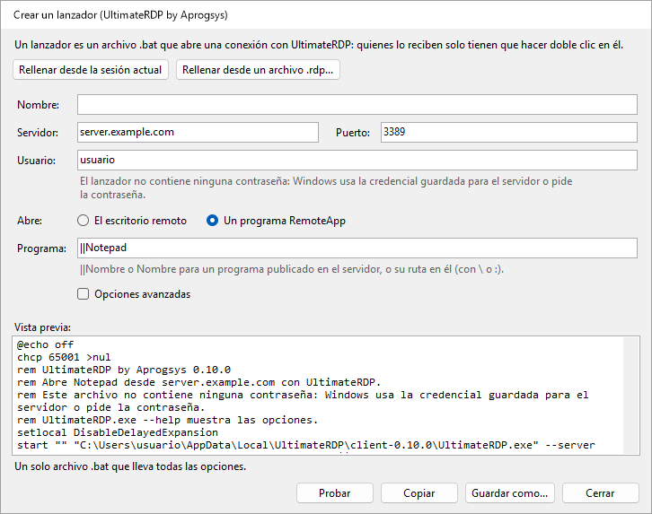

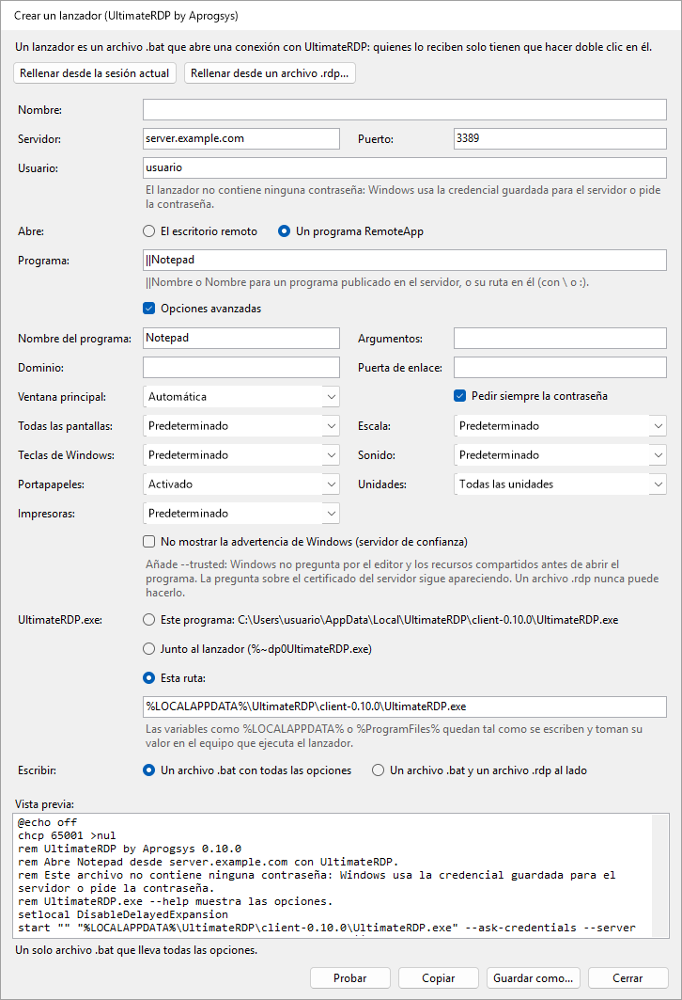

El cuadro de diálogo muestra el texto del archivo .bat a medida que escribe, o qué campo es incorrecto. **Rellenar desde la sesión actual** y **Rellenar desde un archivo .rdp...** rellenan los campos a partir de la configuración de la pestaña activa o de un archivo. **Guardar como...** escribe el archivo, **Copiar** pone su texto en el portapapeles, y **Probar** inicia este UltimateRDP con las opciones del lanzador, lo que abre la conexión en el cliente en ejecución. El lanzador no contiene ninguna contraseña, y el cuadro de diálogo no tiene ningún campo para ella.

El archivo .bat empieza con `@echo off`, `chcp 65001 >nul` cuando un carácter del archivo está fuera de ASCII, un comentario que empieza por «UltimateRDP by Aprogsys» y su versión e indica, en el idioma del cliente, lo que abre y que no contiene ninguna contraseña, `setlocal DisableDelayedExpansion`, y `start "" "<UltimateRDP.exe>" <options>`. Se escribe en UTF-8 sin marca de orden de bytes, con finales de línea CRLF. Cada valor va entre comillas para que cmd.exe lo entregue a UltimateRDP exactamente como se escribió y no pueda ejecutar nada más: consulte «Notas de seguridad».

## Cómo funciona

El cliente aloja el control ActiveX de Escritorio remoto de Microsoft y se registra como destino de colocación en sus ventanas. El agente se ejecuta en su sesión y escucha en un canal virtual estático llamado `ULTRDP`. Para los archivos pequeños, el cliente envía las rutas locales y la posición del cursor, y la sesión lee los archivos desde las unidades redirigidas. Los archivos grandes se envían por el canal, como se describe después de los pasos siguientes.

1. Cuando el arrastre se mueve por primera vez sobre la sesión, el cliente convierte la posición del cursor a coordenadas del escritorio remoto y envía `dragEnter` con las rutas.
2. El agente abre una ventana proxy invisible sobre toda la pantalla remota. Mueve el cursor remoto hasta el punto y simula una pulsación del botón izquierdo sobre esa ventana. La pulsación inicia un verdadero arrastre OLE dentro de la sesión, con los archivos como rutas `\\tsclient\<drive>\...`, o como copias preparadas.
3. El agente responde `dragAck`. Sin esa respuesta en un segundo, el cliente detiene el arrastre.
4. Mientras usted se mueve, el cliente envía `dragMove`. El agente mueve el cursor remoto, así que la aplicación que está debajo ve el arrastre y muestra su indicación.
5. Cuando suelta el botón, el cliente envía `drop`. El agente mueve el cursor hasta el punto final y suelta allí el botón simulado. Si en cambio sale de la sesión, el cliente envía `dragLeave` y el agente cancela el arrastre.
6. El agente comunica `dropResult` con el efecto: `copy` o `link` cuando el destino aceptó, o `none` cuando nada bajo el cursor aceptó los archivos. Con `none`, la colocación se ignora. El cliente muestra el resultado en la barra de estado.

El arrastre solo ofrece copiar y vincular, nunca mover. Las teclas modificadoras se anotan en los registros, pero no se inyectan.

En una sesión RemoteApp, las ventanas del servidor son ventanas del cliente, y todo lo que mostrara el agente aparecería también en su escritorio, incluida su ventana proxy. Por eso el cliente no envía nada mientras usted se mueve: en la colocación envía `dragEnter` y luego `drop` en el mismo punto, y mantiene la colocación abierta en su lado hasta que el agente ha respondido. El agente reproduce el arrastre justo ahí, con una ventana proxy de 32 por 32 píxeles bajo el punto en lugar de una sobre toda la pantalla.

Para los archivos grandes, el `dragEnter` lleva el tamaño de cada elemento, y el agente responde `dragAck` con `transfer: true` cuando deben llegar por el canal. En el paso 5, el cliente envía entonces `drop` con `deferred: true`: el agente cancela el arrastre en la sesión y conserva el punto. El cliente envía los archivos en fragmentos de 32 KiB por defecto, en base64, o en la forma más densa `u15` cuando el agente indica que los datos del cliente le llegan como UTF-16, con como máximo 4 MiB aún no confirmados; el agente los escribe en su carpeta de preparación y comprueba el tamaño y el SHA-256 de cada uno, responde `transferResult`, luego coloca las copias en el punto conservado con un arrastre corto, y comunica `dropResult` como en el paso 6.

Para cerrar la sesión, el cliente envía `logoff`. El agente responde `logoffResult`, espera medio segundo para que la respuesta llegue al cliente y luego pide a Windows que cierre la sesión. Nunca fuerza las aplicaciones que tienen trabajo sin guardar.

Los mensajes son objetos JSON enviados como líneas ASCII, salvo los fragmentos `u15`, y cada lado detecta en tiempo de ejecución cómo convierte el control los bytes del canal en caracteres. Consulte [docs/design.md](docs/design.md) para los detalles.

## Solución de problemas

- **El primer inicio de una nueva versión tarda varios segundos antes de que aparezca nada.** Ese tiempo transcurre antes de que exista el proceso: un antivirus analiza un nuevo ejecutable de unos 120 MB en su primer inicio. Los inicios siguientes muestran la ventana de carga en unos 0,1 s.
- **Un lanzador en el que se hizo clic dos veces.** Desde la versión 0.10.0, el segundo clic inicia el programa en la conexión en ejecución; consulte «Una conexión por servidor y cuenta».
- **El agente nunca está listo.** Ejecute `UltimateRDP.Agent.exe --status` en la sesión: indica si el agente se ejecuta allí y desde dónde está configurado para iniciarse. El icono del área de notificación solo aparece una vez conectado el cliente, así que su ausencia antes de eso es normal. Una directiva del servidor también puede bloquear los canales virtuales: el registro del agente tiene entonces una advertencia de que no puede abrir el canal.
- **«El agente no confirmó el arrastre».** El agente no respondió al inicio del arrastre en un segundo. Puede deberse a una conexión lenta o a un agente ocupado, y también a un agente que terminó o se reinició en la sesión, algo que el cliente no puede ver de otro modo. El cliente busca entonces de nuevo el agente: la etiqueta del agente pasa a «Agente: en espera», y vuelve a «Agente listo» cuando el agente responde. Cuando la barra de estado indica «La sesión no acepta entradas simuladas», es posible que la sesión esté bloqueada o que una directiva bloquee las entradas simuladas. Comuníquelo con ambos registros.
- **El destino no muestra ninguna indicación de colocación, o la barra de estado indica «Nada bajo el cursor aceptó los archivos.»** Es posible que la aplicación bajo el cursor no acepte archivos en ese lugar. Algunas aplicaciones también rechazan las rutas de red como `\\tsclient\C\...`. Para ellas, active «Copiar los archivos en la sesión antes de colocarlos» en el menú del área de notificación del agente.
- **La primera colocación en el Explorador tarda varios segundos.** El Explorador lee la unidad redirigida por primera vez, lo que puede ser lento. Las colocaciones siguientes suelen ser más rápidas.
- **Ctrl+W o Ctrl+O no hacen nada.** Cuando la sesión tiene el teclado, estas teclas van al equipo remoto, como cualquier otra tecla. Use el menú Archivo en su lugar.
- **Mis aplicaciones siguen abiertas en el servidor después de Salir.** Es lo esperado: Salir y Cerrar pestaña desconectan sin finalizar la sesión. Use Archivo, Cerrar la sesión remota.
- **Los textos están en el idioma equivocado.** Elija el idioma en Ver, Idioma. Un mensaje del agente sigue el idioma que el cliente anunció al conectarse; después de un cambio de idioma, el siguiente mensaje usa el nuevo.
- **Las colocaciones se rechazan por las unidades.** Active la redirección de unidades en el archivo .rdp, en Recursos locales, Más, Unidades. En el servidor, compruebe la directiva «No permitir la redirección de unidades».
- **Un programa RemoteApp se abre, pero las colocaciones en sus ventanas se rechazan o no hacen nada.** El registro del cliente tiene una línea por ventana del programa que empieza por `RemoteApp window`, con el resultado del registro del destino de colocación, y una advertencia cuando falló. Las líneas `RemoteApp monitors` y `the target is at` indican si las ventanas del servidor están donde están en su pantalla; una advertencia ahí significa que los monitores cambiaron desde la conexión, y una nueva conexión lo corrige.
- **Una sesión RemoteApp permanece abierta después de cerrarse su programa.** Compruebe que el registro del agente de la sesión indica `RemoteApp session detected`, y lo que dicen las líneas `RemoteApp session:`: un programa que sigue apareciendo ahí mantiene la sesión abierta, con o sin el agente. Consulte «Programas RemoteApp».
- **La colocación cae en la ventana equivocada.** Puede deberse al escalado de coordenadas después de cambiar el tamaño de la ventana, o a la pantalla completa sobre varios monitores. Comuníquelo con ambos registros.
- **Una transferencia de archivos grandes falla, o es lenta.** La barra de estado da el motivo. Ambos registros terminan cada transferencia con una línea de resumen: archivos, bytes, segundos y MB/s, y luego con las líneas descritas en «Medir una transferencia lenta». El registro del cliente también da la longitud de la primera línea de fragmento que envió, y el registro del agente tiene una línea para el primer fragmento de cada archivo que recibió. Cuando la barra de estado indica «El agente no confirmó la recepción de los primeros datos de la transferencia.», los datos no pasaron: el registro del cliente da entonces el modelo de bytes, el tamaño de los fragmentos, la longitud de las líneas y el número de líneas enviadas. Un `transferChunkBytes` más pequeño puede ayudar; consulte «Archivos grandes». Para volver a la redirección de unidades, elija Nunca en el menú del área de notificación del agente, Transferencia rápida de archivos grandes.
- **Una transferencia falla con «Un mensaje de la transferencia se perdió por el camino».** El control de Escritorio remoto pierde a veces un mensaje corto enviado justo antes de uno grande. Desde la 0.5.1 en ambos lados, esto ya no debería aparecer: el agente pide al cliente que vuelva a enviar las líneas que faltan, y el resumen de la transferencia en ambos registros cuenta las líneas reenviadas. Si sigue apareciendo, uno de los lados ejecuta una versión más antigua; si una transferencia falla con «Se perdieron líneas de la transferencia por el camino y no se pudieron recuperar», comuníquelo con ambos registros tomados con `logLevel` en `debug`.
- **Una transferencia falla de inmediato con «Se perdieron o dañaron datos por el camino».** El canal daña a veces los datos de una línea por el camino. Desde la 0.5.2 en ambos lados, el agente vuelve a pedir esa línea, como con una perdida, y su registro indica cómo era el daño en una línea que contiene «arrived damaged»; un agente 0.5.1 sigue haciendo fallar la transferencia.
- **Los archivos grandes nunca usan la conexión directa, o no se pueden enviar archivos de la sesión.** Compruebe primero que la dirección pública de su equipo está en la regla de firewall de la conexión directa, en el servidor y en el proveedor de alojamiento, como lo está en la regla que autoriza RDP; una red nueva da una dirección nueva. El registro del cliente indica el motivo al inicio de cada transferencia: «the direct connection cannot be used» con el motivo, como un puerto que no respondió en 3 segundos. Compruebe las reglas de firewall de «Conexión directa para archivos grandes», en el servidor y en el proveedor de alojamiento, y que ambos lados ejecutan la 0.7.0. El registro del agente indica en qué puerto escuchó, y avisa cuando ningún puerto del rango estaba libre.
- **Una transferencia directa es más lenta que el enlace.** Lea las líneas `direct connection statistics` de ambos registros; consulte «Interpretar las líneas de resumen».
- **Los archivos enviados desde la sesión no llegan.** El registro del cliente tiene una línea `Send offer` por cada oferta, y luego líneas `Receive <id>:` que indican si se pudo establecer la conexión directa, y por qué no. El registro del agente tiene las mismas líneas `Send <id>:`. Cuando el registro del cliente no tiene ninguna línea `Send offer`, compruebe que ambos lados ejecutan la 0.9.0 y que `receiveFiles` y `directTransfer` no están en `never` en client.json; la línea `Hello from client` del registro del agente indica `receives files of the session: True` cuando no lo están.
- **Dónde están los registros.** El cliente escribe `%LOCALAPPDATA%\UltimateRDP\logs\client-yyyyMMdd.log` en su equipo. El agente escribe `agent-yyyyMMdd.log` en la misma carpeta en el servidor; desde la versión 0.9.0, cada una de sus líneas indica la sesión y el subproceso, como `[S3 12]`, ya que los agentes de un mismo usuario en varias sesiones escriben el mismo archivo. Ambos conservan catorce días de registros. El cliente abre su carpeta desde Ayuda, Abrir la carpeta de registros, y el agente desde su menú del área de notificación, Abrir la carpeta de registros.

## Compilar desde el código fuente

Necesita el SDK de .NET 10 en Windows.

```
dotnet build UltimateRDP.sln -c Release
dotnet test UltimateRDP.sln
```

Para publicar un ejecutable autónomo de un solo archivo sin símbolos:

```
dotnet publish src/UltimateRDP.Client -c Release -r win-x64 --self-contained true -p:PublishSingleFile=true -p:IncludeNativeLibrariesForSelfExtract=true -p:DebugType=none -p:DebugSymbols=false
dotnet publish src/UltimateRDP.Agent -c Release -r win-x64 --self-contained true -p:PublishSingleFile=true -p:IncludeNativeLibrariesForSelfExtract=true -p:DebugType=none -p:DebugSymbols=false
```

Las versiones las compila GitHub Actions cuando se publica una etiqueta `v*`. El flujo de trabajo compila, prueba, publica ambas aplicaciones y adjunta los dos archivos zip a la versión.

Los ejecutables de una versión están firmados por APROGSYS, y Windows muestra este editor en sus solicitudes. Un ejecutable que compile usted mismo no está firmado.

## Notas de seguridad

- El agente solo lee de `\\tsclient\`, es decir, de las unidades que usted eligió compartir. El propio agente solo escribe en su carpeta de preparación en su sesión, cuando la preparación está activada o cuando los archivos llegan por el canal. Rechaza cualquier nombre de archivo que saldría de esa carpeta. La aplicación sobre la que suelta decide adónde van los archivos. El agente no se ejecuta como servicio y no tiene ningún privilegio más allá de los suyos.
- El agente simula entradas solo dentro de su propia sesión, y solo entre el inicio y el final de un arrastre. Solo usa el botón izquierdo del ratón. Inyecta la pulsación solo cuando su propia ventana proxy está bajo el cursor, así que la pulsación nunca llega a otra aplicación. Para cancelar, envía Esc a su ventana proxy en lugar de simular una tecla.
- El agente nunca ofrece mover. Un movimiento aceptado en la sesión podría eliminar el archivo de su disco local a través de la unidad redirigida.
- Los mensajes llevan rutas de archivos, coordenadas, indicadores de teclas modificadoras y nombres de ventanas. El contenido de los archivos pasa por el canal solo para una transferencia de archivos grandes, dentro de la conexión cifrada de Escritorio remoto.
- Desde la versión 0.6.0, los archivos de una transferencia de archivos grandes pueden pasar en su lugar por una conexión TLS directa. El agente solo escucha mientras se ofrece una transferencia, y solo acepta una conexión con una prueba del token de un solo uso que dio a través de la conexión cifrada de Escritorio remoto, cada conexión de la oferta una sola vez, 16 como máximo. El cliente solo acepta el certificado cuyo SHA-256 dio allí el agente. Los archivos van a la misma carpeta de preparación, con las mismas comprobaciones. Abra los puertos solo a las direcciones de cliente autorizadas para RDP.
- Desde la versión 0.9.0, la sesión puede enviar archivos a su equipo. Solo el usuario de la sesión puede iniciarlo, a través del agente de esa sesión: `--send` llega a ese agente por una canalización que solo acepta procesos del mismo usuario en la misma sesión. El cliente solo acepta archivos después de haber respondido a una oferta que llegó por la conexión cifrada de Escritorio remoto de su propia sesión, solo por la conexión directa cuyo certificado y token dio esa oferta, y solo en su carpeta de archivos recibidos. Nunca reemplaza un archivo, nunca ejecuta ninguno y marca cada uno como una descarga.
- Desde la versión 0.10.0, la línea de comandos puede dar una conexión, y el cliente puede escribir lanzadores. Ninguna opción acepta una contraseña. Cada valor de la línea de comandos se comprueba antes de que se abra nada, y no puede añadir una clave a la configuración .rdp en la que se convierte. En un lanzador, cada valor va entre comillas dobles con las reglas de entrecomillado de la línea de comandos de Windows, cada `%` se duplica, se pone un `^` delante de `& | < > ^ ( )` allí donde cmd.exe lee fuera de las comillas, y la expansión retrasada está desactivada, para que ningún valor pueda añadir un comando ni expandir una variable. Las pruebas lo comprueban con un modelo de cmd.exe y con el propio cmd.exe.
- El cliente nunca escribe credenciales y nunca las registra. Lee la credencial genérica `TERMSRV/<host>` cuando existe, y la entrega al control de Microsoft. Las demás solicitudes de credenciales proceden del control de Microsoft.

## Estado

La versión 0.10.0 añade las opciones de una conexión en la línea de comandos, el generador de lanzadores, una conexión por servidor y cuenta para los programas RemoteApp, y `--trusted`. Sus lanzadores se comprobaron con cmd.exe en el equipo de las pruebas; la conexión RemoteApp compartida y `--trusted` no se habían probado con un servidor real en el momento de la publicación. La versión 0.9.0 es una versión de prueba. Los archivos enviados desde la sesión a su equipo, el inicio de un programa RemoteApp desde un acceso directo, las correcciones de sus ventanas y la opción de la contraseña no se habían probado con un servidor real en el momento de la publicación; las letras de unidad de la 0.8.0 tampoco.

Verificado en una sesión real de Escritorio remoto, con la versión 0.2.1:

- El canal virtual entre el cliente y el agente, con un byte por carácter en ambos sentidos.
- La transferencia a través de la redirección de unidades al escritorio remoto.
- El arrastre en directo a una aplicación remota.

El comando de cierre de sesión y las traducciones son nuevos en la 0.3.0. La transferencia rápida de archivos grandes es nueva en la 0.4.0. Su primera prueba con un servidor real falló. La versión 0.4.1 corrige los dos defectos encontrados entonces; con ella, un archivo de 496 MB llegó a una sesión real en 193 segundos. La versión 0.4.2 añade una ventana de progreso en cada colocación y solo cambia el cliente. La versión 0.4.3 corrige mensajes cortos que el control de Escritorio remoto perdía a veces justo antes de uno grande, lo que hacía fallar algunas transferencias al empezar. La versión 0.4.4 mide en qué se va el tiempo de una transferencia, en ambos lados, y añade las opciones `transferWindowBytes` y `channelRead` para probar qué la limita.

Sus mediciones mostraron que ninguno de los dos lados limita la transferencia: el canal está lleno, y la codificación de los datos ocupaba la mayor parte de él. La versión 0.5.0 envía los archivos en una forma más densa cuando los datos del cliente llegan al agente como UTF-16, lo que debería multiplicar la velocidad por 2,5 aproximadamente, de 2,1 MB/s a unos 5,4 MB/s en un canal de 5,8 MB/s. También mantiene la transferencia rápida cuando suelta el botón deprisa, antes de que el agente haya respondido al inicio del arrastre, incluso cuando esa respuesta llega en dos etapas. La versión 0.5.1 numera los mensajes de una transferencia, para que el agente pida los que perdió el control de Escritorio remoto y la transferencia continúe. La versión 0.5.2 hace lo mismo con un mensaje que llega dañado. La versión 0.6.0 envía los archivos grandes por una conexión TLS directa cuando el servidor abre sus puertos para ello, ya que el canal se quedaba en 2 a 4 MB/s. Su primera prueba en producción alcanzó de 135 a 180 MB/s durante unos segundos, y luego unos 20 MB/s, el límite de una sola conexión TCP en esa ruta; por eso la versión 0.7.0 usa varias conexiones a la vez, y registra en qué se va el tiempo de una transferencia. La versión 0.8.0 abre programas RemoteApp y acepta colocaciones en sus ventanas, impide que el agente mantenga abierta una sesión RemoteApp, puede dar a las unidades del cliente letras de la sesión y lee una configuración para todo el equipo. Su primera prueba real con Notepad funcionó y mostró una ventana vacía del control sobre un monitor, una ventana principal siempre visible, diez segundos perdidos antes de que se iniciara el programa y un final normal mostrado como un error. La versión 0.9.0 corrige estos puntos, abre programas RemoteApp desde un acceso directo con solo sus propias ventanas en la pantalla, envía archivos de la sesión a su equipo y puede pedir la contraseña cada vez.

Comentarios que ayudan:

- Si el arrastre en directo funciona en su sesión, y con qué aplicaciones.
- Si el cierre de sesión le funciona, y la redacción en su idioma.
- La velocidad de una transferencia de archivos grandes en su conexión, según la línea de resumen de ambos registros.

- Cuánto tarda la primera colocación en el Explorador.
- Si las colocaciones caen en el lugar correcto en pantalla completa, con un monitor o con todos los monitores.
- Si las credenciales guardadas funcionan, y qué tipo tiene en el Administrador de credenciales.
- Con RemoteApp: si el programa se abre, si una colocación en sus ventanas cae donde soltó el botón, y si la sesión termina como antes cuando el programa se cierra, con ambos registros.

Envíelos a través de las [incidencias de GitHub](https://github.com/freeKC/ultimaterdp/issues), con ambos registros.

## Créditos

UltimateRDP by Aprogsys está desarrollado y publicado por [APROGSYS](https://www.aprogsys.com/). El código fuente está en [GitHub](https://github.com/freeKC/ultimaterdp), con la licencia MIT.

## Licencia

MIT. Consulte [LICENSE](LICENSE).
