# UltimateRDP

[](https://github.com/freeKC/ultimaterdp/actions/workflows/ci.yml)

[English](README.md) | **Français** | [Deutsch](README.de.md) | [Español](README.es.md) | [Italiano](README.it.md) | [Nederlands](README.nl.md) | [Português](README.pt.md)

Le README en anglais est la référence ; cette traduction le suit.

UltimateRDP by Aprogsys déplace de gros fichiers entre votre ordinateur et une session Bureau à distance par plusieurs connexions TLS en parallèle, en dehors du flux RDP. Sur une installation de production, il a transporté de 255 à 296 Mo/s du PC vers le serveur et de 115 à 134 Mo/s du serveur vers le PC, là où le canal virtuel RDP transporte environ 2 Mo/s et où une seule connexion TCP s'est stabilisée entre 20 et 22 Mo/s : voir « Transferts rapides par connexions parallèles ».

UltimateRDP vous permet de faire glisser des fichiers ou des dossiers depuis votre bureau et de les déposer dans une session Bureau à distance, sur l'application située sous le curseur. L'Explorateur, un client de messagerie, un navigateur ou une application métier les reçoit comme si vous les aviez déposés à l'intérieur de la session. Quand rien sous le curseur ne les accepte, le dépôt est ignoré. Les fichiers vont aussi dans l'autre sens, de la session vers votre ordinateur. UltimateRDP ouvre des bureaux et des programmes RemoteApp, depuis un fichier .rdp ou depuis un lanceur .bat qu'il écrit pour vous. Il se compose d'un client qui héberge le contrôle Bureau à distance de Microsoft, d'un petit agent dans la session, d'un canal virtuel entre les deux, de la redirection standard des lecteurs et des connexions directes pour les gros fichiers.

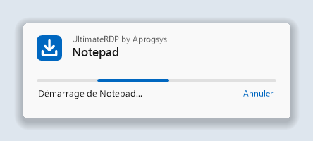

## Sommaire

<!-- toc -->
- [Transferts rapides par connexions parallèles](#transferts-rapides-par-connexions-parallèles)
- [Pourquoi](#pourquoi)
- [Ce qu'il faut](#ce-quil-faut)
- [Installation](#installation)
  - [Sur le serveur](#sur-le-serveur)
  - [Sessions ouvertes avec le client Microsoft](#sessions-ouvertes-avec-le-client-microsoft)
  - [Sur votre ordinateur](#sur-votre-ordinateur)
- [Utilisation](#utilisation)
  - [Sessions et onglets](#sessions-et-onglets)
  - [La fenêtre de chargement](#la-fenêtre-de-chargement)
  - [Fermer la session](#fermer-la-session)
  - [Glisser dans la session](#glisser-dans-la-session)
  - [Gros fichiers](#gros-fichiers)
  - [Envoyer des fichiers de la session vers votre ordinateur](#envoyer-des-fichiers-de-la-session-vers-votre-ordinateur)
  - [Messages de la barre d'état](#messages-de-la-barre-détat)
  - [Menu Affichage](#menu-affichage)
  - [Langue](#langue)
  - [Identifiants enregistrés et mot de passe](#identifiants-enregistrés-et-mot-de-passe)
- [Paramètres du client](#paramètres-du-client)
- [Menu de l'agent dans la zone de notification et paramètres](#menu-de-lagent-dans-la-zone-de-notification-et-paramètres)
  - [Paramètres de l'ordinateur](#paramètres-de-lordinateur)
  - [Lecteurs du poste sur des lettres de lecteur](#lecteurs-du-poste-sur-des-lettres-de-lecteur)
- [Connexion directe pour les gros fichiers](#connexion-directe-pour-les-gros-fichiers)
  - [Règles de pare-feu](#règles-de-pare-feu)
  - [Repli](#repli)
  - [Paramètres](#paramètres)
  - [Lire les lignes de bilan](#lire-les-lignes-de-bilan)
- [Programmes RemoteApp](#programmes-remoteapp)
  - [Depuis un raccourci ou un fichier .bat](#depuis-un-raccourci-ou-un-fichier-bat)
  - [Sur votre ordinateur](#sur-votre-ordinateur-1)
  - [Sur le serveur](#sur-le-serveur-1)
  - [Tester sur un compte](#tester-sur-un-compte)
  - [Une connexion par serveur et par compte](#une-connexion-par-serveur-et-par-compte)
- [Lanceurs](#lanceurs)
  - [Options de la ligne de commande](#options-de-la-ligne-de-commande)
  - [Le générateur de lanceurs](#le-générateur-de-lanceurs)
- [Fonctionnement](#fonctionnement)
- [Dépannage](#dépannage)
- [Compiler depuis les sources](#compiler-depuis-les-sources)
- [Notes de sécurité](#notes-de-sécurité)
- [État du projet](#état-du-projet)
- [Crédits](#crédits)
- [Licence](#licence)
<!-- /toc -->

## Transferts rapides par connexions parallèles

Ce que c'est :

- Depuis la version 0.6.0, les gros fichiers passent par une connexion TLS directe entre le client et l'agent, en dehors de la connexion Bureau à distance, et depuis la version 0.7.0 par plusieurs connexions en parallèle, huit par défaut, seize au plus. Les connexions utilisent TLS 1.3 quand les deux versions de Windows le proposent, comme Windows 11 et Windows Server 2022, et TLS 1.2 sinon.
- L'agent crée son certificat en mémoire et transmet son SHA-256 et un jeton à usage unique par le canal virtuel RDP, qui est déjà authentifié et chiffré. Le client n'accepte que ce certificat, et l'agent n'accepte que les connexions qui prouvent qu'elles connaissent le jeton.
- Chaque fichier est vérifié avec son SHA-256 à la fin. Un fichier qui ne correspond pas n'est pas gardé.
- Quand la connexion directe ne peut pas être utilisée, par exemple à travers une passerelle Bureau à distance (Remote Desktop Gateway) ou avec des ports fermés, les fichiers passent par le canal virtuel RDP sans que l'utilisateur ait rien à faire, et le journal du client dit pourquoi.

Pourquoi c'est important :

- Le canal virtuel RDP transportait environ 2 Mo/s en production, quelle que soit la liaison.
- La redirection des lecteurs lit un fichier par petits blocs, avec un aller-retour par bloc : 3,6 Mo/s lors d'une mesure sur une liaison qui transportait 9,7 Mo/s.
- Une seule connexion TCP sur le chemin de production démarrait entre 90 et 180 Mo/s et se stabilisait entre 20 et 22 Mo/s après les premières secondes. La limite s'applique par connexion, quelque part sur le chemin, et plusieurs connexions s'additionnent.

Mesuré sur une installation de production, un serveur chez un hébergeur et un PC sur une ligne de 2,3 Gbit/s :

| Chemin | Débit |
| --- | --- |
| Du PC au serveur, 8 connexions directes | de 255 à 296 Mo/s |
| Du serveur au PC, 8 connexions directes | de 115 à 134 Mo/s, le plafond de la liaison sortante de ce serveur |
| Une seule connexion directe, après les premières secondes | de 20 à 22 Mo/s |
| Les mêmes fichiers par le canal virtuel RDP | environ 2 Mo/s |

Ce sont des mesures sur une seule installation ; les débits dépendent de la liaison, du serveur et des disques. Le serveur a besoin d'une règle de pare-feu pour une plage de ports : voir « Connexion directe pour les gros fichiers ».

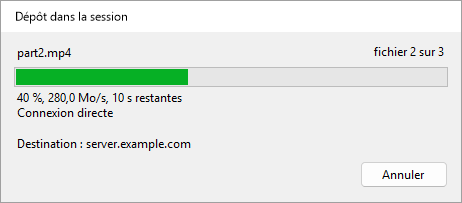

## Pourquoi

Le client Bureau à distance de Microsoft refuse les dépôts sur sa fenêtre, car RDP n'a pas de canal de glisser-déposer. Le copier-coller fonctionne, la redirection des lecteurs aussi, mais ni l'un ni l'autre n'est un dépôt. UltimateRDP ajoute ce geste à ce que RDP offre déjà.

Pendant que vous faites glisser sur la fenêtre du client, l'agent rejoue le même glisser à l'intérieur de la session, comme un vrai glisser-déposer OLE. Toute application distante qui accepte des fichiers déposés les accepte donc depuis UltimateRDP, et affiche son propre retour visuel de dépôt pendant que vous vous déplacez. Quand rien sous le curseur n'accepte le dépôt, le dépôt est ignoré : rien n'est copié nulle part.

Les petits fichiers passent par la redirection des lecteurs. Les gros fichiers passent par le canal UltimateRDP avant le dépôt : voir « Gros fichiers » plus bas.

## Ce qu'il faut

- Un ordinateur client sous Windows 10 ou 11, 64 bits.
- Un serveur sous Windows Server 2016 ou plus récent, ou un ordinateur Windows 10 ou 11 qui sert d'hôte Bureau à distance.
- Un fichier .rdp qui redirige les lecteurs. Dans les paramètres de Connexion Bureau à distance, c'est Ressources locales, puis Plus, puis Lecteurs.
- La possibilité de lancer l'agent dans votre session utilisateur sur le serveur.

Le client est un seul exécutable portable. Il fonctionne sans droits d'administrateur. L'archive de l'agent contient elle aussi un seul exécutable.

UltimateRDP fonctionne à travers une passerelle Bureau à distance (Remote Desktop Gateway). La connexion directe pour les gros fichiers, non, et les fichiers passent alors par le canal : voir « Connexion directe pour les gros fichiers ».

UltimateRDP a un périmètre volontairement restreint :

- Les dépôts vont dans un seul sens, de l'ordinateur local vers la session. Depuis la version 0.9.0, la session envoie des fichiers à votre ordinateur avec son menu Envoyer vers plutôt que par un dépôt, uniquement par la connexion directe : voir « Envoyer des fichiers de la session vers votre ordinateur ».
- Les sessions de bureau complet, et depuis la version 0.8.0 les programmes RemoteApp : voir « Programmes RemoteApp ».
- La session démarre toujours dans une fenêtre, même si le fichier .rdp demande le plein écran. Vous pouvez passer en plein écran ensuite. En plein écran, vous ne pouvez déposer que depuis un écran que la session ne couvre pas.

## Installation

Chaque archive zip contient un seul fichier `.exe`.

### Sur le serveur

1. Téléchargez l'archive zip `UltimateRDP.Agent` depuis la [page des versions](https://github.com/freeKC/ultimaterdp/releases).
2. Décompressez-la dans un dossier que tous les utilisateurs peuvent lire, comme `C:\Program Files\UltimateRDP`.
3. Depuis une invite de commandes élevée, exécutez :

   ```
   "C:\Program Files\UltimateRDP\UltimateRDP.Agent.exe" --install-all-users
   ```

   L'agent démarre alors avec chaque session utilisateur. Les utilisateurs déjà connectés l'auront à leur prochaine connexion. Exécuter de nouveau la commande ne change rien. Si vous aviez installé l'agent pour votre propre compte avec `--install`, la commande supprime aussi cette entrée et le signale, pour que l'agent ne démarre pas deux fois dans votre session. Elle refuse un exécutable situé dans un profil utilisateur, comme un dossier Téléchargements, car les autres utilisateurs risquent de ne pas pouvoir le lire.

Pour l'installer pour votre propre compte seulement, exécutez la même commande avec `--install` depuis une invite normale. Cela démarre aussi l'agent immédiatement.

Les sessions RemoteApp n'utilisent pas l'entrée `Run`. Pour y avoir aussi l'agent, voir « Programmes RemoteApp » plus bas.

Autres options :

- `--uninstall` empêche l'agent de démarrer avec votre session et arrête la copie en cours d'exécution. Exécutez-la depuis une invite élevée pour supprimer aussi l'entrée pour tous les utilisateurs.
- `--send <paths>` envoie des fichiers et des dossiers de la session vers l'ordinateur du client UltimateRDP qui y est connecté. Le raccourci du menu Envoyer vers l'exécute ; voir « Envoyer des fichiers de la session vers votre ordinateur ».
- `--status` affiche la version, les entrées `Run` sous `HKEY_CURRENT_USER` et `HKEY_LOCAL_MACHINE`, le fichier de paramètres, le fichier de paramètres de l'ordinateur et si l'agent fonctionne dans votre session. Elle dit aussi si la session est une session RemoteApp, et si la valeur `SysProcs` et la tâche planifiée de « Programmes RemoteApp » existent. Elle ne change rien.
- `--help` liste les options.

Pour mettre à jour sur un serveur, arrêtez toutes les copies de l'agent depuis une invite élevée avec `taskkill /im UltimateRDP.Agent.exe /f`, remplacez l'exécutable, puis laissez les utilisateurs se reconnecter. Pour mettre à jour votre propre copie, quittez-la depuis son menu dans la zone de notification ou avec `--uninstall`, remplacez l'exécutable, puis installez-la de nouveau. Le client et l'agent doivent avoir la même version.

### Sessions ouvertes avec le client Microsoft

Sur un serveur, la plupart des utilisateurs se connectent peut-être avec le client Microsoft (mstsc), qui n'a pas de canal UltimateRDP. Pour eux, l'agent reste hors de vue et ne fait rien de visible :

- Il n'affiche ni icône, ni fenêtre, ni message. Son icône dans la zone de notification n'apparaît que lorsqu'un client UltimateRDP est connecté à la session, et disparaît quand ce client se déconnecte ; dans une session RemoteApp, elle n'apparaît jamais. Le paramètre `trayIcon` ci-dessous change cela.
- Pendant qu'il attend, il utilise quelques mégaoctets de mémoire et aucun temps processeur mesurable. Il essaie d'ouvrir son canal toutes les dix secondes, et immédiatement quand un client se connecte à la session, pour qu'un utilisateur qui se reconnecte avec le client UltimateRDP trouve l'agent prêt.
- Son journal reçoit une ligne au démarrage et au plus une ligne par heure pendant l'attente.
- Il survit aux déconnexions et aux reconnexions, depuis l'un ou l'autre client. À la fermeture de session, il relâche le bouton de la souris si un dépôt était en cours, ferme le canal et se termine, sans retarder la fermeture de session.
- Une erreur inattendue n'affiche jamais de boîte de dialogue : elle est écrite dans le journal, et l'agent continue ou se termine discrètement.

### Sur votre ordinateur

1. Téléchargez l'archive zip `UltimateRDP` depuis la [page des versions](https://github.com/freeKC/ultimaterdp/releases).
2. Décompressez-la où vous voulez. Il n'y a rien à installer. UltimateRDP n'écrit rien dans le registre.
3. Lancez-le avec votre fichier de connexion :

   ```
   UltimateRDP.exe path\to\connection.rdp
   ```

   Vous pouvez aussi double-cliquer sur `UltimateRDP.exe` et choisir le fichier .rdp dans la boîte de dialogue.

## Utilisation

### Sessions et onglets

Chaque session s'ouvre dans son propre onglet. La barre d'état et les menus suivent l'onglet actif. Le menu Fichier contient :

- **Ouvrir un fichier .rdp...** (Ctrl+O) : ouvre un fichier de connexion dans un nouvel onglet.
- **Fichiers récents** : les dix derniers fichiers de connexion. **Effacer la liste** vide la liste.
- **Créer un lanceur (.bat)...** : depuis la version 0.10.0, écrit un fichier .bat qui ouvre une connexion. Voir « Lanceurs ».
- **Rouvrir dans un nouvel onglet** : ouvre une fois de plus le fichier de l'onglet actif, dans un second onglet. Depuis la version 0.10.0, tant que la session de l'onglet est connectée, c'est son onglet qui reste sélectionné : une seconde connexion avec le même compte reprendrait sa session. Voir « Une connexion par serveur et par compte ».
- **Fermer l'onglet** (Ctrl+W) : déconnecte la session active et ferme son onglet.
- **Fermer la session distante** : met fin à votre session Windows sur le serveur. Voir « Fermer la session » plus bas.
- **Oublier les identifiants enregistrés** : voir « Identifiants enregistrés et mot de passe » plus bas.
- **Toujours demander le mot de passe** : depuis la version 0.9.0, chaque connexion demande le mot de passe au lieu d'utiliser un identifiant enregistré. Voir « Identifiants enregistrés et mot de passe » plus bas.
- **Quitter** : déconnecte toutes les sessions et ferme la fenêtre.

Le menu Session contient Connecter, Déconnecter, Rechercher de nouveau l'agent et Annuler le transfert. Voir « Gros fichiers » plus bas.

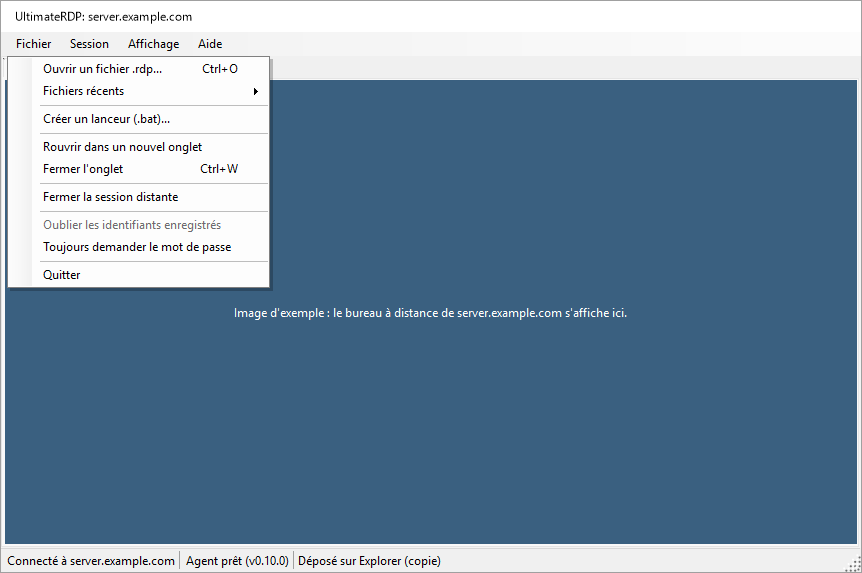

Le menu Aide contient À propos d'UltimateRDP, qui affiche « UltimateRDP by Aprogsys », la version et l'adresse du projet, Page du projet et Ouvrir le dossier des journaux.

### La fenêtre de chargement

Depuis la version 0.9.3, une petite fenêtre s'affiche dès qu'UltimateRDP démarre avec une connexion, depuis un fichier .bat, un raccourci ou l'exécutable, jusqu'à ce que le programme ou le bureau soit là. Elle affiche « UltimateRDP by Aprogsys », le nom du programme ou du serveur, une barre animée et l'étape : « Démarrage... », « Connexion à server.example.com... », « Ouverture de la session... », « Démarrage de Notepad... ». Au bout de 10 secondes, elle indique que le serveur met plus de temps que d'habitude. Son bouton Annuler arrête la connexion.

 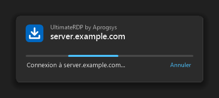

- Elle se ferme quand la fenêtre du programme apparaît, quand la session du bureau est ouverte, ou à toute fin antérieure.
- Elle suit le thème clair ou sombre de Windows et l'échelle de son écran, ne prend jamais le clavier et n'a pas de bouton dans la barre des tâches.
- Elle se masque pendant que la question du serveur sur son certificat, la demande de mot de passe, l'avertissement de Windows sur une connexion RemoteApp ou un message d'UltimateRDP attend une réponse, et revient ensuite au-dessus des autres fenêtres, sans prendre le clavier.
- Un second démarrage transmis à l'UltimateRDP en cours d'exécution affiche immédiatement la fenêtre de chargement de la nouvelle session.
- `"loader": "off"` dans client.json la désactive.

### Fermer la session

Quitter, Fermer l'onglet et Session, Déconnecter ne font que déconnecter, comme le client Bureau à distance de Microsoft. Votre session Windows continue de fonctionner sur le serveur, avec ses applications, et vous la retrouvez à la connexion suivante.

Pour vraiment mettre fin à la session, utilisez Fichier, Fermer la session distante. L'entrée est disponible dès que la barre d'état affiche « Agent prêt ». Le client demande une confirmation, puis l'agent ferme la session, comme le ferait la commande Se déconnecter du menu Démarrer. Les applications qui ont un travail non enregistré demandent quoi faire, dans la session, avant qu'elle se ferme. La barre d'état affiche « Fermeture de la session distante... », puis montre la déconnexion.

### Glisser dans la session

1. Lancez le client. Il se connecte avec les paramètres du fichier .rdp. Ouvrez la session comme d'habitude.
2. Surveillez la barre d'état en bas de la fenêtre. L'indication de l'agent passe de « Agent : en attente » à « Agent prêt (v0.4.3) ».
3. Faites glisser des fichiers ou des dossiers depuis l'Explorateur sur la session. Un bandeau bleu en haut de la session indique « Déposez ici pour envoyer les fichiers dans la session ».
4. Déplacez-vous sur l'application distante voulue. Elle affiche son propre retour visuel de dépôt, par exemple un dossier en surbrillance ou une zone de pièces jointes.
5. Relâchez le bouton sur la cible. L'application distante reçoit les fichiers comme un dépôt normal.

Une fenêtre de progression apparaît à chaque dépôt. La fenêtre « Dépôt dans la session » s'ouvre par-dessus la session dès que vous relâchez le bouton. Elle affiche les éléments déposés, une barre qui défile sans valeur, « Dépôt dans la session... » et le nom de l'ordinateur distant. Puis elle affiche le résultat, comme « Déposé sur Boîte de réception (copie) » ou « Rien sous le curseur n'a accepté les fichiers. », et se ferme d'elle-même trois secondes plus tard, sauf si la souris est dessus. Quand le dépôt échoue, elle affiche la raison en rouge et reste ouverte jusqu'à ce que vous cliquiez sur Fermer. Pour les gros fichiers, la même fenêtre affiche d'abord le transfert, voir « Gros fichiers » plus bas. La fenêtre ne prend jamais le clavier à la session, reste au-dessus de la fenêtre principale et reste ouverte quand vous changez d'onglet. Fermer l'onglet de la session la ferme.

Si rien sous le curseur n'accepte le dépôt, le dépôt est ignoré et la barre d'état affiche « Rien sous le curseur n'a accepté les fichiers. » L'agent ne copie jamais de fichiers de sa propre initiative.

Quand la cible est l'Explorateur, l'Explorateur affiche dans la session sa boîte de dialogue de copie Windows habituelle. Elle montre la progression et demande quoi faire quand un fichier existe déjà.

UltimateRDP ne propose à l'application distante que la copie et le lien. Il ne propose jamais de déplacement. Ctrl, Maj et Alt ne sont pas transmis à la session pendant un glisser.

### Gros fichiers

Une application distante lit un fichier par la redirection des lecteurs en petits blocs, avec un aller-retour sur le réseau par bloc. Sur une connexion qui a un peu de latence, c'est lent : lors d'une mesure, 3,6 Mo/s sur une liaison qui transportait 9,7 Mo/s. Pour les gros fichiers, UltimateRDP envoie donc les fichiers par son propre canal, en flux continu, avant le dépôt.

Par défaut, cela se produit quand les fichiers et dossiers déposés totalisent 10 Mio ou plus. Le paramètre de l'agent « Transfert rapide des gros fichiers » change cela, voir « Menu de l'agent dans la zone de notification et paramètres » plus bas.

Ce que vous voyez :

1. Le glisser sur la session fonctionne comme d'habitude : l'application distante affiche son retour visuel de dépôt.
2. Quand vous relâchez le bouton, le glisser se termine dans la session sans dépôt, et la fenêtre « Dépôt dans la session » affiche le transfert. La barre d'état affiche aussi la progression : « Transfert de 3 fichier(s) : 42 % (12,3 Mo/s, 1 min restantes) ».
3. Une fois que tous les fichiers sont dans la session, l'agent dépose les copies là où vous avez relâché le bouton, et la barre d'état affiche « Déposé sur ... » comme d'habitude.

Pendant un transfert, la fenêtre « Dépôt dans la session » affiche le nom du fichier en cours d'envoi avec « fichier 2 sur 3 », une barre de progression, une ligne comme « 42 %, 2,6 Mo/s, 1 min 40 s restantes », et le nom de l'ordinateur distant. Pendant que le client liste les fichiers, la barre défile sans valeur et la ligne affiche « Préparation... ». Son bouton Annuler arrête le transfert, comme le fait Session, Annuler le transfert. Après une réussite, elle affiche « 3 fichier(s) transféré(s) en 3 min 13 s à 2,6 Mo/s, dépôt dans la session... », puis montre le résultat du dépôt et se ferme d'elle-même trois secondes plus tard, sauf si la souris est dessus. Après un échec ou une annulation, elle affiche la raison en rouge et reste ouverte jusqu'à ce que vous cliquiez sur Fermer. Fermer l'onglet de la session annule le transfert et ferme la fenêtre.

 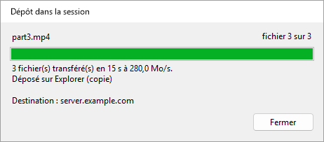

Les copies vont dans `%LOCALAPPDATA%\UltimateRDP\staging` dans la session et sont supprimées une heure après le dépôt. L'agent vérifie la taille et la somme de contrôle SHA-256 de chaque fichier. Si quelque chose se passe mal, rien n'est déposé et la barre d'état dit pourquoi. Session, Annuler le transfert l'arrête ; l'agent supprime alors ce qu'il a reçu.

À savoir :

- Un seul transfert à la fois. Pendant qu'il se déroule, un nouveau glisser sur la session est refusé, et la fenêtre de progression affiche « Attendez la fin de ce transfert avant de déposer d'autres fichiers. » pendant cinq secondes.
- La redirection des lecteurs doit rester activée : le glisser sur la session l'utilise.
- Si vous relâchez le bouton très vite, avant que l'agent ait répondu au début du glisser, le client attend cette réponse, une seconde et demie au plus, avec « Préparation... » dans la fenêtre de progression, pour que les gros fichiers passent quand même par le canal UltimateRDP. Un nouveau glisser est refusé pendant cette attente, comme pendant un transfert.
- Les dossiers vides à l'intérieur d'un dossier déposé ne sont pas créés dans la session.
- L'agent doit être en version 0.4.1 ou plus récente, et le client aussi. La fenêtre de progression est nouvelle dans le client 0.4.2 et fonctionne avec un agent 0.4.1. Avec un client ou un agent plus ancien, chaque dépôt passe par la redirection des lecteurs.
- Depuis la version 0.6.0 des deux côtés, les fichiers passent par une connexion directe quand le serveur ouvre ses ports pour cela, et par le canal sinon. Depuis la 0.7.0 des deux côtés, la connexion directe utilise plusieurs connexions TCP à la fois. Voir « Connexion directe pour les gros fichiers ».

Depuis la version 0.5.0, les fichiers voyagent sous une forme plus dense quand votre connexion le permet. L'agent indique au client comment les données du client lui parviennent. Quand chaque caractère arrive sous forme de deux octets, comme mesuré sur un serveur de production, le client place 15 bits du fichier dans chaque caractère au lieu du base64, et un octet du fichier coûte environ 1,07 octet sur le canal au lieu de 2,67. Sur un canal qui transporte 5,8 Mo/s, le transfert passe d'environ 2,1 Mo/s à environ 5,4 Mo/s. Quand chaque caractère arrive sous forme d'un octet, le client garde le base64, à environ trois quarts du canal. Les deux côtés doivent être en 0.5.0 pour la forme plus dense ; avec un agent plus ancien, le client envoie du base64 comme avant. La barre d'état et la fenêtre de progression ne changent pas ; le journal du client indique quelle forme un transfert utilise.

Le client envoie les fichiers par fragments de 32 Kio. Le paramètre `transferChunkBytes` dans `%LOCALAPPDATA%\UltimateRDP\client.json` change cette taille, de 4096 (4 Kio) à 262144 (256 Kio). Une valeur hors de ces bornes y est ramenée. Le paramètre ne se modifie que dans le fichier, et s'applique au redémarrage du client. N'y touchez pas, sauf si un transfert échoue dès son début.

```json
{
  "transferChunkBytes": 32768,
  "transferBatchCharacters": 200000,
  "transferWindowBytes": 4194304,
  "directTransfer": "auto",
  "directConnections": 8,
  "logLevel": "info"
}
```

Le client regroupe ses messages à l'agent, au plus `transferBatchCharacters` caractères par appel au contrôle Bureau à distance : 200000 par défaut, de 50000 à 1048576. Une valeur hors de ces bornes y est ramenée. N'y touchez pas, sauf si un transfert échoue dès son début.

Le paramètre `logLevel` du même fichier vaut `info` par défaut. Mettez-le à `debug` pour journaliser chaque message que le client envoie à l'agent et chaque appel qu'il fait au contrôle Bureau à distance, puis redémarrez le client.

Le client garde au plus `transferWindowBytes` octets d'un transfert envoyés et pas encore acquittés par l'agent : 4194304 (4 Mio) par défaut, de 1048576 (1 Mio) à 33554432 (32 Mio). Une valeur hors de ces bornes y est ramenée. L'agent acquitte tous les 2 Mio, donc une fenêtre inférieure à 2 Mio plus un fragment est relevée à cette valeur ; le journal donne la fenêtre utilisée au début de chaque transfert. Ne la changez que pour découvrir ce qui limite un transfert lent, voir plus bas.

#### Mesurer un transfert lent

Depuis la version 0.4.4, les deux journaux terminent chaque transfert par des lignes de bilan qui disent où le temps est passé. Installez la 0.4.4 des deux côtés pour avoir l'image complète ; avec un client ou un agent plus ancien, l'autre côté journalise quand même ses propres lignes.

Le journal du client a deux lignes :

```
Transfer <id> channel calls: 2410 calls, 482000000 characters, 9100 ms inside SendOnVirtualChannel, 3.78 ms per call on average, 41.20 ms at most; 5 % of the 190000 ms from the first call to the last, 5 % of the 193000 ms of the transfer.
Transfer <id> acknowledgements: 237 matched a call, round trip 1480 ms on average, 20 ms at least, 1900 ms at most; 3700000 bytes in flight on average when one came, 4194304 at most, 88 % of the window of 4194304 bytes.
```

Le journal de l'agent a une ligne par connexion sur la connexion, et deux lignes par transfert :

```
Transfer <id> channel reads: 302000 reads with data and 12 empty, 482000000 bytes, 1596 bytes per read on average; 301000 of 1600 bytes, 1000 shorter, 0 longer; blocked in the read 178000 ms, processing 14000 ms (9000 ms handling messages), over 193000 ms; read mode wts.
Transfer <id> session counters: 0 bytes, 0 frames and 0 compressed bytes in, 0 bytes out, from WTSSessionInfoEx (zero when Windows does not count them).
```

Comment les lire :

- **Le client passe bien plus de la moitié du temps dans SendOnVirtualChannel.** Le contrôle Bureau à distance limite le transfert sur votre ordinateur.
- **L'agent passe presque tout le temps à traiter, et peu de temps bloqué dans la lecture.** L'agent limite le transfert ; le temps de traitement des messages couvre le JSON, le décodage des fragments, la somme de contrôle et l'écriture du fichier.
- **Les appels du client prennent une petite part et l'agent attend dans la lecture presque tout le temps.** Les données attendent entre les deux, dans la connexion Bureau à distance. Quand les octets en transit restent proches de la fenêtre, essayez un transfert avec `transferWindowBytes` à 16777216. Si le débit ne change pas et que l'aller-retour est multiplié par quatre, le contrôle de flux de la connexion est la limite. Si le débit augmente, gardez la fenêtre plus grande.

L'utilisation d'UDP par la connexion se voit dans la barre de connexion de la session Bureau à distance : cliquez sur l'icône de signal pour afficher les informations de connexion.

### Envoyer des fichiers de la session vers votre ordinateur

Depuis la version 0.9.0, des fichiers et des dossiers de la session vont vers votre ordinateur par la connexion directe, au même débit que les gros fichiers dans l'autre sens. Les deux côtés doivent être en 0.9.0, et la connexion directe doit fonctionner : voir « Connexion directe pour les gros fichiers ».

Dans la session :

- **Envoyer vers.** Cliquez avec le bouton droit sur des fichiers ou des dossiers dans l'Explorateur, puis Envoyer vers, **Mon PC (UltimateRDP)**. Le raccourci n'existe que tant qu'un client UltimateRDP qui reçoit des fichiers est connecté, et disparaît quand il se déconnecte.
- **Le menu de l'agent dans la zone de notification**, Envoyer des fichiers vers mon PC..., permet de choisir des fichiers dans une boîte de dialogue. L'icône dans la zone de notification ne s'affiche pas dans les sessions RemoteApp.

  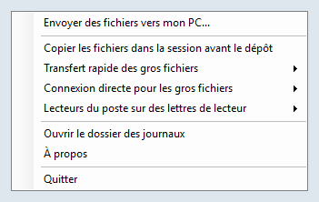

- **La ligne de commande** : `UltimateRDP.Agent.exe --send "C:\Users\me\Documents\report.pdf" "C:\Users\me\Pictures\Trip"`.

Si les fichiers ne peuvent pas être envoyés, un message dans la session dit pourquoi, par exemple qu'aucun client qui reçoit des fichiers n'est connecté.

Sur votre ordinateur :

- Les fichiers vont dans votre dossier Téléchargements. Pendant leur arrivée, ils sont dans un dossier caché `.ultimaterdp-<id>.part` à l'intérieur de celui-ci, et ils apparaissent une fois que chaque fichier a été vérifié avec son SHA-256. Un fichier n'en remplace jamais un autre : quand `report.pdf` existe, le nouveau s'appelle `report (2).pdf`, et un dossier devient `Photos (2)`.
- Une fenêtre « Fichiers de la session » affiche la progression, avec Annuler. À la fin, elle indique où sont les fichiers, et Ouvrir le dossier les montre dans l'Explorateur.

  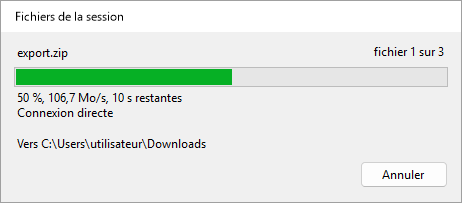 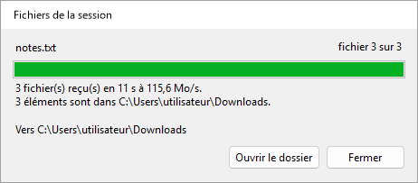

- Chaque fichier reçu porte la marque que Windows donne aux téléchargements, pour que SmartScreen et Office le traitent comme un fichier venu d'Internet. UltimateRDP n'ouvre ni n'exécute jamais un fichier reçu.
- Quand la connexion directe ne peut pas être utilisée, par exemple à travers une passerelle Bureau à distance ou avec des ports fermés par un pare-feu, rien n'est envoyé et la fenêtre le dit. Il n'y a pas de chemin plus lent ; copiez plutôt les fichiers, dans la session, vers un lecteur de votre ordinateur sous `\\tsclient`.
- Des noms que Windows refuse, un chemin qui sortirait du dossier ou un espace libre insuffisant arrêtent le transfert, et rien n'est gardé.

Paramètres dans `%LOCALAPPDATA%\UltimateRDP\client.json`, modifiables uniquement dans le fichier :

```json
{
  "receiveFiles": "auto",
  "receiveFolder": "%USERPROFILE%\\Desktop\\From the server"
}
```

| Paramètre | Valeurs | En l'absence | Signification |
| --- | --- | --- | --- |
| `receiveFiles` | `auto`, `never` | `auto` | `never` refuse les fichiers de la session. `directTransfer` à `never` les refuse aussi, puisque seule la connexion directe les transporte. |
| `receiveFolder` | un chemin complet | votre dossier Téléchargements | Où vont les fichiers. Les variables d'environnement comme `%USERPROFILE%` sont développées ; le dossier est créé s'il manque. |

Sur le serveur, `sendToClient` dans agent.json, `auto` par défaut, mis à `never`, désactive l'envoi pour un utilisateur ou, dans les paramètres de l'ordinateur, pour tout le monde. `directMaxMegabytesPerSecond` limite aussi ce que l'agent envoie, ce qui protège la liaison sortante du serveur. Depuis la version 0.9.2, `sendMaxMegabytesPerSecond` limite l'envoi seul, pour que les fichiers venant des clients gardent le plein débit : par exemple `"sendMaxMegabytesPerSecond": 85` dans les paramètres de l'ordinateur quand la liaison sortante du serveur transporte environ 1 Gbit/s.

### Messages de la barre d'état

Messages d'un glisser :

- **« Glissement de 2 élément(s) vers la session... »** : l'agent rejoue le glisser.
- **« Démarrage du glisser dans la session... »** : l'agent a besoin d'un instant pour démarrer le glisser.
- **« Copie de 2 élément(s) dans la session avant le début du glisser... »** : l'agent copie d'abord les fichiers dans la session, car « Copier les fichiers dans la session avant le dépôt » est activé.
- **« Déposé sur Boîte de réception (copie) »** : la fenêtre distante a accepté le dépôt. Le message nomme la fenêtre et indique copie ou lien.
- **« Rien sous le curseur n'a accepté les fichiers. »** : la fenêtre sous le curseur n'a pas pris le dépôt. Rien n'a été copié.
- **« L'agent n'a pas confirmé le glisser »** : aucune réponse de l'agent dans la seconde. Voir « Dépannage ».
- **« Dépôt refusé »** suivi de la raison donnée par l'agent. Par exemple « Dépôt refusé : Le dépôt précédent est encore en cours dans la session. Réessayez quand il sera terminé. »
- **« Dépôt refusé : le glisser n'a pas démarré dans la session. Faites de nouveau glisser les fichiers. »** : le client a reçu le dépôt sans glisser en cours pour les mêmes fichiers.
- **« Annulé »** suivi de la raison, par exemple « Annulé : Le glisser a été annulé : la touche Échap a été pressée dans la session. »

La fenêtre de progression qui apparaît à chaque dépôt affiche aussi le résultat du dépôt, et la progression d'un transfert avec plus de détails, voir « Glisser dans la session » et « Gros fichiers » plus haut. La barre d'état garde ses textes.

Messages d'un transfert de gros fichiers :

- **« Préparation du transfert de 2 élément(s)... »** : le client liste les fichiers à envoyer.
- **« Transfert de 3 fichier(s) : 42 % (12,3 Mo/s, 1 min restantes) »** : les fichiers sont en route. Le débit couvre les cinq dernières secondes ; Mo signifie un million d'octets.
- **« 3 fichier(s) transféré(s) à 12,3 Mo/s, dépôt en cours... »** : tous les fichiers sont dans la session, et l'agent dépose les copies.
- **« Transfert annulé. »** : vous avez annulé le transfert depuis le menu Session ou la fenêtre de progression.
- **« Un transfert est en cours. Attendez sa fin ou annulez-le depuis le menu Session. »** : un nouveau glisser a été refusé pendant un transfert.
- **« Échec du transfert »** suivi de la raison donnée par l'agent, par exemple « Échec du transfert : Des données ont été perdues ou endommagées en chemin. Réessayez. »
- **« Dépôt refusé : L'espace libre dans la session est insuffisant : 1 234 Mo nécessaires, 800 Mo libres. »** : le disque de la session ne peut pas contenir les fichiers.
- **« Impossible de lire »** suivi d'un nom de fichier et de la raison donnée par Windows : le client n'a pas pu lire un fichier sur votre ordinateur.
- **« L'agent a cessé de répondre pendant le transfert. »** : aucun acquittement pendant une minute.
- **« Le transfert s'est arrêté : la session a été déconnectée. »** : la connexion s'est terminée pendant le transfert.

Messages de la connexion :

- **« Aucun agent sur l'ordinateur distant »** : le client a envoyé des messages de salutation pendant soixante secondes sans obtenir de réponse. Lancez l'agent dans la session, puis utilisez Session, Rechercher de nouveau l'agent.
- **« Ce fichier .rdp ne redirige pas les lecteurs : les dépôts ne fonctionneront pas. »** : le fichier .rdp ne partage aucun lecteur local. Activez les lecteurs dans le fichier .rdp et reconnectez-vous.
- **« La session ne voit aucun lecteur redirigé : les dépôts ne fonctionneront pas. »** : l'agent a répondu, mais aucun lecteur `\\tsclient` n'est accessible depuis la session. Le serveur bloque peut-être la redirection des lecteurs.
- **« Dépôt refusé : non connecté. »** : il n'y a pas encore de session.
- **« Dépôt refusé : l'agent UltimateRDP n'a pas encore répondu. »** : attendez « Agent prêt ».
- **« Dépôt refusé : l'agent UltimateRDP ne fonctionne pas dans la session distante. »** : lancez l'agent dans la session.
- **« Dépôt refusé »** avec un chemin : seuls les fichiers et dossiers d'un lecteur local avec une lettre peuvent être déposés. Les chemins réseau (UNC) sont refusés, car la session accède à vos fichiers par la redirection des lecteurs.
- **« Échec du dépôt »** : l'agent n'a pas pu terminer. La suite du message donne sa raison.

Messages d'une fermeture de session :

- **« Fermeture de la session distante... »** : l'agent a accepté la demande. La déconnexion suit une fois la session fermée. Si une application demande d'enregistrer votre travail, répondez-lui dans la session.
- **« L'agent n'a pas répondu à la demande de fermeture de session. »** : aucune réponse dans les cinq secondes. La session est toujours ouverte ; réessayez, ou déconnectez-vous depuis le menu Démarrer de la session.
- **« Échec de la fermeture de session »** : Windows a refusé de fermer la session. La suite du message donne la raison donnée par Windows.

Ces exemples sont en français. La barre d'état utilise la langue du client, voir « Langue » plus bas.

### Menu Affichage

- **Redimensionner la session à la fenêtre** : le choix par défaut. La résolution de la session suit la taille de la fenêtre.
- **Mettre à l'échelle de la fenêtre** : la session garde sa résolution et l'image est mise à l'échelle de la fenêtre.
- **Facteur d'échelle** : Automatique, ou de 100 % à 200 %. Automatique suit l'écran qui contient la fenêtre. Un changement s'applique à une nouvelle connexion, et le client propose de se reconnecter.
- **Plein écran** (F11, ou Ctrl+Alt+Pause) : bascule le plein écran. La barre de connexion est affichée et peut être épinglée.
- **Utiliser tous les écrans** : la session couvre tous les écrans en plein écran. Cela s'applique à une nouvelle connexion.
- **Touches Windows** : où vont les combinaisons de touches comme Alt+Tab. « Sur cet ordinateur », « Dans la session », ou « Dans la session en plein écran », qui est le choix par défaut.
- **Langue** : voir plus bas.

Vos choix du menu Affichage sont enregistrés pour les sessions que vous ouvrez ensuite. Quand le fichier .rdp définit `desktopscalefactor`, `use multimon` ou `keyboardhook`, c'est le fichier qui l'emporte.

### Langue

Le client et l'agent parlent anglais, français, allemand, espagnol, italien, portugais et néerlandais.

Le sous-menu Affichage, Langue liste « Automatique (langue de Windows) » et les sept langues, chacune nommée dans sa propre langue. Un choix s'applique immédiatement aux menus, à la barre d'état et aux onglets, et le client le retient. Automatique, le choix par défaut, suit la langue d'affichage de Windows, et utilise l'anglais quand Windows fonctionne dans une autre langue.

Le choix est le paramètre `language` dans `%LOCALAPPDATA%\UltimateRDP\client.json` : `auto`, `en`, `fr`, `de`, `es`, `it`, `pt` ou `nl`.

```json
{
  "language": "fr"
}
```

Le client indique sa langue à l'agent, et l'agent écrit dans cette langue les messages qu'il envoie à la barre d'état. Le menu de l'agent dans la zone de notification suit la langue d'affichage de Windows sur le serveur.

Certains textes viennent de Windows et suivent sa propre langue : les boutons Oui et Non des questions, la raison d'une déconnexion et les messages d'erreur de Windows. Les journaux sont toujours en anglais.

### Identifiants enregistrés et mot de passe

Avant de se connecter, le client lit l'identifiant générique `TERMSRV/<host>` dans le Gestionnaire d'identification de Windows. Quand il existe et contient un mot de passe, le client l'applique et désactive la demande pour cette connexion. UltimateRDP n'écrit jamais d'identifiant. Vous pouvez en créer un avec :

```
cmdkey /generic:TERMSRV/<host> /user:<domain\user> /pass
```

`cmdkey` demande alors le mot de passe.

Depuis la version 0.9.0, le client demande plutôt le mot de passe, et ne lit aucun identifiant enregistré, quand l'un de ces éléments le demande :

- l'option `--ask-credentials` sur la ligne de commande ;
- Fichier, **Toujours demander le mot de passe**, que le client retient sous la forme `"credentials": "ask"` dans client.json (`saved` par défaut) ;
- la ligne `prompt for credentials:i:1` dans le fichier .rdp, comme le fait le client Microsoft.

Le nom d'utilisateur du fichier .rdp reste rempli, et la demande ne propose pas d'enregistrer le mot de passe. Le journal du client indique lequel des trois a décidé, et ne contient jamais de mot de passe.

Cela change ce qui se passe avec un fichier .rdp qui contient déjà `prompt for credentials:i:1` : la version 0.8.0 utilisait l'identifiant enregistré et se connectait sans demande ; la version 0.9.0 demande le mot de passe. Retirez la ligne du fichier, ou mettez-la à 0, pour retrouver l'identifiant enregistré.

La case « Mémoriser mes informations » de la fenêtre d'identification de Windows enregistre un autre type d'identifiant, un mot de passe de domaine. Windows garde ce mot de passe pour lui-même, si bien qu'UltimateRDP ne peut pas le lire. La fenêtre d'identification de Windows peut tout de même l'utiliser.

Fichier, Oublier les identifiants enregistrés supprime les deux types d'identifiants pour l'hôte de l'onglet actif. La session ouverte n'est pas touchée, et la connexion suivante les demande de nouveau.

Aucune option de la ligne de commande et aucun champ du générateur de lanceurs n'accepte de mot de passe : voir « Lanceurs ». L'avertissement de Windows sur l'éditeur d'une connexion RemoteApp est une autre question, et `--trusted` est le seul moyen de l'éviter : voir « Options de la ligne de commande ».

## Paramètres du client

Le client garde ses paramètres dans `%LOCALAPPDATA%\UltimateRDP\client.json`. Le menu Affichage, le menu Langue et Fichier, Toujours demander le mot de passe en écrivent certains ; les autres ne se modifient que dans le fichier, et s'appliquent au redémarrage du client. Une valeur inconnue donne la valeur par défaut. Les commentaires sont permis dans le fichier et ne sont pas conservés quand le client l'écrit.

```json
{
  "displayMode": "resizeSession",
  "scaleFactor": null,
  "keyboardHookMode": 2,
  "useAllMonitors": false,
  "language": "auto",
  "transferChunkBytes": 32768,
  "transferBatchCharacters": 200000,
  "transferWindowBytes": 4194304,
  "directTransfer": "auto",
  "directConnections": 8,
  "receiveFiles": "auto",
  "receiveFolder": null,
  "credentials": "saved",
  "loader": "on",
  "logLevel": "info"
}
```

| Paramètre | Valeurs | En l'absence | Signification |
| --- | --- | --- | --- |
| `displayMode` | `resizeSession`, `scaleToWindow` | `resizeSession` | Affichage, Redimensionner la session à la fenêtre ou Mettre à l'échelle de la fenêtre. |
| `scaleFactor` | `null`, ou de 100 à 500 | `null` | Affichage, Facteur d'échelle ; `null` suit l'écran. |
| `keyboardHookMode` | 0, 1, 2 | 2 | Affichage, Touches Windows : sur cet ordinateur, dans la session, dans la session en plein écran. |
| `useAllMonitors` | `true`, `false` | `false` | Affichage, Utiliser tous les écrans. |
| `language` | `auto`, `en`, `fr`, `de`, `es`, `it`, `nl`, `pt` | `auto` | Affichage, Langue. Voir « Langue ». |
| `recentFiles` | une liste de chemins | vide | Fichier, Fichiers récents. Le client l'écrit. |
| `transferChunkBytes` | de 4096 à 262144 | 32768 | Octets par fragment d'un transfert par le canal. Voir « Gros fichiers ». |
| `transferBatchCharacters` | de 50000 à 1048576 | 200000 | Caractères par appel au contrôle Bureau à distance. Voir « Gros fichiers ». |
| `transferWindowBytes` | de 1048576 à 33554432 | 4194304 | Octets d'un transfert par le canal envoyés et pas encore acquittés. Voir « Gros fichiers ». |
| `directTransfer` | `auto`, `never` | `auto` | `never` garde les gros fichiers dans le canal et refuse les fichiers de la session. Voir « Connexion directe pour les gros fichiers ». |
| `directConnections` | de 1 à 16 | 8 | Nombre maximal de connexions d'un transfert direct. |
| `receiveFiles` | `auto`, `never` | `auto` | `never` refuse les fichiers de la session. Voir « Envoyer des fichiers de la session vers votre ordinateur ». |
| `receiveFolder` | `null`, ou un chemin | votre dossier Téléchargements | Où vont les fichiers de la session ; les variables d'environnement sont développées. |
| `credentials` | `saved`, `ask` | `saved` | Fichier, Toujours demander le mot de passe. Voir « Identifiants enregistrés et mot de passe ». |
| `loader` | `on`, `off` | `on` | La fenêtre de chargement. Voir « La fenêtre de chargement ». |
| `logLevel` | `debug`, `info` | `info` | `debug` journalise chaque message à l'agent et chaque appel au contrôle. |

## Menu de l'agent dans la zone de notification et paramètres

Par défaut, l'icône de l'agent dans la zone de notification n'est visible que lorsqu'un client UltimateRDP est connecté à la session. Son menu contient :

- **Envoyer des fichiers vers mon PC...** : depuis la version 0.9.0, envoie les fichiers choisis vers l'ordinateur du client. Voir « Envoyer des fichiers de la session vers votre ordinateur ».
- **Copier les fichiers dans la session avant le dépôt** : désactivé par défaut. Quand il est activé, l'agent copie les fichiers dans la session avant le début du glisser, et l'application distante reçoit des chemins locaux au lieu de chemins `\\tsclient`. Activez-le pour les applications qui refusent les chemins réseau. Les gros fichiers prennent du temps à copier avant le début du glisser. Quand les fichiers arrivent par le canal, voir plus bas, ils arrivent de toute façon sous forme de copies locales.
- **Transfert rapide des gros fichiers** : Automatique, Toujours ou Jamais. Automatique, le choix par défaut, envoie les fichiers par le canal UltimateRDP avant le dépôt quand ils totalisent 10 Mio ou plus. Toujours le fait pour chaque dépôt, Jamais pour aucun : l'application distante lit alors les fichiers par la redirection des lecteurs, comme dans la version 0.3.
- **Connexion directe pour les gros fichiers** : Automatique ou Jamais. Automatique, le choix par défaut, propose la connexion directe pour un transfert rapide, avec le canal comme solution de repli. Jamais garde chaque transfert rapide dans le canal. Voir « Connexion directe pour les gros fichiers ».
- **Lecteurs du poste sur des lettres de lecteur** : Automatique ou Jamais. Jamais, le choix par défaut, laisse les lecteurs de votre ordinateur sous la forme `\\tsclient\C` et ainsi de suite. Automatique leur donne des lettres de lecteur de la session tant qu'un client UltimateRDP est connecté. Voir « Lecteurs du poste sur des lettres de lecteur » plus bas.
- **Ouvrir le dossier des journaux**, **À propos** et **Quitter**.

Le menu suit la langue d'affichage de Windows sur le serveur.

Les copies préalables vont dans `%LOCALAPPDATA%\UltimateRDP\staging\<id>` dans la session. Chaque dossier est supprimé une heure après son dépôt, car la cible lit peut-être encore les fichiers. Au démarrage, l'agent supprime les dossiers de plus d'une heure.

L'agent garde ses paramètres dans `%LOCALAPPDATA%\UltimateRDP\agent.json` sur le serveur :

```json
{
  "logLevel": "debug",
  "stageFiles": false,
  "fastTransfer": "auto",
  "fastTransferMinBytes": 10485760,
  "directTransfer": "auto",
  "directPortRange": "3400-3449",
  "directConnections": 8,
  "directMaxMegabytesPerSecond": 0,
  "sendMaxMegabytesPerSecond": 0,
  "trayIcon": "auto",
  "channelRead": "wts",
  "mapClientDrives": "never",
  "sendToClient": "auto"
}
```

| Paramètre | Valeurs | En l'absence | Signification |
| --- | --- | --- | --- |
| `stageFiles` | `true`, `false` | `false` | L'entrée du menu « Copier les fichiers dans la session avant le dépôt ». |
| `fastTransfer` | `auto`, `always`, `never` | `auto` | L'entrée du menu « Transfert rapide des gros fichiers ». |
| `fastTransferMinBytes` | un nombre d'octets | `10485760` (10 Mio) | La taille à partir de laquelle `auto` envoie les fichiers par le canal, comptée sur l'ensemble des éléments déposés. Modifiable uniquement dans le fichier. |
| `directTransfer` | `auto`, `never` | `auto` | L'entrée du menu « Connexion directe pour les gros fichiers ». |
| `directPortRange` | une plage comme `3400-3449`, ou un seul port | `3400-3449` | Les ports TCP de la connexion directe, voir « Connexion directe pour les gros fichiers ». Modifiable uniquement dans le fichier. |
| `directConnections` | de 1 à 16 | `8` | Le nombre maximal de connexions TCP qu'un transfert direct peut utiliser. Modifiable uniquement dans le fichier. |
| `directMaxMegabytesPerSecond` | 0, ou un nombre de Mo/s | `0` | Une limite du débit d'un transfert direct, toutes ses connexions ensemble ; 0 signifie aucune limite. Modifiable uniquement dans le fichier. |
| `sendMaxMegabytesPerSecond` | 0, ou un nombre de Mo/s | `0` | Depuis la version 0.9.2, une limite de ce que l'agent envoie vers l'ordinateur du client, toutes les connexions d'un envoi ensemble. 0 laisse `directMaxMegabytesPerSecond` comme limite d'un envoi aussi. Modifiable uniquement dans le fichier. |
| `logLevel` | `debug`, `info`, `warn`, `error` | `info` | Le niveau le plus bas écrit dans le journal. Modifiable uniquement dans le fichier. |
| `trayIcon` | `auto`, `always`, `never` | `auto` | `auto` n'affiche l'icône dans la zone de notification que lorsqu'un client UltimateRDP est connecté à la session. `always` l'affiche dès le démarrage de l'agent. `never` ne l'affiche jamais : l'agent se contrôle alors uniquement avec `--uninstall` et son entrée `Run`. Modifiable uniquement dans le fichier. |
| `mapClientDrives` | `never`, `auto` | `never` | L'entrée du menu « Lecteurs du poste sur des lettres de lecteur ». |
| `sendToClient` | `auto`, `never` | `auto` | Si des fichiers de la session peuvent être envoyés vers l'ordinateur d'un client qui les reçoit. Modifiable uniquement dans le fichier. |
| `channelRead` | `wts`, `file` | `wts` | Comment l'agent lit le canal. `wts` le lit avec WTSVirtualChannelRead, 1600 octets à la fois. `file` est une expérience : l'agent lit le handle de fichier du canal avec un tampon de 64 Kio, retire les en-têtes de canal qu'il peut trouver, journalise le découpage trouvé, et revient à `wts` pour la connexion à la première incohérence, avec un avertissement. Modifiable uniquement dans le fichier. |

Une valeur inconnue donne la valeur par défaut et un avertissement dans le journal. Redémarrez l'agent après avoir modifié le fichier à la main. Quand le menu change un paramètre, il écrit cette clé dans votre agent.json et garde vos autres clés ; les commentaires du fichier ne sont pas conservés.

### Paramètres de l'ordinateur

Un administrateur peut définir des valeurs par défaut pour tous les utilisateurs du serveur dans `%ProgramData%\UltimateRDP\agent.json`, avec les mêmes clés. L'agent lit d'abord ce fichier quand il existe, puis l'agent.json de l'utilisateur, dont les clés l'emportent une par une. Une clé que l'utilisateur ne définit pas, ou qu'il met à `null`, vient du fichier de l'ordinateur. L'agent n'écrit jamais le fichier de l'ordinateur ; le menu n'écrit que le fichier de l'utilisateur. Par exemple, pour activer les lettres de lecteur pour tout le monde :

```json
{
  "mapClientDrives": "auto"
}
```

Comme un utilisateur peut créer des fichiers dans `%ProgramData%`, l'agent ne lit le fichier de l'ordinateur que lorsque son propriétaire est le groupe Administrateurs, SYSTEM ou TrustedInstaller, comme pour un fichier créé depuis une invite élevée. Un fichier d'un autre propriétaire est ignoré, avec un avertissement dans le journal qui donne la commande `icacls` pour corriger cela. La ligne de démarrage du journal de l'agent liste les clés qui viennent du fichier de l'ordinateur, et `--status` indique si le fichier existe. Après un changement, redémarrez les agents, ou laissez les utilisateurs se reconnecter.

### Lecteurs du poste sur des lettres de lecteur

Avec `mapClientDrives` à `auto`, l'agent associe chaque lecteur que votre ordinateur redirige, `\\tsclient\C`, `\\tsclient\D` et ainsi de suite, à une lettre de lecteur de la session dès qu'un client UltimateRDP est connecté, pour que les programmes qui veulent une lettre de lecteur puissent utiliser vos fichiers.

- Un lecteur garde sa propre lettre quand cette lettre est libre dans la session, et prend sinon la première lettre libre en partant de Z vers le bas. C, le lecteur système de la session, est généralement pris, donc votre lecteur C: devient souvent Z:.
- L'agent ne remplace jamais une lettre utilisée, qu'il s'agisse d'un lecteur local ou d'une association, et n'associe pas un lecteur qu'une association de la session atteint déjà. Il n'associe que les lecteurs que votre ordinateur redirige, et jamais A: ni B:.
- Les lettres ne sont visibles que par vous, dans votre propre session, et ne sont pas retenues pour la prochaine ouverture de session.
- Elles disparaissent quand le client se déconnecte, quand vous choisissez Jamais dans le menu de la zone de notification et quand l'agent se termine. Si un fichier est ouvert sur un lecteur, l'agent retire quand même la lettre, mais seulement une lettre qu'il a créée lui-même. Une lettre laissée par un agent qui s'est mal terminé est retirée à son prochain démarrage, si elle pointe toujours vers le même lecteur.
- Documents, Bureau et les autres dossiers du profil ne sont pas redirigés.
- Chaque échec est écrit dans le journal comme avertissement, et rien n'est affiché. Le journal a une ligne avec les lettres attribuées, quand le client se connecte.

## Connexion directe pour les gros fichiers

Depuis la version 0.6.0, les fichiers d'un transfert rapide passent par une connexion TLS directe entre le client et l'agent, en dehors de la connexion Bureau à distance, quand le réseau le permet. Par le canal UltimateRDP, les transferts mesurés en production atteignaient de 2 à 4 Mo/s, quelle que soit la liaison ; la connexion directe les transporte au débit du réseau. Quand elle ne peut pas être utilisée, les fichiers passent par le canal comme avant, sans que l'utilisateur ait rien à faire.

Depuis la version 0.7.0, un transfert utilise plusieurs connexions TCP à la fois, huit au plus par défaut. Sur le chemin de production, une seule connexion TCP démarrait entre 90 et 180 Mo/s et tombait à environ 20 Mo/s en quelques secondes, alors que quatre connexions ensemble transportaient quatre fois plus : la limite s'applique par connexion, quelque part sur le chemin, et plusieurs connexions s'additionnent.

Fonctionnement :

1. Quand l'agent décide d'un transfert rapide, il écoute sur le premier port TCP libre d'une plage, de 3400 à 3449 par défaut, pour ce transfert seulement. Chaque session utilise son propre port, d'où le besoin d'une plage sur un serveur qui a de nombreuses sessions.
2. Sa réponse au glisser, par le canal, donne le port, un jeton aléatoire à usage unique, le SHA-256 de son certificat TLS, la version du protocole et le nombre de connexions qu'il accepte.
3. Après le dépôt, le client se connecte à l'hôte du fichier .rdp sur ce port, dans un délai de 3 secondes. Il n'accepte que le certificat dont l'agent a donné le SHA-256, prouve qu'il connaît le jeton et envoie la liste des fichiers.
4. Une fois que l'agent a accepté cette première connexion, le client ouvre les autres vers la même adresse, une par tranche de 32 Mio commencée du transfert, jusqu'au nombre que l'agent accepte et à son propre paramètre. Une connexion qui ne peut pas être ouverte n'est pas une erreur : les autres transportent les fichiers.
5. Les fichiers passent par blocs de 1 Mio sur toutes les connexions. L'agent écrit chaque bloc à sa place dans son fichier, vérifie le SHA-256 de chaque fichier comme par le canal, et dépose les copies.

L'écoute n'existe que pendant qu'un transfert est proposé ou en cours. Elle accepte au plus quatre sockets de plus que les connexions qu'elle propose, et abandonne tout socket qui ne termine pas sa négociation TLS et ne présente pas son jeton dans les 5 secondes. Elle se ferme 10 secondes après le dépôt si la première connexion n'est pas venue. Le certificat est créé en mémoire par l'agent à son premier transfert direct ; sa clé privée est une clé non exportable du magasin de clés de l'utilisateur, que l'agent supprime en se terminant. L'agent fonctionne toujours avec les droits de l'utilisateur : un port au-dessus de 1024 ne demande aucun droit d'administrateur.

### Règles de pare-feu

L'administrateur ouvre la plage, en TCP entrant vers le serveur, limitée aux adresses des clients autorisés pour RDP. Sur le pare-feu Windows du serveur, depuis un PowerShell élevé :

```
New-NetFirewallRule -DisplayName "UltimateRDP direct transfer" -Direction Inbound -Action Allow -Protocol TCP -LocalPort 3400-3449 -RemoteAddress <allowed client addresses> -Program "C:\Program Files\UltimateRDP\UltimateRDP.Agent.exe" -Profile Any
```

Remplacez `<allowed client addresses>` par la même liste que dans la règle qui autorise RDP, séparée par des virgules, et le chemin du programme par l'emplacement de l'agent. Avec `-Program`, Windows a une règle pour l'agent et ne pose pas de question aux utilisateurs quand celui-ci commence à écouter. Pour être sûr que les utilisateurs ne voient jamais une telle question sur le serveur, exécutez `Set-NetFirewallProfile -Profile Domain,Private,Public -NotifyOnListen False`.

Chez l'hébergeur, ajoutez la même règle au pare-feu placé devant le serveur : TCP, ports de destination de 3400 à 3449, source limitée aux adresses des clients autorisés.

Quand un ordinateur client obtient une nouvelle adresse publique, par exemple sur un autre réseau, ajoutez-la à la règle qui autorise RDP et à cette règle-ci, sur le serveur et chez l'hébergeur. Avec la seule règle RDP, la session s'ouvre mais les gros fichiers passent par le canal à environ 2 Mo/s, et les fichiers de la session ne peuvent pas être envoyés vers cet ordinateur.

Si vous changez la plage dans les paramètres de l'agent, changez les deux règles en conséquence. Les connexions d'un transfert utilisent toutes son unique port, donc les règles sont les mêmes que pour la 0.6.0.

### Repli

Le canal prend les fichiers, comme dans la version 0.5.2, quand :

- le client se connecte à travers une passerelle Bureau à distance, ou un pare-feu n'ouvre pas les ports : la première connexion échoue dans les 3 secondes ;
- la négociation TLS échoue, le certificat n'est pas celui que l'agent a donné, ou l'agent refuse le jeton ;
- une connexion se rompt avant que l'agent ait acquitté les 8 premiers Mio ;
- le client ou l'agent est dans une version antérieure à la 0.6.0, un côté est en 0.6.0 et l'autre en 0.7.0, ou l'un d'eux a le paramètre `directTransfer` à `never` ;
- aucun port de la plage n'est libre sur le serveur.

Quand une connexion se rompt plus tard, le transfert s'arrête avec « La connexion directe a été perdue. Réessayez. » et rien n'est déposé. Le journal du client indique au niveau info le chemin pris par un transfert et pourquoi la connexion directe n'a pas été utilisée. La barre d'état et la fenêtre de progression affichent « Connexion directe » pendant que les fichiers y passent, et restent à l'étape de préparation jusqu'à ce que l'agent ait acquitté les premières données ; quand un fichier met plus de 2 secondes à s'ouvrir, elles affichent « Ouverture de ... Windows vérifie peut-être le fichier. » jusqu'à ce qu'il soit lu.

Quand vous annulez, le client prévient l'agent, attend sa réponse une seconde au plus, puis ferme toutes les connexions, même quand une connexion ou la lecture d'un fichier est bloquée. L'agent supprime ce qu'il a reçu et journalise le transfert comme annulé.

### Paramètres

| Où | Paramètre | Valeurs | En l'absence | Signification |
| --- | --- | --- | --- | --- |
| agent.json | `directTransfer` | `auto`, `never` | `auto` | L'entrée du menu « Connexion directe pour les gros fichiers ». `never` envoie chaque transfert rapide par le canal. |
| agent.json | `directPortRange` | une plage comme `3400-3449`, ou un seul port | `3400-3449` | Les ports sur lesquels l'agent peut écouter, de 1025 à 65535, 1000 ports au plus. Modifiable uniquement dans le fichier ; redémarrez l'agent après un changement. |
| agent.json | `directConnections` | de 1 à 16 | `8` | Le nombre maximal de connexions que l'agent accepte pour un transfert. Modifiable uniquement dans le fichier ; redémarrez l'agent après un changement. |
| agent.json | `directMaxMegabytesPerSecond` | 0, ou de 1 à 100000 | `0` | Protège le serveur : l'agent lit toutes les connexions d'un transfert ensemble à ce nombre de Mo/s au plus, et TCP ralentit le client. 0 signifie aucune limite. Modifiable uniquement dans le fichier ; redémarrez l'agent après un changement. |
| client.json | `directTransfer` | `auto`, `never` | `auto` | `never` fait ignorer au client l'offre de l'agent et utiliser le canal. Modifiable uniquement dans le fichier. |
| client.json | `directConnections` | de 1 à 16 | `8` | Le nombre maximal de connexions que le client ouvre pour un transfert, dans la limite de ce que l'agent accepte. Modifiable uniquement dans le fichier. |

La connexion directe demande que les deux côtés soient dans la même version, 0.6.0 ou 0.7.0. Un client 0.7.0 ignore l'offre d'un agent 0.6.0 et utilise le canal ; un client 0.6.0 essaie la connexion directe d'un agent 0.7.0, qui refuse immédiatement son jeton, puis utilise le canal. Un client ou un agent 0.5.2 utilise le canal.

### Lire les lignes de bilan

À la fin d'un transfert direct, chaque journal a une ligne qui commence par `direct connection statistics`. La ligne du client donne les connexions utilisées, les octets que chacune a transportés, les secondes depuis le début des données, le temps passé par le lecteur à ouvrir et lire les fichiers et le temps qu'il a attendu de la place dans sa file, le temps passé par les rédacteurs dans les écritures sur les sockets et le temps qu'ils ont attendu des blocs, et les débits : la moyenne, les 5 premières secondes et les 5 dernières secondes. La ligne de l'agent donne les connexions, les octets de chacune, le temps passé dans les lectures sur les sockets, dans les écritures de fichiers et dans la relecture des fichiers pour les hacher, et les mêmes débits. Les temps de plusieurs threads s'additionnent, ils peuvent donc dépasser la durée du transfert.

- **Le lecteur du client prend la plus grande partie du temps et les rédacteurs attendent des blocs.** La lecture des fichiers sur votre ordinateur limite le transfert, par exemple un antivirus qui analyse un gros fichier. Le client journalise aussi au niveau info tout fichier dont l'ouverture ou la première lecture prend plus d'une demi-seconde.
- **Les rédacteurs du client passent la plus grande partie du temps dans les écritures sur les sockets et le lecteur attend de la place.** Le réseau limite le transfert. Des 5 premières secondes bien plus rapides que les 5 dernières correspondent à la limite par connexion décrite plus haut : davantage de connexions aident, jusqu'à 16.
- **L'agent passe beaucoup de temps dans les écritures de fichiers ou dans le hachage.** Le serveur limite le transfert : son disque, ou son processeur.

Avec `logLevel` à `debug` dans client.json ou agent.json, les deux côtés journalisent aussi le débit de chaque seconde.

## Programmes RemoteApp

Depuis la version 0.8.0, UltimateRDP ouvre aussi des programmes RemoteApp : un programme publié sur le serveur qui s'affiche dans ses propres fenêtres sur votre bureau, sans le bureau distant autour. Ouvrez son fichier .rdp comme n'importe quel autre, par exemple celui que votre administrateur vous donne ou celui du flux web. Un fichier avec `remoteapplicationmode:i:1` ouvre un onglet RemoteApp. La version 0.8.0 a été testée une fois contre un vrai serveur avec Notepad ; la version 0.9.0 corrige ce que ce test a montré, et ses changements n'avaient pas été testés contre un vrai serveur au moment de sa publication : merci de signaler ce que vous constatez, avec les deux journaux.

### Depuis un raccourci ou un fichier .bat

Depuis la version 0.9.0, `UltimateRDP.exe` démarré avec un fichier RemoteApp n'affiche que les fenêtres du programme, comme le client Microsoft. Par exemple, dans un fichier `Notepad on the server.bat` :

```bat
@echo off
start "" "C:\Tools\UltimateRDP\UltimateRDP.exe" "C:\Users\me\Documents\notepad-server.example.com.rdp"
```

ou un raccourci dont la cible est `"C:\Tools\UltimateRDP\UltimateRDP.exe" "C:\Users\me\Documents\notepad-server.example.com.rdp"`.

- Depuis la version 0.9.3, une fenêtre de chargement s'affiche immédiatement, avec le nom du programme, une barre animée et l'étape du démarrage, « Connexion à server.example.com... », « Ouverture de la session... », puis « Démarrage de Notepad... », jusqu'à ce que la fenêtre du programme apparaisse. Son bouton Annuler arrête la connexion. Elle se masque pendant que la question du serveur sur son certificat ou la demande de mot de passe attend une réponse. Un fichier de bureau l'affiche aussi, par-dessus la fenêtre d'UltimateRDP, jusqu'à l'ouverture de la session du bureau. `"loader": "off"` dans `%LOCALAPPDATA%\UltimateRDP\client.json` la désactive.
- La fenêtre d'UltimateRDP reste hors de vue. Une icône de notification nomme le programme et son serveur, et son menu contient Afficher UltimateRDP, Déconnecter et Quitter. Aucun bouton n'apparaît dans la barre des tâches en dehors de ceux des fenêtres du programme.
- Quand vous fermez la dernière fenêtre du programme, le serveur garde la session environ 20 secondes, puis y met fin, et UltimateRDP se termine de lui-même sans message. D'ici là, seule l'icône de notification reste.
- Quand la connexion échoue, ou se termine pour une autre raison, un message dit pourquoi ; quand elle a échoué avant l'ouverture de session, la fenêtre d'UltimateRDP s'affiche aussi, avec la raison dans son onglet et Session, Connecter.
- Démarrer de nouveau UltimateRDP avec un autre fichier le transmet à la copie en cours d'exécution : une seule copie par utilisateur fonctionne à la fois.
- Depuis la version 0.10.0, un lancement RemoteApp vers un serveur où un onglet RemoteApp fonctionne déjà, avec le même compte, démarre son programme sur cette connexion, comme le client Microsoft : voir « Une connexion par serveur et par compte ».
- `--show` affiche quand même la fenêtre d'UltimateRDP, et `--hidden` la garde hors de vue aussi pour un fichier de bureau. Un fichier de bureau affiche la fenêtre par défaut.
- `--ask-credentials` demande le mot de passe, voir « Identifiants enregistrés et mot de passe ».

La ligne de commande est `UltimateRDP.exe [options] [file.rdp]`. Depuis la version 0.10.0, les options peuvent aussi donner toute la connexion, sans fichier .rdp : voir « Lanceurs ».

### Sur votre ordinateur

- L'onglet affiche les noms des programmes de la connexion, le nombre de leurs fenêtres ouvertes, l'état de la connexion et de l'agent, le résultat du dernier dépôt et un bouton Déconnecter. Le programme lui-même s'ouvre dans ses propres fenêtres, en dehors de la fenêtre d'UltimateRDP, que vous pouvez réduire une fois la session ouverte.
- Déposez des fichiers sur une fenêtre du programme. Rien ne se passe pendant que vous vous déplacez dessus : le dépôt se produit là où vous relâchez le bouton. La fenêtre de progression « Dépôt dans la session » s'ouvre par-dessus la fenêtre sur laquelle vous avez déposé, comme pour une session de bureau, et les gros fichiers passent par le canal ou par la connexion directe comme décrit plus haut.
- L'application distante n'affiche aucun retour visuel de dépôt pendant que vous vous déplacez, puisque le glisser ne commence dans la session qu'au moment où vous relâchez le bouton.
- Affichage, Redimensionner la session à la fenêtre, Mettre à l'échelle de la fenêtre, Facteur d'échelle, Plein écran et Utiliser tous les écrans ne s'appliquent pas à un onglet RemoteApp et y sont désactivés. La session couvre toujours tous vos écrans.
- Quand le programme ferme sa dernière fenêtre, le serveur met fin à la session ou la déconnecte environ 20 secondes plus tard, et l'onglet se ferme. La barre d'état parle d'une fin normale.
- Fermer l'onglet, ou quitter UltimateRDP, pendant que des fenêtres du programme sont ouvertes demande d'abord confirmation : le programme continue de fonctionner sur le serveur et revient à la connexion suivante avec le même fichier. Pour y mettre fin, fermez-le dans sa propre fenêtre, ou utilisez Fichier, Fermer la session distante.
- Plusieurs onglets, de bureau et RemoteApp, fonctionnent côte à côte. Un dépôt sur une fenêtre d'un programme va dans la session de ce programme.

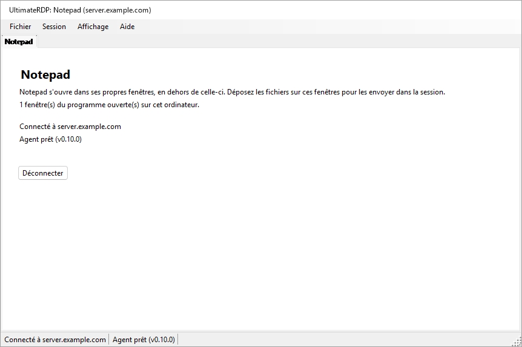

Pendant que la fenêtre principale est hors de vue, l'icône de notification d'UltimateRDP nomme les programmes et leur serveur ; son info-bulle affiche « UltimateRDP by Aprogsys » suivi des programmes.

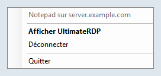

Le client lit `remoteapplicationprogram`, `remoteapplicationname`, `remoteapplicationcmdline`, `remoteapplicationexpandcmdline`, `remoteapplicationexpandworkingdir` et `remoteapplicationfile`. Un fichier qui demande RemoteApp sans programme est refusé à son ouverture.

### Sur le serveur

Une session RemoteApp n'exécute pas l'Explorateur, elle ignore donc l'entrée `Run` qu'écrit `--install-all-users` : l'agent n'y démarre pas de lui-même. L'administrateur le démarre avec une tâche planifiée à l'ouverture de session. Une session RemoteApp se termine aussi quand il n'y reste plus aucun programme de l'utilisateur, et un agent qui continuerait de fonctionner la garderait ouverte. L'agent s'en occupe donc de deux façons :

- Dans une session RemoteApp, il liste les processus de sa session toutes les 15 secondes. Dès qu'il ne reste plus que les processus que toute session RemoteApp exécute et les noms de la clé `SysProcs` du serveur, pendant deux vérifications de suite, et qu'aucun dépôt ni transfert n'est en cours, il se termine. Pendant ses 90 premières secondes, tant qu'aucun programme n'a été vu, les vérifications ne comptent pas, pour qu'un programme lent à démarrer ne le fasse pas partir. Il se termine aussi quand la session est déconnectée et qu'il ne reste aucun programme. Dans une session de bureau, il regarde une fois, au démarrage, et ne fait rien de plus.
- Son icône dans la zone de notification n'apparaît jamais dans une session RemoteApp tant que `trayIcon` vaut `auto`. Ne mettez pas `trayIcon` à `always` pour les utilisateurs RemoteApp.

L'administrateur ajoute aussi l'agent à `SysProcs`, pour que Windows lui-même ne le compte pas. UltimateRDP n'écrit jamais dans le registre et ne crée jamais de tâche : voici les commandes, pour un PowerShell élevé sur le serveur. Remplacez le chemin de l'agent par le vôtre.

1. Lisez d'abord l'état actuel, et gardez le résultat :

   ```powershell
   Get-ItemProperty 'HKLM:\SYSTEM\CurrentControlSet\Control\Terminal Server\SysProcs'
   Get-ScheduledTask -TaskPath '\UltimateRDP\' -ErrorAction SilentlyContinue
   quser
   ```

2. Ajoutez l'agent à `SysProcs`. Seul, cela ne change rien, puisque l'agent ne fonctionne pas encore dans les sessions RemoteApp. Cela s'applique aux nouvelles sessions ; ne redémarrez pas les services Bureau à distance pour cela, ce qui déconnecterait tous les utilisateurs.

   ```powershell
   New-ItemProperty -Path 'HKLM:\SYSTEM\CurrentControlSet\Control\Terminal Server\SysProcs' -Name 'UltimateRDP.Agent.exe' -PropertyType DWord -Value 0
   ```

3. Créez la tâche pour un seul compte de test :

   ```powershell
   $exe       = 'C:\Program Files\UltimateRDP\UltimateRDP.Agent.exe'
   $action    = New-ScheduledTaskAction -Execute $exe
   $trigger   = New-ScheduledTaskTrigger -AtLogOn -User '<DOMAIN\test account>'
   $principal = New-ScheduledTaskPrincipal -UserId '<DOMAIN\test account>' -LogonType Interactive -RunLevel Limited
   $settings  = New-ScheduledTaskSettingsSet -ExecutionTimeLimit ([TimeSpan]::Zero) -AllowStartIfOnBatteries -DontStopIfGoingOnBatteries -MultipleInstances Parallel -Priority 5 -Compatibility Win8
   Register-ScheduledTask -TaskPath '\UltimateRDP\' -TaskName 'Agent' -Action $action -Trigger $trigger -Principal $principal -Settings $settings -Description 'Starts the UltimateRDP agent in each user session, RemoteApp sessions included.'
   ```

   `-LogonType Interactive` exécute l'agent dans la session de l'utilisateur avec les droits de l'utilisateur, et aucun mot de passe n'est enregistré. `-RunLevel Limited` l'empêche de jamais fonctionner en mode élevé. `-ExecutionTimeLimit` à zéro supprime la limite de 72 heures d'une tâche. Dans une session de bureau, l'entrée `Run` et la tâche démarrent toutes deux l'agent ; la seconde copie voit la première et se termine immédiatement.

4. Testez avec le compte de test, comme décrit plus bas.

5. Seulement ensuite, démarrez-le pour tous les utilisateurs. Modifiez l'objet de la tâche et réécrivez-le en entier :

   ```powershell
   $users = (New-Object System.Security.Principal.SecurityIdentifier 'S-1-5-32-545').Translate([System.Security.Principal.NTAccount]).Value
   $task = Get-ScheduledTask -TaskPath '\UltimateRDP\' -TaskName 'Agent'
   $task.Triggers = @(New-ScheduledTaskTrigger -AtLogOn)
   $task.Principal = New-ScheduledTaskPrincipal -GroupId $users -RunLevel Limited
   $task | Set-ScheduledTask
   ```

   La première ligne donne le nom local du groupe Utilisateurs, qui dépend de la langue de Windows. `Set-ScheduledTask -Trigger ... -Principal ...` avec ces valeurs s'est terminé sans erreur sur un Windows Server en français et a laissé en place le déclencheur et le principal du compte de test, alors vérifiez ce que le planificateur a enregistré :

   ```powershell
   Export-ScheduledTask -TaskPath '\UltimateRDP\' -TaskName 'Agent'
   ```

   Le XML doit montrer `<GroupId>S-1-5-32-545</GroupId>` et `<LogonTrigger />` sans utilisateur. `Get-ScheduledTask` seul peut afficher des valeurs qui ne sont pas celles enregistrées.

Après une mise à jour de l'agent dans un autre dossier, faites pointer la tâche vers lui :

```powershell
Set-ScheduledTask -TaskPath '\UltimateRDP\' -TaskName 'Agent' -Action (New-ScheduledTaskAction -Execute 'C:\Program Files\UltimateRDP\<version>\UltimateRDP.Agent.exe')
```

N'utilisez jamais `Stop-ScheduledTask`, ni Fin dans le Planificateur de tâches, sur cette tâche : cela arrêterait les agents de toutes les sessions que la tâche a démarrées.

Pour tout retirer, dans cet ordre :

```powershell
Unregister-ScheduledTask -TaskPath '\UltimateRDP\' -TaskName 'Agent' -Confirm:$false
Remove-ItemProperty -Path 'HKLM:\SYSTEM\CurrentControlSet\Control\Terminal Server\SysProcs' -Name 'UltimateRDP.Agent.exe'
```

Supprimer la tâche n'arrête pas les agents déjà en cours d'exécution ; ils se terminent avec leur session, ou d'eux-mêmes dans les sessions RemoteApp. Retirez la valeur `SysProcs` en dernier, une fois qu'aucun agent ne fonctionne dans une session RemoteApp.

`UltimateRDP.Agent.exe --status`, exécuté dans une session, indique s'il s'agit d'une session RemoteApp, si la valeur `SysProcs` de l'agent existe et si la tâche `\UltimateRDP\Agent` existe. Il se contente de lire.

Constaté en production avec le client Windows (mstsc) dans une session RemoteApp : l'agent démarre, ne trouve pas de canal UltimateRDP (erreur 50, que son journal note une fois comme information : le client de la session n'est probablement pas UltimateRDP), reste inactif, et la session se termine comme d'habitude : le serveur la déconnecte 19 secondes après la fermeture de la dernière fenêtre, l'agent se termine immédiatement, et la session disparaît 8 secondes plus tard.

### Tester sur un compte

Avant que la tâche existe pour tout le monde, avec le compte de test seulement :

1. Sans aucun changement, ouvrez le programme avec le client Microsoft, fermez-le, et notez ce qui arrive à la session avec `quser` : elle devrait se terminer, ou se déconnecter, environ 20 secondes après la fermeture de la dernière fenêtre. C'est le comportement à conserver.
2. Après les étapes 2 et 3 ci-dessus, ouvrez de nouveau le programme avec le client Microsoft. L'agent doit fonctionner dans la session (`Get-CimInstance Win32_Process -Filter "Name='UltimateRDP.Agent.exe'"`, avec son `SessionId`), sans aucune icône ni fenêtre pour l'utilisateur, et son journal doit indiquer `RemoteApp session detected`. Fermez le programme : la session doit se terminer comme à l'étape 1, et le journal de l'agent doit se terminer par `the agent exits so that the session can end`, ou par la fin de la session.
3. Ouvrez le programme avec UltimateRDP et déposez un petit fichier, puis un gros, sur une fenêtre du programme.
4. Le lendemain de l'étape 5 de « Sur le serveur », comparez le nombre de sessions, et de sessions déconnectées, avec le résultat de son étape 1.

Si une session reste ouverte après la fermeture de son programme, supprimez d'abord la tâche, voir plus haut, puis signalez-le avec le journal de l'agent de cette session.

### Une connexion par serveur et par compte

Windows donne à un utilisateur une seule session par serveur. Une seconde connexion avec le même compte prend cette session à la première, qui se termine avec « déconnectée parce qu'une autre connexion a été établie vers l'ordinateur distant » ; avec la version 0.9.3, un lanceur RemoteApp cliqué une seconde fois pendant que son programme fonctionnait mettait fin aux deux connexions sans démarrer le programme. Depuis la version 0.10.0 :

- Un lancement RemoteApp vers le même serveur, le même port et la même passerelle qu'un onglet RemoteApp en cours, avec le même compte, démarre son programme sur cette connexion : immédiatement quand la session est ouverte, même s'il ne reste aucune fenêtre de programme dans ses dernières secondes ; après l'ouverture de session, et après le programme de l'onglet, pendant qu'elle se connecte encore, ouvre la session, ou attend l'avertissement de Windows ou la question sur le certificat. Un lancement sans nom d'utilisateur prend le compte de l'onglet ; deux noms d'utilisateur différents ouvrent chacun leur propre connexion.
- La fenêtre de chargement de ce lancement affiche « Démarrage de {program}... » jusqu'à ce qu'une nouvelle fenêtre de programme apparaisse, ou que le serveur signale un échec, ou quelques secondes après que le serveur a répondu sans nouvelle fenêtre (un programme peut se contenter de ramener sa fenêtre au premier plan), ou 30 secondes au plus. Elle n'a pas de bouton Annuler, qui fermerait la connexion des autres programmes.
- Si la connexion se termine avant que le programme d'un lancement se soit affiché, ce lancement ouvre sa propre connexion, sauf si vous avez fermé l'onglet.
- L'onglet et l'info-bulle de l'icône de notification nomment tous les programmes de la connexion.
- Rouvrir un bureau pendant qu'un onglet de bureau vers la même cible et avec le même compte fonctionne sélectionne cet onglet, avec un avis dans sa ligne d'état, au lieu d'une seconde connexion qui prendrait sa session.
- Quand une autre connexion prend quand même une session, par exemple depuis un autre ordinateur, l'onglet affiche « Cette session a été reprise par une autre connexion avec le même compte. », et un seul message s'affiche à la fois.

## Lanceurs

Depuis la version 0.10.0, un seul fichier .bat suffit pour donner une connexion aux personnes qui l'utilisent : `UltimateRDP.exe` prend la connexion sur sa ligne de commande, et Fichier, **Créer un lanceur (.bat)...** écrit le fichier .bat pour vous.

### Options de la ligne de commande

`UltimateRDP.exe [options] [file.rdp]`. Les options viennent dans n'importe quel ordre et sont comparées sans tenir compte de la casse. Une option qui prend une valeur prend l'argument suivant. `UltimateRDP.exe --help` (ou `/?`) affiche cette liste dans la langue du client.

| Option | Valeur | Clés .rdp qu'elle définit |
| --- | --- | --- |
| `--server` | nom d'hôte, adresse IPv4, ou adresse IPv6 avec ou sans crochets ; pas de port | `full address` |
| `--port` | de 1 à 65535, 3389 en l'absence | `server port` |
| `--user` | nom d'utilisateur | `username` |
| `--domain` | domaine | `domain` |
| `--remoteapp` | `\|\|Name` ou `Name` pour un programme publié, ou un chemin sur le serveur | `remoteapplicationmode`, `remoteapplicationprogram` |
| `--remoteapp-name` | nom affiché à l'utilisateur | `remoteapplicationname` |
| `--remoteapp-args` | arguments du programme, guillemets permis | `remoteapplicationcmdline` |
| `--gateway` | hôte d'une passerelle Bureau à distance | `gatewayhostname`, `gatewayusagemethod:i:1`, `gatewayprofileusagemethod:i:1` |
| `--multimon` | `on` ou `off` : tous les écrans en plein écran | `use multimon` |
| `--scale` | de 100 à 500, en pourcentage | `desktopscalefactor` |
| `--windows-keys` | `local`, `remote` ou `fullscreen` | `keyboardhook` 0, 1 ou 2 |
| `--clipboard` | `on` ou `off` | `redirectclipboard` |
| `--drives` | `on` (tous les lecteurs) ou `off` | `redirectdrives`, `drivestoredirect` |
| `--printers` | `on` ou `off` | `redirectprinters` |
| `--audio` | `local`, `remote` ou `off` | `audiomode` 0, 1 ou 2 |
| `--ask-credentials` | | demande le mot de passe, voir « Identifiants enregistrés et mot de passe » |
| `--trusted` | | pas d'avertissement de Windows sur l'éditeur et les ressources partagées pour ce lancement, voir plus bas |
| `--show`, `--hidden` | | la fenêtre principale, voir « Depuis un raccourci ou un fichier .bat » |
| `--help`, `/?` | | affiche cette liste et n'ouvre rien |

Les règles :

- Sans fichier .rdp, `--server` est nécessaire. Avec un fichier .rdp, les options s'ajoutent par-dessus et l'emportent sur ses clés.
- `--server` remplace l'adresse du fichier, et le port est alors `--port` ou 3389. `--port` seul garde l'hôte du fichier.
- `--remoteapp` : une valeur qui commence par `||` est un alias publié ; sinon, une valeur avec `\`, `/` ou `:` est un chemin sur le serveur, et toute autre valeur est un alias publié, écrit `||Name` pour le serveur. `--remoteapp Notepad` et `--remoteapp "||Notepad"` sont équivalents.
- Chaque valeur est vérifiée avant que quoi que ce soit s'ouvre : un nom d'hôte ou une adresse IP pour `--server` et `--gateway`, un nombre dans les bornes, 256 caractères au plus pour les noms (1024 pour un programme, 2048 pour les arguments), aucun caractère de contrôle, aucun guillemet sauf dans `--remoteapp-args`, et aucune valeur qui commence par `--` sauf les arguments. Une option erronée affiche un message qui dit laquelle et pourquoi, et rien ne se connecte.
- Il n'y a pas d'option pour un mot de passe, volontairement : une ligne de commande peut être lue par d'autres programmes de l'ordinateur, et elle reste dans le fichier .bat, dans les raccourcis et dans les journaux. Windows utilise l'identifiant enregistré pour le serveur (voir « Identifiants enregistrés et mot de passe »), ou demande le mot de passe. `--password` est refusé avec un message qui le dit.
- Un second démarrage transmet ses options à l'UltimateRDP déjà en cours d'exécution, comme il le fait avec un fichier.
- `--trusted` : avant une connexion RemoteApp, Windows affiche un avertissement sur l'éditeur de la connexion et les ressources qu'elle partage, avec un bouton Se connecter, pour un fichier .rdp qui n'est pas signé. `--trusted` le désactive pour ce lancement (les propriétés du contrôle `ShowRedirectionWarningDialog` et `RedirectionWarningType`). Un fichier .bat ou un raccourci est du code que l'utilisateur a choisi d'exécuter, donc l'option ne donne à son auteur rien que le fichier .bat ne donnait déjà ; un fichier .rdp est une donnée qui peut arriver par courriel, donc aucune clé d'un fichier .rdp ne désactive l'avertissement, et un lancement sans `--trusted` garde l'avertissement de Windows comme avant. La question sur le certificat du serveur est une autre boîte de dialogue et s'affiche toujours quand Windows la pose. Le journal du client indique, pour chaque connexion, si l'avertissement est laissé à Windows ou désactivé, et pourquoi.
- Une session ouverte avec des options ne va pas dans Fichier, Fichiers récents, puisque les options y seraient perdues ; Fichier, Rouvrir dans un nouvel onglet l'ouvre de nouveau avec les mêmes options.
- Le plein écran au démarrage et une taille de bureau fixe ne sont pas proposés : le client démarre chaque session dans sa fenêtre et dimensionne le bureau à la fenêtre, quoi que dise le fichier (`screen mode id`, `desktopwidth`, `desktopheight`).

Le client construit en mémoire le texte d'un fichier .rdp à partir des options, après le texte du fichier quand il y en a un, et le lit avec le même analyseur que n'importe quel fichier : une connexion depuis la ligne de commande et une connexion depuis un fichier passent par le même code. Rien n'est écrit sur le disque.

Exemples :

```bat
@echo off
start "" "%LOCALAPPDATA%\UltimateRDP\client-0.10.0\UltimateRDP.exe" --server "server.example.com" --user "jdoe"
```

```bat
@echo off
start "" "%LOCALAPPDATA%\UltimateRDP\client-0.10.0\UltimateRDP.exe" --server "server.example.com" --remoteapp "||Notepad" --remoteapp-name "Notepad" --ask-credentials
```

### Le générateur de lanceurs

Fichier, **Créer un lanceur (.bat)...** ouvre une boîte de dialogue remplie à partir de l'onglet actif, s'il y en a un. La première vue contient le nom du lanceur, le serveur, le port (3389), l'utilisateur, ce qu'il ouvre (le bureau à distance ou un programme RemoteApp) et le programme. **Options avancées** affiche le nom et les arguments du programme, le domaine, la passerelle, la fenêtre principale, « Toujours demander le mot de passe », « Ne pas afficher l'avertissement de Windows (serveur de confiance) » (désactivé par défaut, il ajoute `--trusted`), les choix d'affichage et de redirection du tableau ci-dessus (« Par défaut » laisse le choix au client et au fichier .rdp), l'endroit où le lanceur trouve UltimateRDP.exe, et ce qu'il faut écrire :

- UltimateRDP.exe : ce programme (le chemin de l'UltimateRDP.exe en cours d'exécution, le choix par défaut), à côté du lanceur (`%~dp0UltimateRDP.exe`), ou un chemin que vous tapez, où les variables comme `%LOCALAPPDATA%` ou `%ProgramFiles%` restent telles quelles et prennent leur valeur sur l'ordinateur qui exécute le lanceur.
- Un seul fichier .bat qui porte toutes les options (le choix par défaut), ou un fichier .bat et un fichier .rdp à côté, nommé d'après le fichier .bat ; le fichier .bat ouvre alors `%~dp0<name>.rdp`. Le fichier .rdp est écrit en UTF-16, comme les écrit le client Microsoft.

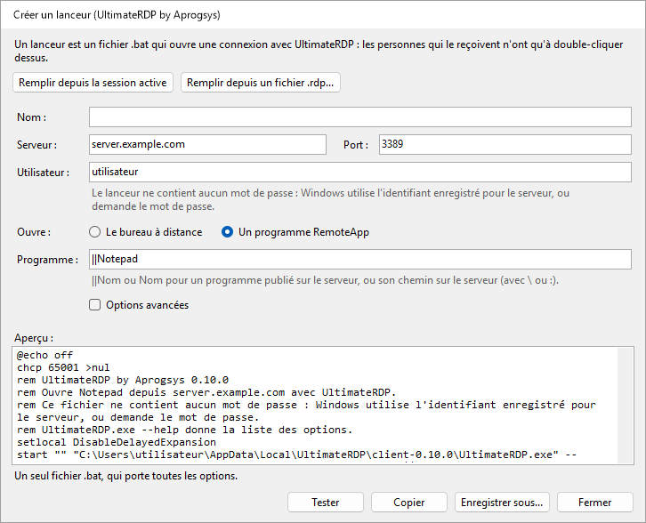

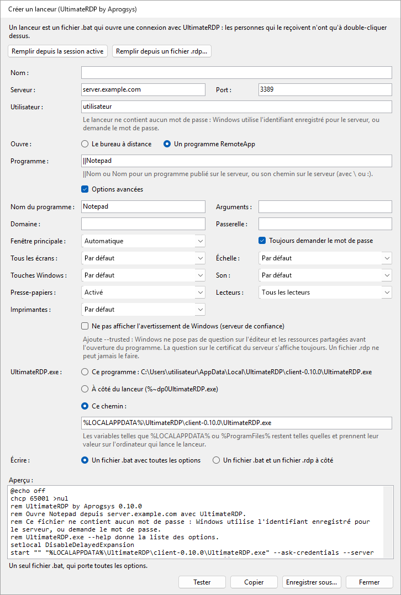

La boîte de dialogue affiche le texte du fichier .bat au fil de la saisie, ou le champ erroné. **Remplir depuis la session active** et **Remplir depuis un fichier .rdp...** remplissent les champs à partir des paramètres de l'onglet actif ou d'un fichier. **Enregistrer sous...** écrit le fichier, **Copier** place son texte dans le presse-papiers, et **Tester** démarre cet UltimateRDP avec les options du lanceur, ce qui ouvre la connexion dans le client en cours d'exécution. Le lanceur ne contient aucun mot de passe, et la boîte de dialogue n'a aucun champ pour en saisir un.

Le fichier .bat commence par `@echo off`, `chcp 65001 >nul` quand un caractère du fichier est hors ASCII, un commentaire qui commence par « UltimateRDP by Aprogsys » et sa version et qui dit, dans la langue du client, ce qu'il ouvre et qu'il ne contient aucun mot de passe, `setlocal DisableDelayedExpansion`, et `start "" "<UltimateRDP.exe>" <options>`. Il est écrit en UTF-8 sans marque d'ordre des octets, avec des fins de ligne CRLF. Chaque valeur est mise entre guillemets pour que cmd.exe la transmette à UltimateRDP exactement telle qu'elle a été tapée et ne puisse rien exécuter d'autre : voir « Notes de sécurité ».

## Fonctionnement

Le client héberge le contrôle ActiveX Bureau à distance de Microsoft et s'enregistre comme cible de dépôt sur ses fenêtres. L'agent fonctionne dans votre session et écoute sur un canal virtuel statique nommé `ULTRDP`. Pour les petits fichiers, le client envoie les chemins locaux et la position du curseur, et la session lit les fichiers sur les lecteurs redirigés. Les gros fichiers sont envoyés par le canal, comme décrit après les étapes ci-dessous.

1. Quand le glisser passe pour la première fois sur la session, le client convertit la position du curseur en coordonnées du bureau distant et envoie `dragEnter` avec les chemins.
2. L'agent ouvre une fenêtre relais invisible sur tout l'écran distant. Il déplace le curseur distant au point voulu et simule un appui sur le bouton gauche dans cette fenêtre. L'appui démarre un vrai glisser OLE dans la session, avec les fichiers sous forme de chemins `\\tsclient\<drive>\...`, ou sous forme de copies préalables.
3. L'agent répond `dragAck`. Sans cette réponse dans la seconde, le client arrête le glisser.
4. Pendant que vous vous déplacez, le client envoie `dragMove`. L'agent déplace le curseur distant, si bien que l'application située dessous voit le glisser et affiche son retour visuel.
5. Quand vous relâchez le bouton, le client envoie `drop`. L'agent déplace le curseur au point final et y relâche le bouton simulé. Si vous quittez plutôt la session, le client envoie `dragLeave` et l'agent annule le glisser.
6. L'agent renvoie `dropResult` avec l'effet : `copy` ou `link` quand la cible a accepté, ou `none` quand rien sous le curseur n'a accepté les fichiers. Avec `none`, le dépôt est ignoré. Le client affiche le résultat dans la barre d'état.

Le glisser ne propose que la copie et le lien, jamais le déplacement. Les touches de modification sont notées dans les journaux mais pas injectées.

Dans une session RemoteApp, les fenêtres du serveur sont des fenêtres du client, et tout ce que l'agent affiche apparaîtrait aussi sur votre bureau, y compris sa fenêtre relais. Le client n'envoie donc rien pendant que vous vous déplacez : au dépôt, il envoie `dragEnter` puis `drop` au même point, et garde le dépôt ouvert de votre côté jusqu'à ce que l'agent ait répondu. L'agent rejoue le glisser à cet endroit précis, avec une fenêtre relais de 32 pixels sur 32 sous le point au lieu d'une fenêtre sur tout l'écran.

Pour les gros fichiers, le `dragEnter` porte la taille de chaque élément, et l'agent répond `dragAck` avec `transfer: true` quand ils doivent passer par le canal. À l'étape 5, le client envoie alors `drop` avec `deferred: true` : l'agent annule le glisser dans la session et garde le point. Le client envoie les fichiers par fragments de 32 Kio par défaut, en base64, ou sous la forme plus dense `u15` quand l'agent indique que les données du client lui parviennent en UTF-16, avec au plus 4 Mio pas encore acquittés ; l'agent les écrit dans son dossier de copies préalables et vérifie la taille et le SHA-256 de chacun, répond `transferResult`, puis dépose les copies au point gardé par un court glisser, et renvoie `dropResult` comme à l'étape 6.

Pour fermer la session, le client envoie `logoff`. L'agent répond `logoffResult`, attend une demi-seconde pour que la réponse parvienne au client, puis demande à Windows de fermer la session. Il ne force jamais les applications qui ont un travail non enregistré.

Les messages sont des objets JSON envoyés sous forme de lignes ASCII, sauf les fragments `u15`, et chaque côté détecte à l'exécution comment le contrôle fait correspondre les octets du canal aux caractères. Voir [docs/design.md](docs/design.md) pour les détails.

## Dépannage

- **Le premier démarrage d'une nouvelle version prend plusieurs secondes avant que quoi que ce soit s'affiche.** Ce temps passe avant que le processus existe : un antivirus analyse un nouvel exécutable d'environ 120 Mo à son premier démarrage. Les démarrages suivants affichent la fenêtre de chargement en 0,1 s environ.
- **Un lanceur cliqué deux fois.** Depuis la version 0.10.0, le second clic démarre le programme sur la connexion en cours ; voir « Une connexion par serveur et par compte ».
- **L'agent n'est jamais prêt.** Exécutez `UltimateRDP.Agent.exe --status` dans la session : il indique si l'agent y fonctionne et d'où il est configuré pour démarrer. L'icône dans la zone de notification n'apparaît qu'une fois le client connecté, son absence avant cela est donc normale. Une stratégie du serveur peut aussi bloquer les canaux virtuels : le journal de l'agent contient alors un avertissement indiquant qu'il ne peut pas ouvrir le canal.
- **« L'agent n'a pas confirmé le glisser ».** L'agent n'a pas répondu au début du glisser dans la seconde. Une connexion lente ou un agent occupé peut en être la cause, tout comme un agent qui s'est terminé ou a redémarré dans la session, ce que le client ne peut pas voir autrement. Le client recherche alors de nouveau l'agent : l'indication de l'agent passe à « Agent : en attente », puis revient à « Agent prêt » quand l'agent répond. Quand la barre d'état affiche « La session n'accepte pas les entrées simulées », la session est peut-être verrouillée, ou une stratégie bloque peut-être les entrées simulées. Merci de le signaler avec les deux journaux.
- **La cible n'affiche aucun retour visuel de dépôt, ou la barre d'état affiche « Rien sous le curseur n'a accepté les fichiers. »** L'application sous le curseur n'accepte peut-être pas de fichiers à cet endroit. Certaines applications refusent aussi les chemins réseau comme `\\tsclient\C\...`. Pour celles-ci, activez « Copier les fichiers dans la session avant le dépôt » dans le menu de l'agent dans la zone de notification.
- **Le premier dépôt sur l'Explorateur prend plusieurs secondes.** L'Explorateur lit le lecteur redirigé pour la première fois, ce qui peut être lent. Les dépôts suivants sont généralement plus rapides.
- **Ctrl+W ou Ctrl+O ne fait rien.** Quand la session a le clavier, ces touches vont à l'ordinateur distant, comme toutes les autres touches. Utilisez plutôt le menu Fichier.
- **Mes applications sont toujours ouvertes sur le serveur après Quitter.** C'est normal : Quitter et Fermer l'onglet déconnectent sans mettre fin à la session. Utilisez Fichier, Fermer la session distante.
- **Les textes sont dans la mauvaise langue.** Choisissez la langue dans Affichage, Langue. Un message de l'agent suit la langue que le client a annoncée au moment de la connexion ; après un changement de langue, le message suivant utilise la nouvelle.
- **Les dépôts sont refusés à cause des lecteurs.** Activez la redirection des lecteurs dans le fichier .rdp, sous Ressources locales, Plus, Lecteurs. Sur le serveur, vérifiez la stratégie « Ne pas autoriser la redirection de lecteur ».
- **Un programme RemoteApp s'ouvre, mais les dépôts sur ses fenêtres sont refusés ou ne font rien.** Le journal du client a une ligne par fenêtre du programme qui commence par `RemoteApp window`, avec le résultat de l'enregistrement de la cible de dépôt, et un avertissement en cas d'échec. Les lignes `RemoteApp monitors` et `the target is at` indiquent si les fenêtres sur le serveur sont là où elles sont sur votre écran ; un avertissement à cet endroit signifie que les écrans ont changé depuis la connexion, et une nouvelle connexion corrige cela.
- **Une session RemoteApp reste ouverte après la fermeture de son programme.** Vérifiez que le journal de l'agent de la session indique `RemoteApp session detected`, et ce que disent les lignes `RemoteApp session:` : un programme qui y figure encore garde la session ouverte, avec ou sans l'agent. Voir « Programmes RemoteApp ».
- **Le dépôt arrive sur la mauvaise fenêtre.** La mise à l'échelle des coordonnées après un redimensionnement de la fenêtre, ou le plein écran sur plusieurs écrans, peut en être la cause. Merci de le signaler avec les deux journaux.
- **Un transfert de gros fichiers échoue, ou est lent.** La barre d'état donne la raison. Les deux journaux terminent chaque transfert par une ligne de bilan : fichiers, octets, secondes et Mo/s, puis par les lignes décrites sous « Mesurer un transfert lent ». Le journal du client donne aussi la longueur de la première ligne de fragment qu'il a envoyée, et le journal de l'agent a une ligne pour le premier fragment de chaque fichier reçu. Quand la barre d'état affiche « L'agent n'a pas accusé réception des premières données du transfert. », les données ne sont pas passées : le journal du client donne alors le modèle d'octets, la taille des fragments, la longueur des lignes et le nombre de lignes envoyées. Un `transferChunkBytes` plus petit peut aider, voir « Gros fichiers ». Pour revenir à la redirection des lecteurs, choisissez Jamais dans le menu de l'agent dans la zone de notification, Transfert rapide des gros fichiers.
- **Un transfert échoue avec « Un message du transfert s'est perdu en chemin ».** Le contrôle Bureau à distance perd parfois un message court envoyé juste avant un long. Depuis la 0.5.1 des deux côtés, cela ne devrait plus apparaître : l'agent demande au client de renvoyer les lignes manquantes, et le bilan du transfert dans les deux journaux compte les lignes renvoyées. Si cela apparaît encore, un côté est dans une version plus ancienne ; si un transfert échoue avec « Des lignes du transfert se sont perdues en chemin et n'ont pas pu être récupérées », signalez-le avec les deux journaux pris avec `logLevel` à `debug`.
- **Un transfert échoue immédiatement avec « Des données ont été perdues ou endommagées en chemin ».** Le canal endommage parfois les données d'une ligne en chemin. Depuis la 0.5.2 des deux côtés, l'agent redemande cette ligne, comme pour une ligne perdue, et son journal décrit l'aspect du dommage dans une ligne qui contient « arrived damaged » ; un agent 0.5.1 fait encore échouer le transfert.
- **Les gros fichiers n'utilisent jamais la connexion directe, ou les fichiers de la session ne peuvent pas être envoyés.** Vérifiez d'abord que l'adresse publique de votre ordinateur figure dans la règle de pare-feu de la connexion directe, sur le serveur et chez l'hébergeur, comme elle figure dans la règle qui autorise RDP ; un nouveau réseau donne une nouvelle adresse. Le journal du client dit pourquoi au début de chaque transfert : « the direct connection cannot be used » avec la raison, comme un port qui n'a pas répondu dans les 3 secondes. Vérifiez les règles de pare-feu de « Connexion directe pour les gros fichiers », sur le serveur et chez l'hébergeur, et que les deux côtés sont en 0.7.0. Le journal de l'agent indique sur quel port il a écouté, et avertit quand aucun port de la plage n'était libre.
- **Un transfert direct est plus lent que la liaison.** Lisez les lignes `direct connection statistics` des deux journaux, voir « Lire les lignes de bilan ».
- **Les fichiers envoyés depuis la session n'arrivent pas.** Le journal du client a une ligne `Send offer` pour chaque offre, puis des lignes `Receive <id>:` qui indiquent si la connexion directe a pu être établie, et sinon pourquoi. Le journal de l'agent a les mêmes lignes `Send <id>:`. Quand le journal du client n'a aucune ligne `Send offer`, vérifiez que les deux côtés sont en 0.9.0 et que `receiveFiles` et `directTransfer` ne valent pas `never` dans client.json ; la ligne `Hello from client` du journal de l'agent indique `receives files of the session: True` quand ils ne valent pas `never`.
- **Où sont les journaux.** Le client écrit `%LOCALAPPDATA%\UltimateRDP\logs\client-yyyyMMdd.log` sur votre ordinateur. L'agent écrit `agent-yyyyMMdd.log` dans le même dossier sur le serveur ; depuis la version 0.9.0, chacune de ses lignes donne la session et le thread, comme `[S3 12]`, puisque les agents d'un même utilisateur dans plusieurs sessions écrivent dans le même fichier. Les deux gardent quatorze jours de journaux. Le client ouvre son dossier depuis Aide, Ouvrir le dossier des journaux, et l'agent depuis son menu dans la zone de notification, Ouvrir le dossier des journaux.

## Compiler depuis les sources

Il vous faut le SDK .NET 10 sous Windows.

```
dotnet build UltimateRDP.sln -c Release
dotnet test UltimateRDP.sln
```

Pour publier un exécutable autonome en un seul fichier, sans symboles :

```
dotnet publish src/UltimateRDP.Client -c Release -r win-x64 --self-contained true -p:PublishSingleFile=true -p:IncludeNativeLibrariesForSelfExtract=true -p:DebugType=none -p:DebugSymbols=false
dotnet publish src/UltimateRDP.Agent -c Release -r win-x64 --self-contained true -p:PublishSingleFile=true -p:IncludeNativeLibrariesForSelfExtract=true -p:DebugType=none -p:DebugSymbols=false
```

Les versions publiées sont compilées par GitHub Actions quand une étiquette `v*` est poussée. Le workflow compile, teste, publie les deux applications et joint les deux archives zip à la version publiée.

Les exécutables d'une version publiée sont signés par APROGSYS, et Windows affiche cet éditeur dans ses demandes de confirmation. Un exécutable que vous compilez vous-même n'est pas signé.

## Notes de sécurité

- L'agent ne lit que depuis `\\tsclient\`, c'est-à-dire depuis les lecteurs que vous avez choisi de partager. L'agent lui-même n'écrit que dans son dossier de copies préalables dans votre session, quand la copie préalable est activée ou quand des fichiers arrivent par le canal. Il refuse tout nom de fichier qui sortirait de ce dossier. L'application sur laquelle vous déposez décide où vont les fichiers. L'agent ne fonctionne pas comme un service et n'a aucun privilège au-delà des vôtres.
- L'agent ne simule des entrées que dans votre propre session, et seulement entre le début et la fin d'un glisser. Il n'utilise que le bouton gauche de la souris. Il n'injecte l'appui qu'une fois sa propre fenêtre relais sous le curseur, si bien que l'appui n'atteint jamais une autre application. Pour annuler, il envoie Échap à sa fenêtre relais au lieu de simuler une touche.
- L'agent ne propose jamais de déplacement. Un déplacement accepté dans la session pourrait supprimer le fichier sur votre disque local à travers le lecteur redirigé.
- Les messages transportent des chemins de fichiers, des coordonnées, des indicateurs de touches de modification et des noms de fenêtres. Le contenu des fichiers ne passe par le canal que pour un transfert de gros fichiers, à l'intérieur de la connexion Bureau à distance chiffrée.
- Depuis la version 0.6.0, les fichiers d'un transfert de gros fichiers peuvent passer à la place par une connexion TLS directe. L'agent n'écoute que pendant qu'un transfert est proposé, et n'accepte une connexion qu'avec une preuve du jeton à usage unique qu'il a donné par la connexion Bureau à distance chiffrée, chaque connexion de l'offre une seule fois, 16 au plus. Le client n'accepte que le certificat dont l'agent y a donné le SHA-256. Les fichiers vont dans le même dossier de copies préalables, avec les mêmes vérifications. N'ouvrez les ports qu'aux adresses des clients autorisés pour RDP.
- Depuis la version 0.9.0, la session peut envoyer des fichiers à votre ordinateur. Seul l'utilisateur de la session peut lancer cet envoi, par l'agent de cette session : `--send` atteint cet agent par un canal nommé qui n'accepte que les processus du même utilisateur dans la même session. Le client ne prend des fichiers qu'après avoir répondu à une offre venue par la connexion Bureau à distance chiffrée de sa propre session, seulement par la connexion directe dont cette offre a donné le certificat et le jeton, et seulement dans son dossier des fichiers reçus. Il ne remplace jamais un fichier, n'en exécute jamais aucun, et marque chacun comme un téléchargement.
- Depuis la version 0.10.0, la ligne de commande peut donner une connexion, et le client peut écrire des lanceurs. Aucune option n'accepte de mot de passe. Chaque valeur de la ligne de commande est vérifiée avant que quoi que ce soit s'ouvre, et ne peut pas ajouter de clé aux paramètres .rdp qu'elle devient. Dans un lanceur, chaque valeur est entre guillemets doubles avec les règles de citation de la ligne de commande Windows, chaque `%` est doublé, un `^` précède `& | < > ^ ( )` partout où cmd.exe lit hors des guillemets, et l'expansion retardée est désactivée, si bien qu'aucune valeur ne peut ajouter de commande ni développer de variable. Les tests le vérifient avec un modèle de cmd.exe et avec cmd.exe lui-même.
- Le client n'écrit jamais d'identifiants et ne les journalise jamais. Il lit l'identifiant générique `TERMSRV/<host>` quand il en existe un, et le transmet au contrôle Microsoft. Les autres demandes d'identifiants viennent du contrôle Microsoft.

## État du projet

La version 0.10.0 ajoute les options d'une connexion sur la ligne de commande, le générateur de lanceurs, une connexion par serveur et par compte pour les programmes RemoteApp, et `--trusted`. Ses lanceurs ont été vérifiés avec cmd.exe sur l'ordinateur des tests ; la connexion RemoteApp partagée et `--trusted` n'avaient pas été testés contre un vrai serveur au moment de la publication. La version 0.9.0 est une version de test. Les fichiers envoyés de la session vers votre ordinateur, le lancement d'un programme RemoteApp depuis un raccourci, les corrections de ses fenêtres et l'option du mot de passe n'avaient pas été testés contre un vrai serveur au moment de la publication ; les lettres de lecteur de la 0.8.0 non plus.

Vérifié dans une vraie session Bureau à distance, avec la version 0.2.1 :

- Le canal virtuel entre le client et l'agent, avec un octet par caractère dans les deux sens.
- Le transfert par la redirection des lecteurs vers le bureau distant.
- Le glisser en direct dans une application distante.

La commande de fermeture de session et les traductions sont nouvelles dans la 0.3.0. Le transfert rapide des gros fichiers est nouveau dans la 0.4.0. Son premier test contre un vrai serveur a échoué. La version 0.4.1 corrige les deux défauts trouvés à cette occasion ; avec elle, un fichier de 496 Mo a atteint une vraie session en 193 secondes. La version 0.4.2 ajoute une fenêtre de progression à chaque dépôt et ne change que le client. La version 0.4.3 corrige les messages courts que le contrôle Bureau à distance perdait parfois juste avant un long, ce qui faisait échouer certains transferts dès leur début. La version 0.4.4 mesure où passe le temps d'un transfert, des deux côtés, et ajoute les paramètres `transferWindowBytes` et `channelRead` pour tester ce qui le limite.

Ses mesures ont montré qu'aucun des deux côtés ne limite le transfert : le canal est plein, et l'encodage des données en occupait la plus grande partie. La version 0.5.0 envoie les fichiers sous une forme plus dense quand les données du client parviennent à l'agent en UTF-16, ce qui devrait multiplier le débit par environ 2,5, de 2,1 Mo/s à environ 5,4 Mo/s sur un canal de 5,8 Mo/s. Elle garde aussi le transfert rapide quand vous relâchez le bouton vite, avant que l'agent ait répondu au début du glisser, y compris quand cette réponse arrive en deux temps. La version 0.5.1 numérote les messages d'un transfert, pour que l'agent redemande ceux que le contrôle Bureau à distance a perdus et que le transfert continue. La version 0.5.2 fait de même pour un message qui arrive endommagé. La version 0.6.0 envoie les gros fichiers par une connexion TLS directe quand le serveur ouvre ses ports pour cela, puisque le canal restait entre 2 et 4 Mo/s. Son premier test en production a atteint de 135 à 180 Mo/s pendant quelques secondes, puis environ 20 Mo/s, la limite d'une seule connexion TCP sur ce chemin ; la version 0.7.0 utilise donc plusieurs connexions à la fois, et journalise où passe le temps d'un transfert. La version 0.8.0 ouvre les programmes RemoteApp et accepte les dépôts sur leurs fenêtres, empêche l'agent de garder une session RemoteApp ouverte, peut donner aux lecteurs du client des lettres de la session, et lit des paramètres définis pour tout l'ordinateur. Son premier test réel avec Notepad a fonctionné et a montré une fenêtre vide du contrôle par-dessus un écran, une fenêtre principale toujours affichée, dix secondes perdues avant le démarrage du programme, et une fin normale affichée comme une erreur. La version 0.9.0 corrige ces points, ouvre les programmes RemoteApp depuis un raccourci avec seulement leurs propres fenêtres à l'écran, envoie des fichiers de la session vers votre ordinateur, et peut demander le mot de passe à chaque fois.

Retours utiles :

- Si le glisser en direct fonctionne dans votre session, et avec quelles applications.
- Si la fermeture de session fonctionne chez vous, et la formulation dans votre langue.
- Le débit d'un transfert de gros fichiers sur votre connexion, d'après la ligne de bilan des deux journaux.

- Le temps que prend le premier dépôt sur l'Explorateur.
- Si les dépôts arrivent au bon endroit en plein écran, avec un écran ou tous les écrans.
- Si les identifiants enregistrés fonctionnent, et quel type vous avez dans le Gestionnaire d'identification.
- Avec RemoteApp : si le programme s'ouvre, si un dépôt sur ses fenêtres arrive là où vous avez relâché le bouton, et si la session se termine comme avant quand le programme se ferme, avec les deux journaux.

Merci de les envoyer par les [issues GitHub](https://github.com/freeKC/ultimaterdp/issues), avec les deux journaux.

## Crédits

UltimateRDP by Aprogsys est développé et publié par [APROGSYS](https://www.aprogsys.com/). Le code source est sur [GitHub](https://github.com/freeKC/ultimaterdp), sous licence MIT.

## Licence

MIT. Voir [LICENSE](LICENSE).
