# UltimateRDP

[](https://github.com/freeKC/ultimaterdp/actions/workflows/ci.yml)

[English](README.md) | [Français](README.fr.md) | [Deutsch](README.de.md) | [Español](README.es.md) | **Italiano** | [Nederlands](README.nl.md) | [Português](README.pt.md)

Il README in inglese è il testo di riferimento; questa traduzione lo segue.

UltimateRDP by Aprogsys sposta file di grandi dimensioni tra il tuo computer e una sessione Desktop remoto attraverso più connessioni TLS in parallelo, al di fuori del flusso RDP. In un'installazione di produzione ha trasportato da 255 a 296 MB/s dal PC al server e da 115 a 134 MB/s dal server al PC, mentre il canale virtuale RDP trasporta circa 2 MB/s e una sola connessione TCP si è stabilizzata tra 20 e 22 MB/s: vedi "Trasferimenti rapidi tramite connessioni parallele".

UltimateRDP ti permette di trascinare file o cartelle dal tuo desktop e di rilasciarli in una sessione Desktop remoto, sull'applicazione sotto il cursore. Explorer, un client di posta, un browser o un'applicazione gestionale li ricevono come se li avessi rilasciati all'interno della sessione. Se nulla sotto il cursore li accetta, il rilascio viene ignorato. I file viaggiano anche nell'altra direzione, dalla sessione al tuo computer. UltimateRDP apre desktop e programmi RemoteApp, da un file .rdp o da un file di avvio .bat che scrive per te. È composto da un client che ospita il controllo Desktop remoto di Microsoft, da un piccolo agente nella sessione, da un canale virtuale tra i due, dal reindirizzamento standard delle unità e dalle connessioni dirette per i file di grandi dimensioni.

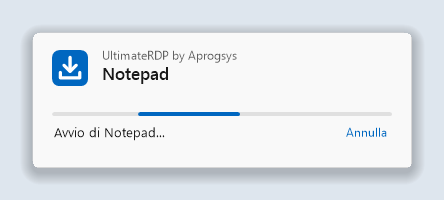

## Indice

<!-- toc -->
- [Trasferimenti rapidi tramite connessioni parallele](#trasferimenti-rapidi-tramite-connessioni-parallele)
- [Perché](#perché)
- [Requisiti](#requisiti)
- [Installazione](#installazione)
  - [Sul server](#sul-server)
  - [Sessioni aperte con il client Microsoft](#sessioni-aperte-con-il-client-microsoft)
  - [Sul tuo computer](#sul-tuo-computer)
- [Utilizzo](#utilizzo)
  - [Sessioni e schede](#sessioni-e-schede)
  - [La finestra di caricamento](#la-finestra-di-caricamento)
  - [Chiudere la sessione](#chiudere-la-sessione)
  - [Trascinare nella sessione](#trascinare-nella-sessione)
  - [File di grandi dimensioni](#file-di-grandi-dimensioni)
  - [Inviare file dalla sessione al tuo computer](#inviare-file-dalla-sessione-al-tuo-computer)
  - [Messaggi della barra di stato](#messaggi-della-barra-di-stato)
  - [Menu Visualizza](#menu-visualizza)
  - [Lingua](#lingua)
  - [Credenziali salvate e password](#credenziali-salvate-e-password)
- [Impostazioni del client](#impostazioni-del-client)
- [Menu dell'agente nell'area di notifica e impostazioni](#menu-dellagente-nellarea-di-notifica-e-impostazioni)
  - [Impostazioni per l'intero computer](#impostazioni-per-lintero-computer)
  - [Unità del client su lettere di unità](#unità-del-client-su-lettere-di-unità)
- [Connessione diretta per i file di grandi dimensioni](#connessione-diretta-per-i-file-di-grandi-dimensioni)
  - [Regole del firewall](#regole-del-firewall)
  - [Ripiego](#ripiego)
  - [Impostazioni](#impostazioni)
  - [Leggere le righe di riepilogo](#leggere-le-righe-di-riepilogo)
- [Programmi RemoteApp](#programmi-remoteapp)
  - [Da un collegamento o da un file .bat](#da-un-collegamento-o-da-un-file-bat)
  - [Sul tuo computer](#sul-tuo-computer-1)
  - [Sul server](#sul-server-1)
  - [Prova con un solo account](#prova-con-un-solo-account)
  - [Una connessione per server e account](#una-connessione-per-server-e-account)
- [File di avvio](#file-di-avvio)
  - [Opzioni della riga di comando](#opzioni-della-riga-di-comando)
  - [Il generatore di file di avvio](#il-generatore-di-file-di-avvio)
- [Come funziona](#come-funziona)
- [Risoluzione dei problemi](#risoluzione-dei-problemi)
- [Compilare dai sorgenti](#compilare-dai-sorgenti)
- [Note sulla sicurezza](#note-sulla-sicurezza)
- [Stato](#stato)
- [Riconoscimenti](#riconoscimenti)
- [Licenza](#licenza)
<!-- /toc -->

## Trasferimenti rapidi tramite connessioni parallele

Che cos'è:

- Dalla versione 0.6.0 i file di grandi dimensioni passano per una connessione TLS diretta tra il client e l'agente, al di fuori della connessione Desktop remoto, e dalla versione 0.7.0 per più connessioni in parallelo, otto per impostazione predefinita, sedici al massimo. Le connessioni usano TLS 1.3 quando entrambe le versioni di Windows lo offrono, come fanno Windows 11 e Windows Server 2022, e TLS 1.2 negli altri casi.
- L'agente crea il suo certificato in memoria e ne comunica lo SHA-256 e un token monouso attraverso il canale virtuale RDP, che è già autenticato e cifrato. Il client accetta solo quel certificato, e l'agente accetta solo le connessioni che dimostrano di conoscere il token.
- Ogni file viene verificato alla fine con il suo SHA-256. Un file che non corrisponde non viene conservato.
- Quando la connessione diretta non può essere usata, per esempio attraverso un Remote Desktop Gateway o con le porte chiuse, i file passano per il canale virtuale RDP senza che l'utente debba fare nulla, e il log del client ne indica il motivo.

Perché è importante:

- In produzione il canale virtuale RDP ha trasportato circa 2 MB/s, qualunque fosse il collegamento.
- Il reindirizzamento delle unità legge un file a piccoli blocchi, con un viaggio di andata e ritorno per blocco: 3,6 MB/s in una misurazione su un collegamento che trasportava 9,7 MB/s.
- Una sola connessione TCP sul percorso di produzione è partita da 90 a 180 MB/s e si è stabilizzata tra 20 e 22 MB/s dopo i primi secondi. Il limite vale per connessione, in qualche punto del percorso, e più connessioni si sommano.

Misurato su un'installazione di produzione, un server presso un provider di hosting e un PC su una linea da 2,3 Gbit/s:

| Percorso | Velocità |
| --- | --- |
| Dal PC al server, 8 connessioni dirette | da 255 a 296 MB/s |
| Dal server al PC, 8 connessioni dirette | da 115 a 134 MB/s, il limite del collegamento in uscita di quel server |
| Una sola connessione diretta, dopo i primi secondi | da 20 a 22 MB/s |
| Gli stessi file attraverso il canale virtuale RDP | circa 2 MB/s |

Si tratta di misurazioni su un'unica installazione; le velocità dipendono dal collegamento, dal server e dai dischi. Il server ha bisogno di una regola del firewall per un intervallo di porte: vedi "Connessione diretta per i file di grandi dimensioni".

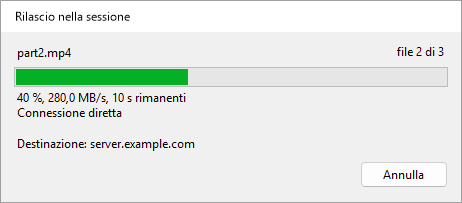

## Perché

Il client Desktop remoto di Microsoft rifiuta i rilasci sulla sua finestra, perché RDP non ha un canale per il trascinamento della selezione. Copia e incolla funziona, e così il reindirizzamento delle unità, ma nessuno dei due è un rilascio. UltimateRDP aggiunge questo gesto a ciò che RDP offre già.

Mentre trascini sulla finestra del client, l'agente riproduce lo stesso trascinamento all'interno della sessione come un vero trascinamento OLE. Qualsiasi applicazione remota che accetta file rilasciati li accetta quindi da UltimateRDP, e mostra il proprio riscontro visivo di rilascio mentre ti muovi. Se nulla sotto il cursore accetta il rilascio, il rilascio viene ignorato: nulla viene copiato da nessuna parte.

I file piccoli viaggiano tramite il reindirizzamento delle unità. I file di grandi dimensioni viaggiano attraverso il canale UltimateRDP prima del rilascio: vedi "File di grandi dimensioni" più avanti.

## Requisiti

- Un computer client con Windows 10 o 11 a 64 bit.
- Un server con Windows Server 2016 o successivo, oppure un computer Windows 10 o 11 che funge da host Desktop remoto.
- Un file .rdp che reindirizza le unità. Nelle impostazioni di Connessione Desktop remoto si trova in Risorse locali, poi Altro, poi Unità.
- La possibilità di eseguire l'agente nella tua sessione utente sul server.

Il client è un unico eseguibile portabile. Funziona senza diritti di amministratore. Anche l'archivio dell'agente contiene un solo eseguibile.

UltimateRDP funziona attraverso un Remote Desktop Gateway. La connessione diretta per i file di grandi dimensioni no, e in quel caso i file passano per il canale: vedi "Connessione diretta per i file di grandi dimensioni".

UltimateRDP ha un ambito volutamente ristretto:

- I rilasci vanno in una sola direzione, dal computer locale alla sessione. Dalla versione 0.9.0 la sessione invia file al tuo computer con il suo menu Invia a invece che con un rilascio, solo attraverso la connessione diretta: vedi "Inviare file dalla sessione al tuo computer".
- Sessioni con desktop completo e, dalla versione 0.8.0, programmi RemoteApp: vedi "Programmi RemoteApp".
- La sessione si avvia sempre in una finestra, anche se il file .rdp chiede lo schermo intero. Puoi passare allo schermo intero in seguito. A schermo intero puoi rilasciare solo da un monitor che la sessione non copre.

## Installazione

Ogni zip contiene un solo file `.exe`.

### Sul server

1. Scarica lo zip `UltimateRDP.Agent` dalla [pagina Releases](https://github.com/freeKC/ultimaterdp/releases).
2. Decomprimilo in una cartella leggibile da tutti gli utenti, come `C:\Program Files\UltimateRDP`.
3. Da un prompt dei comandi con privilegi elevati, esegui:

   ```
   "C:\Program Files\UltimateRDP\UltimateRDP.Agent.exe" --install-all-users
   ```

   L'agente si avvia quindi con ogni sessione utente. Gli utenti che hanno già effettuato l'accesso lo ricevono al prossimo accesso. Eseguire di nuovo il comando non cambia nulla. Se avevi installato l'agente per il tuo account con `--install`, il comando rimuove anche quella voce e lo segnala, in modo che l'agente non si avvii due volte nella tua sessione. Rifiuta un eseguibile che si trova in un profilo utente, come una cartella Download, perché gli altri utenti potrebbero non riuscire a leggerlo.

Per installarlo solo per il tuo account, esegui lo stesso comando con `--install` da un prompt normale. In questo modo l'agente si avvia anche subito.

Le sessioni RemoteApp non usano la voce `Run`. Per avere l'agente anche lì, vedi "Programmi RemoteApp" più avanti.

Altre opzioni:

- `--uninstall` impedisce all'agente di avviarsi con la tua sessione e arresta la copia in esecuzione. Eseguilo da un prompt con privilegi elevati per rimuovere anche la voce per tutti gli utenti.
- `--send <paths>` invia file e cartelle della sessione al computer del client UltimateRDP collegato a essa. Il collegamento di Invia a lo esegue; vedi "Inviare file dalla sessione al tuo computer".
- `--status` mostra la versione, le voci `Run` in `HKEY_CURRENT_USER` e `HKEY_LOCAL_MACHINE`, il file delle impostazioni, il file delle impostazioni del computer e se l'agente è in esecuzione nella tua sessione. Indica anche se la sessione è una sessione RemoteApp e se esistono il valore `SysProcs` e l'attività pianificata di "Programmi RemoteApp". Non modifica nulla.
- `--help` elenca le opzioni.

Per aggiornare su un server, arresta tutte le copie dell'agente da un prompt con privilegi elevati con `taskkill /im UltimateRDP.Agent.exe /f`, sostituisci l'eseguibile, poi lascia che gli utenti accedano di nuovo. Per aggiornare la tua copia, chiudila dal suo menu nell'area di notifica o con `--uninstall`, sostituisci l'eseguibile, poi installala di nuovo. Il client e l'agente devono avere la stessa versione.

### Sessioni aperte con il client Microsoft

Su un server, la maggior parte degli utenti può connettersi con il client Microsoft (mstsc), che non ha il canale UltimateRDP. Per loro l'agente resta fuori dalla vista e non fa nulla di visibile:

- Non mostra icone, finestre né messaggi. La sua icona nell'area di notifica appare solo mentre un client UltimateRDP è collegato alla sessione, e scompare quando quel client si disconnette; in una sessione RemoteApp non appare mai. L'impostazione `trayIcon` descritta più avanti modifica questo comportamento.
- Mentre attende, usa pochi megabyte di memoria e un tempo di processore non misurabile. Prova ad aprire il suo canale ogni dieci secondi, e subito quando un client si connette alla sessione, così un utente che si riconnette con il client UltimateRDP trova l'agente pronto.
- Il suo log riceve una riga all'avvio e al massimo una riga all'ora mentre attende.
- Sopravvive a disconnessioni e riconnessioni, da entrambi i client. Alla disconnessione dell'utente rilascia il pulsante del mouse se era in corso un rilascio, chiude il canale ed esce, senza ritardare la chiusura della sessione.
- Un errore imprevisto non mostra mai una finestra di dialogo: viene scritto nel log, e l'agente prosegue oppure esce senza segnalazioni.

### Sul tuo computer

1. Scarica lo zip `UltimateRDP` dalla [pagina Releases](https://github.com/freeKC/ultimaterdp/releases).
2. Decomprimilo dove vuoi. Non c'è nulla da installare. UltimateRDP non scrive nulla nel Registro di sistema.
3. Avvialo con il tuo file di connessione:

   ```
   UltimateRDP.exe path\to\connection.rdp
   ```

   Puoi anche fare doppio clic su `UltimateRDP.exe` e scegliere il file .rdp nella finestra di dialogo.

## Utilizzo

### Sessioni e schede

Ogni sessione si apre in una propria scheda. La barra di stato e i menu seguono la scheda attiva. Il menu File contiene:

- **Apri .rdp...** (Ctrl+O): apre un file di connessione in una nuova scheda.
- **Recenti**: gli ultimi dieci file di connessione. **Cancella elenco** svuota l'elenco.
- **Crea un file di avvio (.bat)...**: dalla versione 0.10.0, scrive un file .bat che apre una connessione. Vedi "File di avvio".
- **Riapri in una nuova scheda**: apre ancora una volta il file della scheda attiva, in una seconda scheda. Dalla versione 0.10.0, mentre la sessione della scheda è connessa, resta invece selezionata la sua scheda: una seconda connessione con lo stesso account prenderebbe la sua sessione. Vedi "Una connessione per server e account".
- **Chiudi scheda** (Ctrl+W): disconnette la sessione attiva e chiude la sua scheda.
- **Chiudi la sessione remota**: termina la tua sessione Windows sul server. Vedi "Chiudere la sessione" più avanti.
- **Dimentica le credenziali salvate**: vedi "Credenziali salvate" più avanti.
- **Chiedi sempre la password**: dalla versione 0.9.0, ogni connessione chiede la password invece di usare una credenziale salvata. Vedi "Credenziali salvate" più avanti.
- **Esci**: disconnette tutte le sessioni e chiude la finestra.

Il menu Sessione contiene Connetti, Disconnetti, Cerca di nuovo l'agente e Annulla il trasferimento. Vedi "File di grandi dimensioni" più avanti.

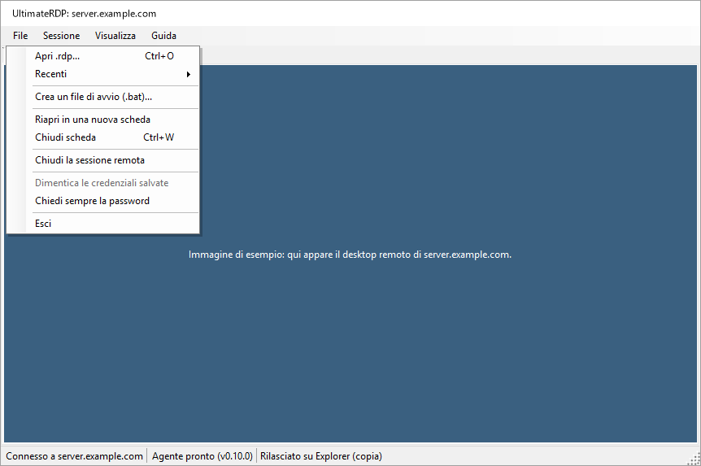

Il menu Guida contiene Informazioni su UltimateRDP, che mostra "UltimateRDP by Aprogsys", la versione e l'indirizzo del progetto, Pagina del progetto e Apri la cartella dei log.

### La finestra di caricamento

Dalla versione 0.9.3, una piccola finestra appare non appena UltimateRDP si avvia con una connessione, da un file .bat, da un collegamento o dall'eseguibile, finché il programma o il desktop non è pronto. Mostra "UltimateRDP by Aprogsys", il nome del programma o del server, una barra in movimento e la fase: "Avvio in corso...", "Connessione a server.example.com...", "Apertura della sessione...", "Avvio di Notepad...". Dopo 10 secondi indica che il server impiega più tempo del solito. Il suo pulsante Annulla interrompe la connessione.

 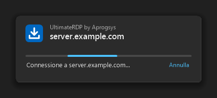

- Si chiude quando appare la finestra del programma, quando l'accesso al desktop è eseguito, o a qualsiasi conclusione precedente.
- Segue il tema chiaro o scuro di Windows e la scala del suo monitor, non prende mai la tastiera e non ha un pulsante nella barra delle applicazioni.
- Si nasconde mentre la domanda sul certificato del server, la richiesta della password, l'avviso di Windows su una connessione RemoteApp o un messaggio di UltimateRDP attende una risposta, e torna poi sopra le altre finestre, senza prendere la tastiera.
- Un secondo avvio passato all'UltimateRDP in esecuzione mostra subito la finestra di caricamento della nuova sessione.
- `"loader": "off"` in client.json la disattiva.

### Chiudere la sessione

Esci, Chiudi scheda e Sessione, Disconnetti si limitano a disconnettere, come fa il client Desktop remoto di Microsoft. La tua sessione Windows continua a funzionare sul server, con le sue applicazioni, e la ritrovi alla connessione successiva.

Per terminare davvero la sessione, usa File, Chiudi la sessione remota. La voce è disponibile quando la barra di stato indica "Agente pronto". Il client chiede una conferma, poi l'agente chiude la sessione, come farebbe il comando di disconnessione del menu Start. Le applicazioni con lavoro non salvato chiedono cosa fare, nella sessione, prima che si chiuda. La barra di stato indica "Chiusura della sessione remota...", poi mostra la disconnessione.

### Trascinare nella sessione

1. Avvia il client. Si connette con le impostazioni del file .rdp. Accedi come al solito.
2. Osserva la barra di stato in fondo alla finestra. L'etichetta dell'agente passa da "Agente: in attesa" a "Agente pronto (v0.4.3)".
3. Trascina file o cartelle da Explorer sulla sessione. Un banner blu in cima alla sessione indica "Rilascia qui per inviare i file nella sessione".
4. Spostati sull'applicazione remota che vuoi. Mostra il proprio riscontro visivo di rilascio, per esempio una cartella evidenziata o un'area per gli allegati.
5. Rilascia il pulsante sulla destinazione. L'applicazione remota riceve i file come un normale rilascio.

A ogni rilascio appare una finestra di avanzamento. La finestra "Rilascio nella sessione" si apre sopra la sessione appena rilasci il pulsante. Mostra gli elementi rilasciati, una barra che scorre senza valore, "Rilascio nella sessione..." e il nome del computer remoto. Poi mostra il risultato, come "Rilasciato su Posta in arrivo (copia)" o "Nessuna finestra sotto il cursore ha accettato i file.", e si chiude da sola tre secondi dopo, a meno che il mouse non sia sopra di essa. Quando il rilascio non riesce, mostra il motivo in rosso e resta aperta finché non fai clic su Chiudi. Per i file di grandi dimensioni la stessa finestra mostra prima il trasferimento, vedi "File di grandi dimensioni" più avanti. La finestra non prende mai la tastiera alla sessione, resta sopra la finestra principale e resta aperta quando cambi scheda. Chiudere la scheda della sessione la chiude.

Se nulla sotto il cursore accetta il rilascio, il rilascio viene ignorato e la barra di stato indica "Nessuna finestra sotto il cursore ha accettato i file." L'agente non copia mai file di sua iniziativa.

Quando la destinazione è Explorer, Explorer mostra nella sessione la consueta finestra di copia di Windows. Questa mostra l'avanzamento e chiede cosa fare quando un file esiste già.

UltimateRDP offre all'applicazione remota solo la copia e il collegamento. Non offre mai lo spostamento. Ctrl, Maiusc e Alt non vengono passati alla sessione durante un trascinamento.

### File di grandi dimensioni

Un'applicazione remota legge un file tramite il reindirizzamento delle unità a piccoli blocchi, con un viaggio di andata e ritorno in rete per ogni blocco. Su una connessione con una certa latenza questo è lento: in una misurazione, 3,6 MB/s su un collegamento che trasportava 9,7 MB/s. Per i file di grandi dimensioni UltimateRDP invia quindi i file attraverso il proprio canale, in un flusso continuo, prima del rilascio.

Per impostazione predefinita questo avviene quando i file e le cartelle rilasciati contengono 10 MiB o più. L'impostazione dell'agente "Trasferimento rapido dei file di grandi dimensioni" lo modifica, vedi "Menu dell'agente nell'area di notifica e impostazioni" più avanti.

Cosa vedi:

1. Il trascinamento sulla sessione funziona come al solito: l'applicazione remota mostra il suo riscontro visivo di rilascio.
2. Quando rilasci il pulsante, il trascinamento termina nella sessione senza rilascio, e la finestra "Rilascio nella sessione" mostra il trasferimento. Anche la barra di stato mostra l'avanzamento: "Trasferimento di 3 file: 42 % (12,3 MB/s, 1 min rimanenti)".
3. Quando tutti i file sono nella sessione, l'agente rilascia le copie dove hai rilasciato il pulsante, e la barra di stato indica "Rilasciato su ..." come al solito.

Durante un trasferimento, la finestra "Rilascio nella sessione" mostra il nome del file in corso di invio con "file 2 di 3", una barra di avanzamento, una riga come "42 %, 2,6 MB/s, 1 min 40 s rimanenti" e il nome del computer remoto. Mentre il client elenca i file, la barra scorre senza valore e la riga indica "Preparazione...". Il suo pulsante Annulla interrompe il trasferimento, come Sessione, Annulla il trasferimento. Dopo un successo indica "3 file trasferiti in 3 min 13 s a 2,6 MB/s, rilascio nella sessione...", poi mostra il risultato del rilascio e si chiude da sola tre secondi dopo, a meno che il mouse non sia sopra di essa. Dopo un errore o un annullamento mostra il motivo in rosso e resta aperta finché non fai clic su Chiudi. Chiudere la scheda della sessione annulla il trasferimento e chiude la finestra.

 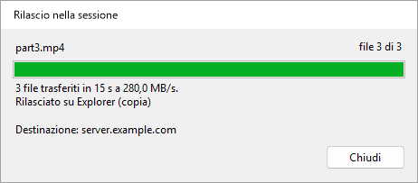

Le copie vanno in `%LOCALAPPDATA%\UltimateRDP\staging` nella sessione e vengono eliminate un'ora dopo il rilascio. L'agente verifica la dimensione e il checksum SHA-256 di ogni file. Se qualcosa va storto, nulla viene rilasciato e la barra di stato ne indica il motivo. Sessione, Annulla il trasferimento lo interrompe; l'agente elimina allora ciò che ha ricevuto.

Da sapere:

- Un trasferimento alla volta. Mentre uno è in corso, un nuovo trascinamento sulla sessione viene rifiutato, e la finestra di avanzamento indica "Attendere la fine di questo trasferimento prima di rilasciare altri file." per cinque secondi.
- Il reindirizzamento delle unità deve restare attivo: il trascinamento sulla sessione lo usa.
- Se rilasci il pulsante molto in fretta, prima che l'agente abbia risposto all'inizio del trascinamento, il client attende quella risposta, al massimo un secondo e mezzo, con "Preparazione..." nella finestra di avanzamento, così i file di grandi dimensioni passano comunque per il canale UltimateRDP. Durante questa attesa un nuovo trascinamento viene rifiutato, come durante un trasferimento.
- Le cartelle vuote all'interno di una cartella rilasciata non vengono create nella sessione.
- L'agente deve eseguire la versione 0.4.1 o successiva, e anche il client. La finestra di avanzamento è una novità del client 0.4.2 e funziona con un agente 0.4.1. Con un client o un agente più vecchio, ogni rilascio passa per il reindirizzamento delle unità.
- Dalla versione 0.6.0 su entrambi i lati, i file passano per una connessione diretta quando il server apre le sue porte a questo scopo, e per il canale negli altri casi. Dalla 0.7.0 su entrambi i lati, la connessione diretta usa più connessioni TCP contemporaneamente. Vedi "Connessione diretta per i file di grandi dimensioni".

Dalla versione 0.5.0 i file viaggiano in una forma più compatta quando la tua connessione lo consente. L'agente comunica al client come gli arrivano i dati del client. Quando ogni carattere arriva come due byte, come misurato su un server di produzione, il client impacchetta 15 bit del file in ogni carattere invece di usare base64, e un byte del file costa circa 1,07 byte sul canale invece di 2,67. Su un canale che trasporta 5,8 MB/s, il trasferimento passa da circa 2,1 MB/s a circa 5,4 MB/s. Quando ogni carattere arriva come un byte, il client mantiene base64, a circa tre quarti del canale. Entrambi i lati devono eseguire la 0.5.0 per la forma compatta; con un agente più vecchio il client invia base64 come prima. La barra di stato e la finestra di avanzamento non cambiano; il log del client indica quale forma usa un trasferimento.

Il client invia i file in blocchi di 32 KiB. L'impostazione `transferChunkBytes` in `%LOCALAPPDATA%\UltimateRDP\client.json` modifica questa dimensione, da 4096 (4 KiB) a 262144 (256 KiB). Un valore fuori da questi limiti viene riportato al loro interno. L'impostazione si può modificare solo nel file, e si applica al riavvio del client. Non toccarla, a meno che un trasferimento non fallisca al suo inizio.

```json
{
  "transferChunkBytes": 32768,
  "transferBatchCharacters": 200000,
  "transferWindowBytes": 4194304,
  "directTransfer": "auto",
  "directConnections": 8,
  "logLevel": "info"
}
```

Il client invia insieme i suoi messaggi all'agente, al massimo `transferBatchCharacters` caratteri in una chiamata al controllo Desktop remoto: 200000 per impostazione predefinita, da 50000 a 1048576. Un valore fuori da questi limiti viene riportato al loro interno. Non toccarla, a meno che un trasferimento non fallisca al suo inizio.

L'impostazione `logLevel` dello stesso file vale `info` per impostazione predefinita. Impostala su `debug` per registrare ogni messaggio che il client invia all'agente e ogni chiamata che fa al controllo Desktop remoto, poi riavvia il client.

Il client mantiene al massimo `transferWindowBytes` byte di un trasferimento inviati e non ancora confermati dall'agente: 4194304 (4 MiB) per impostazione predefinita, da 1048576 (1 MiB) a 33554432 (32 MiB). Un valore fuori da questi limiti viene riportato al loro interno. L'agente conferma ogni 2 MiB, quindi una finestra inferiore a 2 MiB più un blocco viene portata a quel valore; il log indica la finestra usata all'inizio di ogni trasferimento. Modificala solo per capire cosa limita un trasferimento lento, vedi sotto.

#### Misurare un trasferimento lento

Dalla versione 0.4.4 entrambi i log chiudono ogni trasferimento con righe di riepilogo che indicano dove è andato il tempo. Installa la 0.4.4 su entrambi i lati per avere il quadro completo; con un client o un agente più vecchio, l'altro lato registra comunque le proprie righe.

Il log del client ha due righe:

```
Transfer <id> channel calls: 2410 calls, 482000000 characters, 9100 ms inside SendOnVirtualChannel, 3.78 ms per call on average, 41.20 ms at most; 5 % of the 190000 ms from the first call to the last, 5 % of the 193000 ms of the transfer.
Transfer <id> acknowledgements: 237 matched a call, round trip 1480 ms on average, 20 ms at least, 1900 ms at most; 3700000 bytes in flight on average when one came, 4194304 at most, 88 % of the window of 4194304 bytes.
```

Il log dell'agente ha una riga per connessione sulla connessione, e due righe per trasferimento:

```
Transfer <id> channel reads: 302000 reads with data and 12 empty, 482000000 bytes, 1596 bytes per read on average; 301000 of 1600 bytes, 1000 shorter, 0 longer; blocked in the read 178000 ms, processing 14000 ms (9000 ms handling messages), over 193000 ms; read mode wts.
Transfer <id> session counters: 0 bytes, 0 frames and 0 compressed bytes in, 0 bytes out, from WTSSessionInfoEx (zero when Windows does not count them).
```

Come leggerle:

- **Il client passa ben più della metà del tempo dentro SendOnVirtualChannel.** Il controllo Desktop remoto limita il trasferimento sul tuo computer.
- **L'agente passa quasi tutto il tempo a elaborare, e poco bloccato nella lettura.** L'agente limita il trasferimento; il tempo di gestione dei messaggi comprende il JSON, la decodifica dei blocchi, il checksum e la scrittura del file.
- **Le chiamate del client occupano una piccola parte e l'agente attende nella lettura quasi tutto il tempo.** I dati attendono tra i due, nella connessione Desktop remoto. Quando i byte in transito restano vicini alla finestra, prova un trasferimento con `transferWindowBytes` a 16777216. Se la velocità non cambia e il tempo di andata e ritorno quadruplica, il limite è il controllo di flusso della connessione. Se la velocità aumenta, mantieni la finestra più grande.

Se la connessione usa UDP si vede nella barra di connessione della sessione Desktop remoto: fai clic sull'icona del segnale per le informazioni sulla connessione.

### Inviare file dalla sessione al tuo computer

Dalla versione 0.9.0, file e cartelle della sessione arrivano al tuo computer attraverso la connessione diretta, alla stessa velocità dei file di grandi dimensioni nell'altra direzione. Entrambi i lati devono eseguire la 0.9.0, e la connessione diretta deve funzionare: vedi "Connessione diretta per i file di grandi dimensioni".

Nella sessione:

- **Invia a.** Fai clic con il pulsante destro su file o cartelle in Explorer, poi Invia a, **Il mio PC (UltimateRDP)**. Il collegamento esiste solo mentre è collegato un client UltimateRDP che riceve file, e scompare quando si disconnette.
- **Il menu dell'agente nell'area di notifica**, Invia file al mio PC..., sceglie i file in una finestra di dialogo. L'icona nell'area di notifica non appare nelle sessioni RemoteApp.

  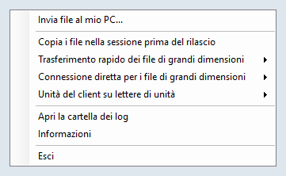

- **La riga di comando**: `UltimateRDP.Agent.exe --send "C:\Users\me\Documents\report.pdf" "C:\Users\me\Pictures\Trip"`.

Se i file non possono essere inviati, un messaggio nella sessione ne indica il motivo, per esempio che non è collegato alcun client che riceve file.

Sul tuo computer:

- I file vanno nella tua cartella Download. Mentre arrivano, si trovano in una cartella nascosta `.ultimaterdp-<id>.part` al suo interno, e appaiono quando ogni file è stato verificato con il suo SHA-256. Un file non ne sostituisce mai un altro: quando `report.pdf` esiste, il nuovo è `report (2).pdf`, e una cartella diventa `Photos (2)`.
- Una finestra "File dalla sessione" mostra l'avanzamento, con Annulla. Alla fine indica dove si trovano i file, e Apri cartella li mostra in Explorer.

  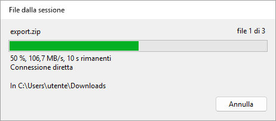 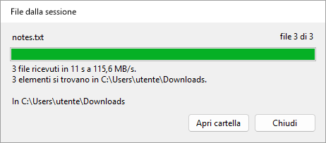

- Ogni file ricevuto riceve il contrassegno che Windows assegna ai download, così SmartScreen e Office lo trattano come un file proveniente da Internet. UltimateRDP non apre né esegue mai un file ricevuto.
- Quando la connessione diretta non può essere usata, per esempio attraverso un Remote Desktop Gateway o con porte chiuse da un firewall, nulla viene inviato e la finestra lo segnala. Non esiste un percorso più lento; copia invece i file nella sessione su un'unità del tuo computer in `\\tsclient`.
- Nomi che Windows rifiuta, un percorso che uscirebbe dalla cartella o spazio libero insufficiente interrompono il trasferimento, e nulla viene conservato.

Impostazioni in `%LOCALAPPDATA%\UltimateRDP\client.json`, modificabili solo nel file:

```json
{
  "receiveFiles": "auto",
  "receiveFolder": "%USERPROFILE%\\Desktop\\From the server"
}
```

| Impostazione | Valori | Se assente | Significato |
| --- | --- | --- | --- |
| `receiveFiles` | `auto`, `never` | `auto` | `never` rifiuta i file della sessione. Anche `directTransfer` a `never` li rifiuta, poiché solo la connessione diretta li trasporta. |
| `receiveFolder` | un percorso completo | la tua cartella Download | Dove vanno i file. Le variabili d'ambiente come `%USERPROFILE%` vengono espanse; la cartella viene creata se manca. |

Sul server, `sendToClient` in agent.json, `auto` per impostazione predefinita, impostato su `never` disattiva l'invio per un utente oppure, nelle impostazioni del computer, per tutti. Anche `directMaxMegabytesPerSecond` limita ciò che l'agente invia, il che protegge il collegamento in uscita del server. Dalla versione 0.9.2, `sendMaxMegabytesPerSecond` limita solo l'invio, così i file provenienti dai client mantengono la piena velocità: per esempio `"sendMaxMegabytesPerSecond": 85` nelle impostazioni del computer quando il collegamento in uscita del server trasporta circa 1 Gbit/s.

### Messaggi della barra di stato

Messaggi di un trascinamento:

- **"Trascinamento di 2 elemento/i nella sessione..."**: l'agente sta riproducendo il trascinamento.
- **"Avvio del trascinamento nella sessione..."**: l'agente ha bisogno di un momento per avviare il trascinamento.
- **"Copia di 2 elemento/i nella sessione prima dell'inizio del trascinamento..."**: l'agente copia prima i file nella sessione, perché "Copia i file nella sessione prima del rilascio" è attivo.
- **"Rilasciato su Posta in arrivo (copia)"**: la finestra remota ha accettato il rilascio. Indica il nome della finestra e se si tratta di copia o collegamento.
- **"Nessuna finestra sotto il cursore ha accettato i file."**: la finestra sotto il cursore non ha accettato il rilascio. Nulla è stato copiato.
- **"L'agente non ha confermato il trascinamento"**: nessuna risposta dall'agente entro un secondo. Vedi "Risoluzione dei problemi".
- **"Rilascio rifiutato"** seguito dal motivo fornito dall'agente. Per esempio "Rilascio rifiutato: Il rilascio precedente è ancora in corso nella sessione. Riprova al termine."
- **"Rilascio rifiutato: il trascinamento non è iniziato nella sessione. Trascina di nuovo i file."**: il client ha ricevuto il rilascio senza un trascinamento in corso per gli stessi file.
- **"Annullato"** seguito dal motivo, per esempio "Annullato: Il trascinamento è stato annullato: è stato premuto Esc nella sessione."

La finestra di avanzamento che appare a ogni rilascio mostra anch'essa il risultato del rilascio, e l'avanzamento di un trasferimento con maggiori dettagli, vedi "Trascinare nella sessione" e "File di grandi dimensioni" sopra. La barra di stato mantiene i suoi testi.

Messaggi di un trasferimento di file di grandi dimensioni:

- **"Preparazione del trasferimento di 2 elemento/i..."**: il client elenca i file da inviare.
- **"Trasferimento di 3 file: 42 % (12,3 MB/s, 1 min rimanenti)"**: i file sono in viaggio. La velocità si riferisce agli ultimi cinque secondi; MB significa un milione di byte.
- **"3 file trasferiti a 12,3 MB/s, rilascio in corso..."**: tutti i file sono nella sessione, e l'agente rilascia le copie.
- **"Trasferimento annullato."**: hai annullato il trasferimento dal menu Sessione o dalla finestra di avanzamento.
- **"È in corso un trasferimento. Attenderne la fine o annullarlo dal menu Sessione."**: un nuovo trascinamento è stato rifiutato durante un trasferimento.
- **"Trasferimento non riuscito"** seguito dal motivo fornito dall'agente, per esempio "Trasferimento non riuscito: Alcuni dati sono andati persi o danneggiati lungo il percorso. Riprovare."
- **"Rilascio rifiutato: Non c'è abbastanza spazio libero nella sessione: servono 1.234 MB, liberi 800 MB."**: il disco della sessione non può contenere i file.
- **"Impossibile leggere"** seguito da un nome di file e dal motivo di Windows: il client non è riuscito a leggere un file sul tuo computer.
- **"L'agente ha smesso di rispondere durante il trasferimento."**: nessuna conferma per un minuto.
- **"Il trasferimento si è interrotto: la sessione è stata disconnessa."**: la connessione è terminata durante il trasferimento.

Messaggi della connessione:

- **"Nessun agente nel computer remoto"**: il client ha inviato messaggi di saluto per sessanta secondi senza ricevere risposta. Avvia l'agente nella sessione, poi usa Sessione, Cerca di nuovo l'agente.
- **"Questo file .rdp non reindirizza le unità: il rilascio non funzionerà."**: il file .rdp non condivide alcuna unità locale. Attiva le unità nel file .rdp e riconnettiti.
- **"La sessione non vede alcuna unità reindirizzata: il rilascio non funzionerà."**: l'agente ha risposto, ma nessuna unità `\\tsclient` è raggiungibile dalla sessione. Il server potrebbe bloccare il reindirizzamento delle unità.
- **"Rilascio rifiutato: non connesso."**: non c'è ancora una sessione.
- **"Rilascio rifiutato: l'agente UltimateRDP non ha ancora risposto."**: attendi "Agente pronto".
- **"Rilascio rifiutato: l'agente UltimateRDP non è in esecuzione nella sessione remota."**: avvia l'agente nella sessione.
- **"Rilascio rifiutato"** con un percorso: si possono rilasciare solo file e cartelle su una lettera di unità locale. I percorsi di rete (UNC) vengono rifiutati, perché la sessione raggiunge i tuoi file tramite il reindirizzamento delle unità.
- **"Rilascio non riuscito"**: l'agente non è riuscito a concludere. Il resto del messaggio ne indica il motivo.

Messaggi di una chiusura della sessione:

- **"Chiusura della sessione remota..."**: l'agente ha accettato la richiesta. La disconnessione segue quando la sessione è chiusa. Se un'applicazione chiede di salvare il tuo lavoro, rispondi nella sessione.
- **"L'agente non ha risposto alla richiesta di chiusura della sessione."**: nessuna risposta entro cinque secondi. La sessione è ancora aperta; riprova, oppure esci dal menu Start della sessione.
- **"Chiusura della sessione non riuscita"**: Windows ha rifiutato di chiudere la sessione. Il resto del messaggio indica il motivo di Windows.

Questi esempi sono in italiano. La barra di stato usa la lingua del client, vedi "Lingua" più avanti.

### Menu Visualizza

- **Ridimensiona la sessione alla finestra**: l'impostazione predefinita. La risoluzione della sessione segue le dimensioni della finestra.
- **Adatta alla finestra**: la sessione mantiene la sua risoluzione e l'immagine viene adattata alla finestra.
- **Fattore di scala**: Automatico, oppure da 100 % a 200 %. Automatico segue il monitor che contiene la finestra. Una modifica si applica a una nuova connessione, e il client propone di riconnettersi.
- **Schermo intero** (F11, oppure Ctrl+Alt+Pausa): attiva o disattiva lo schermo intero. La barra di connessione è visibile e può essere fissata.
- **Usa tutti i monitor**: a schermo intero la sessione copre tutti i monitor. Si applica a una nuova connessione.
- **Tasti Windows**: dove vanno le combinazioni di tasti come Alt+Tab. "Su questo computer", "Nella sessione" oppure "Nella sessione a schermo intero", che è l'impostazione predefinita.
- **Lingua**: vedi sotto.

Le tue scelte del menu Visualizza vengono salvate per le sessioni che aprirai in seguito. Quando il file .rdp imposta `desktopscalefactor`, `use multimon` o `keyboardhook`, prevale il file.

### Lingua

Il client e l'agente parlano inglese, francese, tedesco, spagnolo, italiano, portoghese e olandese.

Il sottomenu Visualizza, Lingua elenca "Automatica (lingua di Windows)" e le sette lingue, ciascuna indicata nella propria lingua. Una scelta si applica subito ai menu, alla barra di stato e alle schede, e il client la ricorda. Automatica, l'impostazione predefinita, segue la lingua di visualizzazione di Windows, e usa l'inglese quando Windows è in un'altra lingua.

La scelta è l'impostazione `language` in `%LOCALAPPDATA%\UltimateRDP\client.json`: `auto`, `en`, `fr`, `de`, `es`, `it`, `pt` o `nl`.

```json
{
  "language": "fr"
}
```

Il client comunica all'agente la sua lingua, e l'agente scrive in quella lingua i messaggi che invia alla barra di stato. Il menu dell'agente nell'area di notifica segue la lingua di visualizzazione di Windows sul server.

Alcuni testi provengono da Windows e seguono la sua lingua: i pulsanti Sì e No delle domande, il motivo di una disconnessione e i messaggi di errore di Windows. I log sono sempre in inglese.

### Credenziali salvate e password

Prima di connettersi, il client legge la credenziale generica `TERMSRV/<host>` da Gestione credenziali di Windows. Quando esiste e contiene una password, il client la applica e disattiva la richiesta per quella connessione. UltimateRDP non scrive mai una credenziale. Puoi crearne una con:

```
cmdkey /generic:TERMSRV/<host> /user:<domain\user> /pass
```

`cmdkey` chiede poi la password.

Dalla versione 0.9.0 il client chiede invece la password, e non legge alcuna credenziale salvata, quando uno di questi elementi lo indica:

- l'opzione `--ask-credentials` sulla riga di comando;
- File, **Chiedi sempre la password**, che il client ricorda come `"credentials": "ask"` in client.json (`saved` per impostazione predefinita);
- la riga `prompt for credentials:i:1` nel file .rdp, come fa il client Microsoft.

Il nome utente del file .rdp resta compilato, e la richiesta non propone di salvare la password. Il log del client indica quale dei tre elementi ha deciso, e non contiene mai una password.

Questo cambia ciò che accade con un file .rdp che contiene già `prompt for credentials:i:1`: la versione 0.8.0 usava la credenziale salvata e si connetteva senza richiesta; la versione 0.9.0 chiede la password. Rimuovi la riga dal file, o impostala a 0, per tornare alla credenziale salvata.

La casella "Memorizza credenziali" della richiesta di credenziali di Windows salva un tipo di credenziale diverso, una password di dominio. Windows conserva quella password per sé, quindi UltimateRDP non può leggerla. La richiesta di Windows stessa può comunque usarla.

File, Dimentica le credenziali salvate elimina entrambi i tipi di credenziale per l'host della scheda attiva. La sessione aperta non viene modificata, e la connessione successiva chiede di nuovo le credenziali.

Nessuna opzione della riga di comando e nessun campo del generatore di file di avvio accetta una password: vedi "File di avvio". L'avviso di Windows sull'editore di una connessione RemoteApp è una questione diversa, e `--trusted` è l'unico modo per saltarlo: vedi "Opzioni della riga di comando".

## Impostazioni del client

Il client conserva le sue impostazioni in `%LOCALAPPDATA%\UltimateRDP\client.json`. Il menu Visualizza, il menu Lingua e File, Chiedi sempre la password ne scrivono alcune; le altre si possono modificare solo nel file, e si applicano al successivo avvio del client. Un valore sconosciuto dà il valore predefinito. I commenti sono ammessi nel file e non vengono conservati quando il client lo scrive.

```json
{
  "displayMode": "resizeSession",
  "scaleFactor": null,
  "keyboardHookMode": 2,
  "useAllMonitors": false,
  "language": "auto",
  "transferChunkBytes": 32768,
  "transferBatchCharacters": 200000,
  "transferWindowBytes": 4194304,
  "directTransfer": "auto",
  "directConnections": 8,
  "receiveFiles": "auto",
  "receiveFolder": null,
  "credentials": "saved",
  "loader": "on",
  "logLevel": "info"
}
```

| Impostazione | Valori | Se assente | Significato |
| --- | --- | --- | --- |
| `displayMode` | `resizeSession`, `scaleToWindow` | `resizeSession` | Visualizza, Ridimensiona la sessione alla finestra o Adatta alla finestra. |
| `scaleFactor` | `null`, oppure da 100 a 500 | `null` | Visualizza, Fattore di scala; `null` segue il monitor. |
| `keyboardHookMode` | 0, 1, 2 | 2 | Visualizza, Tasti Windows: su questo computer, nella sessione, nella sessione a schermo intero. |
| `useAllMonitors` | `true`, `false` | `false` | Visualizza, Usa tutti i monitor. |
| `language` | `auto`, `en`, `fr`, `de`, `es`, `it`, `nl`, `pt` | `auto` | Visualizza, Lingua. Vedi "Lingua". |
| `recentFiles` | un elenco di percorsi | vuoto | File, Recenti. La scrive il client. |
| `transferChunkBytes` | da 4096 a 262144 | 32768 | Byte per blocco di un trasferimento attraverso il canale. Vedi "File di grandi dimensioni". |
| `transferBatchCharacters` | da 50000 a 1048576 | 200000 | Caratteri per chiamata al controllo Desktop remoto. Vedi "File di grandi dimensioni". |
| `transferWindowBytes` | da 1048576 a 33554432 | 4194304 | Byte di un trasferimento attraverso il canale inviati e non ancora confermati. Vedi "File di grandi dimensioni". |
| `directTransfer` | `auto`, `never` | `auto` | `never` mantiene i file di grandi dimensioni nel canale e rifiuta i file della sessione. Vedi "Connessione diretta per i file di grandi dimensioni". |
| `directConnections` | da 1 a 16 | 8 | Numero massimo di connessioni di un trasferimento diretto. |
| `receiveFiles` | `auto`, `never` | `auto` | `never` rifiuta i file della sessione. Vedi "Inviare file dalla sessione al tuo computer". |
| `receiveFolder` | `null`, oppure un percorso | la tua cartella Download | Dove vanno i file della sessione; le variabili d'ambiente vengono espanse. |
| `credentials` | `saved`, `ask` | `saved` | File, Chiedi sempre la password. Vedi "Credenziali salvate e password". |
| `loader` | `on`, `off` | `on` | La finestra di caricamento. Vedi "La finestra di caricamento". |
| `logLevel` | `debug`, `info` | `info` | `debug` registra ogni messaggio all'agente e ogni chiamata al controllo. |

## Menu dell'agente nell'area di notifica e impostazioni

Per impostazione predefinita l'icona dell'agente nell'area di notifica è visibile solo mentre un client UltimateRDP è collegato alla sessione. Il suo menu contiene:

- **Invia file al mio PC...**: dalla versione 0.9.0, invia i file scelti al computer del client. Vedi "Inviare file dalla sessione al tuo computer".
- **Copia i file nella sessione prima del rilascio**: disattivato per impostazione predefinita. Quando è attivo, l'agente copia i file nella sessione prima che inizi il trascinamento, e l'applicazione remota riceve percorsi locali invece di percorsi `\\tsclient`. Attivalo per le applicazioni che rifiutano i percorsi di rete. La copia dei file di grandi dimensioni prima dell'inizio del trascinamento richiede tempo. Quando i file arrivano attraverso il canale, vedi sotto, arrivano comunque come copie locali.
- **Trasferimento rapido dei file di grandi dimensioni**: Automatico, Sempre o Mai. Automatico, l'impostazione predefinita, invia i file attraverso il canale UltimateRDP prima del rilascio quando contengono 10 MiB o più. Sempre lo fa per ogni rilascio, Mai per nessuno: l'applicazione remota legge allora i file tramite il reindirizzamento delle unità, come nella versione 0.3.
- **Connessione diretta per i file di grandi dimensioni**: Automatico o Mai. Automatico, l'impostazione predefinita, offre la connessione diretta per un trasferimento rapido, con il canale come ripiego. Mai mantiene ogni trasferimento rapido nel canale. Vedi "Connessione diretta per i file di grandi dimensioni".
- **Unità del client su lettere di unità**: Automatico o Mai. Mai, l'impostazione predefinita, lascia le unità del tuo computer come `\\tsclient\C` e così via. Automatico assegna loro lettere di unità della sessione mentre un client UltimateRDP è collegato. Vedi "Unità del client su lettere di unità" più avanti.
- **Apri la cartella dei log**, **Informazioni** ed **Esci**.

Il menu segue la lingua di visualizzazione di Windows sul server.

Le copie preliminari vanno in `%LOCALAPPDATA%\UltimateRDP\staging\<id>` nella sessione. Ogni cartella viene eliminata un'ora dopo il suo rilascio, perché la destinazione potrebbe ancora leggere i file. All'avvio, l'agente elimina le cartelle più vecchie di un'ora.

L'agente conserva le sue impostazioni in `%LOCALAPPDATA%\UltimateRDP\agent.json` sul server:

```json
{
  "logLevel": "debug",
  "stageFiles": false,
  "fastTransfer": "auto",
  "fastTransferMinBytes": 10485760,
  "directTransfer": "auto",
  "directPortRange": "3400-3449",
  "directConnections": 8,
  "directMaxMegabytesPerSecond": 0,
  "sendMaxMegabytesPerSecond": 0,
  "trayIcon": "auto",
  "channelRead": "wts",
  "mapClientDrives": "never",
  "sendToClient": "auto"
}
```

| Impostazione | Valori | Se assente | Significato |
| --- | --- | --- | --- |
| `stageFiles` | `true`, `false` | `false` | La voce del menu nell'area di notifica "Copia i file nella sessione prima del rilascio". |
| `fastTransfer` | `auto`, `always`, `never` | `auto` | La voce del menu nell'area di notifica "Trasferimento rapido dei file di grandi dimensioni". |
| `fastTransferMinBytes` | un numero di byte | `10485760` (10 MiB) | La dimensione a partire dalla quale `auto` invia i file attraverso il canale, calcolata su tutti gli elementi rilasciati. Modificabile solo nel file. |
| `directTransfer` | `auto`, `never` | `auto` | La voce del menu nell'area di notifica "Connessione diretta per i file di grandi dimensioni". |
| `directPortRange` | un intervallo come `3400-3449`, oppure una porta | `3400-3449` | Le porte TCP della connessione diretta, vedi "Connessione diretta per i file di grandi dimensioni". Modificabile solo nel file. |
| `directConnections` | da 1 a 16 | `8` | Quante connessioni TCP può usare al massimo un trasferimento diretto. Modificabile solo nel file. |
| `directMaxMegabytesPerSecond` | 0, oppure un numero di MB/s | `0` | Un limite alla velocità di un trasferimento diretto, per tutte le sue connessioni insieme; 0 significa nessun limite. Modificabile solo nel file. |
| `sendMaxMegabytesPerSecond` | 0, oppure un numero di MB/s | `0` | Dalla versione 0.9.2, un limite a ciò che l'agente invia al computer del client, per tutte le connessioni di un invio insieme. Con 0, anche per un invio il limite resta `directMaxMegabytesPerSecond`. Modificabile solo nel file. |
| `logLevel` | `debug`, `info`, `warn`, `error` | `info` | Il livello più basso scritto nel log. Modificabile solo nel file. |
| `trayIcon` | `auto`, `always`, `never` | `auto` | `auto` mostra l'icona nell'area di notifica solo mentre un client UltimateRDP è collegato alla sessione. `always` la mostra dall'avvio dell'agente. `never` non la mostra mai: l'agente si controlla allora solo con `--uninstall` e la sua voce `Run`. Modificabile solo nel file. |
| `mapClientDrives` | `never`, `auto` | `never` | La voce del menu nell'area di notifica "Unità del client su lettere di unità". |
| `sendToClient` | `auto`, `never` | `auto` | Se i file della sessione possono essere inviati al computer di un client che li riceve. Modificabile solo nel file. |
| `channelRead` | `wts`, `file` | `wts` | Come l'agente legge il canale. `wts` lo legge con WTSVirtualChannelRead, 1600 byte alla volta. `file` è un esperimento: l'agente legge l'handle di file del canale con un buffer di 64 KiB, rimuove le intestazioni del canale che può trovare, registra quale suddivisione ha trovato, e alla prima incoerenza torna a `wts` per la connessione, con un avviso. Modificabile solo nel file. |

Un valore sconosciuto dà il valore predefinito e un avviso nel log. Riavvia l'agente dopo aver modificato il file a mano. Quando il menu nell'area di notifica modifica un'impostazione, scrive quella chiave nel tuo agent.json e mantiene le altre chiavi; i commenti nel file non vengono conservati.

### Impostazioni per l'intero computer

Un amministratore può impostare valori predefiniti per tutti gli utenti del server in `%ProgramData%\UltimateRDP\agent.json`, con le stesse chiavi. L'agente legge prima quel file, quando esiste, poi l'agent.json dell'utente, le cui chiavi prevalgono una per una. Una chiave che l'utente non imposta, o imposta a `null`, proviene dal file del computer. L'agente non scrive mai il file del computer; il menu nell'area di notifica scrive solo il file dell'utente. Per esempio, per attivare le lettere di unità per tutti:

```json
{
  "mapClientDrives": "auto"
}
```

Poiché un utente può creare file in `%ProgramData%`, l'agente legge il file del computer solo quando il suo proprietario è il gruppo Administrators, SYSTEM o TrustedInstaller, come per un file creato da un prompt con privilegi elevati. Un file con un altro proprietario viene ignorato, con un avviso nel log che fornisce il comando `icacls` per correggerlo. La riga di avvio del log dell'agente elenca le chiavi che provengono dal file del computer, e `--status` indica se il file esiste. Dopo una modifica, riavvia gli agenti o lascia che gli utenti accedano di nuovo.

### Unità del client su lettere di unità

Con `mapClientDrives` impostato su `auto`, l'agente associa ogni unità che il tuo computer reindirizza, `\\tsclient\C`, `\\tsclient\D` e così via, a una lettera di unità della sessione non appena un client UltimateRDP è collegato, così i programmi che vogliono una lettera di unità possono usare i tuoi file.

- Un'unità mantiene la propria lettera quando quella lettera è libera nella sessione, e altrimenti riceve la prima lettera libera partendo da Z verso il basso. C, l'unità di sistema della sessione, è di solito occupata, quindi la tua unità C: diventa spesso Z:.
- L'agente non sostituisce mai una lettera in uso, che sia un'unità locale o un'associazione, e non associa un'unità che un'associazione della sessione raggiunge già. Associa solo le unità che il tuo computer reindirizza, e mai A: o B:.
- Le lettere sono visibili solo a te, nella tua sessione, e non vengono ricordate per l'accesso successivo.
- Scompaiono quando il client si disconnette, quando scegli Mai nel menu nell'area di notifica e quando l'agente esce. Se un file è aperto su un'unità, l'agente rimuove comunque la lettera, ma solo una lettera che ha creato lui stesso. Una lettera lasciata da un agente che è terminato in modo anomalo viene rimossa al suo avvio successivo, se punta ancora alla stessa unità.
- Documenti, Desktop e le altre cartelle del profilo non vengono reindirizzati.
- Ogni errore viene scritto nel log come avviso, e non viene mostrato nulla. Il log ha una riga con le lettere assegnate, quando il client si connette.

## Connessione diretta per i file di grandi dimensioni

Dalla versione 0.6.0, i file di un trasferimento rapido passano per una connessione TLS diretta tra il client e l'agente, al di fuori della connessione Desktop remoto, quando la rete lo consente. Attraverso il canale UltimateRDP, i trasferimenti misurati in produzione hanno raggiunto da 2 a 4 MB/s, qualunque fosse il collegamento; la connessione diretta li trasporta alla velocità della rete. Quando non può essere usata, i file passano per il canale come prima, senza che l'utente debba fare nulla.

Dalla versione 0.7.0, un trasferimento usa più connessioni TCP contemporaneamente, al massimo otto per impostazione predefinita. Sul percorso di produzione una sola connessione TCP è partita da 90 a 180 MB/s ed è scesa a circa 20 MB/s in pochi secondi, mentre quattro connessioni insieme ne trasportavano quattro volte tanto: il limite vale per connessione, in qualche punto del percorso, e più connessioni si sommano.

Come funziona:

1. Quando l'agente decide un trasferimento rapido, si mette in ascolto sulla prima porta TCP libera di un intervallo, da 3400 a 3449 per impostazione predefinita, solo per questo trasferimento. Ogni sessione usa la propria porta, quindi su un server con molte sessioni serve un intervallo.
2. La sua risposta al trascinamento, attraverso il canale, indica la porta, un token monouso casuale, lo SHA-256 del suo certificato TLS, la versione del protocollo e il numero di connessioni che accetta.
3. Dopo il rilascio il client si connette all'host del file .rdp su quella porta, entro 3 secondi. Accetta solo il certificato il cui SHA-256 è stato indicato dall'agente, dimostra di conoscere il token e invia l'elenco dei file.
4. Quando l'agente ha accettato questa prima connessione, il client apre le altre verso lo stesso indirizzo, una per ogni blocco di 32 MiB iniziato del trasferimento, fino al numero che l'agente accetta e alla propria impostazione. Una connessione che non può essere aperta non è un errore: le altre trasportano i file.
5. I file viaggiano a blocchi di 1 MiB su tutte le connessioni. L'agente scrive ogni blocco al suo posto nel file, verifica lo SHA-256 di ogni file come attraverso il canale, e rilascia le copie.

Il listener esiste solo mentre un trasferimento è offerto o in corso. Accetta al massimo quattro socket in più rispetto alle connessioni che offre, e chiude qualsiasi socket che non completa il suo handshake TLS e non presenta il suo token entro 5 secondi. Si chiude 10 secondi dopo il rilascio se la prima connessione non è arrivata. Il certificato viene creato in memoria dall'agente al suo primo trasferimento diretto; la sua chiave privata è una chiave non esportabile dell'archivio chiavi dell'utente, che l'agente elimina quando esce. L'agente funziona comunque con i diritti dell'utente: una porta superiore a 1024 non richiede diritti di amministratore.

### Regole del firewall

L'amministratore apre l'intervallo, TCP in ingresso verso il server, limitato agli indirizzi client autorizzati per RDP. Sul firewall di Windows del server, da un PowerShell con privilegi elevati:

```
New-NetFirewallRule -DisplayName "UltimateRDP direct transfer" -Direction Inbound -Action Allow -Protocol TCP -LocalPort 3400-3449 -RemoteAddress <allowed client addresses> -Program "C:\Program Files\UltimateRDP\UltimateRDP.Agent.exe" -Profile Any
```

Sostituisci `<allowed client addresses>` con lo stesso elenco della regola che autorizza RDP, separato da virgole, e il percorso del programma con la posizione dell'agente. Con `-Program`, Windows ha una regola per l'agente e non chiede nulla agli utenti quando l'agente si mette in ascolto. Per essere certo che gli utenti non vedano mai una domanda del genere sul server, esegui `Set-NetFirewallProfile -Profile Domain,Private,Public -NotifyOnListen False`.

Presso il provider di hosting, aggiungi la stessa regola al firewall posto davanti al server: TCP, porte di destinazione da 3400 a 3449, origine solo gli indirizzi client autorizzati.

Quando un computer client riceve un nuovo indirizzo pubblico, per esempio su un'altra rete, aggiungilo alla regola che autorizza RDP e a questa regola, sul server e presso il provider di hosting. Con la sola regola RDP, la sessione si apre ma i file di grandi dimensioni passano per il canale a circa 2 MB/s, e i file della sessione non possono essere inviati a quel computer.

Se modifichi l'intervallo nelle impostazioni dell'agente, modifica di conseguenza entrambe le regole. Le connessioni di un trasferimento usano tutte la sua unica porta, quindi le regole sono le stesse della 0.6.0.

### Ripiego

Il canale trasporta i file, come nella versione 0.5.2, quando:

- il client si connette attraverso un Remote Desktop Gateway, o un firewall non apre le porte: la prima connessione fallisce entro 3 secondi;
- l'handshake TLS fallisce, il certificato non è quello indicato dall'agente, o l'agente rifiuta il token;
- una connessione si interrompe prima che l'agente abbia confermato i primi 8 MiB;
- il client o l'agente esegue una versione precedente alla 0.6.0, un lato esegue la 0.6.0 e l'altro la 0.7.0, oppure uno dei due ha l'impostazione `directTransfer` a `never`;
- nessuna porta dell'intervallo è libera sul server.

Quando una connessione si interrompe più tardi, il trasferimento si arresta con "La connessione diretta è stata persa. Riprovare." e nulla viene rilasciato. Il log del client indica al livello info quale percorso ha seguito un trasferimento e perché la connessione diretta non è stata usata. La barra di stato e la finestra di avanzamento mostrano "Connessione diretta" mentre i file vi passano, e mantengono la fase di preparazione finché l'agente non ha confermato i primi dati; quando un file impiega più di 2 secondi ad aprirsi, indicano "Apertura di ... Windows potrebbe verificare il file." finché non viene letto.

Quando annulli, il client lo comunica all'agente, attende al massimo un secondo la sua risposta, poi chiude tutte le connessioni, anche quando una connessione o la lettura di un file è bloccata. L'agente elimina ciò che ha ricevuto e registra il trasferimento come annullato.

### Impostazioni

| Dove | Impostazione | Valori | Se assente | Significato |
| --- | --- | --- | --- | --- |
| agent.json | `directTransfer` | `auto`, `never` | `auto` | La voce del menu nell'area di notifica "Connessione diretta per i file di grandi dimensioni". `never` invia ogni trasferimento rapido attraverso il canale. |
| agent.json | `directPortRange` | un intervallo come `3400-3449`, oppure una porta | `3400-3449` | Le porte su cui l'agente può mettersi in ascolto, da 1025 a 65535, al massimo 1000 porte. Modificabile solo nel file; riavvia l'agente dopo una modifica. |
| agent.json | `directConnections` | da 1 a 16 | `8` | Quante connessioni l'agente accetta al massimo per un trasferimento. Modificabile solo nel file; riavvia l'agente dopo una modifica. |
| agent.json | `directMaxMegabytesPerSecond` | 0, oppure da 1 a 100000 | `0` | Protegge il server: l'agente legge tutte le connessioni di un trasferimento insieme al massimo a questo numero di MB/s, e TCP rallenta il client. 0 significa nessun limite. Modificabile solo nel file; riavvia l'agente dopo una modifica. |
| client.json | `directTransfer` | `auto`, `never` | `auto` | `never` fa sì che il client ignori l'offerta dell'agente e usi il canale. Modificabile solo nel file. |
| client.json | `directConnections` | da 1 a 16 | `8` | Quante connessioni il client apre al massimo per un trasferimento, entro quanto l'agente accetta. Modificabile solo nel file. |

La connessione diretta richiede entrambi i lati alla stessa versione, 0.6.0 o 0.7.0. Un client 0.7.0 ignora l'offerta di un agente 0.6.0 e usa il canale; un client 0.6.0 prova la connessione diretta di un agente 0.7.0, che rifiuta subito il suo token, e poi usa il canale. Un client o un agente 0.5.2 usa il canale.

### Leggere le righe di riepilogo

Alla fine di un trasferimento diretto ogni log ha una riga che inizia con `direct connection statistics`. La riga del client indica le connessioni usate, i byte trasportati da ciascuna, i secondi dall'inizio dei dati, il tempo che il lettore ha impiegato ad aprire e leggere i file e il tempo che ha atteso spazio nella sua coda, il tempo che gli scrittori hanno impiegato nelle scritture sui socket e il tempo che hanno atteso i blocchi, e le velocità: la media, i primi 5 secondi e gli ultimi 5 secondi. La riga dell'agente indica le connessioni, i byte di ciascuna, il tempo impiegato nelle letture dai socket, nelle scritture dei file e nella rilettura dei file per calcolarne l'hash, e le stesse velocità. I tempi di più thread vengono sommati, quindi possono superare la durata del trasferimento.

- **Il lettore del client occupa la maggior parte del tempo e gli scrittori attendono i blocchi.** La lettura dei file sul tuo computer limita il trasferimento, per esempio un antivirus che analizza un file di grandi dimensioni. Il client registra anche al livello info qualsiasi file la cui apertura o prima lettura richiede più di mezzo secondo.
- **Gli scrittori del client passano la maggior parte del tempo nelle scritture sui socket e il lettore attende spazio.** La rete limita il trasferimento. Primi 5 secondi molto più veloci degli ultimi 5 secondi indicano il limite per connessione descritto sopra: più connessioni aiutano, fino a 16.
- **L'agente passa molto tempo nelle scritture dei file o nel calcolo dell'hash.** Il server limita il trasferimento: il suo disco, o il suo processore.

Con `logLevel` a `debug` in client.json o agent.json, entrambi i lati registrano anche la velocità di ogni secondo.

## Programmi RemoteApp

Dalla versione 0.8.0, UltimateRDP apre anche i programmi RemoteApp: un programma pubblicato sul server che si mostra in finestre proprie sul tuo desktop, senza il desktop remoto intorno. Apri il suo file .rdp come qualsiasi altro, per esempio quello che ti fornisce l'amministratore o quello del feed web. Un file con `remoteapplicationmode:i:1` apre una scheda RemoteApp. La versione 0.8.0 è stata provata una volta con un server reale con Notepad; la versione 0.9.0 corregge ciò che quella prova ha mostrato, e le sue modifiche non erano state provate con un server reale al momento del rilascio: segnala ciò che osservi, con entrambi i log.

### Da un collegamento o da un file .bat

Dalla versione 0.9.0, `UltimateRDP.exe` avviato con un file RemoteApp mostra solo le finestre del programma, come fa il client Microsoft. Per esempio, in un file `Notepad on the server.bat`:

```bat
@echo off
start "" "C:\Tools\UltimateRDP\UltimateRDP.exe" "C:\Users\me\Documents\notepad-server.example.com.rdp"
```

oppure un collegamento la cui destinazione è `"C:\Tools\UltimateRDP\UltimateRDP.exe" "C:\Users\me\Documents\notepad-server.example.com.rdp"`.

- Dalla versione 0.9.3, appare subito una finestra di caricamento, con il nome del programma, una barra in movimento e la fase dell'avvio, "Connessione a server.example.com...", "Apertura della sessione...", poi "Avvio di Notepad...", finché non appare la finestra del programma. Il suo pulsante Annulla interrompe la connessione. Si nasconde mentre la domanda sul certificato del server o la richiesta della password attende una risposta. Anche un file desktop la mostra, sopra la finestra di UltimateRDP, finché l'accesso al desktop non è eseguito. `"loader": "off"` in `%LOCALAPPDATA%\UltimateRDP\client.json` la disattiva.
- La finestra di UltimateRDP resta fuori dalla vista. Un'icona nell'area di notifica indica il programma e il suo server, e il suo menu contiene Mostra UltimateRDP, Disconnetti ed Esci. Nella barra delle applicazioni non appare alcun pulsante oltre a quelli delle finestre del programma.
- Quando chiudi l'ultima finestra del programma, il server mantiene la sessione per circa 20 secondi, poi la termina, e UltimateRDP esce da solo senza messaggi. Fino ad allora resta solo l'icona nell'area di notifica.
- Quando la connessione non riesce, o termina per un altro motivo, un messaggio ne indica la causa; quando non è riuscita prima dell'accesso, appare anche la finestra di UltimateRDP, con il motivo nella sua scheda e Sessione, Connetti.
- Avviare di nuovo UltimateRDP con un altro file lo passa alla copia in esecuzione: è in esecuzione una sola copia per utente alla volta.
- Dalla versione 0.10.0, un avvio RemoteApp verso un server su cui è già in esecuzione una scheda RemoteApp, con lo stesso account, avvia il suo programma su quella connessione, come fa il client Microsoft: vedi "Una connessione per server e account".
- `--show` mostra comunque la finestra di UltimateRDP, e `--hidden` la tiene fuori dalla vista anche per un file desktop. Un file desktop mostra la finestra per impostazione predefinita.
- `--ask-credentials` chiede la password, vedi "Credenziali salvate".

La riga di comando è `UltimateRDP.exe [options] [file.rdp]`. Dalla versione 0.10.0 le opzioni possono anche fornire l'intera connessione, senza un file .rdp: vedi "File di avvio".

### Sul tuo computer

- La scheda mostra i nomi dei programmi della connessione, quante delle loro finestre sono aperte, lo stato della connessione e dell'agente, il risultato dell'ultimo rilascio e un pulsante Disconnetti. Il programma stesso si apre in finestre proprie, fuori dalla finestra di UltimateRDP, che puoi ridurre a icona una volta eseguito l'accesso.
- Rilascia i file su una finestra del programma. Mentre ti muovi sopra di essa non succede nulla: il rilascio avviene dove rilasci il pulsante. La finestra di avanzamento "Rilascio nella sessione" si apre sopra la finestra su cui hai rilasciato, come per una sessione desktop, e i file di grandi dimensioni passano per il canale o per la connessione diretta come descritto sopra.
- L'applicazione remota non mostra alcun riscontro visivo di rilascio mentre ti muovi, poiché il trascinamento inizia nella sessione solo quando rilasci il pulsante.
- Visualizza, Ridimensiona la sessione alla finestra, Adatta alla finestra, Fattore di scala, Schermo intero e Usa tutti i monitor non si applicano a una scheda RemoteApp e lì sono disattivati. La sessione copre sempre tutti i tuoi monitor.
- Quando il programma chiude la sua ultima finestra, il server termina o disconnette la sessione circa 20 secondi dopo, e la scheda si chiude. La barra di stato lo indica come una conclusione normale.
- Chiudere la scheda, o uscire da UltimateRDP, mentre sono aperte finestre del programma chiede prima conferma: il programma continua a funzionare sul server e torna alla connessione successiva con lo stesso file. Per terminarlo, chiudilo nella sua finestra, oppure usa File, Chiudi la sessione remota.
- Più schede, desktop e RemoteApp, funzionano fianco a fianco. Un rilascio su una finestra di un programma va alla sessione di quel programma.

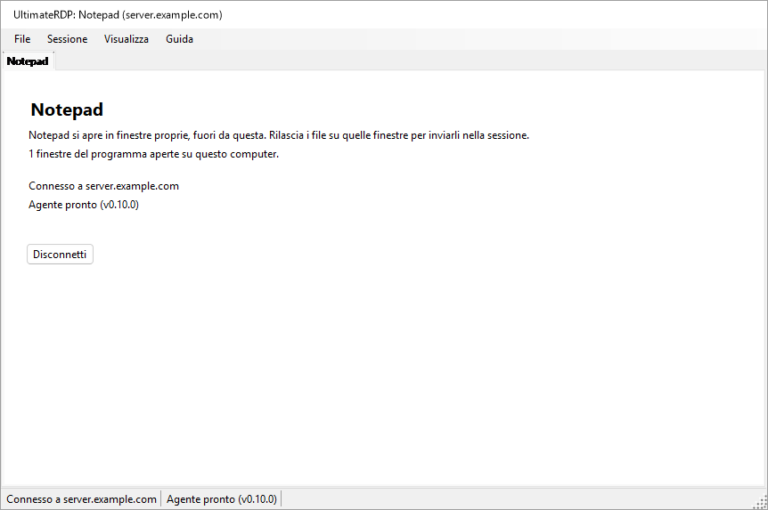

Mentre la finestra principale è fuori dalla vista, l'icona di UltimateRDP nell'area di notifica indica i programmi e il loro server; la sua descrizione comandi riporta "UltimateRDP by Aprogsys" seguito dai programmi.

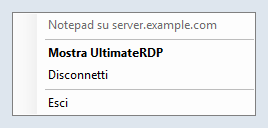

Il client legge `remoteapplicationprogram`, `remoteapplicationname`, `remoteapplicationcmdline`, `remoteapplicationexpandcmdline`, `remoteapplicationexpandworkingdir` e `remoteapplicationfile`. Un file che chiede RemoteApp senza un programma viene rifiutato quando lo apri.

### Sul server

Una sessione RemoteApp non esegue Explorer, quindi ignora la voce `Run` che `--install-all-users` scrive: l'agente non vi si avvia da solo. L'amministratore lo avvia con un'attività pianificata all'accesso. Una sessione RemoteApp termina inoltre quando non vi resta alcun programma dell'utente, e un agente che continuasse a funzionare la terrebbe aperta. L'agente se ne occupa quindi in due modi:

- In una sessione RemoteApp, elenca i processi della sua sessione ogni 15 secondi. Quando non resta altro che i processi che ogni sessione RemoteApp esegue e i nomi della chiave `SysProcs` del server, per due controlli di fila, e nessun rilascio o trasferimento è in corso, esce. Durante i suoi primi 90 secondi, finché non è stato visto alcun programma, i controlli non contano, così un programma lento ad avviarsi non lo fa uscire. Esce anche quando la sessione viene disconnessa e non resta alcun programma. In una sessione desktop controlla una sola volta, all'avvio, e non fa altro.
- La sua icona nell'area di notifica non appare mai in una sessione RemoteApp finché `trayIcon` vale `auto`. Non impostare `trayIcon` su `always` per gli utenti RemoteApp.

L'amministratore aggiunge l'agente anche a `SysProcs`, così Windows stesso non lo conta. UltimateRDP non scrive mai nel Registro di sistema e non crea mai attività: ecco i comandi, per un PowerShell con privilegi elevati sul server. Sostituisci il percorso dell'agente con il tuo.

1. Leggi prima lo stato attuale, e conserva l'output:

   ```powershell
   Get-ItemProperty 'HKLM:\SYSTEM\CurrentControlSet\Control\Terminal Server\SysProcs'
   Get-ScheduledTask -TaskPath '\UltimateRDP\' -ErrorAction SilentlyContinue
   quser
   ```

2. Aggiungi l'agente a `SysProcs`. Da solo, questo non cambia nulla, poiché l'agente non viene ancora eseguito nelle sessioni RemoteApp. Si applica alle nuove sessioni; non riavviare i Servizi Desktop remoto per questo, perché disconnetterebbe tutti gli utenti.

   ```powershell
   New-ItemProperty -Path 'HKLM:\SYSTEM\CurrentControlSet\Control\Terminal Server\SysProcs' -Name 'UltimateRDP.Agent.exe' -PropertyType DWord -Value 0
   ```

3. Crea l'attività solo per un account di prova:

   ```powershell
   $exe       = 'C:\Program Files\UltimateRDP\UltimateRDP.Agent.exe'
   $action    = New-ScheduledTaskAction -Execute $exe
   $trigger   = New-ScheduledTaskTrigger -AtLogOn -User '<DOMAIN\test account>'
   $principal = New-ScheduledTaskPrincipal -UserId '<DOMAIN\test account>' -LogonType Interactive -RunLevel Limited
   $settings  = New-ScheduledTaskSettingsSet -ExecutionTimeLimit ([TimeSpan]::Zero) -AllowStartIfOnBatteries -DontStopIfGoingOnBatteries -MultipleInstances Parallel -Priority 5 -Compatibility Win8
   Register-ScheduledTask -TaskPath '\UltimateRDP\' -TaskName 'Agent' -Action $action -Trigger $trigger -Principal $principal -Settings $settings -Description 'Starts the UltimateRDP agent in each user session, RemoteApp sessions included.'
   ```

   `-LogonType Interactive` esegue l'agente nella sessione dell'utente con i diritti dell'utente, e non viene memorizzata alcuna password. `-RunLevel Limited` gli impedisce di essere mai eseguito con privilegi elevati. `-ExecutionTimeLimit` a zero rimuove il limite di 72 ore di un'attività. In una sessione desktop sia la voce `Run` sia l'attività avviano l'agente; la seconda copia vede la prima ed esce subito.

4. Prova con l'account di prova, come descritto più avanti.

5. Solo dopo, avviala per tutti gli utenti. Modifica l'oggetto dell'attività e riscrivilo per intero:

   ```powershell
   $users = (New-Object System.Security.Principal.SecurityIdentifier 'S-1-5-32-545').Translate([System.Security.Principal.NTAccount]).Value
   $task = Get-ScheduledTask -TaskPath '\UltimateRDP\' -TaskName 'Agent'
   $task.Triggers = @(New-ScheduledTaskTrigger -AtLogOn)
   $task.Principal = New-ScheduledTaskPrincipal -GroupId $users -RunLevel Limited
   $task | Set-ScheduledTask
   ```

   La prima riga fornisce il nome locale del gruppo Users, che dipende dalla lingua di Windows. `Set-ScheduledTask -Trigger ... -Principal ...` con questi valori è terminato senza errori su un Windows Server in francese e ha lasciato in posizione il trigger e l'entità di sicurezza dell'account di prova, quindi verifica ciò che l'Utilità di pianificazione ha memorizzato:

   ```powershell
   Export-ScheduledTask -TaskPath '\UltimateRDP\' -TaskName 'Agent'
   ```

   L'XML deve mostrare `<GroupId>S-1-5-32-545</GroupId>` e `<LogonTrigger />` senza un utente. `Get-ScheduledTask` da solo può mostrare valori che non sono quelli memorizzati.

Dopo un aggiornamento dell'agente in un'altra cartella, fai puntare l'attività alla nuova posizione:

```powershell
Set-ScheduledTask -TaskPath '\UltimateRDP\' -TaskName 'Agent' -Action (New-ScheduledTaskAction -Execute 'C:\Program Files\UltimateRDP\<version>\UltimateRDP.Agent.exe')
```

Non usare mai `Stop-ScheduledTask`, né Termina nell'Utilità di pianificazione, su questa attività: arresterebbe gli agenti di tutte le sessioni avviate dall'attività.

Per rimuovere tutto, in quest'ordine:

```powershell
Unregister-ScheduledTask -TaskPath '\UltimateRDP\' -TaskName 'Agent' -Confirm:$false
Remove-ItemProperty -Path 'HKLM:\SYSTEM\CurrentControlSet\Control\Terminal Server\SysProcs' -Name 'UltimateRDP.Agent.exe'
```

Rimuovere l'attività non arresta gli agenti già in esecuzione; terminano con la loro sessione, o da soli nelle sessioni RemoteApp. Rimuovi il valore `SysProcs` per ultimo, quando nessun agente è più in esecuzione in una sessione RemoteApp.

`UltimateRDP.Agent.exe --status`, eseguito in una sessione, indica se si tratta di una sessione RemoteApp, se esiste il valore `SysProcs` dell'agente e se esiste l'attività `\UltimateRDP\Agent`. Si limita a leggere.

Osservato in produzione con il client Windows (mstsc) in una sessione RemoteApp: l'agente si avvia, non trova alcun canale UltimateRDP (errore 50, che il suo log annota una sola volta come informazione: il client della sessione probabilmente non è UltimateRDP), resta inattivo, e la sessione termina come al solito: il server la disconnette 19 secondi dopo la chiusura dell'ultima finestra, l'agente esce subito, e la sessione scompare 8 secondi dopo.

### Prova con un solo account

Prima che l'attività esista per tutti, solo con l'account di prova:

1. Senza alcuna modifica, apri il programma con il client Microsoft, chiudilo e osserva con `quser` cosa succede alla sessione: dovrebbe terminare, o disconnettersi, circa 20 secondi dopo la chiusura dell'ultima finestra. Questo è il comportamento da mantenere.
2. Dopo i passaggi 2 e 3 sopra, apri di nuovo il programma con il client Microsoft. L'agente deve essere in esecuzione nella sessione (`Get-CimInstance Win32_Process -Filter "Name='UltimateRDP.Agent.exe'"`, con il suo `SessionId`), senza alcuna icona o finestra per l'utente, e il suo log deve riportare `RemoteApp session detected`. Chiudi il programma: la sessione deve terminare come al passaggio 1, e il log dell'agente deve terminare con `the agent exits so that the session can end`, o con la fine della sessione.
3. Apri il programma con UltimateRDP e rilascia un file piccolo, poi uno grande, su una finestra del programma.
4. Il giorno dopo il passaggio 5 di "Sul server", confronta il numero di sessioni, e di quelle disconnesse, con l'output del suo passaggio 1.

Se una sessione resta aperta dopo la chiusura del suo programma, rimuovi prima l'attività, vedi sopra, poi segnalalo con il log dell'agente di quella sessione.

### Una connessione per server e account

Windows assegna a un utente una sessione per server. Una seconda connessione con lo stesso account prende quella sessione alla prima, che termina con "disconnessa perché è stata stabilita un'altra connessione al computer remoto"; con la versione 0.9.3, un file di avvio RemoteApp su cui si faceva clic una seconda volta mentre il suo programma era in esecuzione terminava entrambe le connessioni senza avviare il programma. Dalla versione 0.10.0:

- Un avvio RemoteApp verso lo stesso server, la stessa porta e lo stesso gateway di una scheda RemoteApp in esecuzione, con lo stesso account, avvia il suo programma su quella connessione: subito quando l'accesso alla sessione è eseguito, anche se nei suoi ultimi secondi non resta alcuna finestra di un programma; dopo l'accesso, e dopo il programma della scheda, mentre questa si sta ancora connettendo, sta eseguendo l'accesso o attende l'avviso di Windows o la domanda sul certificato. Un avvio senza nome utente prende l'account della scheda; due nomi utente diversi aprono ciascuno la propria connessione.
- La finestra di caricamento di quell'avvio indica "Avvio di {program}..." finché non appare una nuova finestra di un programma, o il server segnala un errore, o pochi secondi dopo che il server ha risposto senza una nuova finestra (un programma può limitarsi a portare in primo piano la sua finestra), o al massimo 30 secondi. Non ha il pulsante Annulla, che chiuderebbe la connessione degli altri programmi.
- Se la connessione termina prima che il programma di un avvio sia apparso, quell'avvio apre la propria connessione, a meno che tu non abbia chiuso la scheda.
- La scheda e la descrizione comandi dell'icona nell'area di notifica indicano tutti i programmi della connessione.
- Aprire di nuovo un desktop mentre è in esecuzione una scheda desktop verso la stessa destinazione e con lo stesso account seleziona quella scheda, con un avviso nella sua riga di stato, invece di una seconda connessione che prenderebbe la sua sessione.
- Quando un'altra connessione prende comunque una sessione, per esempio da un altro computer, la scheda indica "Questa sessione è stata presa da un'altra connessione con lo stesso account.", e viene mostrato un solo messaggio alla volta.

## File di avvio

Dalla versione 0.10.0, un solo file .bat basta per fornire una connessione alle persone che la usano: `UltimateRDP.exe` riceve la connessione sulla sua riga di comando, e File, **Crea un file di avvio (.bat)...** scrive il file .bat per te.

### Opzioni della riga di comando

`UltimateRDP.exe [options] [file.rdp]`. Le opzioni possono comparire in qualsiasi ordine e vengono confrontate senza distinzione tra maiuscole e minuscole. Un'opzione che richiede un valore prende l'argomento successivo. `UltimateRDP.exe --help` (o `/?`) mostra questo elenco nella lingua del client.

| Opzione | Valore | Chiavi .rdp che imposta |
| --- | --- | --- |
| `--server` | nome host, indirizzo IPv4, o indirizzo IPv6 con o senza parentesi quadre; nessuna porta | `full address` |
| `--port` | da 1 a 65535, 3389 se assente | `server port` |
| `--user` | nome utente | `username` |
| `--domain` | dominio | `domain` |
| `--remoteapp` | `\|\|Name` o `Name` per un programma pubblicato, oppure un percorso sul server | `remoteapplicationmode`, `remoteapplicationprogram` |
| `--remoteapp-name` | nome mostrato all'utente | `remoteapplicationname` |
| `--remoteapp-args` | argomenti del programma, virgolette ammesse | `remoteapplicationcmdline` |
| `--gateway` | host di un Remote Desktop Gateway | `gatewayhostname`, `gatewayusagemethod:i:1`, `gatewayprofileusagemethod:i:1` |
| `--multimon` | `on` o `off`: tutti i monitor a schermo intero | `use multimon` |
| `--scale` | da 100 a 500, in percentuale | `desktopscalefactor` |
| `--windows-keys` | `local`, `remote` o `fullscreen` | `keyboardhook` 0, 1 o 2 |
| `--clipboard` | `on` o `off` | `redirectclipboard` |
| `--drives` | `on` (tutte le unità) o `off` | `redirectdrives`, `drivestoredirect` |
| `--printers` | `on` o `off` | `redirectprinters` |
| `--audio` | `local`, `remote` o `off` | `audiomode` 0, 1 o 2 |
| `--ask-credentials` | | chiede la password, vedi "Credenziali salvate" |
| `--trusted` | | nessun avviso di Windows sull'editore e sulle risorse condivise per questo avvio, vedi sotto |
| `--show`, `--hidden` | | la finestra principale, vedi "Da un collegamento o da un file .bat" |
| `--help`, `/?` | | mostra questo elenco e non apre nulla |

Le regole:

- Senza un file .rdp, `--server` è necessario. Con un file .rdp, le opzioni si aggiungono al file e prevalgono sulle sue chiavi.
- `--server` sostituisce l'indirizzo del file, e la porta è allora `--port` oppure 3389. `--port` da solo mantiene l'host del file.
- `--remoteapp`: un valore che inizia con `||` è un alias pubblicato; altrimenti un valore con `\`, `/` o `:` è un percorso sul server, e qualsiasi altro valore è un alias pubblicato, scritto `||Name` per il server. `--remoteapp Notepad` e `--remoteapp "||Notepad"` sono equivalenti.
- Ogni valore viene verificato prima che si apra qualcosa: un nome host o un indirizzo IP per `--server` e `--gateway`, un numero nell'intervallo previsto, al massimo 256 caratteri per i nomi (1024 per un programma, 2048 per gli argomenti), nessun carattere di controllo, nessuna virgoletta tranne che in `--remoteapp-args`, e nessun valore che inizia con `--` tranne gli argomenti. Un'opzione errata mostra un messaggio che indica quale e perché, e non si connette nulla.
- Non esiste un'opzione per la password, di proposito: una riga di comando può essere letta da altri programmi del computer, e resta nel file .bat, nei collegamenti e nei log. Windows usa la credenziale salvata per il server (vedi "Credenziali salvate"), o chiede la password. `--password` viene rifiutata con un messaggio che lo spiega.
- Un secondo avvio passa le sue opzioni all'UltimateRDP già in esecuzione, come fa con un file.
- `--trusted`: prima di una connessione RemoteApp, Windows mostra un avviso sull'editore della connessione e sulle risorse che condivide, con un pulsante Connetti, per un file .rdp non firmato. `--trusted` lo disattiva per questo avvio (le proprietà del controllo `ShowRedirectionWarningDialog` e `RedirectionWarningType`). Un file .bat o un collegamento è codice che l'utente ha scelto di eseguire, quindi il flag non dà al suo autore nulla che il file .bat non desse già; un file .rdp è un dato che può arrivare per posta, quindi nessuna chiave di un file .rdp disattiva l'avviso, e un avvio senza `--trusted` mantiene l'avviso di Windows come prima. La domanda sul certificato del server è un'altra finestra di dialogo e appare sempre quando Windows la pone. Il log del client indica, per ogni connessione, se l'avviso è lasciato a Windows o disattivato, e perché.
- Una sessione aperta con opzioni non finisce in File, Recenti, poiché lì le opzioni andrebbero perse; File, Riapri in una nuova scheda la riapre con le stesse opzioni.
- Lo schermo intero all'avvio e una dimensione fissa del desktop non sono previsti: il client avvia ogni sessione nella sua finestra e adatta il desktop alla finestra, qualunque cosa indichi il file (`screen mode id`, `desktopwidth`, `desktopheight`).

Il client costruisce in memoria il testo di un file .rdp a partire dalle opzioni, dopo il testo del file quando ce n'è uno, e lo legge con lo stesso parser di qualsiasi file: una connessione dalla riga di comando e una da un file passano per lo stesso codice. Non viene scritto nulla sul disco.

Esempi:

```bat
@echo off
start "" "%LOCALAPPDATA%\UltimateRDP\client-0.10.0\UltimateRDP.exe" --server "server.example.com" --user "jdoe"
```

```bat
@echo off
start "" "%LOCALAPPDATA%\UltimateRDP\client-0.10.0\UltimateRDP.exe" --server "server.example.com" --remoteapp "||Notepad" --remoteapp-name "Notepad" --ask-credentials
```

### Il generatore di file di avvio

File, **Crea un file di avvio (.bat)...** apre una finestra di dialogo compilata a partire dalla scheda attiva, se presente. La prima vista contiene il nome del file di avvio, il server, la porta (3389), l'utente, cosa apre (il desktop remoto o un programma RemoteApp) e il programma. **Opzioni avanzate** mostra il nome e gli argomenti del programma, il dominio, il gateway, la finestra principale, "Chiedere sempre la password", "Non mostrare l'avviso di Windows (server attendibile)" (disattivato per impostazione predefinita, aggiunge `--trusted`), le scelte di visualizzazione e di reindirizzamento della tabella sopra ("Predefinito" lascia la scelta al client e al file .rdp), dove il file di avvio trova UltimateRDP.exe, e cosa scrivere:

- UltimateRDP.exe: questo programma (il percorso dell'UltimateRDP.exe in esecuzione, l'impostazione predefinita), accanto al file di avvio (`%~dp0UltimateRDP.exe`), oppure un percorso che digiti, in cui variabili come `%LOCALAPPDATA%` o `%ProgramFiles%` restano come sono scritte e prendono il loro valore sul computer che esegue il file di avvio.
- Un solo file .bat che contiene tutte le opzioni (l'impostazione predefinita), oppure un file .bat e un file .rdp accanto, con il nome del file .bat; il file .bat apre allora `%~dp0<name>.rdp`. Il file .rdp viene scritto in UTF-16, come li scrive il client Microsoft.

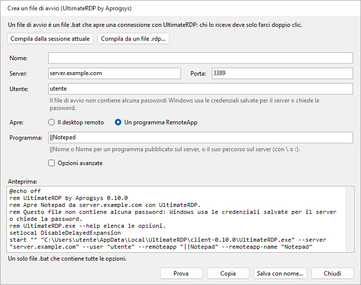

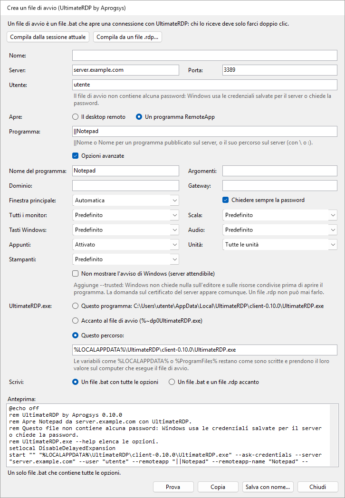

La finestra di dialogo mostra il testo del file .bat mentre digiti, oppure quale campo è errato. **Compila dalla sessione attuale** e **Compila da un file .rdp...** compilano i campi a partire dalle impostazioni della scheda attiva o di un file. **Salva con nome...** scrive il file, **Copia** ne mette il testo negli appunti, e **Prova** avvia questo UltimateRDP con le opzioni del file di avvio, che apre la connessione nel client in esecuzione. Il file di avvio non contiene alcuna password, e la finestra di dialogo non ha un campo per inserirla.

Il file .bat inizia con `@echo off`, `chcp 65001 >nul` quando un carattere del file è al di fuori di ASCII, un commento che inizia con "UltimateRDP by Aprogsys" e la sua versione e indica, nella lingua del client, cosa apre e che non contiene alcuna password, `setlocal DisableDelayedExpansion`, e `start "" "<UltimateRDP.exe>" <options>`. Viene scritto in UTF-8 senza byte order mark, con terminazioni di riga CRLF. Ogni valore è racchiuso tra virgolette in modo che cmd.exe lo passi a UltimateRDP esattamente come è stato digitato e non possa eseguire nient'altro: vedi "Note sulla sicurezza".

## Come funziona

Il client ospita il controllo ActiveX Desktop remoto di Microsoft e si registra come destinazione di rilascio sulle sue finestre. L'agente viene eseguito nella tua sessione e resta in ascolto su un canale virtuale statico chiamato `ULTRDP`. Per i file piccoli il client invia i percorsi locali e la posizione del cursore, e la sessione legge i file dalle unità reindirizzate. I file di grandi dimensioni vengono inviati attraverso il canale, come descritto dopo i passaggi seguenti.

1. Quando il trascinamento passa per la prima volta sopra la sessione, il client converte la posizione del cursore in coordinate del desktop remoto e invia `dragEnter` con i percorsi.
2. L'agente apre una finestra proxy invisibile sull'intero schermo remoto. Sposta il cursore remoto sul punto e simula la pressione del pulsante sinistro su quella finestra. La pressione avvia un vero trascinamento OLE all'interno della sessione, con i file come percorsi `\\tsclient\<drive>\...`, o come copie preliminari.
3. L'agente risponde `dragAck`. Senza questa risposta entro un secondo, il client interrompe il trascinamento.
4. Mentre ti muovi, il client invia `dragMove`. L'agente sposta il cursore remoto, così l'applicazione sottostante vede il trascinamento e mostra il suo riscontro visivo.
5. Quando rilasci il pulsante, il client invia `drop`. L'agente sposta il cursore sul punto finale e lì rilascia il pulsante simulato. Se invece esci dalla sessione, il client invia `dragLeave` e l'agente annulla il trascinamento.
6. L'agente riporta `dropResult` con l'effetto: `copy` o `link` quando la destinazione ha accettato, oppure `none` quando nulla sotto il cursore ha accettato i file. Con `none`, il rilascio viene ignorato. Il client mostra il risultato nella barra di stato.

Il trascinamento offre solo copia e collegamento, mai lo spostamento. I tasti modificatori vengono registrati nei log ma non iniettati.

In una sessione RemoteApp le finestre del server sono finestre del client, e qualsiasi cosa mostri l'agente apparirebbe anche sul tuo desktop, finestra proxy compresa. Il client quindi non invia nulla mentre ti muovi: al rilascio invia `dragEnter` e poi `drop` nello stesso punto, e mantiene aperto il rilascio dal tuo lato finché l'agente non ha risposto. L'agente riproduce il trascinamento proprio lì, con una finestra proxy di 32 per 32 pixel sotto il punto invece di una sull'intero schermo.

Per i file di grandi dimensioni, `dragEnter` trasporta la dimensione di ogni elemento, e l'agente risponde `dragAck` con `transfer: true` quando devono passare per il canale. Al passaggio 5 il client invia allora `drop` con `deferred: true`: l'agente annulla il trascinamento nella sessione e conserva il punto. Il client invia i file in blocchi di 32 KiB per impostazione predefinita, in base64, o nella forma più compatta `u15` quando l'agente indica che i dati del client gli arrivano come UTF-16, con al massimo 4 MiB non ancora confermati; l'agente li scrive nella sua cartella delle copie preliminari e verifica la dimensione e lo SHA-256 di ciascuno, risponde `transferResult`, poi rilascia le copie nel punto conservato con un breve trascinamento, e riporta `dropResult` come al passaggio 6.

Per chiudere la sessione, il client invia `logoff`. L'agente risponde `logoffResult`, attende mezzo secondo affinché la risposta raggiunga il client, poi chiede a Windows di chiudere la sessione. Non forza mai le applicazioni che hanno lavoro non salvato.

I messaggi sono oggetti JSON inviati come righe ASCII, tranne i blocchi `u15`, e ogni lato rileva in fase di esecuzione come il controllo converte i byte del canale in caratteri. Vedi [docs/design.md](docs/design.md) per i dettagli.

## Risoluzione dei problemi

- **Il primo avvio di una nuova versione richiede diversi secondi prima che appaia qualcosa.** Questo tempo trascorre prima che il processo esista: un antivirus analizza un nuovo eseguibile di circa 120 MB al suo primo avvio. Agli avvii successivi la finestra di caricamento appare in circa 0,1 s.
- **Un file di avvio su cui si è fatto clic due volte.** Dalla versione 0.10.0 il secondo clic avvia il programma sulla connessione in esecuzione; vedi "Una connessione per server e account".
- **L'agente non diventa mai pronto.** Esegui `UltimateRDP.Agent.exe --status` nella sessione: indica se l'agente vi è in esecuzione e da dove è impostato per avviarsi. L'icona nell'area di notifica appare solo quando il client è connesso, quindi la sua assenza prima di allora è normale. Anche un criterio del server può bloccare i canali virtuali: il log dell'agente contiene allora un avviso che non riesce ad aprire il canale.
- **"L'agente non ha confermato il trascinamento".** L'agente non ha risposto all'inizio del trascinamento entro un secondo. Può dipendere da una connessione lenta o da un agente occupato, e anche da un agente che è uscito o si è riavviato nella sessione, cosa che il client non può vedere altrimenti. Il client cerca allora di nuovo l'agente: l'etichetta dell'agente passa a "Agente: in attesa", e torna a "Agente pronto" quando l'agente risponde. Quando la barra di stato indica "La sessione non accetta input simulato", la sessione potrebbe essere bloccata, oppure un criterio potrebbe bloccare l'input simulato. Segnalalo con entrambi i log.
- **La destinazione non mostra alcun riscontro visivo di rilascio, o la barra di stato indica "Nessuna finestra sotto il cursore ha accettato i file."** L'applicazione sotto il cursore potrebbe non accettare file in quel punto. Alcune applicazioni rifiutano anche i percorsi di rete come `\\tsclient\C\...`. Per queste, attiva "Copia i file nella sessione prima del rilascio" nel menu dell'agente nell'area di notifica.
- **Il primo rilascio su Explorer richiede diversi secondi.** Explorer legge l'unità reindirizzata per la prima volta, il che può essere lento. I rilasci successivi sono di solito più veloci.
- **Ctrl+W o Ctrl+O non fanno nulla.** Quando la sessione ha la tastiera, questi tasti vanno al computer remoto, come tutti gli altri tasti. Usa invece il menu File.
- **Le mie applicazioni sono ancora aperte sul server dopo Esci.** È previsto: Esci e Chiudi scheda disconnettono senza terminare la sessione. Usa File, Chiudi la sessione remota.
- **I testi sono nella lingua sbagliata.** Scegli la lingua in Visualizza, Lingua. Un messaggio dell'agente segue la lingua che il client ha comunicato al momento della connessione; dopo un cambio di lingua, il messaggio successivo usa quella nuova.
- **I rilasci vengono rifiutati a causa delle unità.** Attiva il reindirizzamento delle unità nel file .rdp, in Risorse locali, Altro, Unità. Sul server, verifica il criterio "Non consentire il reindirizzamento delle unità".
- **Un programma RemoteApp si apre, ma i rilasci sulle sue finestre vengono rifiutati o non fanno nulla.** Il log del client ha una riga per ogni finestra del programma che inizia con `RemoteApp window`, con il risultato della registrazione della destinazione di rilascio, e un avviso quando non è riuscita. Le righe `RemoteApp monitors` e `the target is at` indicano se le finestre sul server si trovano dove sono sul tuo schermo; un avviso lì significa che i monitor sono cambiati dopo la connessione, e una nuova connessione risolve il problema.
- **Una sessione RemoteApp resta aperta dopo la chiusura del suo programma.** Verifica che il log dell'agente della sessione riporti `RemoteApp session detected`, e cosa dicono le righe `RemoteApp session:`: un programma ancora elencato lì mantiene aperta la sessione, con o senza l'agente. Vedi "Programmi RemoteApp".
- **Il rilascio finisce sulla finestra sbagliata.** La causa può essere il ridimensionamento delle coordinate dopo un ridimensionamento della finestra, o lo schermo intero su più monitor. Segnalalo con entrambi i log.
- **Un trasferimento di file di grandi dimensioni non riesce, o è lento.** La barra di stato ne indica il motivo. Entrambi i log chiudono ogni trasferimento con una riga di riepilogo: file, byte, secondi e MB/s, poi con le righe descritte in "Misurare un trasferimento lento". Il log del client indica anche la lunghezza della prima riga di blocco che ha inviato, e il log dell'agente ha una riga per il primo blocco di ogni file ricevuto. Quando la barra di stato indica "L'agente non ha confermato la ricezione dei primi dati del trasferimento.", i dati non sono passati: il log del client indica allora il modello dei byte, la dimensione dei blocchi, la lunghezza delle righe e il numero di righe inviate. Un `transferChunkBytes` più piccolo può aiutare, vedi "File di grandi dimensioni". Per tornare al reindirizzamento delle unità, scegli Mai nel menu dell'agente nell'area di notifica, Trasferimento rapido dei file di grandi dimensioni.
- **Un trasferimento non riesce con "Un messaggio del trasferimento è andato perso lungo il percorso".** Il controllo Desktop remoto a volte perde un messaggio breve inviato subito prima di uno grande. Dalla 0.5.1 su entrambi i lati questo non dovrebbe più accadere: l'agente chiede al client di inviare di nuovo le righe mancanti, e il riepilogo del trasferimento in entrambi i log conta le righe inviate di nuovo. Se appare ancora, un lato esegue una versione più vecchia; se un trasferimento non riesce con "Alcune righe del trasferimento sono andate perse lungo il percorso e non è stato possibile recuperarle", segnalalo con entrambi i log raccolti con `logLevel` impostato su `debug`.
- **Un trasferimento non riesce subito con "Alcuni dati sono andati persi o danneggiati lungo il percorso".** Il canale a volte danneggia lungo il percorso i dati di una riga. Dalla 0.5.2 su entrambi i lati l'agente richiede di nuovo quella riga, come per una riga persa, e il suo log descrive l'aspetto del danno in una riga che contiene "arrived damaged"; un agente 0.5.1 fa ancora fallire il trasferimento.
- **I file di grandi dimensioni non usano mai la connessione diretta, o i file della sessione non possono essere inviati.** Verifica prima che l'indirizzo pubblico del tuo computer sia nella regola del firewall della connessione diretta, sul server e presso il provider di hosting, come lo è nella regola che autorizza RDP; una nuova rete dà un nuovo indirizzo. Il log del client indica il motivo all'inizio di ogni trasferimento: "the direct connection cannot be used" con la causa, come una porta che non ha risposto entro 3 secondi. Verifica le regole del firewall di "Connessione diretta per i file di grandi dimensioni", sul server e presso il provider di hosting, e che entrambi i lati eseguano la 0.7.0. Il log dell'agente indica su quale porta si è messo in ascolto, e avvisa quando nessuna porta dell'intervallo era libera.
- **Un trasferimento diretto è più lento del collegamento.** Leggi le righe `direct connection statistics` di entrambi i log, vedi "Leggere le righe di riepilogo".
- **I file inviati dalla sessione non arrivano.** Il log del client ha una riga `Send offer` per ogni offerta, poi righe `Receive <id>:` che indicano se è stato possibile stabilire la connessione diretta, e perché no. Il log dell'agente ha le stesse righe `Send <id>:`. Quando il log del client non ha alcuna riga `Send offer`, verifica che entrambi i lati eseguano la 0.9.0 e che `receiveFiles` e `directTransfer` non siano `never` in client.json; la riga `Hello from client` del log dell'agente riporta `receives files of the session: True` quando non lo sono.
- **Dove si trovano i log.** Il client scrive `%LOCALAPPDATA%\UltimateRDP\logs\client-yyyyMMdd.log` sul tuo computer. L'agente scrive `agent-yyyyMMdd.log` nella stessa cartella sul server; dalla versione 0.9.0 ciascuna delle sue righe indica la sessione e il thread, come `[S3 12]`, poiché gli agenti di uno stesso utente in più sessioni scrivono lo stesso file. Entrambi conservano quattordici giorni di log. Il client apre la sua cartella da Guida, Apri la cartella dei log, e l'agente dal suo menu nell'area di notifica, Apri la cartella dei log.

## Compilare dai sorgenti

Serve il .NET 10 SDK su Windows.

```
dotnet build UltimateRDP.sln -c Release
dotnet test UltimateRDP.sln
```

Per pubblicare un eseguibile autonomo in un solo file senza simboli:

```
dotnet publish src/UltimateRDP.Client -c Release -r win-x64 --self-contained true -p:PublishSingleFile=true -p:IncludeNativeLibrariesForSelfExtract=true -p:DebugType=none -p:DebugSymbols=false
dotnet publish src/UltimateRDP.Agent -c Release -r win-x64 --self-contained true -p:PublishSingleFile=true -p:IncludeNativeLibrariesForSelfExtract=true -p:DebugType=none -p:DebugSymbols=false
```

Le release vengono compilate da GitHub Actions quando viene inviato un tag `v*`. Il workflow compila, esegue i test, pubblica entrambe le applicazioni e allega i due zip alla release.

Gli eseguibili di una release sono firmati da APROGSYS, e Windows mostra questo editore nelle sue richieste. Un eseguibile che compili da te non è firmato.

## Note sulla sicurezza

- L'agente legge solo da `\\tsclient\`, cioè dalle unità che hai scelto di condividere. L'agente stesso scrive solo nella sua cartella delle copie preliminari nella tua sessione, quando la copia preliminare è attiva o quando i file arrivano attraverso il canale. Rifiuta qualsiasi nome di file che uscirebbe da quella cartella. È l'applicazione su cui rilasci a decidere dove vanno i file. L'agente non viene eseguito come servizio e non ha privilegi oltre ai tuoi.
- L'agente simula l'input solo all'interno della tua sessione, e solo tra l'inizio e la fine di un trascinamento. Usa solo il pulsante sinistro del mouse. Inietta la pressione solo quando la propria finestra proxy è sotto il cursore, quindi la pressione non raggiunge mai un'altra applicazione. Per annullare, invia Esc alla propria finestra proxy invece di simulare un tasto.
- L'agente non offre mai lo spostamento. Uno spostamento accettato nella sessione potrebbe eliminare il file sul tuo disco locale attraverso l'unità reindirizzata.
- I messaggi trasportano percorsi di file, coordinate, indicatori dei tasti modificatori e nomi di finestre. Il contenuto dei file passa per il canale solo per un trasferimento di file di grandi dimensioni, all'interno della connessione Desktop remoto cifrata.
- Dalla versione 0.6.0, i file di un trasferimento di file di grandi dimensioni possono invece passare per una connessione TLS diretta. L'agente resta in ascolto solo mentre un trasferimento è offerto, e accetta una connessione solo con una prova del token monouso che ha fornito attraverso la connessione Desktop remoto cifrata, ogni connessione dell'offerta una sola volta, 16 al massimo. Il client accetta solo il certificato il cui SHA-256 l'agente ha indicato in quella sede. I file vanno nella stessa cartella delle copie preliminari, con gli stessi controlli. Apri le porte solo agli indirizzi client autorizzati per RDP.
- Dalla versione 0.9.0, la sessione può inviare file al tuo computer. Solo l'utente della sessione può avviare l'invio, tramite l'agente di quella sessione: `--send` raggiunge quell'agente attraverso una pipe che accetta solo processi dello stesso utente nella stessa sessione. Il client accetta file solo dopo aver risposto a un'offerta arrivata attraverso la connessione Desktop remoto cifrata della propria sessione, solo attraverso la connessione diretta di cui quell'offerta ha fornito il certificato e il token, e solo nella sua cartella per i file ricevuti. Non sostituisce mai un file, non ne esegue mai uno, e contrassegna ciascuno come download.
- Dalla versione 0.10.0, la riga di comando può fornire una connessione, e il client può scrivere file di avvio. Nessuna opzione accetta una password. Ogni valore della riga di comando viene verificato prima che si apra qualcosa, e non può aggiungere una chiave alle impostazioni .rdp in cui viene trasformato. In un file di avvio, ogni valore è tra virgolette doppie secondo le regole di quoting della riga di comando di Windows, ogni `%` è raddoppiato, un `^` precede `& | < > ^ ( )` ovunque cmd.exe legga al di fuori delle virgolette, e l'espansione ritardata è disattivata, così nessun valore può aggiungere un comando o espandere una variabile. I test lo verificano con un modello di cmd.exe e con cmd.exe stesso.
- Il client non scrive mai le credenziali e non le registra mai nei log. Legge la credenziale generica `TERMSRV/<host>` quando ne esiste una, e la passa al controllo Microsoft. Le altre richieste di credenziali provengono dal controllo Microsoft.

## Stato

La versione 0.10.0 aggiunge le opzioni di una connessione sulla riga di comando, il generatore di file di avvio, una connessione per server e account per i programmi RemoteApp, e `--trusted`. I suoi file di avvio sono stati verificati con cmd.exe sul computer dei test; la connessione RemoteApp condivisa e `--trusted` non erano stati provati con un server reale al momento del rilascio. La versione 0.9.0 è una release di prova. I file inviati dalla sessione al tuo computer, l'avvio di un programma RemoteApp da un collegamento, le correzioni delle sue finestre e l'opzione della password non erano stati provati con un server reale al momento del rilascio; nemmeno le lettere di unità della 0.8.0.

Verificato in una vera sessione Desktop remoto, con la versione 0.2.1:

- Il canale virtuale tra il client e l'agente, con un byte per carattere in entrambe le direzioni.
- Il trasferimento tramite il reindirizzamento delle unità verso il desktop remoto.
- Il trascinamento dal vivo in un'applicazione remota.

Il comando di chiusura della sessione e le traduzioni sono novità della 0.3.0. Il trasferimento rapido dei file di grandi dimensioni è una novità della 0.4.0. La sua prima prova con un server reale non è riuscita. La versione 0.4.1 corregge i due difetti trovati in quell'occasione; con essa, un file di 496 MB ha raggiunto una sessione reale in 193 secondi. La versione 0.4.2 aggiunge una finestra di avanzamento a ogni rilascio e modifica solo il client. La versione 0.4.3 corregge i messaggi brevi che il controllo Desktop remoto a volte perdeva subito prima di uno grande, cosa che faceva fallire alcuni trasferimenti al loro inizio. La versione 0.4.4 misura dove va il tempo di un trasferimento, su entrambi i lati, e aggiunge le impostazioni `transferWindowBytes` e `channelRead` per verificare cosa lo limita.

Le sue misurazioni hanno mostrato che nessuno dei due lati limita il trasferimento: il canale è pieno, e la codifica dei dati ne occupava la parte maggiore. La versione 0.5.0 invia i file in una forma più compatta quando i dati del client arrivano all'agente come UTF-16, il che dovrebbe aumentare la velocità di circa 2,5 volte, da 2,1 MB/s a circa 5,4 MB/s su un canale di 5,8 MB/s. Mantiene anche il trasferimento rapido quando rilasci il pulsante in fretta, prima che l'agente abbia risposto all'inizio del trascinamento, anche quando quella risposta arriva in due fasi. La versione 0.5.1 numera i messaggi di un trasferimento, così l'agente richiede quelli che il controllo Desktop remoto ha perso e il trasferimento prosegue. La versione 0.5.2 fa lo stesso per un messaggio che arriva danneggiato. La versione 0.6.0 invia i file di grandi dimensioni attraverso una connessione TLS diretta quando il server apre le sue porte a questo scopo, poiché il canale restava tra 2 e 4 MB/s. La sua prima prova in produzione ha raggiunto da 135 a 180 MB/s per alcuni secondi, poi circa 20 MB/s, il limite di una sola connessione TCP su quel percorso; la versione 0.7.0 usa quindi più connessioni contemporaneamente, e registra dove va il tempo di un trasferimento. La versione 0.8.0 apre i programmi RemoteApp e accetta i rilasci sulle loro finestre, impedisce all'agente di tenere aperta una sessione RemoteApp, può assegnare alle unità del client lettere della sessione, e legge le impostazioni per l'intero computer. La sua prima prova reale con Notepad ha funzionato e ha mostrato una finestra vuota del controllo sopra un monitor, una finestra principale sempre visibile, dieci secondi persi prima dell'avvio del programma, e una conclusione normale mostrata come errore. La versione 0.9.0 corregge questi problemi, apre i programmi RemoteApp da un collegamento con solo le loro finestre sullo schermo, invia file dalla sessione al tuo computer, e può chiedere la password ogni volta.

Riscontri utili:

- Se il trascinamento dal vivo funziona nella tua sessione, e con quali applicazioni.
- Se la chiusura della sessione funziona per te, e la formulazione nella tua lingua.
- La velocità di un trasferimento di file di grandi dimensioni sulla tua connessione, dalla riga di riepilogo di entrambi i log.

- Quanto tempo richiede il primo rilascio su Explorer.
- Se i rilasci finiscono nel punto giusto a schermo intero, con un monitor o con tutti i monitor.
- Se le credenziali salvate funzionano, e quale tipo hai in Gestione credenziali.
- Con RemoteApp: se il programma si apre, se un rilascio sulle sue finestre finisce dove hai rilasciato il pulsante, e se la sessione termina come prima quando il programma si chiude, con entrambi i log.

Inviali tramite le [issue di GitHub](https://github.com/freeKC/ultimaterdp/issues), con entrambi i log.

## Riconoscimenti

UltimateRDP by Aprogsys è sviluppato e pubblicato da [APROGSYS](https://www.aprogsys.com/). Il codice sorgente è su [GitHub](https://github.com/freeKC/ultimaterdp), con licenza MIT.

## Licenza

MIT. Vedi [LICENSE](LICENSE).
