# UltimateRDP

[](https://github.com/freeKC/ultimaterdp/actions/workflows/ci.yml)

[English](README.md) | [Français](README.fr.md) | [Deutsch](README.de.md) | [Español](README.es.md) | [Italiano](README.it.md) | **Nederlands** | [Português](README.pt.md)

De Engelse README is de referentie; deze vertaling volgt die.

UltimateRDP by Aprogsys verplaatst grote bestanden tussen uw computer en een sessie van Extern bureaublad via meerdere TLS-verbindingen tegelijk, buiten de RDP-stroom om. Op een productieopstelling haalde het 255 tot 296 MB/s van de pc naar de server en 115 tot 134 MB/s van de server naar de pc, terwijl het virtuele RDP-kanaal ongeveer 2 MB/s haalt en één TCP-verbinding uitkwam op 20 tot 22 MB/s: zie "Snelle overdrachten via parallelle verbindingen".

Met UltimateRDP sleept u bestanden of mappen van uw bureaublad naar een sessie van Extern bureaublad en zet u ze daar neer, op de toepassing onder de cursor. Verkenner, een e-mailprogramma, een browser of een bedrijfstoepassing ontvangt ze alsof u ze in de sessie zelf had neergezet. Als niets onder de cursor ze accepteert, wordt het neerzetten genegeerd. Bestanden gaan ook de andere kant op, van de sessie naar uw computer. UltimateRDP opent bureaubladen en RemoteApp-programma's, vanuit een .rdp-bestand of vanuit één .bat-startbestand dat het voor u schrijft. Het bestaat uit een client die het besturingselement van Microsoft Extern bureaublad bevat, een kleine agent in de sessie, een virtueel kanaal tussen die twee, de standaardomleiding van stations en de directe verbindingen voor grote bestanden.

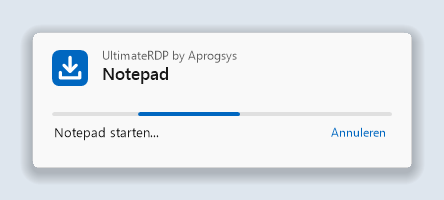

## Inhoud

<!-- toc -->
- [Snelle overdrachten via parallelle verbindingen](#snelle-overdrachten-via-parallelle-verbindingen)
- [Waarom](#waarom)
- [Wat u nodig hebt](#wat-u-nodig-hebt)
- [Installatie](#installatie)
  - [Op de server](#op-de-server)
  - [Sessies geopend met de Microsoft-client](#sessies-geopend-met-de-microsoft-client)
  - [Op uw computer](#op-uw-computer)
- [Gebruik](#gebruik)
  - [Sessies en tabbladen](#sessies-en-tabbladen)
  - [Het laadvenster](#het-laadvenster)
  - [De sessie beëindigen](#de-sessie-beëindigen)
  - [Slepen naar de sessie](#slepen-naar-de-sessie)
  - [Grote bestanden](#grote-bestanden)
  - [Bestanden uit de sessie naar uw computer sturen](#bestanden-uit-de-sessie-naar-uw-computer-sturen)
  - [Berichten in de statusbalk](#berichten-in-de-statusbalk)
  - [Menu Beeld](#menu-beeld)
  - [Taal](#taal)
  - [Opgeslagen referenties en het wachtwoord](#opgeslagen-referenties-en-het-wachtwoord)
- [Instellingen van de client](#instellingen-van-de-client)
- [Systeemvakmenu en instellingen van de agent](#systeemvakmenu-en-instellingen-van-de-agent)
  - [Instellingen voor de hele computer](#instellingen-voor-de-hele-computer)
  - [Stations van de client op stationsletters](#stations-van-de-client-op-stationsletters)
- [Directe verbinding voor grote bestanden](#directe-verbinding-voor-grote-bestanden)
  - [Firewallregels](#firewallregels)
  - [Terugval](#terugval)
  - [Instellingen](#instellingen)
  - [De samenvattingsregels lezen](#de-samenvattingsregels-lezen)
- [RemoteApp-programma's](#remoteapp-programmas)
  - [Vanuit een snelkoppeling of een .bat-bestand](#vanuit-een-snelkoppeling-of-een-bat-bestand)
  - [Op uw computer](#op-uw-computer-1)
  - [Op de server](#op-de-server-1)
  - [Testen met één account](#testen-met-één-account)
  - [Eén verbinding per server en account](#eén-verbinding-per-server-en-account)
- [Startbestanden](#startbestanden)
  - [Opties van de opdrachtregel](#opties-van-de-opdrachtregel)
  - [De generator voor startbestanden](#de-generator-voor-startbestanden)
- [Hoe het werkt](#hoe-het-werkt)
- [Problemen oplossen](#problemen-oplossen)
- [Bouwen vanaf de broncode](#bouwen-vanaf-de-broncode)
- [Opmerkingen over beveiliging](#opmerkingen-over-beveiliging)
- [Status](#status)
- [Credits](#credits)
- [Licentie](#licentie)
<!-- /toc -->

## Snelle overdrachten via parallelle verbindingen

Wat het is:

- Vanaf versie 0.6.0 gaan grote bestanden via een directe TLS-verbinding tussen de client en de agent, buiten de verbinding van Extern bureaublad om, en vanaf versie 0.7.0 via meerdere verbindingen tegelijk, standaard acht, hoogstens zestien. De verbindingen gebruiken TLS 1.3 wanneer beide Windows-versies dat bieden, zoals Windows 11 en Windows Server 2022, en anders TLS 1.2.
- De agent maakt zijn certificaat in het geheugen aan en geeft de SHA-256 ervan en een token voor eenmalig gebruik door via het virtuele RDP-kanaal, dat al geverifieerd en versleuteld is. De client accepteert alleen dat certificaat, en de agent accepteert alleen verbindingen die bewijzen dat ze het token kennen.
- Elk bestand wordt aan het eind gecontroleerd met zijn SHA-256. Een bestand dat niet overeenkomt, wordt niet bewaard.
- Wanneer de directe verbinding niet kan worden gebruikt, bijvoorbeeld via een Remote Desktop Gateway of met gesloten poorten, gaan de bestanden via het virtuele RDP-kanaal zonder dat de gebruiker iets hoeft te doen, en het logboek van de client vermeldt waarom.

Waarom het ertoe doet:

- Het virtuele RDP-kanaal haalde in productie ongeveer 2 MB/s, ongeacht de verbinding.
- Omleiding van stations leest een bestand in kleine blokken, met één heen-en-terugreis per blok: 3,6 MB/s bij een meting op een verbinding die 9,7 MB/s haalde.
- Eén TCP-verbinding op het productiepad begon op 90 tot 180 MB/s en kwam na de eerste seconden uit op 20 tot 22 MB/s. De limiet geldt per verbinding, ergens op het pad, en meerdere verbindingen tellen op.

Gemeten op een productieopstelling, een server bij een hostingprovider en een pc op een lijn van 2,3 Gbit/s:

| Pad | Snelheid |
| --- | --- |
| Pc naar server, 8 directe verbindingen | 255 tot 296 MB/s |
| Server naar pc, 8 directe verbindingen | 115 tot 134 MB/s, het plafond van de uitgaande verbinding van die server |
| Eén directe verbinding, na de eerste seconden | 20 tot 22 MB/s |
| Dezelfde bestanden via het virtuele RDP-kanaal | ongeveer 2 MB/s |

Dit zijn metingen op één opstelling; de snelheden hangen af van de verbinding, de server en de schijven. De server heeft een firewallregel nodig voor een reeks poorten: zie "Directe verbinding voor grote bestanden".

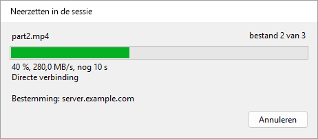

## Waarom

De Microsoft-client voor Extern bureaublad weigert neerzetten op zijn venster, omdat RDP geen kanaal voor slepen en neerzetten heeft. Kopiëren en plakken werkt, en omleiding van stations ook, maar geen van beide is neerzetten. UltimateRDP voegt het gebaar toe bovenop wat RDP al biedt.

Terwijl u over het venster van de client sleept, speelt de agent hetzelfde slepen in de sessie na als een echte OLE-sleepbewerking. Elke externe toepassing die neergezette bestanden accepteert, accepteert ze dus ook van UltimateRDP, en toont haar eigen feedback voor neerzetten terwijl u beweegt. Als niets onder de cursor het neerzetten accepteert, wordt het neerzetten genegeerd: er wordt nergens iets gekopieerd.

Kleine bestanden reizen via omleiding van stations. Grote bestanden reizen vóór het neerzetten via het kanaal van UltimateRDP: zie "Grote bestanden" hieronder.

## Wat u nodig hebt

- Een clientcomputer met Windows 10 of 11, 64-bits.
- Een server met Windows Server 2016 of later, of een computer met Windows 10 of 11 die als host voor Extern bureaublad dient.
- Een .rdp-bestand dat stations omleidt. In de instellingen van Verbinding met extern bureaublad is dat Lokale bronnen, dan Meer, dan Stations.
- De mogelijkheid om de agent in uw gebruikerssessie op de server uit te voeren.

De client is één draagbaar uitvoerbaar bestand. Het draait zonder administratorrechten. Het archief van de agent bevat ook één uitvoerbaar bestand.

UltimateRDP werkt via een Remote Desktop Gateway. De directe verbinding voor grote bestanden niet, en de bestanden gaan dan via het kanaal: zie "Directe verbinding voor grote bestanden".

UltimateRDP heeft bewust een beperkt bereik:

- Neerzetten gaat in één richting, van de lokale computer naar de sessie. Vanaf versie 0.9.0 stuurt de sessie bestanden naar uw computer met het menu Kopiëren naar in plaats van met neerzetten, en alleen via de directe verbinding: zie "Bestanden uit de sessie naar uw computer sturen".
- Volledige bureaubladsessies, en vanaf versie 0.8.0 RemoteApp-programma's: zie "RemoteApp-programma's".
- De sessie start altijd in een venster, ook als het .rdp-bestand om volledig scherm vraagt. U kunt daarna naar volledig scherm overschakelen. In volledig scherm kunt u alleen neerzetten vanaf een beeldscherm dat de sessie niet bedekt.

## Installatie

Elk zip-bestand bevat één `.exe`-bestand.

### Op de server

1. Download het zip-bestand `UltimateRDP.Agent` van de [pagina Releases](https://github.com/freeKC/ultimaterdp/releases).
2. Pak het uit in een map die elke gebruiker kan lezen, zoals `C:\Program Files\UltimateRDP`.
3. Voer vanaf een opdrachtprompt met verhoogde bevoegdheden uit:

   ```
   "C:\Program Files\UltimateRDP\UltimateRDP.Agent.exe" --install-all-users
   ```

   De agent start dan met elke gebruikerssessie. Gebruikers die al zijn aangemeld, krijgen hem bij hun volgende aanmelding. De opdracht nogmaals uitvoeren verandert niets. Als u de agent voor uw eigen account had geïnstalleerd met `--install`, verwijdert de opdracht ook die vermelding en meldt dat, zodat de agent niet twee keer start in uw sessie. De opdracht weigert een uitvoerbaar bestand in een gebruikersprofiel, zoals een map Downloads, omdat andere gebruikers het mogelijk niet kunnen lezen.

Om de agent alleen voor uw eigen account te installeren, voert u dezelfde opdracht uit met `--install` vanaf een gewone opdrachtprompt. Dit start de agent ook meteen.

RemoteApp-sessies gebruiken de vermelding `Run` niet. Om de agent daar ook te hebben, zie "RemoteApp-programma's" hieronder.

Andere opties:

- `--uninstall` zorgt dat de agent niet meer met uw sessie start en stopt de actieve kopie. Voer het uit vanaf een opdrachtprompt met verhoogde bevoegdheden om ook de vermelding voor alle gebruikers te verwijderen.
- `--send <paths>` stuurt bestanden en mappen van de sessie naar de computer van de UltimateRDP-client die ermee verbonden is. De snelkoppeling in Kopiëren naar voert het uit; zie "Bestanden uit de sessie naar uw computer sturen".
- `--status` toont de versie, de vermeldingen `Run` onder `HKEY_CURRENT_USER` en `HKEY_LOCAL_MACHINE`, het instellingenbestand, het instellingenbestand van de computer en of de agent in uw sessie draait. Het vermeldt ook of de sessie een RemoteApp-sessie is, en of de waarde `SysProcs` en de geplande taak van "RemoteApp-programma's" bestaan. Het verandert niets.
- `--help` toont de opties.

Om bij te werken op een server, stopt u elke kopie van de agent vanaf een opdrachtprompt met verhoogde bevoegdheden met `taskkill /im UltimateRDP.Agent.exe /f`, vervangt u het uitvoerbare bestand en laat u de gebruikers zich opnieuw aanmelden. Om uw eigen kopie bij te werken, sluit u die af via het menu in het systeemvak of met `--uninstall`, vervangt u het uitvoerbare bestand en installeert u het opnieuw. De client en de agent moeten dezelfde versie hebben.

### Sessies geopend met de Microsoft-client

Op een server maken de meeste gebruikers misschien verbinding met de Microsoft-client (mstsc), die geen kanaal van UltimateRDP heeft. Voor hen blijft de agent uit het zicht en doet hij niets zichtbaars:

- Hij toont geen pictogram, geen venster en geen bericht. Zijn pictogram in het systeemvak verschijnt alleen zolang een UltimateRDP-client met de sessie verbonden is, en verdwijnt wanneer die client de verbinding verbreekt; in een RemoteApp-sessie verschijnt het nooit. De instelling `trayIcon` hieronder verandert dit.
- Terwijl hij wacht, gebruikt hij een paar megabytes geheugen en geen meetbare processortijd. Hij probeert zijn kanaal elke tien seconden te openen, en meteen wanneer een client verbinding maakt met de sessie, zodat een gebruiker die opnieuw verbinding maakt met de UltimateRDP-client de agent gereed vindt.
- Zijn logboek krijgt één regel bij het starten en hoogstens één regel per uur terwijl hij wacht.
- Hij overleeft het verbreken en herstellen van verbindingen, met beide clients. Bij het afmelden laat hij de muisknop los als er een neerzetbewerking bezig was, sluit hij het kanaal en sluit hij af, zonder het afmelden te vertragen.
- Een onverwachte fout toont nooit een dialoogvenster: die wordt in het logboek geschreven, en de agent gaat door of sluit stil af.

### Op uw computer

1. Download het zip-bestand `UltimateRDP` van de [pagina Releases](https://github.com/freeKC/ultimaterdp/releases).
2. Pak het ergens uit. Er hoeft niets te worden geïnstalleerd. UltimateRDP schrijft niets in het register.
3. Start het met uw verbindingsbestand:

   ```
   UltimateRDP.exe path\to\connection.rdp
   ```

   U kunt ook dubbelklikken op `UltimateRDP.exe` en het .rdp-bestand in het dialoogvenster kiezen.

## Gebruik

### Sessies en tabbladen

Elke sessie opent in een eigen tabblad. De statusbalk en de menu's volgen het actieve tabblad. Het menu Bestand bevat:

- **.rdp openen...** (Ctrl+O): opent een verbindingsbestand in een nieuw tabblad.
- **Recent**: de laatste tien verbindingsbestanden. **Lijst wissen** maakt de lijst leeg.
- **Startbestand maken (.bat)...**: vanaf versie 0.10.0 schrijft dit een .bat-bestand dat één verbinding opent. Zie "Startbestanden".
- **Opnieuw openen in nieuw tabblad**: opent het bestand van het actieve tabblad nog een keer, in een tweede tabblad. Vanaf versie 0.10.0 blijft in plaats daarvan het tabblad zelf geselecteerd zolang de sessie ervan verbonden is: een tweede verbinding met hetzelfde account zou de sessie overnemen. Zie "Eén verbinding per server en account".
- **Tabblad sluiten** (Ctrl+W): verbreekt de verbinding met de actieve sessie en sluit het tabblad.
- **Afmelden bij de externe sessie**: beëindigt uw Windows-sessie op de server. Zie "De sessie beëindigen" hieronder.
- **Opgeslagen referenties vergeten**: zie "Opgeslagen referenties en het wachtwoord" hieronder.
- **Altijd om het wachtwoord vragen**: vanaf versie 0.9.0 vraagt elke verbinding om het wachtwoord in plaats van een opgeslagen referentie te gebruiken. Zie "Opgeslagen referenties en het wachtwoord" hieronder.
- **Afsluiten**: verbreekt de verbinding met elke sessie en sluit het venster.

Het menu Sessie bevat Verbinden, Verbinding verbreken, Opnieuw naar de agent zoeken en Overdracht annuleren. Zie "Grote bestanden" hieronder.

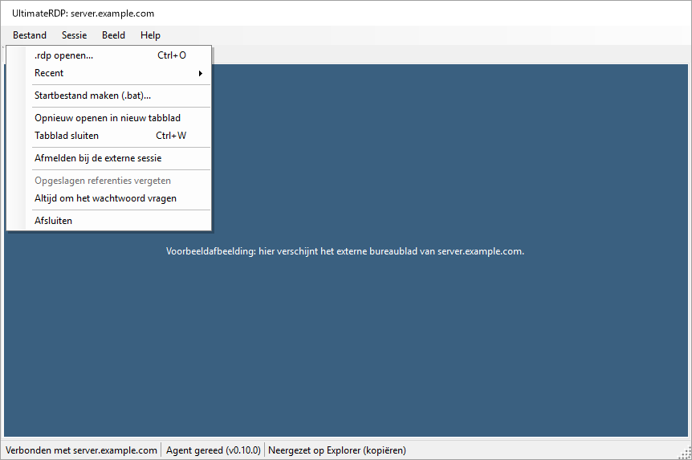

Het menu Help bevat Over UltimateRDP, dat "UltimateRDP by Aprogsys", de versie en het adres van het project toont, Projectpagina en Logboekmap openen.

### Het laadvenster

Vanaf versie 0.9.3 verschijnt een klein venster zodra UltimateRDP met een verbinding start, vanuit een .bat-bestand, een snelkoppeling of het uitvoerbare bestand, totdat het programma of het bureaublad er is. Het toont "UltimateRDP by Aprogsys", de naam van het programma of van de server, een bewegende balk en de stap: "Starten...", "Verbinden met server.example.com...", "Sessie openen...", "Notepad starten...". Na 10 seconden meldt het dat de server er langer over doet dan gewoonlijk. Met Annuleren stopt u de verbinding.

 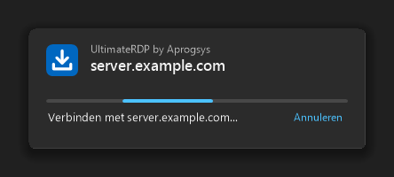

- Het sluit wanneer het venster van het programma verschijnt, wanneer het bureaublad is aangemeld, of bij elk eerder einde.
- Het volgt het lichte of donkere thema van Windows en de schaal van zijn beeldscherm, neemt nooit het toetsenbord over en heeft geen knop op de taakbalk.
- Het verdwijnt zolang de certificaatvraag van de server, de vraag om het wachtwoord, de waarschuwing van Windows over een RemoteApp-verbinding of een bericht van UltimateRDP op een antwoord wacht, en komt daarna terug boven de andere vensters, zonder het toetsenbord over te nemen.
- Een tweede start die aan de actieve UltimateRDP wordt doorgegeven, toont meteen het laadvenster van de nieuwe sessie.
- `"loader": "off"` in client.json schakelt het uit.

### De sessie beëindigen

Afsluiten, Tabblad sluiten en Sessie, Verbinding verbreken verbreken alleen de verbinding, zoals de Microsoft-client voor Extern bureaublad doet. Uw Windows-sessie blijft op de server actief, met haar toepassingen, en u vindt haar terug bij de volgende verbinding.

Om de sessie echt te beëindigen, gebruikt u Bestand, Afmelden bij de externe sessie. De opdracht is beschikbaar zodra de statusbalk "Agent gereed" meldt. De client vraagt om een bevestiging, waarna de agent de sessie afmeldt, zoals de opdracht Afmelden van het menu Start zou doen. Toepassingen met niet-opgeslagen werk vragen in de sessie wat er moet gebeuren, voordat die sluit. De statusbalk meldt "Afmelden bij de externe sessie..." en toont daarna het verbreken van de verbinding.

### Slepen naar de sessie

1. Start de client. Die maakt verbinding met de instellingen van het .rdp-bestand. Meld u aan zoals gewoonlijk.
2. Let op de statusbalk onder in het venster. Het label van de agent gaat van "Agent: wachten" naar "Agent gereed (v0.4.3)".
3. Sleep bestanden of mappen vanuit Verkenner naar de sessie. Een blauwe banner boven in de sessie meldt "Zet de bestanden hier neer om ze naar de sessie te sturen".
4. Beweeg over de externe toepassing die u wilt. Die toont haar eigen feedback voor neerzetten, bijvoorbeeld een gemarkeerde map of een gebied voor bijlagen.
5. Laat de knop los op het doel. De externe toepassing ontvangt de bestanden als een gewone neerzetbewerking.

Bij elke neerzetbewerking verschijnt een voortgangsvenster. Het venster "Neerzetten in de sessie" opent boven de sessie zodra u de knop loslaat. Het toont de neergezette items, een balk die zonder waarde loopt, "Neerzetten in de sessie..." en de naam van de externe computer. Daarna toont het het resultaat, zoals "Neergezet op Postvak IN (kopiëren)" of "Niets onder de cursor heeft de bestanden geaccepteerd.", en sluit het vanzelf drie seconden later, tenzij de muis erboven staat. Wanneer het neerzetten mislukt, toont het de reden in het rood en blijft het open totdat u op Sluiten klikt. Voor grote bestanden toont hetzelfde venster eerst de overdracht, zie "Grote bestanden" hieronder. Het venster neemt nooit het toetsenbord van de sessie over, blijft boven het hoofdvenster en blijft open wanneer u van tabblad wisselt. Wanneer u het tabblad van de sessie sluit, sluit ook het venster.

Als niets onder de cursor het neerzetten accepteert, wordt het neerzetten genegeerd en meldt de statusbalk "Niets onder de cursor heeft de bestanden geaccepteerd." De agent kopieert nooit uit zichzelf bestanden.

Wanneer het doel Verkenner is, toont Verkenner in de sessie zijn gebruikelijke kopieervenster van Windows. Dat toont de voortgang en vraagt wat er moet gebeuren als een bestand al bestaat.

UltimateRDP biedt de externe toepassing alleen kopiëren en koppelen aan. Het biedt nooit verplaatsen aan. Ctrl, Shift en Alt worden tijdens het slepen niet aan de sessie doorgegeven.

### Grote bestanden

Een externe toepassing leest een bestand via omleiding van stations in kleine blokken, met één heen-en-terugreis over het netwerk per blok. Op een verbinding met enige latentie is dit traag: bij één meting 3,6 MB/s op een verbinding die 9,7 MB/s haalde. Voor grote bestanden stuurt UltimateRDP de bestanden daarom vóór het neerzetten via zijn eigen kanaal, in een doorlopende stroom.

Standaard gebeurt dit wanneer de neergezette bestanden en mappen samen 10 MiB of meer bevatten. De instelling "Snelle overdracht van grote bestanden" van de agent verandert dat, zie "Systeemvakmenu en instellingen van de agent" hieronder.

Wat u ziet:

1. Het slepen over de sessie werkt zoals gewoonlijk: de externe toepassing toont haar feedback voor neerzetten.
2. Wanneer u de knop loslaat, eindigt het slepen in de sessie zonder neerzetten, en toont het venster "Neerzetten in de sessie" de overdracht. De statusbalk toont ook de voortgang: "3 bestand(en) overdragen: 42 % (12,3 MB/s, nog 1 min)".
3. Zodra elk bestand in de sessie staat, zet de agent de kopieën neer waar u de knop hebt losgelaten, en meldt de statusbalk zoals gewoonlijk "Neergezet op ...".

Tijdens een overdracht toont het venster "Neerzetten in de sessie" de naam van het bestand dat wordt verzonden met "bestand 2 van 3", een voortgangsbalk, een regel zoals "42 %, 2,6 MB/s, nog 1 min 40 s", en de naam van de externe computer. Terwijl de client de bestanden opsomt, loopt de balk zonder waarde en meldt de regel "Voorbereiden...". Met de knop Annuleren stopt u de overdracht, net als met Sessie, Overdracht annuleren. Na een geslaagde overdracht meldt het "3 bestand(en) overgedragen in 3 min 13 s met 2,6 MB/s, neerzetten in de sessie...", toont het daarna het resultaat van het neerzetten en sluit het vanzelf drie seconden later, tenzij de muis erboven staat. Na een mislukking of een annulering toont het de reden in het rood en blijft het open totdat u op Sluiten klikt. Wanneer u het tabblad van de sessie sluit, wordt de overdracht geannuleerd en sluit het venster.

 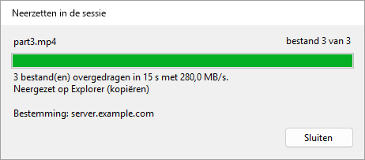

De kopieën gaan naar `%LOCALAPPDATA%\UltimateRDP\staging` in de sessie en worden een uur na het neerzetten verwijderd. De agent controleert de grootte en de SHA-256-controlesom van elk bestand. Als er iets misgaat, wordt er niets neergezet en meldt de statusbalk waarom. Sessie, Overdracht annuleren stopt de overdracht; de agent verwijdert dan wat hij heeft ontvangen.

Goed om te weten:

- Eén overdracht tegelijk. Terwijl er een loopt, wordt een nieuwe sleepbewerking over de sessie geweigerd, en meldt het voortgangsvenster vijf seconden lang "Wacht tot deze overdracht klaar is voordat u meer bestanden neerzet."
- Omleiding van stations moet nog steeds aan staan: het slepen over de sessie gebruikt die.
- Als u de knop heel snel loslaat, voordat de agent op het begin van het slepen heeft geantwoord, wacht de client op dat antwoord, hoogstens anderhalve seconde, met "Voorbereiden..." in het voortgangsvenster, zodat grote bestanden toch via het kanaal van UltimateRDP gaan. Tijdens dat wachten wordt een nieuwe sleepbewerking geweigerd, net als tijdens een overdracht.
- Lege mappen in een neergezette map worden niet in de sessie aangemaakt.
- De agent moet versie 0.4.1 of later draaien, en de client ook. Het voortgangsvenster is nieuw in client 0.4.2 en werkt met een agent 0.4.1. Met een oudere client of agent gaat elke neerzetbewerking via omleiding van stations.
- Vanaf versie 0.6.0 aan beide kanten gaan de bestanden via een directe verbinding wanneer de server zijn poorten daarvoor openzet, en anders via het kanaal. Vanaf 0.7.0 aan beide kanten gebruikt de directe verbinding meerdere TCP-verbindingen tegelijk. Zie "Directe verbinding voor grote bestanden".

Vanaf versie 0.5.0 reizen de bestanden in een compactere vorm wanneer uw verbinding dat toelaat. De agent vertelt de client hoe de gegevens van de client bij hem aankomen. Wanneer elk teken als twee bytes aankomt, zoals gemeten op een productieserver, verpakt de client 15 bits van het bestand in elk teken in plaats van base64, en kost een byte van het bestand ongeveer 1,07 bytes op het kanaal in plaats van 2,67. Op een kanaal dat 5,8 MB/s haalt, gaat de overdracht van ongeveer 2,1 MB/s naar ongeveer 5,4 MB/s. Wanneer elk teken als één byte aankomt, houdt de client base64 aan, op ongeveer drie kwart van het kanaal. Beide kanten moeten 0.5.0 draaien voor de compactere vorm; met een oudere agent stuurt de client base64 zoals voorheen. De statusbalk en het voortgangsvenster veranderen niet; het logboek van de client vermeldt welke vorm een overdracht gebruikt.

De client stuurt de bestanden in blokken van 32 KiB. De instelling `transferChunkBytes` in `%LOCALAPPDATA%\UltimateRDP\client.json` verandert die grootte, van 4096 (4 KiB) tot 262144 (256 KiB). Een waarde buiten deze grenzen wordt binnen de grenzen teruggebracht. De instelling kan alleen in het bestand worden bewerkt, en geldt zodra de client opnieuw start. Laat haar ongemoeid, tenzij een overdracht bij het begin mislukt.

```json
{
  "transferChunkBytes": 32768,
  "transferBatchCharacters": 200000,
  "transferWindowBytes": 4194304,
  "directTransfer": "auto",
  "directConnections": 8,
  "logLevel": "info"
}
```

De client stuurt zijn berichten aan de agent gebundeld, hoogstens `transferBatchCharacters` tekens in één aanroep van het besturingselement van Extern bureaublad: standaard 200000, van 50000 tot 1048576. Een waarde buiten deze grenzen wordt binnen de grenzen teruggebracht. Laat haar ongemoeid, tenzij een overdracht bij het begin mislukt.

De instelling `logLevel` van hetzelfde bestand is standaard `info`. Zet haar op `debug` om elk bericht dat de client aan de agent stuurt en elke aanroep die hij doet naar het besturingselement van Extern bureaublad te loggen, en start de client daarna opnieuw.

De client houdt hoogstens `transferWindowBytes` bytes van een overdracht verzonden en nog niet door de agent bevestigd: standaard 4194304 (4 MiB), van 1048576 (1 MiB) tot 33554432 (32 MiB). Een waarde buiten deze grenzen wordt binnen de grenzen teruggebracht. De agent bevestigt elke 2 MiB, dus een venster kleiner dan 2 MiB plus één blok wordt daartoe verhoogd; het logboek geeft het gebruikte venster aan het begin van elke overdracht. Verander het alleen om uit te zoeken wat een trage overdracht beperkt, zie hieronder.

#### Een trage overdracht meten

Vanaf versie 0.4.4 sluiten beide logboeken elke overdracht af met samenvattingsregels die vermelden waar de tijd is gebleven. Installeer 0.4.4 aan beide kanten voor het volledige beeld; met een oudere client of agent logt de andere kant nog steeds zijn eigen regels.

Het logboek van de client heeft twee regels:

```
Transfer <id> channel calls: 2410 calls, 482000000 characters, 9100 ms inside SendOnVirtualChannel, 3.78 ms per call on average, 41.20 ms at most; 5 % of the 190000 ms from the first call to the last, 5 % of the 193000 ms of the transfer.
Transfer <id> acknowledgements: 237 matched a call, round trip 1480 ms on average, 20 ms at least, 1900 ms at most; 3700000 bytes in flight on average when one came, 4194304 at most, 88 % of the window of 4194304 bytes.
```

Het logboek van de agent heeft één regel per verbinding over de verbinding, en twee regels per overdracht:

```
Transfer <id> channel reads: 302000 reads with data and 12 empty, 482000000 bytes, 1596 bytes per read on average; 301000 of 1600 bytes, 1000 shorter, 0 longer; blocked in the read 178000 ms, processing 14000 ms (9000 ms handling messages), over 193000 ms; read mode wts.
Transfer <id> session counters: 0 bytes, 0 frames and 0 compressed bytes in, 0 bytes out, from WTSSessionInfoEx (zero when Windows does not count them).
```

Zo leest u ze:

- **De client besteedt ruim meer dan de helft van de tijd in SendOnVirtualChannel.** Het besturingselement van Extern bureaublad beperkt de overdracht op uw computer.
- **De agent besteedt bijna alle tijd aan verwerking, en weinig geblokkeerd in het lezen.** De agent beperkt de overdracht; de tijd voor het afhandelen van berichten omvat de JSON, het decoderen van de blokken, de controlesom en het schrijven van het bestand.
- **De aanroepen van de client nemen een klein deel in beslag en de agent wacht bijna de hele tijd in het lezen.** De gegevens wachten tussen de twee, in de verbinding van Extern bureaublad. Wanneer de bytes onderweg dicht bij het venster blijven, probeer dan een overdracht met `transferWindowBytes` op 16777216. Als de snelheid niet verandert en de heen-en-terugreis vier keer zo lang wordt, is de flow control van de verbinding de limiet. Als de snelheid stijgt, houd dan het grotere venster aan.

Of de verbinding UDP gebruikt, ziet u in de verbindingsbalk van de sessie van Extern bureaublad: klik op het signaalpictogram voor de verbindingsgegevens.

### Bestanden uit de sessie naar uw computer sturen

Vanaf versie 0.9.0 gaan bestanden en mappen van de sessie naar uw computer via de directe verbinding, met dezelfde snelheid als grote bestanden in de andere richting. Beide kanten moeten 0.9.0 draaien, en de directe verbinding moet werken: zie "Directe verbinding voor grote bestanden".

In de sessie:

- **Kopiëren naar.** Klik in Verkenner met de rechtermuisknop op bestanden of mappen en kies Kopiëren naar, **Mijn pc (UltimateRDP)**. De snelkoppeling bestaat alleen zolang een UltimateRDP-client die bestanden ontvangt verbonden is, en verdwijnt wanneer die de verbinding verbreekt.
- **Het menu van de agent in het systeemvak**, Bestanden naar mijn pc sturen..., kiest bestanden in een dialoogvenster. Het pictogram in het systeemvak verschijnt niet in RemoteApp-sessies.

  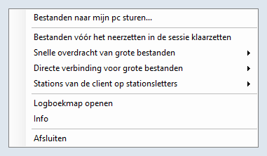

- **De opdrachtregel**: `UltimateRDP.Agent.exe --send "C:\Users\me\Documents\report.pdf" "C:\Users\me\Pictures\Trip"`.

Als de bestanden niet kunnen worden verstuurd, meldt een bericht in de sessie waarom, bijvoorbeeld dat er geen client verbonden is die bestanden ontvangt.

Op uw computer:

- De bestanden gaan naar uw map Downloads. Terwijl ze binnenkomen, staan ze daarin in een verborgen map `.ultimaterdp-<id>.part`, en ze verschijnen zodra elk bestand met zijn SHA-256 is gecontroleerd. Een bestand vervangt nooit een ander: wanneer `report.pdf` bestaat, wordt het nieuwe `report (2).pdf`, en een map wordt `Photos (2)`.
- Een venster "Bestanden uit de sessie" toont de voortgang, met Annuleren. Aan het eind meldt het waar de bestanden staan, en Map openen toont ze in Verkenner.

  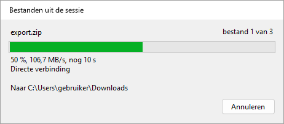 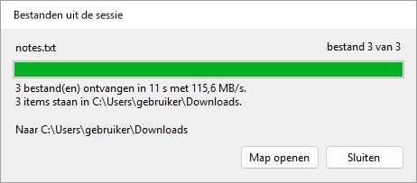

- Elk ontvangen bestand krijgt de markering die Windows aan downloads geeft, zodat SmartScreen en Office het behandelen als een bestand van internet. UltimateRDP opent of start nooit een ontvangen bestand.
- Wanneer de directe verbinding niet kan worden gebruikt, bijvoorbeeld via een Remote Desktop Gateway of met poorten die door een firewall zijn gesloten, wordt er niets verstuurd en meldt het venster dat. Er is geen tragere route; kopieer de bestanden in plaats daarvan in de sessie naar een station van uw computer onder `\\tsclient`.
- Namen die Windows weigert, een pad dat de map zou verlaten, of onvoldoende vrije ruimte stoppen de overdracht, en er wordt niets bewaard.

Instellingen in `%LOCALAPPDATA%\UltimateRDP\client.json`, alleen in het bestand te bewerken:

```json
{
  "receiveFiles": "auto",
  "receiveFolder": "%USERPROFILE%\\Desktop\\From the server"
}
```

| Instelling | Waarden | Indien afwezig | Betekenis |
| --- | --- | --- | --- |
| `receiveFiles` | `auto`, `never` | `auto` | `never` weigert de bestanden van de sessie. `directTransfer` op `never` weigert ze ook, omdat alleen de directe verbinding ze vervoert. |
| `receiveFolder` | een volledig pad | uw map Downloads | Waar de bestanden naartoe gaan. Omgevingsvariabelen zoals `%USERPROFILE%` worden uitgevouwen; de map wordt aangemaakt als die ontbreekt. |

Op de server schakelt `sendToClient` in agent.json, standaard `auto`, het versturen uit wanneer het op `never` staat: voor een gebruiker, of in de instellingen van de computer voor iedereen. `directMaxMegabytesPerSecond` beperkt ook wat de agent verstuurt, wat de uitgaande verbinding van de server beschermt. Vanaf versie 0.9.2 beperkt `sendMaxMegabytesPerSecond` alleen het versturen, zodat bestanden van de clients de volle snelheid houden: bijvoorbeeld `"sendMaxMegabytesPerSecond": 85` in de instellingen van de computer wanneer de uitgaande verbinding van de server ongeveer 1 Gbit/s haalt.

### Berichten in de statusbalk

Berichten bij het slepen:

- **"2 item(s) naar de sessie slepen..."**: de agent speelt het slepen na.
- **"Het slepen in de sessie starten..."**: de agent heeft even nodig om het slepen te starten.
- **"2 item(s) naar de sessie kopiëren voordat het slepen begint..."**: de agent kopieert de bestanden eerst naar de sessie, omdat "Bestanden vóór het neerzetten in de sessie klaarzetten" aan staat.
- **"Neergezet op Postvak IN (kopiëren)"**: het externe venster heeft het neerzetten geaccepteerd. Het bericht noemt het venster en vermeldt kopiëren of koppeling.
- **"Niets onder de cursor heeft de bestanden geaccepteerd."**: het venster onder de cursor heeft het neerzetten niet aangenomen. Er is niets gekopieerd.
- **"De agent heeft het slepen niet bevestigd"**: geen antwoord van de agent binnen een seconde. Zie "Problemen oplossen".
- **"Neerzetten geweigerd"** gevolgd door de reden van de agent. Bijvoorbeeld "Neerzetten geweigerd: De vorige neerzetbewerking wordt nog afgeleverd in de sessie. Probeer het opnieuw zodra die klaar is."
- **"Neerzetten geweigerd: het slepen is niet gestart in de sessie. Sleep de bestanden opnieuw."**: de client kreeg het neerzetten zonder dat er een sleepbewerking voor dezelfde bestanden bezig was.
- **"Geannuleerd"** gevolgd door de reden, bijvoorbeeld "Geannuleerd: Het slepen is geannuleerd: Esc is ingedrukt in de sessie."

Het voortgangsvenster dat bij elke neerzetbewerking verschijnt, toont ook het resultaat van het neerzetten, en de voortgang van een overdracht met meer details, zie "Slepen naar de sessie" en "Grote bestanden" hierboven. De statusbalk behoudt zijn teksten.

Berichten bij een overdracht van grote bestanden:

- **"Overdracht van 2 item(s) voorbereiden..."**: de client somt de te verzenden bestanden op.
- **"3 bestand(en) overdragen: 42 % (12,3 MB/s, nog 1 min)"**: de bestanden zijn onderweg. De snelheid geldt voor de laatste vijf seconden; MB betekent een miljoen bytes.
- **"3 bestand(en) overgedragen met 12,3 MB/s, neerzetten..."**: elk bestand staat in de sessie, en de agent zet de kopieën neer.
- **"Overdracht geannuleerd."**: u hebt de overdracht geannuleerd via het menu Sessie of het voortgangsvenster.
- **"Er is een overdracht bezig. Wacht tot die klaar is, of annuleer die via het menu Sessie."**: een nieuwe sleepbewerking is tijdens een overdracht geweigerd.
- **"Overdracht mislukt"** gevolgd door de reden van de agent, bijvoorbeeld "Overdracht mislukt: Er zijn onderweg gegevens verloren gegaan of beschadigd. Probeer het opnieuw."
- **"Neerzetten geweigerd: Er is niet genoeg vrije ruimte in de sessie: 1.234 MB nodig, 800 MB vrij."**: de schijf van de sessie kan de bestanden niet bevatten.
- **"... kan niet worden gelezen"**, voorafgegaan door een bestandsnaam en gevolgd door de reden van Windows: de client kon een bestand op uw computer niet lezen.
- **"De agent reageerde niet meer tijdens de overdracht."**: een minuut lang geen bevestiging.
- **"De overdracht is gestopt: de verbinding met de sessie is verbroken."**: de verbinding eindigde tijdens de overdracht.

Berichten bij de verbinding:

- **"Geen agent op de externe computer"**: de client heeft zestig seconden lang hello-berichten gestuurd en geen antwoord gekregen. Start de agent in de sessie en gebruik daarna Sessie, Opnieuw naar de agent zoeken.
- **"Dit .rdp-bestand stuurt geen stations om: neerzetten werkt niet."**: het .rdp-bestand deelt geen enkel lokaal station. Schakel stations in het .rdp-bestand in en maak opnieuw verbinding.
- **"De sessie ziet geen omgeleid station: neerzetten werkt niet."**: de agent heeft geantwoord, maar vanuit de sessie is geen station `\\tsclient` bereikbaar. De server blokkeert mogelijk omleiding van stations.
- **"Neerzetten geweigerd: niet verbonden."**: er is nog geen sessie.
- **"Neerzetten geweigerd: de UltimateRDP-agent heeft nog niet geantwoord."**: wacht op "Agent gereed".
- **"Neerzetten geweigerd: de UltimateRDP-agent wordt niet uitgevoerd in de externe sessie."**: start de agent in de sessie.
- **"Neerzetten geweigerd"** met een pad: alleen bestanden en mappen op een lokale stationsletter kunnen worden neergezet. Netwerkpaden (UNC) worden geweigerd, omdat de sessie uw bestanden via omleiding van stations bereikt.
- **"Neerzetten mislukt"**: de agent kon het niet afmaken. De rest van het bericht geeft de reden.

Berichten bij het afmelden:

- **"Afmelden bij de externe sessie..."**: de agent heeft het verzoek aangenomen. Het verbreken van de verbinding volgt zodra de sessie gesloten is. Als een toepassing vraagt om uw werk op te slaan, beantwoord die vraag dan in de sessie.
- **"De agent heeft niet geantwoord op het verzoek om af te melden."**: geen antwoord binnen vijf seconden. De sessie is nog open; probeer het opnieuw, of meld u af via het menu Start van de sessie.
- **"Afmelden mislukt"**: Windows weigerde de sessie af te melden. De rest van het bericht geeft de reden van Windows.

Deze voorbeelden zijn in het Nederlands. De statusbalk gebruikt de taal van de client, zie "Taal" hieronder.

### Menu Beeld

- **Sessie aan venster aanpassen**: de standaardinstelling. De resolutie van de sessie volgt de grootte van het venster.
- **Schalen naar venster**: de sessie behoudt haar resolutie en het beeld wordt naar het venster geschaald.
- **Schaalfactor**: Automatisch, of 100 % tot 200 %. Automatisch volgt het beeldscherm waarop het venster staat. Een wijziging geldt voor een nieuwe verbinding, en de client biedt aan opnieuw verbinding te maken.
- **Volledig scherm** (F11, of Ctrl+Alt+Pause): schakelt volledig scherm in of uit. De verbindingsbalk wordt getoond en kan worden vastgezet.
- **Alle monitoren gebruiken**: de sessie bedekt in volledig scherm elk beeldscherm. Dit geldt voor een nieuwe verbinding.
- **Windows-toetsen**: waar toetscombinaties zoals Alt+Tab heen gaan. "Op deze computer", "In de sessie", of "In de sessie bij volledig scherm", de standaardinstelling.
- **Taal**: zie hieronder.

Uw keuzes in Beeld worden bewaard voor de sessies die u later opent. Wanneer het .rdp-bestand `desktopscalefactor`, `use multimon` of `keyboardhook` instelt, gaat het bestand voor.

### Taal

De client en de agent spreken Engels, Frans, Duits, Spaans, Italiaans, Portugees en Nederlands.

Het submenu Beeld, Taal toont "Automatisch (Windows-taal)" en de zeven talen, elk in de eigen taal benoemd. Een keuze geldt meteen voor de menu's, de statusbalk en de tabbladen, en de client onthoudt haar. Automatisch, de standaardinstelling, volgt de weergavetaal van Windows, en gebruikt Engels wanneer Windows in een andere taal draait.

De keuze is de instelling `language` in `%LOCALAPPDATA%\UltimateRDP\client.json`: `auto`, `en`, `fr`, `de`, `es`, `it`, `pt` of `nl`.

```json
{
  "language": "fr"
}
```

De client geeft de agent zijn taal door, en de agent schrijft de berichten die hij naar de statusbalk stuurt in die taal. Het menu van de agent in het systeemvak volgt de weergavetaal van Windows op de server.

Sommige teksten komen van Windows en volgen de taal van Windows: de knoppen Ja en Nee van de vragen, de reden van het verbreken van een verbinding, en foutmeldingen van Windows. De logboeken zijn altijd in het Engels.

### Opgeslagen referenties en het wachtwoord

Voordat de verbinding wordt gemaakt, leest de client de algemene referentie `TERMSRV/<host>` uit Referentiebeheer van Windows. Wanneer die bestaat en een wachtwoord bevat, past de client haar toe en schakelt hij de vraag om het wachtwoord voor die verbinding uit. UltimateRDP schrijft nooit een referentie. U kunt er een aanmaken met:

```
cmdkey /generic:TERMSRV/<host> /user:<domain\user> /pass
```

`cmdkey` vraagt dan om het wachtwoord.

Vanaf versie 0.9.0 vraagt de client in plaats daarvan om het wachtwoord, en leest hij geen opgeslagen referentie, wanneer een van deze dat aangeeft:

- de optie `--ask-credentials` op de opdrachtregel;
- Bestand, **Altijd om het wachtwoord vragen**, wat de client onthoudt als `"credentials": "ask"` in client.json (standaard `saved`);
- de regel `prompt for credentials:i:1` in het .rdp-bestand, zoals de Microsoft-client doet.

De gebruikersnaam van het .rdp-bestand blijft ingevuld, en de vraag biedt niet aan het wachtwoord op te slaan. Het logboek van de client vermeldt welke van de drie de doorslag gaf, en bevat nooit een wachtwoord.

Dit verandert wat er gebeurt met een .rdp-bestand dat al `prompt for credentials:i:1` bevat: versie 0.8.0 gebruikte de opgeslagen referentie en maakte verbinding zonder te vragen; versie 0.9.0 vraagt om het wachtwoord. Verwijder de regel uit het bestand, of zet hem op 0, om de opgeslagen referentie terug te krijgen.

Het vakje "Mijn gegevens onthouden" van het referentievenster van Windows slaat een ander type referentie op, een domeinwachtwoord. Windows houdt dat wachtwoord voor zichzelf, dus UltimateRDP kan het niet lezen. Het venster van Windows zelf kan het nog wel gebruiken.

Bestand, Opgeslagen referenties vergeten verwijdert beide soorten referenties voor de host van het actieve tabblad. De geopende sessie blijft ongewijzigd, en de volgende verbinding vraagt opnieuw.

Geen enkele optie van de opdrachtregel en geen enkel veld van de generator voor startbestanden neemt een wachtwoord aan: zie "Startbestanden". De waarschuwing van Windows over de uitgever van een RemoteApp-verbinding is een andere vraag, en `--trusted` is de enige manier om die over te slaan: zie "Opties van de opdrachtregel".

## Instellingen van de client

De client bewaart zijn instellingen in `%LOCALAPPDATA%\UltimateRDP\client.json`. Het menu Beeld, het menu Taal en Bestand, Altijd om het wachtwoord vragen schrijven er een deel van; de andere kunnen alleen in het bestand worden bewerkt, en gelden wanneer de client opnieuw start. Een onbekende waarde geeft de standaardwaarde. Opmerkingen zijn toegestaan in het bestand en worden niet bewaard wanneer de client het schrijft.

```json
{
  "displayMode": "resizeSession",
  "scaleFactor": null,
  "keyboardHookMode": 2,
  "useAllMonitors": false,
  "language": "auto",
  "transferChunkBytes": 32768,
  "transferBatchCharacters": 200000,
  "transferWindowBytes": 4194304,
  "directTransfer": "auto",
  "directConnections": 8,
  "receiveFiles": "auto",
  "receiveFolder": null,
  "credentials": "saved",
  "loader": "on",
  "logLevel": "info"
}
```

| Instelling | Waarden | Indien afwezig | Betekenis |
| --- | --- | --- | --- |
| `displayMode` | `resizeSession`, `scaleToWindow` | `resizeSession` | Beeld, Sessie aan venster aanpassen of Schalen naar venster. |
| `scaleFactor` | `null`, of 100 tot 500 | `null` | Beeld, Schaalfactor; `null` volgt het beeldscherm. |
| `keyboardHookMode` | 0, 1, 2 | 2 | Beeld, Windows-toetsen: op deze computer, in de sessie, in de sessie bij volledig scherm. |
| `useAllMonitors` | `true`, `false` | `false` | Beeld, Alle monitoren gebruiken. |
| `language` | `auto`, `en`, `fr`, `de`, `es`, `it`, `nl`, `pt` | `auto` | Beeld, Taal. Zie "Taal". |
| `recentFiles` | een lijst met paden | leeg | Bestand, Recent. De client schrijft deze instelling. |
| `transferChunkBytes` | 4096 tot 262144 | 32768 | Bytes per blok van een overdracht via het kanaal. Zie "Grote bestanden". |
| `transferBatchCharacters` | 50000 tot 1048576 | 200000 | Tekens per aanroep van het besturingselement van Extern bureaublad. Zie "Grote bestanden". |
| `transferWindowBytes` | 1048576 tot 33554432 | 4194304 | Bytes van een overdracht via het kanaal die verzonden en nog niet bevestigd zijn. Zie "Grote bestanden". |
| `directTransfer` | `auto`, `never` | `auto` | `never` houdt grote bestanden in het kanaal en weigert bestanden van de sessie. Zie "Directe verbinding voor grote bestanden". |
| `directConnections` | 1 tot 16 | 8 | Het hoogste aantal verbindingen van een directe overdracht. |
| `receiveFiles` | `auto`, `never` | `auto` | `never` weigert de bestanden van de sessie. Zie "Bestanden uit de sessie naar uw computer sturen". |
| `receiveFolder` | `null`, of een pad | uw map Downloads | Waar bestanden van de sessie naartoe gaan; omgevingsvariabelen worden uitgevouwen. |
| `credentials` | `saved`, `ask` | `saved` | Bestand, Altijd om het wachtwoord vragen. Zie "Opgeslagen referenties en het wachtwoord". |
| `loader` | `on`, `off` | `on` | Het laadvenster. Zie "Het laadvenster". |
| `logLevel` | `debug`, `info` | `info` | `debug` logt elk bericht aan de agent en elke aanroep van het besturingselement. |

## Systeemvakmenu en instellingen van de agent

Standaard is het pictogram van de agent in het systeemvak alleen zichtbaar zolang een UltimateRDP-client met de sessie verbonden is. Het menu bevat:

- **Bestanden naar mijn pc sturen...**: vanaf versie 0.9.0 stuurt dit de gekozen bestanden naar de computer van de client. Zie "Bestanden uit de sessie naar uw computer sturen".
- **Bestanden vóór het neerzetten in de sessie klaarzetten**: standaard uit. Wanneer dit aan staat, kopieert de agent de bestanden naar de sessie voordat het slepen begint, en ontvangt de externe toepassing lokale paden in plaats van paden `\\tsclient`. Schakel het in voor toepassingen die netwerkpaden weigeren. Het kopiëren van grote bestanden kost tijd voordat het slepen begint. Wanneer de bestanden via het kanaal komen, zie hieronder, komen ze hoe dan ook als lokale kopieën aan.
- **Snelle overdracht van grote bestanden**: Automatisch, Altijd of Nooit. Automatisch, de standaardinstelling, stuurt de bestanden vóór het neerzetten via het kanaal van UltimateRDP wanneer ze samen 10 MiB of meer bevatten. Altijd doet dat bij elke neerzetbewerking, Nooit bij geen enkele: de externe toepassing leest de bestanden dan via omleiding van stations, zoals in versie 0.3.
- **Directe verbinding voor grote bestanden**: Automatisch of Nooit. Automatisch, de standaardinstelling, biedt de directe verbinding aan voor een snelle overdracht, met het kanaal als terugval. Nooit houdt elke snelle overdracht in het kanaal. Zie "Directe verbinding voor grote bestanden".
- **Stations van de client op stationsletters**: Automatisch of Nooit. Nooit, de standaardinstelling, laat de stations van uw computer als `\\tsclient\C` enzovoort. Automatisch geeft ze stationsletters van de sessie zolang een UltimateRDP-client verbonden is. Zie "Stations van de client op stationsletters" hieronder.
- **Logboekmap openen**, **Info** en **Afsluiten**.

Het menu volgt de weergavetaal van Windows op de server.

Klaargezette kopieën gaan naar `%LOCALAPPDATA%\UltimateRDP\staging\<id>` in de sessie. Elke map wordt een uur na het neerzetten verwijderd, omdat het doel de bestanden misschien nog leest. Wanneer de agent start, verwijdert hij de mappen die ouder zijn dan een uur.

De agent bewaart zijn instellingen in `%LOCALAPPDATA%\UltimateRDP\agent.json` op de server:

```json
{
  "logLevel": "debug",
  "stageFiles": false,
  "fastTransfer": "auto",
  "fastTransferMinBytes": 10485760,
  "directTransfer": "auto",
  "directPortRange": "3400-3449",
  "directConnections": 8,
  "directMaxMegabytesPerSecond": 0,
  "sendMaxMegabytesPerSecond": 0,
  "trayIcon": "auto",
  "channelRead": "wts",
  "mapClientDrives": "never",
  "sendToClient": "auto"
}
```

| Instelling | Waarden | Indien afwezig | Betekenis |
| --- | --- | --- | --- |
| `stageFiles` | `true`, `false` | `false` | De opdracht "Bestanden vóór het neerzetten in de sessie klaarzetten" van het menu in het systeemvak. |
| `fastTransfer` | `auto`, `always`, `never` | `auto` | De opdracht "Snelle overdracht van grote bestanden" van het menu in het systeemvak. |
| `fastTransferMinBytes` | een aantal bytes | `10485760` (10 MiB) | De grootte vanaf welke `auto` de bestanden via het kanaal stuurt, geteld over alle neergezette items. Alleen in het bestand te bewerken. |
| `directTransfer` | `auto`, `never` | `auto` | De opdracht "Directe verbinding voor grote bestanden" van het menu in het systeemvak. |
| `directPortRange` | een reeks zoals `3400-3449`, of één poort | `3400-3449` | De TCP-poorten van de directe verbinding, zie "Directe verbinding voor grote bestanden". Alleen in het bestand te bewerken. |
| `directConnections` | 1 tot 16 | `8` | Hoeveel TCP-verbindingen een directe overdracht hoogstens mag gebruiken. Alleen in het bestand te bewerken. |
| `directMaxMegabytesPerSecond` | 0, of een aantal MB/s | `0` | Een limiet op de snelheid van een directe overdracht, alle verbindingen samen; 0 betekent geen limiet. Alleen in het bestand te bewerken. |
| `sendMaxMegabytesPerSecond` | 0, of een aantal MB/s | `0` | Vanaf versie 0.9.2 een limiet op wat de agent naar de computer van de client stuurt, alle verbindingen van een verzending samen. Met 0 blijft `directMaxMegabytesPerSecond` ook de limiet van een verzending. Alleen in het bestand te bewerken. |
| `logLevel` | `debug`, `info`, `warn`, `error` | `info` | Het laagste niveau dat in het logboek wordt geschreven. Alleen in het bestand te bewerken. |
| `trayIcon` | `auto`, `always`, `never` | `auto` | `auto` toont het pictogram in het systeemvak alleen zolang een UltimateRDP-client met de sessie verbonden is. `always` toont het vanaf de start van de agent. `never` toont het nooit: de agent wordt dan alleen bestuurd met `--uninstall` en zijn vermelding `Run`. Alleen in het bestand te bewerken. |
| `mapClientDrives` | `never`, `auto` | `never` | De opdracht "Stations van de client op stationsletters" van het menu in het systeemvak. |
| `sendToClient` | `auto`, `never` | `auto` | Of bestanden van de sessie naar de computer van een client die ze ontvangt mogen worden gestuurd. Alleen in het bestand te bewerken. |
| `channelRead` | `wts`, `file` | `wts` | Hoe de agent het kanaal leest. `wts` leest het met WTSVirtualChannelRead, 1600 bytes per keer. `file` is een experiment: de agent leest de bestandshandle van het kanaal met een buffer van 64 KiB, haalt de kanaalheaders eruit die hij tegenkomt, logt welke framing hij heeft gevonden, en gaat bij de eerste inconsistentie voor die verbinding terug naar `wts`, met een waarschuwing. Alleen in het bestand te bewerken. |

Een onbekende waarde geeft de standaardwaarde en een waarschuwing in het logboek. Start de agent opnieuw nadat u het bestand met de hand hebt bewerkt. Wanneer het menu in het systeemvak een instelling verandert, schrijft het die sleutel in uw agent.json en behoudt het uw andere sleutels; opmerkingen in het bestand worden niet bewaard.

### Instellingen voor de hele computer

Een administrator kan in `%ProgramData%\UltimateRDP\agent.json` standaardwaarden instellen voor elke gebruiker van de server, met dezelfde sleutels. De agent leest dat bestand eerst als het bestaat, daarna de agent.json van de gebruiker, waarvan de sleutels een voor een voorgaan. Een sleutel die de gebruiker niet instelt, of op `null` zet, komt uit het bestand van de computer. De agent schrijft nooit het bestand van de computer; het menu in het systeemvak schrijft alleen het bestand van de gebruiker. Om bijvoorbeeld de stationsletters voor iedereen in te schakelen:

```json
{
  "mapClientDrives": "auto"
}
```

Omdat een gebruiker bestanden mag aanmaken in `%ProgramData%`, leest de agent het bestand van de computer alleen wanneer de eigenaar ervan de groep Administrators, SYSTEM of TrustedInstaller is, zoals bij een bestand dat vanaf een opdrachtprompt met verhoogde bevoegdheden is aangemaakt. Een bestand met een andere eigenaar wordt overgeslagen, met een waarschuwing in het logboek die de opdracht `icacls` geeft om dat te herstellen. De startregel van het logboek van de agent somt de sleutels op die uit het bestand van de computer komen, en `--status` vermeldt of het bestand bestaat. Start na een wijziging de agents opnieuw, of laat de gebruikers zich opnieuw aanmelden.

### Stations van de client op stationsletters

Met `mapClientDrives` op `auto` koppelt de agent elk station dat uw computer omleidt, `\\tsclient\C`, `\\tsclient\D` enzovoort, aan een stationsletter van de sessie zodra een UltimateRDP-client verbonden is, zodat programma's die een stationsletter willen uw bestanden kunnen gebruiken.

- Een station behoudt zijn eigen letter wanneer die letter vrij is in de sessie, en krijgt anders de eerste vrije letter vanaf Z naar beneden. C, het systeemstation van de sessie, is meestal bezet, dus uw station C: wordt vaak Z:.
- De agent vervangt nooit een letter die in gebruik is, of het nu een lokaal station of een koppeling is, en koppelt geen station dat al via een koppeling van de sessie bereikbaar is. Hij koppelt alleen de stations die uw computer omleidt, en nooit A: of B:.
- De letters zijn alleen voor u zichtbaar, in uw eigen sessie, en worden niet onthouden voor de volgende aanmelding.
- Ze verdwijnen wanneer de client de verbinding verbreekt, wanneer u Nooit kiest in het menu in het systeemvak, en wanneer de agent afsluit. Als er een bestand op een station geopend is, verwijdert de agent de letter toch, maar alleen een letter die hij zelf heeft gemaakt. Een letter die is achtergebleven van een agent die slecht is geëindigd, wordt bij de volgende start verwijderd, als die nog naar hetzelfde station wijst.
- Documenten, Bureaublad en de andere mappen van het profiel worden niet omgeleid.
- Elke mislukking wordt als waarschuwing in het logboek geschreven, en er wordt niets getoond. Het logboek heeft één regel met de toegekende letters, wanneer de client verbinding maakt.

## Directe verbinding voor grote bestanden

Vanaf versie 0.6.0 gaan de bestanden van een snelle overdracht via een directe TLS-verbinding tussen de client en de agent, buiten de verbinding van Extern bureaublad om, wanneer het netwerk dat toelaat. Via het kanaal van UltimateRDP haalden in productie gemeten overdrachten 2 tot 4 MB/s, ongeacht de verbinding; de directe verbinding vervoert ze met de snelheid van het netwerk. Wanneer die niet kan worden gebruikt, gaan de bestanden zoals voorheen via het kanaal, zonder dat de gebruiker iets hoeft te doen.

Vanaf versie 0.7.0 gebruikt een overdracht meerdere TCP-verbindingen tegelijk, standaard hoogstens acht. Op het productiepad begon één TCP-verbinding op 90 tot 180 MB/s en zakte die binnen enkele seconden naar ongeveer 20 MB/s, terwijl vier verbindingen samen vier keer zoveel vervoerden: de limiet geldt per verbinding, ergens op het pad, en meerdere verbindingen tellen op.

Hoe het werkt:

1. Wanneer de agent tot een snelle overdracht besluit, luistert hij op de eerste vrije TCP-poort van een reeks, standaard 3400 tot 3449, alleen voor deze overdracht. Elke sessie gebruikt haar eigen poort, dus op een server met veel sessies is een reeks nodig.
2. Zijn antwoord op het slepen, via het kanaal, geeft de poort, een willekeurig token voor eenmalig gebruik, de SHA-256 van zijn TLS-certificaat, de versie van het protocol en het aantal verbindingen dat hij accepteert.
3. Na het neerzetten maakt de client binnen 3 seconden verbinding met de host van het .rdp-bestand op die poort. Hij accepteert alleen het certificaat waarvan de agent de SHA-256 heeft gegeven, bewijst dat hij het token kent, en stuurt de lijst met bestanden.
4. Zodra de agent die eerste verbinding heeft geaccepteerd, opent de client de andere naar hetzelfde adres, één per begonnen 32 MiB van de overdracht, tot het aantal dat de agent accepteert en zijn eigen instelling. Een verbinding die niet kan worden geopend, is geen fout: de andere vervoeren de bestanden.
5. De bestanden gaan in blokken van 1 MiB over alle verbindingen. De agent schrijft elk blok op de juiste plaats in het bestand, controleert de SHA-256 van elk bestand zoals via het kanaal, en zet de kopieën neer.

De listener bestaat alleen zolang een overdracht wordt aangeboden of loopt. Hij accepteert hoogstens vier sockets meer dan de verbindingen die hij aanbiedt, en verbreekt elke socket die zijn TLS-handshake niet binnen 5 seconden afrondt en zijn token toont. Hij sluit 10 seconden na het neerzetten als de eerste verbinding niet is gekomen. Het certificaat wordt door de agent in het geheugen aangemaakt bij zijn eerste directe overdracht; de privésleutel ervan is een niet-exporteerbare sleutel in het sleutelarchief van de gebruiker, die de agent verwijdert wanneer hij afsluit. De agent draait nog steeds met de rechten van de gebruiker: een poort boven 1024 vereist geen administratorrechten.

### Firewallregels

De administrator opent de reeks, inkomend TCP naar de server, beperkt tot de clientadressen die voor RDP zijn toegestaan. Op de Windows-firewall van de server, vanuit een PowerShell met verhoogde bevoegdheden:

```
New-NetFirewallRule -DisplayName "UltimateRDP direct transfer" -Direction Inbound -Action Allow -Protocol TCP -LocalPort 3400-3449 -RemoteAddress <allowed client addresses> -Program "C:\Program Files\UltimateRDP\UltimateRDP.Agent.exe" -Profile Any
```

Vervang `<allowed client addresses>` door dezelfde lijst als in de regel die RDP toestaat, gescheiden door komma's, en het pad van het programma door de locatie van de agent. Met `-Program` heeft Windows een regel voor de agent en vraagt het de gebruikers niets wanneer de agent begint te luisteren. Om zeker te weten dat gebruikers op de server nooit zo'n vraag zien, voert u `Set-NetFirewallProfile -Profile Domain,Private,Public -NotifyOnListen False` uit.

Voeg bij de hostingprovider dezelfde regel toe aan de firewall vóór de server: TCP, doelpoorten 3400 tot 3449, alleen de toegestane clientadressen als bron.

Wanneer een clientcomputer een nieuw openbaar adres krijgt, bijvoorbeeld op een ander netwerk, voegt u het toe aan de regel die RDP toestaat en aan deze regel, op de server en bij de hostingprovider. Met alleen de RDP-regel opent de sessie wel, maar gaan grote bestanden via het kanaal met ongeveer 2 MB/s, en kunnen bestanden van de sessie niet naar die computer worden gestuurd.

Als u de reeks in de instellingen van de agent verandert, verander dan beide regels mee. De verbindingen van een overdracht gebruiken allemaal dezelfde poort, dus de regels zijn dezelfde als voor 0.6.0.

### Terugval

Het kanaal neemt de bestanden over, zoals in versie 0.5.2, wanneer:

- de client verbinding maakt via een Remote Desktop Gateway, of een firewall de poorten niet openzet: de eerste verbinding mislukt binnen 3 seconden;
- de TLS-handshake mislukt, het certificaat niet het certificaat is dat de agent heeft gegeven, of de agent het token weigert;
- een verbinding wegvalt voordat de agent de eerste 8 MiB heeft bevestigd;
- de client of de agent een versie van vóór 0.6.0 draait, de ene kant 0.6.0 draait en de andere 0.7.0, of een van beide de instelling `directTransfer` op `never` heeft;
- geen poort van de reeks vrij is op de server.

Wanneer een verbinding later wegvalt, stopt de overdracht met "De directe verbinding is verbroken. Probeer het opnieuw." en wordt er niets neergezet. Het logboek van de client vermeldt op het niveau info welke route een overdracht nam en waarom de directe verbinding niet werd gebruikt. De statusbalk en het voortgangsvenster tonen "Directe verbinding" zolang de bestanden erdoor gaan, en blijven in de voorbereidingsfase totdat de agent de eerste gegevens heeft bevestigd; wanneer het openen van een bestand meer dan 2 seconden duurt, melden ze "... wordt geopend... Windows controleert het bestand mogelijk." totdat het gelezen is.

Wanneer u annuleert, laat de client het de agent weten, wacht hij hoogstens een seconde op zijn antwoord en sluit hij daarna elke verbinding, ook wanneer een verbinding of het lezen van een bestand vastzit. De agent verwijdert wat hij heeft ontvangen en logt de overdracht als geannuleerd.

### Instellingen

| Waar | Instelling | Waarden | Indien afwezig | Betekenis |
| --- | --- | --- | --- | --- |
| agent.json | `directTransfer` | `auto`, `never` | `auto` | De opdracht "Directe verbinding voor grote bestanden" van het menu in het systeemvak. `never` stuurt elke snelle overdracht via het kanaal. |
| agent.json | `directPortRange` | een reeks zoals `3400-3449`, of één poort | `3400-3449` | De poorten waarop de agent mag luisteren, van 1025 tot 65535, hoogstens 1000 poorten. Alleen in het bestand te bewerken; start de agent na een wijziging opnieuw. |
| agent.json | `directConnections` | 1 tot 16 | `8` | Hoeveel verbindingen de agent hoogstens accepteert voor één overdracht. Alleen in het bestand te bewerken; start de agent na een wijziging opnieuw. |
| agent.json | `directMaxMegabytesPerSecond` | 0, of 1 tot 100000 | `0` | Beschermt de server: de agent leest alle verbindingen van een overdracht samen met hoogstens zoveel MB/s, en TCP remt de client af. 0 betekent geen limiet. Alleen in het bestand te bewerken; start de agent na een wijziging opnieuw. |
| client.json | `directTransfer` | `auto`, `never` | `auto` | Met `never` negeert de client het aanbod van de agent en gebruikt hij het kanaal. Alleen in het bestand te bewerken. |
| client.json | `directConnections` | 1 tot 16 | `8` | Hoeveel verbindingen de client hoogstens opent voor één overdracht, binnen wat de agent accepteert. Alleen in het bestand te bewerken. |

De directe verbinding vereist beide kanten op dezelfde versie, 0.6.0 of 0.7.0. Een client 0.7.0 negeert het aanbod van een agent 0.6.0 en gebruikt het kanaal; een client 0.6.0 probeert de directe verbinding van een agent 0.7.0, die zijn token meteen weigert, en gebruikt dan het kanaal. Een client of een agent 0.5.2 gebruikt het kanaal.

### De samenvattingsregels lezen

Aan het eind van een directe overdracht heeft elk logboek een regel die begint met `direct connection statistics`. De regel van de client geeft de gebruikte verbindingen, de bytes die elk ervan vervoerde, de seconden vanaf het begin van de gegevens, de tijd die de lezer besteedde aan het openen en lezen van de bestanden en de tijd die hij wachtte op ruimte in zijn wachtrij, de tijd die de schrijvers besteedden aan het schrijven naar sockets en de tijd dat ze op blokken wachtten, en de snelheden: het gemiddelde, de eerste 5 seconden en de laatste 5 seconden. De regel van de agent geeft de verbindingen, de bytes van elk, de tijd besteed aan het lezen van sockets, aan het schrijven van bestanden en aan het teruglezen van de bestanden om ze te hashen, en dezelfde snelheden. De tijden van meerdere threads worden opgeteld, dus ze kunnen langer zijn dan de duur van de overdracht.

- **De lezer van de client neemt de meeste tijd in beslag en de schrijvers wachten op blokken.** Het lezen van de bestanden op uw computer beperkt de overdracht, bijvoorbeeld een antivirusprogramma dat een groot bestand scant. De client logt op het niveau info ook elk bestand waarvan het openen of het eerste lezen meer dan een halve seconde duurt.
- **De schrijvers van de client besteden de meeste tijd aan het schrijven naar sockets en de lezer wacht op ruimte.** Het netwerk beperkt de overdracht. Eerste 5 seconden die veel sneller zijn dan de laatste 5 seconden wijzen op de limiet per verbinding die hierboven is beschreven: meer verbindingen helpen, tot 16.
- **De agent besteedt veel tijd aan het schrijven van bestanden of aan hashen.** De server beperkt de overdracht: zijn schijf, of zijn processor.

Met `logLevel` op `debug` in client.json of agent.json loggen beide kanten ook de snelheid van elke seconde.

## RemoteApp-programma's

Vanaf versie 0.8.0 opent UltimateRDP ook RemoteApp-programma's: een programma dat op de server is gepubliceerd en in eigen vensters op uw bureaublad verschijnt, zonder het externe bureaublad eromheen. Open het .rdp-bestand ervan zoals elk ander, bijvoorbeeld het bestand dat uw administrator u geeft of dat van de webfeed. Een bestand met `remoteapplicationmode:i:1` opent een RemoteApp-tabblad. Versie 0.8.0 is één keer getest tegen een echte server met Notepad; versie 0.9.0 lost op wat die test aan het licht bracht, en de wijzigingen ervan waren op het moment van de release niet getest tegen een echte server: meld wat u ziet, met beide logboeken.

### Vanuit een snelkoppeling of een .bat-bestand

Vanaf versie 0.9.0 toont `UltimateRDP.exe`, gestart met een RemoteApp-bestand, alleen de vensters van het programma, zoals de Microsoft-client doet. Bijvoorbeeld in een bestand `Notepad on the server.bat`:

```bat
@echo off
start "" "C:\Tools\UltimateRDP\UltimateRDP.exe" "C:\Users\me\Documents\notepad-server.example.com.rdp"
```

of een snelkoppeling met als doel `"C:\Tools\UltimateRDP\UltimateRDP.exe" "C:\Users\me\Documents\notepad-server.example.com.rdp"`.

- Vanaf versie 0.9.3 verschijnt meteen een laadvenster, met de naam van het programma, een bewegende balk en de stap van het starten, "Verbinden met server.example.com...", "Sessie openen...", daarna "Notepad starten...", totdat het venster van het programma verschijnt. Met Annuleren stopt u de verbinding. Het verdwijnt zolang de certificaatvraag van de server of de vraag om het wachtwoord op een antwoord wacht. Een bureaubladbestand toont het ook, boven het venster van UltimateRDP, totdat het bureaublad is aangemeld. `"loader": "off"` in `%LOCALAPPDATA%\UltimateRDP\client.json` schakelt het uit.
- Het venster van UltimateRDP blijft uit het zicht. Een meldingspictogram noemt het programma en de server ervan, en het menu ervan bevat UltimateRDP weergeven, Verbinding verbreken en Afsluiten. Naast de knoppen van de vensters van het programma verschijnt er geen knop op de taakbalk.
- Wanneer u het laatste venster van het programma sluit, houdt de server de sessie ongeveer 20 seconden aan en beëindigt hij haar daarna, en UltimateRDP sluit vanzelf af zonder bericht. Tot dan blijft alleen het meldingspictogram over.
- Wanneer de verbinding mislukt, of om een andere reden eindigt, meldt een bericht waarom; als ze vóór het aanmelden mislukte, verschijnt ook het venster van UltimateRDP, met de reden in het tabblad en Sessie, Verbinden.
- Wanneer u UltimateRDP opnieuw start met een ander bestand, wordt dat doorgegeven aan de kopie die draait: er draait één kopie per gebruiker tegelijk.
- Vanaf versie 0.10.0 start een RemoteApp-start naar een server waar al een RemoteApp-tabblad draait, met hetzelfde account, het programma op die verbinding, zoals de Microsoft-client doet: zie "Eén verbinding per server en account".
- `--show` toont het venster van UltimateRDP toch, en `--hidden` houdt het ook voor een bureaubladbestand uit het zicht. Een bureaubladbestand toont het venster standaard.
- `--ask-credentials` vraagt om het wachtwoord, zie "Opgeslagen referenties en het wachtwoord".

De opdrachtregel is `UltimateRDP.exe [options] [file.rdp]`. Vanaf versie 0.10.0 kunnen de opties ook de hele verbinding opgeven, zonder .rdp-bestand: zie "Startbestanden".

### Op uw computer

- Het tabblad toont de namen van de programma's van de verbinding, hoeveel van hun vensters geopend zijn, de status van de verbinding en van de agent, het resultaat van de laatste neerzetbewerking, en een knop Verbinding verbreken. Het programma zelf opent in eigen vensters, buiten het venster van UltimateRDP, dat u kunt minimaliseren zodra u bent aangemeld.
- Zet bestanden neer op een venster van het programma. Terwijl u erover beweegt, gebeurt er niets: het neerzetten gebeurt waar u de knop loslaat. Het voortgangsvenster "Neerzetten in de sessie" opent boven het venster waarop u hebt neergezet, net als bij een bureaubladsessie, en grote bestanden gaan via het kanaal of de directe verbinding zoals hierboven beschreven.
- De externe toepassing toont geen feedback voor neerzetten terwijl u beweegt, omdat het slepen pas in de sessie begint wanneer u de knop loslaat.
- Beeld, Sessie aan venster aanpassen, Schalen naar venster, Schaalfactor, Volledig scherm en Alle monitoren gebruiken gelden niet voor een RemoteApp-tabblad en zijn daar uitgeschakeld. De sessie bedekt altijd al uw beeldschermen.
- Wanneer het programma zijn laatste venster sluit, beëindigt of verbreekt de server de sessie ongeveer 20 seconden later, en sluit het tabblad. De statusbalk noemt het een normaal einde.
- Wanneer u het tabblad sluit, of UltimateRDP afsluit, terwijl vensters van het programma geopend zijn, wordt eerst om bevestiging gevraagd: het programma blijft op de server actief en komt terug bij de volgende verbinding met hetzelfde bestand. Om het te beëindigen, sluit u het in zijn eigen venster, of gebruikt u Bestand, Afmelden bij de externe sessie.
- Meerdere tabbladen, bureaublad en RemoteApp, werken naast elkaar. Een neerzetbewerking op een venster van een programma gaat naar de sessie van dat programma.

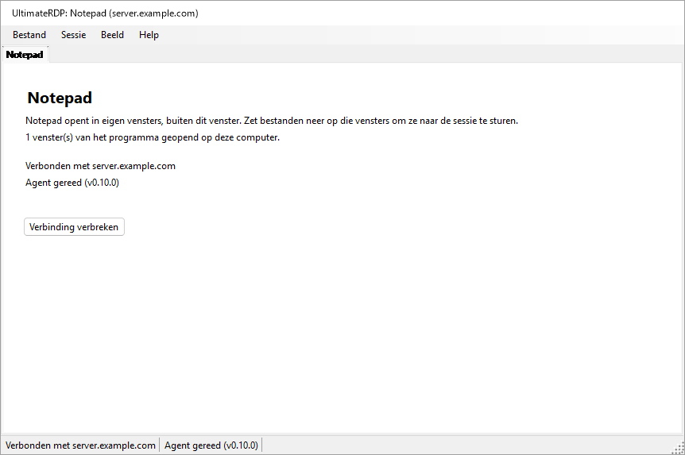

Zolang het hoofdvenster uit het zicht is, noemt het meldingspictogram van UltimateRDP de programma's en hun server; de knopinfo ervan luidt "UltimateRDP by Aprogsys" gevolgd door de programma's.

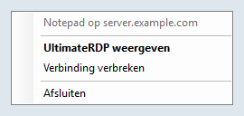

De client leest `remoteapplicationprogram`, `remoteapplicationname`, `remoteapplicationcmdline`, `remoteapplicationexpandcmdline`, `remoteapplicationexpandworkingdir` en `remoteapplicationfile`. Een bestand dat om RemoteApp vraagt zonder programma, wordt geweigerd wanneer u het opent.

### Op de server

Een RemoteApp-sessie voert Verkenner niet uit, en negeert dus de vermelding `Run` die `--install-all-users` schrijft: de agent start daar niet vanzelf. De administrator start hem met een geplande taak bij het aanmelden. Een RemoteApp-sessie eindigt ook wanneer er geen programma van de gebruiker meer in draait, en een agent die blijft draaien, zou haar openhouden. De agent houdt daar op twee manieren rekening mee:

- In een RemoteApp-sessie somt hij elke 15 seconden de processen van zijn sessie op. Zodra er bij twee controles achter elkaar niets meer over is dan de processen die elke RemoteApp-sessie uitvoert en de namen uit de sleutel `SysProcs` van de server, en er geen neerzetbewerking of overdracht bezig is, sluit hij af. Tijdens zijn eerste 90 seconden tellen de controles niet mee zolang er geen programma is gezien, zodat een programma dat traag start hem niet laat vertrekken. Hij sluit ook af wanneer de verbinding met de sessie is verbroken en er geen programma meer over is. In een bureaubladsessie kijkt hij één keer, bij het starten, en doet hij verder niets.
- Zijn pictogram in het systeemvak verschijnt nooit in een RemoteApp-sessie zolang `trayIcon` op `auto` staat. Zet `trayIcon` niet op `always` voor RemoteApp-gebruikers.

De administrator voegt de agent ook toe aan `SysProcs`, zodat Windows zelf hem niet meetelt. UltimateRDP schrijft nooit in het register en maakt nooit een taak aan: hier zijn de opdrachten, voor een PowerShell met verhoogde bevoegdheden op de server. Vervang het pad van de agent door het uwe.

1. Lees eerst de huidige toestand, en bewaar de uitvoer:

   ```powershell
   Get-ItemProperty 'HKLM:\SYSTEM\CurrentControlSet\Control\Terminal Server\SysProcs'
   Get-ScheduledTask -TaskPath '\UltimateRDP\' -ErrorAction SilentlyContinue
   quser
   ```

2. Voeg de agent toe aan `SysProcs`. Op zich verandert dit niets, omdat de agent nog niet in RemoteApp-sessies draait. Het geldt voor nieuwe sessies; start de Extern bureaublad-services hiervoor niet opnieuw, want dat zou de verbinding van elke gebruiker verbreken.

   ```powershell
   New-ItemProperty -Path 'HKLM:\SYSTEM\CurrentControlSet\Control\Terminal Server\SysProcs' -Name 'UltimateRDP.Agent.exe' -PropertyType DWord -Value 0
   ```

3. Maak de taak aan voor alleen één testaccount:

   ```powershell
   $exe       = 'C:\Program Files\UltimateRDP\UltimateRDP.Agent.exe'
   $action    = New-ScheduledTaskAction -Execute $exe
   $trigger   = New-ScheduledTaskTrigger -AtLogOn -User '<DOMAIN\test account>'
   $principal = New-ScheduledTaskPrincipal -UserId '<DOMAIN\test account>' -LogonType Interactive -RunLevel Limited
   $settings  = New-ScheduledTaskSettingsSet -ExecutionTimeLimit ([TimeSpan]::Zero) -AllowStartIfOnBatteries -DontStopIfGoingOnBatteries -MultipleInstances Parallel -Priority 5 -Compatibility Win8
   Register-ScheduledTask -TaskPath '\UltimateRDP\' -TaskName 'Agent' -Action $action -Trigger $trigger -Principal $principal -Settings $settings -Description 'Starts the UltimateRDP agent in each user session, RemoteApp sessions included.'
   ```

   `-LogonType Interactive` voert de agent uit in de sessie van de gebruiker met de rechten van de gebruiker, en er wordt geen wachtwoord opgeslagen. `-RunLevel Limited` zorgt dat hij nooit met verhoogde bevoegdheden draait. `-ExecutionTimeLimit` op nul verwijdert de limiet van 72 uur van een taak. In een bureaubladsessie starten de vermelding `Run` en de taak allebei de agent; de tweede kopie ziet de eerste en sluit meteen af.

4. Test met het testaccount, zoals hieronder beschreven.

5. Start de agent pas daarna voor elke gebruiker. Wijzig het taakobject en schrijf het in zijn geheel terug:

   ```powershell
   $users = (New-Object System.Security.Principal.SecurityIdentifier 'S-1-5-32-545').Translate([System.Security.Principal.NTAccount]).Value
   $task = Get-ScheduledTask -TaskPath '\UltimateRDP\' -TaskName 'Agent'
   $task.Triggers = @(New-ScheduledTaskTrigger -AtLogOn)
   $task.Principal = New-ScheduledTaskPrincipal -GroupId $users -RunLevel Limited
   $task | Set-ScheduledTask
   ```

   De eerste regel geeft de lokale naam van de groep Users, die afhangt van de taal van Windows. `Set-ScheduledTask -Trigger ... -Principal ...` met deze waarden kwam op een Franse Windows Server zonder fout terug en liet de trigger en de principal van het testaccount staan, dus controleer wat de planner heeft opgeslagen:

   ```powershell
   Export-ScheduledTask -TaskPath '\UltimateRDP\' -TaskName 'Agent'
   ```

   De XML moet `<GroupId>S-1-5-32-545</GroupId>` tonen, en `<LogonTrigger />` zonder gebruiker. `Get-ScheduledTask` alleen kan waarden tonen die niet de opgeslagen waarden zijn.

Na een update van de agent in een andere map laat u de taak ernaar wijzen:

```powershell
Set-ScheduledTask -TaskPath '\UltimateRDP\' -TaskName 'Agent' -Action (New-ScheduledTaskAction -Execute 'C:\Program Files\UltimateRDP\<version>\UltimateRDP.Agent.exe')
```

Gebruik nooit `Stop-ScheduledTask`, of Beëindigen in Taakplanner, op deze taak: dat zou de agents stoppen van elke sessie die de taak heeft gestart.

Om alles te verwijderen, in deze volgorde:

```powershell
Unregister-ScheduledTask -TaskPath '\UltimateRDP\' -TaskName 'Agent' -Confirm:$false
Remove-ItemProperty -Path 'HKLM:\SYSTEM\CurrentControlSet\Control\Terminal Server\SysProcs' -Name 'UltimateRDP.Agent.exe'
```

Het verwijderen van de taak stopt de agents die al draaien niet; die eindigen met hun sessie, of vanzelf in RemoteApp-sessies. Verwijder de waarde `SysProcs` als laatste, zodra er geen agent meer in een RemoteApp-sessie draait.

`UltimateRDP.Agent.exe --status`, uitgevoerd in een sessie, vermeldt of het een RemoteApp-sessie is, of de waarde `SysProcs` van de agent bestaat en of de taak `\UltimateRDP\Agent` bestaat. Het leest alleen.

In productie gezien met de Windows-client (mstsc) in een RemoteApp-sessie: de agent start, vindt geen kanaal van UltimateRDP (fout 50, die zijn logboek één keer als informatie noteert: de client van de sessie is waarschijnlijk geen UltimateRDP), blijft inactief, en de sessie eindigt zoals gewoonlijk: de server verbreekt de verbinding 19 seconden nadat het laatste venster is gesloten, de agent sluit meteen af, en de sessie is 8 seconden later verdwenen.

### Testen met één account

Voordat de taak voor iedereen bestaat, alleen met het testaccount:

1. Open zonder enige wijziging het programma met de Microsoft-client, sluit het, en noteer met `quser` wat er met de sessie gebeurt: die zou ongeveer 20 seconden nadat het laatste venster is gesloten moeten eindigen, of de verbinding moeten verbreken. Dit is het gedrag dat behouden moet blijven.
2. Open na de stappen 2 en 3 hierboven het programma opnieuw met de Microsoft-client. De agent moet in de sessie draaien (`Get-CimInstance Win32_Process -Filter "Name='UltimateRDP.Agent.exe'"`, met zijn `SessionId`), zonder pictogram of venster voor de gebruiker, en zijn logboek moet `RemoteApp session detected` vermelden. Sluit het programma: de sessie moet eindigen zoals in stap 1, en het logboek van de agent moet eindigen met `the agent exits so that the session can end`, of met het einde van de sessie.
3. Open het programma met UltimateRDP en zet een klein bestand neer, daarna een groot, op een venster van het programma.
4. Vergelijk op de dag na stap 5 van "Op de server" het aantal sessies, en het aantal sessies zonder verbinding, met de uitvoer van stap 1 daar.

Als een sessie open blijft nadat haar programma is gesloten, verwijder dan eerst de taak, zie hierboven, en meld het daarna met het logboek van de agent van die sessie.

### Eén verbinding per server en account

Windows geeft een gebruiker één sessie per server. Een tweede verbinding met hetzelfde account neemt die sessie over van de eerste, die eindigt met "verbinding verbroken omdat er een andere verbinding met de externe computer is gemaakt"; met versie 0.9.3 beëindigde een RemoteApp-startbestand dat een tweede keer werd aangeklikt terwijl het programma draaide beide verbindingen, zonder het programma te starten. Vanaf versie 0.10.0:

- Een RemoteApp-start naar dezelfde server, poort en gateway als een RemoteApp-tabblad dat draait, met hetzelfde account, start zijn programma op die verbinding: meteen wanneer de sessie is aangemeld, ook als er in de laatste seconden geen venster van een programma meer over is; na het aanmelden, en na het programma van het tabblad, wanneer het tabblad nog verbinding maakt, zich aanmeldt, of wacht op de waarschuwing van Windows of de certificaatvraag. Een start zonder gebruikersnaam neemt het account van het tabblad; twee verschillende gebruikersnamen openen elk hun eigen verbinding.
- Het laadvenster van die start meldt "{programma} starten..." totdat een nieuw venster van een programma verschijnt, of de server een mislukking meldt, of enkele seconden nadat de server zonder nieuw venster heeft geantwoord (een programma brengt misschien alleen zijn venster naar voren), of hoogstens 30 seconden. Het heeft geen Annuleren, want dat zou de verbinding van de andere programma's sluiten.
- Als de verbinding eindigt voordat het programma van een start is verschenen, opent die start zijn eigen verbinding, tenzij u het tabblad hebt gesloten.
- Het tabblad en de knopinfo van het meldingspictogram noemen elk programma van de verbinding.
- Wanneer u een bureaublad opnieuw opent terwijl een bureaubladtabblad naar hetzelfde doel en met hetzelfde account draait, wordt dat tabblad geselecteerd, met een melding in de statusregel ervan, in plaats van een tweede verbinding te openen die de sessie zou overnemen.
- Wanneer een andere verbinding toch een sessie overneemt, bijvoorbeeld vanaf een andere computer, meldt het tabblad "Deze sessie is overgenomen door een andere verbinding met hetzelfde account.", en er verschijnt maar één bericht tegelijk.

## Startbestanden

Vanaf versie 0.10.0 is één .bat-bestand genoeg om een verbinding te geven aan de mensen die haar gebruiken: `UltimateRDP.exe` neemt de verbinding aan op zijn opdrachtregel, en Bestand, **Startbestand maken (.bat)...** schrijft het .bat-bestand voor u.

### Opties van de opdrachtregel

`UltimateRDP.exe [options] [file.rdp]`. Opties komen in willekeurige volgorde en worden vergeleken zonder onderscheid tussen hoofdletters en kleine letters. Een optie die een waarde neemt, neemt het volgende argument. `UltimateRDP.exe --help` (of `/?`) toont deze lijst in de taal van de client.

| Optie | Waarde | .rdp-sleutels die ze instelt |
| --- | --- | --- |
| `--server` | hostnaam, IPv4-adres, of IPv6-adres met of zonder haken; geen poort | `full address` |
| `--port` | 1 tot 65535, 3389 indien afwezig | `server port` |
| `--user` | gebruikersnaam | `username` |
| `--domain` | domein | `domain` |
| `--remoteapp` | `\|\|Name` of `Name` voor een gepubliceerd programma, of een pad op de server | `remoteapplicationmode`, `remoteapplicationprogram` |
| `--remoteapp-name` | naam die de gebruiker te zien krijgt | `remoteapplicationname` |
| `--remoteapp-args` | argumenten van het programma, aanhalingstekens toegestaan | `remoteapplicationcmdline` |
| `--gateway` | host van een Remote Desktop Gateway | `gatewayhostname`, `gatewayusagemethod:i:1`, `gatewayprofileusagemethod:i:1` |
| `--multimon` | `on` of `off`: alle beeldschermen in volledig scherm | `use multimon` |
| `--scale` | 100 tot 500, in procent | `desktopscalefactor` |
| `--windows-keys` | `local`, `remote` of `fullscreen` | `keyboardhook` 0, 1 of 2 |
| `--clipboard` | `on` of `off` | `redirectclipboard` |
| `--drives` | `on` (alle stations) of `off` | `redirectdrives`, `drivestoredirect` |
| `--printers` | `on` of `off` | `redirectprinters` |
| `--audio` | `local`, `remote` of `off` | `audiomode` 0, 1 of 2 |
| `--ask-credentials` | | vraagt om het wachtwoord, zie "Opgeslagen referenties en het wachtwoord" |
| `--trusted` | | geen Windows-waarschuwing over de uitgever en de gedeelde bronnen voor deze start, zie hieronder |
| `--show`, `--hidden` | | het hoofdvenster, zie "Vanuit een snelkoppeling of een .bat-bestand" |
| `--help`, `/?` | | toont deze lijst en opent niets |

De regels:

- Zonder .rdp-bestand is `--server` nodig. Met een .rdp-bestand komen de opties eroverheen en gaan ze voor op de sleutels ervan.
- `--server` vervangt het adres van het bestand, en de poort is dan `--port` of 3389. `--port` alleen behoudt de host van het bestand.
- `--remoteapp`: een waarde die met `||` begint, is een gepubliceerde alias; anders is een waarde met `\`, `/` of `:` een pad op de server, en al het andere een gepubliceerde alias, die voor de server als `||Name` wordt geschreven. `--remoteapp Notepad` en `--remoteapp "||Notepad"` zijn hetzelfde.
- Elke waarde wordt gecontroleerd voordat er iets opent: een hostnaam of een IP-adres voor `--server` en `--gateway`, een getal binnen het bereik, hoogstens 256 tekens voor namen (1024 voor een programma, 2048 voor argumenten), geen stuurtekens, geen aanhalingstekens behalve in `--remoteapp-args`, en geen waarde die met `--` begint behalve de argumenten. Een verkeerde optie toont een bericht dat zegt welke en waarom, en er wordt geen verbinding gemaakt.
- Er is met opzet geen optie voor een wachtwoord: een opdrachtregel kan door andere programma's op de computer worden gelezen, en blijft staan in het .bat-bestand, in snelkoppelingen en in logboeken. Windows gebruikt de referentie die voor de server is opgeslagen (zie "Opgeslagen referenties en het wachtwoord"), of vraagt om het wachtwoord. `--password` wordt geweigerd met een bericht dat dat uitlegt.
- Een tweede start geeft zijn opties door aan de UltimateRDP die al draait, zoals bij een bestand.
- `--trusted`: vóór een RemoteApp-verbinding toont Windows, bij een .rdp-bestand dat niet ondertekend is, een waarschuwing over de uitgever van de verbinding en de bronnen die ze deelt, met een knop Verbinding maken. `--trusted` schakelt die voor deze start uit (de eigenschappen `ShowRedirectionWarningDialog` en `RedirectionWarningType` van het besturingselement). Een .bat-bestand of een snelkoppeling is code die de gebruiker zelf heeft gekozen uit te voeren, dus de vlag geeft de auteur ervan niets wat het .bat-bestand niet al gaf; een .rdp-bestand is data die per e-mail kan binnenkomen, dus geen enkele sleutel van een .rdp-bestand schakelt de waarschuwing uit, en een start zonder `--trusted` behoudt de waarschuwing van Windows zoals voorheen. De vraag over het certificaat van de server is een ander dialoogvenster en verschijnt altijd wanneer Windows die stelt. Het logboek van de client vermeldt voor elke verbinding of de waarschuwing aan Windows wordt overgelaten of is uitgeschakeld, en waarom.
- Een sessie die met opties is geopend, komt niet in Bestand, Recent, omdat de opties daar verloren zouden gaan; Bestand, Opnieuw openen in nieuw tabblad opent haar opnieuw met dezelfde opties.
- Volledig scherm bij het starten en een vaste bureaubladgrootte worden niet aangeboden: de client start elke sessie in zijn venster en stemt de grootte van het bureaublad af op het venster, wat het bestand ook zegt (`screen mode id`, `desktopwidth`, `desktopheight`).

De client stelt de tekst van een .rdp-bestand in het geheugen samen uit de opties, na de tekst van het bestand als er een is, en leest die met dezelfde parser als elk bestand: een verbinding vanaf de opdrachtregel en een verbinding vanuit een bestand doorlopen dezelfde code. Er wordt niets naar de schijf geschreven.

Voorbeelden:

```bat
@echo off
start "" "%LOCALAPPDATA%\UltimateRDP\client-0.10.0\UltimateRDP.exe" --server "server.example.com" --user "jdoe"
```

```bat
@echo off
start "" "%LOCALAPPDATA%\UltimateRDP\client-0.10.0\UltimateRDP.exe" --server "server.example.com" --remoteapp "||Notepad" --remoteapp-name "Notepad" --ask-credentials
```

### De generator voor startbestanden

Bestand, **Startbestand maken (.bat)...** opent een dialoogvenster dat wordt ingevuld vanuit het actieve tabblad, als dat er is. De eerste weergave bevat de naam van het startbestand, de server, de poort (3389), de gebruiker, wat het opent (het externe bureaublad of een RemoteApp-programma) en het programma. **Geavanceerde opties** toont de naam en de argumenten van het programma, het domein, de gateway, het hoofdvenster, "Altijd om het wachtwoord vragen", "De Windows-waarschuwing niet tonen (vertrouwde server)" (standaard uit, voegt `--trusted` toe), de keuzes voor weergave en omleiding uit de tabel hierboven ("Standaard" laat de keuze aan de client en het .rdp-bestand), waar het startbestand UltimateRDP.exe vindt, en wat er wordt geschreven:

- UltimateRDP.exe: dit programma (het pad van de actieve UltimateRDP.exe, de standaardinstelling), naast het startbestand (`%~dp0UltimateRDP.exe`), of een pad dat u typt, waarin variabelen zoals `%LOCALAPPDATA%` of `%ProgramFiles%` blijven zoals ze geschreven zijn en hun waarde krijgen op de computer die het startbestand uitvoert.
- Eén .bat-bestand dat alle opties bevat (de standaardinstelling), of een .bat-bestand met een .rdp-bestand ernaast, genoemd naar het .bat-bestand; het .bat-bestand opent dan `%~dp0<name>.rdp`. Het .rdp-bestand wordt in UTF-16 geschreven, zoals de Microsoft-client ze schrijft.

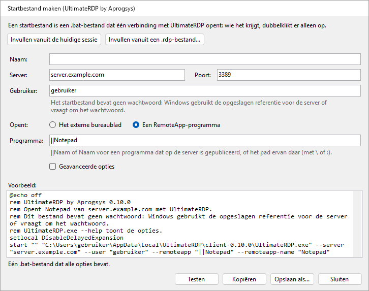

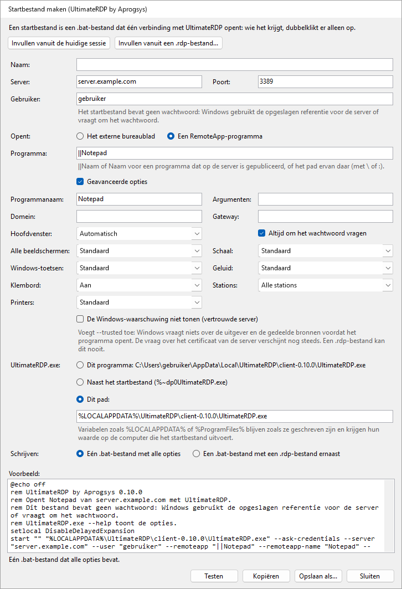

Het dialoogvenster toont de tekst van het .bat-bestand terwijl u typt, of welk veld verkeerd is. **Invullen vanuit de huidige sessie** en **Invullen vanuit een .rdp-bestand...** vullen de velden in vanuit de instellingen van het actieve tabblad of van een bestand. **Opslaan als...** schrijft het bestand, **Kopiëren** zet de tekst ervan op het klembord, en **Testen** start deze UltimateRDP met de opties van het startbestand, wat de verbinding opent in de actieve client. Het startbestand bevat geen wachtwoord, en het dialoogvenster heeft er geen veld voor.

Het .bat-bestand begint met `@echo off`, `chcp 65001 >nul` wanneer een teken van het bestand buiten ASCII valt, een opmerking die begint met "UltimateRDP by Aprogsys" en de versie ervan en in de taal van de client vermeldt wat het opent en dat het geen wachtwoord bevat, `setlocal DisableDelayedExpansion`, en `start "" "<UltimateRDP.exe>" <options>`. Het wordt geschreven in UTF-8 zonder byte order mark, met CRLF-regeleinden. Elke waarde staat tussen aanhalingstekens, zodat cmd.exe haar precies zoals getypt aan UltimateRDP doorgeeft en niets anders kan uitvoeren: zie "Opmerkingen over beveiliging".

## Hoe het werkt

De client bevat het ActiveX-besturingselement van Microsoft Extern bureaublad en registreert zich als neerzetdoel op de vensters ervan. De agent draait in uw sessie en luistert op een statisch virtueel kanaal met de naam `ULTRDP`. Voor kleine bestanden stuurt de client de lokale paden en de positie van de cursor, en de sessie leest de bestanden van de omgeleide stations. Grote bestanden worden via het kanaal verstuurd, zoals na de onderstaande stappen beschreven.

1. Wanneer het slepen voor het eerst over de sessie beweegt, rekent de client de positie van de cursor om naar coördinaten van het externe bureaublad en stuurt hij `dragEnter` met de paden.
2. De agent opent een onzichtbaar proxyvenster over het hele externe scherm. Hij verplaatst de externe cursor naar het punt en simuleert een druk op de linkerknop op dat venster. De druk start een echte OLE-sleepbewerking in de sessie, met de bestanden als paden `\\tsclient\<drive>\...`, of als klaargezette kopieën.
3. De agent antwoordt `dragAck`. Zonder dat antwoord binnen een seconde stopt de client het slepen.
4. Terwijl u beweegt, stuurt de client `dragMove`. De agent verplaatst de externe cursor, zodat de toepassing eronder het slepen ziet en haar feedback toont.
5. Wanneer u de knop loslaat, stuurt de client `drop`. De agent verplaatst de cursor naar het eindpunt en laat daar de gesimuleerde knop los. Als u in plaats daarvan de sessie verlaat, stuurt de client `dragLeave` en annuleert de agent het slepen.
6. De agent meldt `dropResult` met het effect: `copy` of `link` wanneer het doel het neerzetten heeft geaccepteerd, of `none` wanneer niets onder de cursor de bestanden heeft geaccepteerd. Bij `none` wordt het neerzetten genegeerd. De client toont het resultaat in de statusbalk.

Het slepen biedt alleen kopiëren en koppelen aan, nooit verplaatsen. Wijzigingstoetsen worden in de logboeken vastgelegd, maar niet geïnjecteerd.

In een RemoteApp-sessie zijn de vensters van de server vensters van de client, en alles wat de agent toont, zou ook op uw bureaublad verschijnen, zijn proxyvenster inbegrepen. Daarom stuurt de client niets terwijl u beweegt: bij het neerzetten stuurt hij `dragEnter` en daarna `drop` op hetzelfde punt, en houdt hij het neerzetten aan uw kant open totdat de agent heeft geantwoord. De agent speelt het slepen daar ter plekke na, met een proxyvenster van 32 bij 32 pixels onder het punt in plaats van een venster over het hele scherm.

Voor grote bestanden bevat `dragEnter` de grootte van elk item, en antwoordt de agent `dragAck` met `transfer: true` wanneer ze via het kanaal moeten komen. Bij stap 5 stuurt de client dan `drop` met `deferred: true`: de agent annuleert het slepen in de sessie en onthoudt het punt. De client stuurt de bestanden in blokken van standaard 32 KiB, in base64, of in de compactere vorm `u15` wanneer de agent meldt dat de gegevens van de client als UTF-16 bij hem aankomen, met hoogstens 4 MiB nog niet bevestigd; de agent schrijft ze in zijn klaarzetmap en controleert de grootte en de SHA-256 van elk bestand, antwoordt `transferResult`, zet daarna de kopieën met een korte sleepbewerking neer op het onthouden punt, en meldt `dropResult` zoals in stap 6.

Om af te melden, stuurt de client `logoff`. De agent antwoordt `logoffResult`, wacht een halve seconde zodat het antwoord de client bereikt, en vraagt Windows daarna de sessie af te melden. Hij dwingt toepassingen met niet-opgeslagen werk nooit tot sluiten.

Berichten zijn JSON-objecten die als ASCII-regels worden verstuurd, behalve de blokken `u15`, en elke kant bepaalt tijdens het draaien hoe het besturingselement de bytes van het kanaal op tekens afbeeldt. Zie [docs/design.md](docs/design.md) voor de details.

## Problemen oplossen

- **De eerste start van een nieuwe versie duurt enkele seconden voordat er iets verschijnt.** Die tijd verstrijkt voordat het proces bestaat: een antivirusprogramma analyseert een nieuw uitvoerbaar bestand van ongeveer 120 MB bij de eerste start. De volgende starts tonen het laadvenster in ongeveer 0,1 s.
- **Een startbestand dat twee keer is aangeklikt.** Vanaf versie 0.10.0 start de tweede klik het programma op de verbinding die draait; zie "Eén verbinding per server en account".
- **De agent wordt nooit gereed.** Voer `UltimateRDP.Agent.exe --status` uit in de sessie: het vermeldt of de agent daar draait en van waaruit hij is ingesteld om te starten. Het pictogram in het systeemvak verschijnt pas zodra de client verbonden is, dus het ontbreken ervan daarvoor is normaal. Een serverbeleid kan ook virtuele kanalen blokkeren: het logboek van de agent bevat dan een waarschuwing dat hij het kanaal niet kan openen.
- **"De agent heeft het slepen niet bevestigd".** De agent heeft binnen een seconde niet geantwoord op het begin van het slepen. Een trage verbinding of een drukke agent kan de oorzaak zijn, en ook een agent die in de sessie is afgesloten of opnieuw gestart, wat de client anders niet kan zien. De client zoekt dan opnieuw naar de agent: het label van de agent gaat naar "Agent: wachten", en terug naar "Agent gereed" wanneer de agent antwoordt. Wanneer de statusbalk "De sessie accepteert geen gesimuleerde invoer" meldt, is de sessie mogelijk vergrendeld, of blokkeert een beleid gesimuleerde invoer. Meld het met beide logboeken.
- **Het doel toont geen feedback voor neerzetten, of de statusbalk meldt "Niets onder de cursor heeft de bestanden geaccepteerd."** De toepassing onder de cursor accepteert op die plek misschien geen bestanden. Sommige toepassingen weigeren ook netwerkpaden zoals `\\tsclient\C\...`. Schakel daarvoor "Bestanden vóór het neerzetten in de sessie klaarzetten" in, in het menu van de agent in het systeemvak.
- **Het eerste neerzetten op Verkenner duurt enkele seconden.** Verkenner leest het omgeleide station de eerste keer, wat traag kan zijn. Latere neerzetbewerkingen zijn meestal sneller.
- **Ctrl+W of Ctrl+O doet niets.** Wanneer de sessie het toetsenbord heeft, gaan deze toetsen naar de externe computer, zoals elke andere toets. Gebruik in plaats daarvan het menu Bestand.
- **Mijn toepassingen zijn na Afsluiten nog open op de server.** Dat is de bedoeling: Afsluiten en Tabblad sluiten verbreken de verbinding zonder de sessie te beëindigen. Gebruik Bestand, Afmelden bij de externe sessie.
- **De teksten staan in de verkeerde taal.** Kies de taal in Beeld, Taal. Een bericht van de agent volgt de taal die de client bij het verbinden heeft doorgegeven; na een taalwijziging gebruikt het volgende bericht de nieuwe taal.
- **Neerzetten wordt geweigerd vanwege de stations.** Schakel omleiding van stations in het .rdp-bestand in, onder Lokale bronnen, Meer, Stations. Controleer op de server het beleid "Omleiding van stations niet toestaan".
- **Een RemoteApp-programma opent, maar neerzetten op de vensters ervan wordt geweigerd of doet niets.** Het logboek van de client heeft één regel per venster van het programma die begint met `RemoteApp window`, met het resultaat van de registratie van het neerzetdoel, en een waarschuwing wanneer die mislukte. De regels `RemoteApp monitors` en `the target is at` vermelden of de vensters op de server staan waar ze op uw scherm staan; een waarschuwing daar betekent dat de beeldschermen sinds de verbinding zijn veranderd, en een nieuwe verbinding verhelpt dat.
- **Een RemoteApp-sessie blijft open nadat haar programma is gesloten.** Controleer of het logboek van de agent van de sessie `RemoteApp session detected` vermeldt, en wat de regels `RemoteApp session:` zeggen: een programma dat daar nog staat, houdt de sessie open, met of zonder de agent. Zie "RemoteApp-programma's".
- **Het neerzetten komt op het verkeerde venster terecht.** Het schalen van coördinaten na het aanpassen van de venstergrootte, of volledig scherm over meerdere beeldschermen, kan de oorzaak zijn. Meld het met beide logboeken.
- **Een overdracht van grote bestanden mislukt, of is traag.** De statusbalk geeft de reden. Beide logboeken sluiten elke overdracht af met een samenvattingsregel: bestanden, bytes, seconden en MB/s, en daarna met de regels die onder "Een trage overdracht meten" zijn beschreven. Het logboek van de client geeft ook de lengte van de eerste blokregel die het verstuurde, en het logboek van de agent heeft een regel voor het eerste blok van elk ontvangen bestand. Wanneer de statusbalk "De agent heeft de eerste gegevens van de overdracht niet bevestigd." meldt, zijn de gegevens niet doorgekomen: het logboek van de client geeft dan het bytemodel, de blokgrootte, de lengte van de regels en het aantal verzonden regels. Een kleinere `transferChunkBytes` kan helpen, zie "Grote bestanden". Om terug te gaan naar omleiding van stations, kiest u Nooit in het menu van de agent in het systeemvak, Snelle overdracht van grote bestanden.
- **Een overdracht mislukt met "Een bericht van de overdracht is onderweg verloren gegaan".** Het besturingselement van Extern bureaublad verliest soms een kort bericht dat vlak voor een groot bericht is verzonden. Vanaf 0.5.1 aan beide kanten zou dit niet meer moeten voorkomen: de agent vraagt de client de ontbrekende regels opnieuw te sturen, en de samenvatting van de overdracht in beide logboeken telt de opnieuw verzonden regels. Als het toch verschijnt, draait een van de kanten een oudere versie; als een overdracht mislukt met "Regels van de overdracht zijn onderweg verloren gegaan en konden niet worden hersteld", meld het dan met beide logboeken, opgenomen met `logLevel` op `debug`.
- **Een overdracht mislukt meteen met "Er zijn onderweg gegevens verloren gegaan of beschadigd".** Het kanaal beschadigt soms onderweg de gegevens van één regel. Vanaf 0.5.2 aan beide kanten vraagt de agent die regel opnieuw op, zoals bij een verloren regel, en zijn logboek beschrijft hoe de beschadiging eruitzag, in een regel die "arrived damaged" bevat; een agent 0.5.1 laat de overdracht nog mislukken.
- **Grote bestanden gebruiken nooit de directe verbinding, of bestanden van de sessie kunnen niet worden verstuurd.** Controleer eerst of het openbare adres van uw computer in de firewallregel van de directe verbinding staat, op de server en bij de hostingprovider, zoals het in de regel staat die RDP toestaat; een nieuw netwerk geeft een nieuw adres. Het logboek van de client vermeldt aan het begin van elke overdracht waarom: "the direct connection cannot be used" met de reden, zoals een poort die niet binnen 3 seconden antwoordde. Controleer de firewallregels van "Directe verbinding voor grote bestanden", op de server en bij de hostingprovider, en of beide kanten 0.7.0 draaien. Het logboek van de agent vermeldt op welke poort hij luisterde, en waarschuwt wanneer geen poort van de reeks vrij was.
- **Een directe overdracht is trager dan de verbinding.** Lees de regels `direct connection statistics` van beide logboeken, zie "De samenvattingsregels lezen".
- **Bestanden die vanuit de sessie zijn verstuurd, komen niet aan.** Het logboek van de client heeft een regel `Send offer` voor elk aanbod, daarna regels `Receive <id>:` die vermelden of de directe verbinding tot stand kon komen, en zo niet, waarom. Het logboek van de agent heeft dezelfde regels `Send <id>:`. Wanneer het logboek van de client geen regel `Send offer` heeft, controleer dan of beide kanten 0.9.0 draaien en of `receiveFiles` en `directTransfer` niet op `never` staan in client.json; de regel `Hello from client` in het logboek van de agent vermeldt `receives files of the session: True` wanneer dat niet zo is.
- **Waar de logboeken staan.** De client schrijft `%LOCALAPPDATA%\UltimateRDP\logs\client-yyyyMMdd.log` op uw computer. De agent schrijft `agent-yyyyMMdd.log` in dezelfde map op de server; vanaf versie 0.9.0 geeft elke regel ervan de sessie en de thread, zoals `[S3 12]`, omdat de agents van één gebruiker in meerdere sessies hetzelfde bestand schrijven. Beide bewaren de logboeken van veertien dagen. De client opent zijn map via Help, Logboekmap openen, en de agent via zijn menu in het systeemvak, Logboekmap openen.

## Bouwen vanaf de broncode

U hebt de .NET 10 SDK op Windows nodig.

```
dotnet build UltimateRDP.sln -c Release
dotnet test UltimateRDP.sln
```

Om een zelfstandig uitvoerbaar bestand uit één bestand zonder symbolen te publiceren:

```
dotnet publish src/UltimateRDP.Client -c Release -r win-x64 --self-contained true -p:PublishSingleFile=true -p:IncludeNativeLibrariesForSelfExtract=true -p:DebugType=none -p:DebugSymbols=false
dotnet publish src/UltimateRDP.Agent -c Release -r win-x64 --self-contained true -p:PublishSingleFile=true -p:IncludeNativeLibrariesForSelfExtract=true -p:DebugType=none -p:DebugSymbols=false
```

Releases worden gebouwd door GitHub Actions wanneer een tag `v*` wordt gepusht. De workflow bouwt, test, publiceert beide toepassingen en voegt de twee zip-bestanden aan de release toe.

De uitvoerbare bestanden van een release zijn ondertekend door APROGSYS, en Windows toont deze uitgever in zijn meldingen. Een uitvoerbaar bestand dat u zelf bouwt, is niet ondertekend.

## Opmerkingen over beveiliging

- De agent leest alleen van `\\tsclient\`, dat wil zeggen van de stations die u hebt gekozen te delen. De agent zelf schrijft alleen naar zijn klaarzetmap in uw sessie, wanneer klaarzetten aan staat of wanneer bestanden via het kanaal komen. Hij weigert elke bestandsnaam die die map zou verlaten. De toepassing waarop u neerzet, beslist waar de bestanden naartoe gaan. De agent draait niet als service en heeft geen andere rechten dan de uwe.
- De agent simuleert alleen invoer in uw eigen sessie, en alleen tussen het begin en het einde van een sleepbewerking. Hij gebruikt alleen de linkermuisknop. Hij injecteert de druk pas wanneer zijn eigen proxyvenster onder de cursor staat, zodat de druk nooit een andere toepassing bereikt. Om te annuleren, plaatst hij Esc in de wachtrij van zijn proxyvenster in plaats van een toets te simuleren.
- De agent biedt nooit verplaatsen aan. Een verplaatsing die in de sessie wordt geaccepteerd, zou het bestand op uw lokale schijf via het omgeleide station kunnen verwijderen.
- Berichten bevatten bestandspaden, coördinaten, vlaggen voor wijzigingstoetsen en vensternamen. Bestandsinhoud gaat alleen via het kanaal bij een overdracht van grote bestanden, binnen de versleutelde verbinding van Extern bureaublad.
- Vanaf versie 0.6.0 kunnen de bestanden van een overdracht van grote bestanden in plaats daarvan via een directe TLS-verbinding gaan. De agent luistert alleen zolang een overdracht wordt aangeboden, en accepteert een verbinding alleen met een bewijs van het token voor eenmalig gebruik dat hij via de versleutelde verbinding van Extern bureaublad heeft gegeven, elke verbinding van het aanbod één keer, hoogstens 16. De client accepteert alleen het certificaat waarvan de agent daar de SHA-256 heeft gegeven. De bestanden gaan naar dezelfde klaarzetmap, met dezelfde controles. Open de poorten alleen voor de clientadressen die voor RDP zijn toegestaan.
- Vanaf versie 0.9.0 kan de sessie bestanden naar uw computer sturen. Alleen de gebruiker van de sessie kan dat starten, via de agent van die sessie: `--send` bereikt die agent via een pipe die alleen processen van dezelfde gebruiker in dezelfde sessie accepteert. De client neemt bestanden alleen aan nadat hij heeft geantwoord op een aanbod dat via de versleutelde verbinding van Extern bureaublad van zijn eigen sessie kwam, alleen via de directe verbinding waarvan dat aanbod het certificaat en het token gaf, en alleen in zijn map voor ontvangen bestanden. Hij vervangt nooit een bestand, voert er nooit een uit, en markeert elk bestand als download.
- Vanaf versie 0.10.0 kan de opdrachtregel een verbinding opgeven, en kan de client startbestanden schrijven. Geen enkele optie neemt een wachtwoord aan. Elke waarde van de opdrachtregel wordt gecontroleerd voordat er iets opent, en kan geen sleutel toevoegen aan de .rdp-instellingen waarin ze wordt omgezet. In een startbestand staat elke waarde tussen dubbele aanhalingstekens volgens de aanhalingsregels van de Windows-opdrachtregel, wordt elke `%` verdubbeld, komt er een `^` vóór `& | < > ^ ( )` overal waar cmd.exe buiten aanhalingstekens leest, en staat vertraagde uitbreiding uit, zodat geen enkele waarde een opdracht kan toevoegen of een variabele kan uitvouwen. De tests controleren dit met een model van cmd.exe en met cmd.exe zelf.
- De client schrijft nooit referenties en logt ze nooit. Hij leest de algemene referentie `TERMSRV/<host>` wanneer die bestaat, en geeft haar door aan het besturingselement van Microsoft. Andere vragen om referenties komen van het besturingselement van Microsoft.

## Status

Versie 0.10.0 voegt de opties van een verbinding op de opdrachtregel toe, de generator voor startbestanden, één verbinding per server en account voor RemoteApp-programma's, en `--trusted`. De startbestanden ervan zijn gecontroleerd met cmd.exe op de testcomputer; de gedeelde RemoteApp-verbinding en `--trusted` waren op het moment van de release niet getest tegen een echte server. Versie 0.9.0 is een testrelease. De bestanden die vanuit de sessie naar uw computer worden gestuurd, het starten van een RemoteApp-programma vanuit een snelkoppeling, de verbeteringen aan de vensters ervan en de optie voor het wachtwoord waren op het moment van de release niet getest tegen een echte server; de stationsletters van 0.8.0 evenmin.

Geverifieerd in een echte sessie van Extern bureaublad, met versie 0.2.1:

- Het virtuele kanaal tussen de client en de agent, met één byte per teken in beide richtingen.
- De overdracht via omleiding van stations naar het externe bureaublad.
- Het live slepen naar een externe toepassing.

De opdracht om af te melden en de vertalingen zijn nieuw in 0.3.0. De snelle overdracht van grote bestanden is nieuw in 0.4.0. De eerste test ervan tegen een echte server mislukte. Versie 0.4.1 verhelpt de twee gebreken die daar zijn gevonden; daarmee bereikte een bestand van 496 MB een echte sessie in 193 seconden. Versie 0.4.2 voegt bij elke neerzetbewerking een voortgangsvenster toe en verandert alleen de client. Versie 0.4.3 verhelpt het verlies van korte berichten die het besturingselement van Extern bureaublad soms vlak voor een groot bericht kwijtraakte, waardoor sommige overdrachten bij het begin mislukten. Versie 0.4.4 meet aan beide kanten waar de tijd van een overdracht naartoe gaat, en voegt de instellingen `transferWindowBytes` en `channelRead` toe om te testen wat haar beperkt.

De metingen ervan lieten zien dat geen van beide kanten de overdracht beperkt: het kanaal is vol, en de codering van de gegevens nam het grootste deel ervan in beslag. Versie 0.5.0 stuurt de bestanden in een compactere vorm wanneer de gegevens van de client als UTF-16 bij de agent aankomen, wat de snelheid naar verwachting ongeveer 2,5 keer verhoogt, van 2,1 MB/s naar ongeveer 5,4 MB/s op een kanaal van 5,8 MB/s. Ze behoudt ook de snelle overdracht wanneer u de knop snel loslaat, voordat de agent op het begin van het slepen heeft geantwoord, ook wanneer dat antwoord in twee stappen komt. Versie 0.5.1 nummert de berichten van een overdracht, zodat de agent vraagt om de berichten die het besturingselement van Extern bureaublad kwijtraakte en de overdracht doorgaat. Versie 0.5.2 doet hetzelfde voor een bericht dat beschadigd aankomt. Versie 0.6.0 stuurt grote bestanden via een directe TLS-verbinding wanneer de server zijn poorten daarvoor openzet, omdat het kanaal op 2 tot 4 MB/s bleef. De eerste productietest ervan haalde enkele seconden lang 135 tot 180 MB/s, daarna ongeveer 20 MB/s, de limiet van één TCP-verbinding op dat pad; versie 0.7.0 gebruikt daarom meerdere verbindingen tegelijk, en logt waar de tijd van een overdracht naartoe gaat. Versie 0.8.0 opent RemoteApp-programma's en neemt neerzetbewerkingen op hun vensters aan, voorkomt dat de agent een RemoteApp-sessie openhoudt, kan de stations van de client letters van de sessie geven, en leest instellingen voor de hele computer. De eerste echte test ervan met Notepad werkte en liet een leeg venster van het besturingselement boven een beeldscherm zien, een hoofdvenster dat altijd werd getoond, tien seconden verlies voordat het programma startte, en een normaal einde dat als fout werd getoond. Versie 0.9.0 verhelpt deze punten, opent RemoteApp-programma's vanuit een snelkoppeling met alleen hun eigen vensters op het scherm, stuurt bestanden vanuit de sessie naar uw computer, en kan elke keer om het wachtwoord vragen.

Feedback die helpt:

- Of het live slepen in uw sessie werkt, en met welke toepassingen.
- Of het afmelden bij u werkt, en de formulering in uw taal.
- De snelheid van een overdracht van grote bestanden op uw verbinding, uit de samenvattingsregel van beide logboeken.

- Hoe lang het eerste neerzetten op Verkenner duurt.
- Of neerzetbewerkingen op de juiste plaats terechtkomen in volledig scherm, met één beeldscherm of alle beeldschermen.
- Of opgeslagen referenties werken, en welk soort u in Referentiebeheer hebt.
- Met RemoteApp: of het programma opent, of een neerzetbewerking op de vensters ervan terechtkomt waar u de knop hebt losgelaten, en of de sessie zoals voorheen eindigt wanneer het programma sluit, met beide logboeken.

Stuur het via [GitHub issues](https://github.com/freeKC/ultimaterdp/issues), met beide logboeken.

## Credits

UltimateRDP by Aprogsys wordt ontwikkeld en uitgegeven door [APROGSYS](https://www.aprogsys.com/). De broncode staat op [GitHub](https://github.com/freeKC/ultimaterdp), onder de MIT-licentie.

## Licentie

MIT. Zie [LICENSE](LICENSE).
