# UltimateRDP

[](https://github.com/freeKC/ultimaterdp/actions/workflows/ci.yml)

[English](README.md) | [Français](README.fr.md) | [Deutsch](README.de.md) | [Español](README.es.md) | [Italiano](README.it.md) | [Nederlands](README.nl.md) | **Português**

O README em inglês é a referência; esta tradução o acompanha.

O UltimateRDP by Aprogsys transfere arquivos grandes entre o seu computador e uma sessão da Área de Trabalho Remota por várias conexões TLS em paralelo, fora do fluxo RDP. Em uma instalação de produção, ele transportou de 255 a 296 MB/s do PC para o servidor e de 115 a 134 MB/s do servidor para o PC, enquanto o canal virtual RDP transporta cerca de 2 MB/s e uma única conexão TCP se estabilizou em 20 a 22 MB/s: veja "Transferências rápidas por conexões paralelas".

O UltimateRDP permite arrastar arquivos ou pastas da sua área de trabalho e soltá-los em uma sessão da Área de Trabalho Remota, sobre o aplicativo que está sob o cursor. O Explorer, um cliente de e-mail, um navegador ou um aplicativo de negócios os recebe como se você os tivesse soltado dentro da sessão. Quando nada sob o cursor os aceita, o envio é ignorado. Os arquivos também vão no outro sentido, da sessão para o seu computador. O UltimateRDP abre áreas de trabalho e programas RemoteApp, a partir de um arquivo .rdp ou de um único iniciador .bat que ele grava para você. Ele é composto de um cliente que hospeda o controle da Área de Trabalho Remota da Microsoft, um pequeno agente na sessão, um canal virtual entre os dois, o redirecionamento de unidades padrão e as conexões diretas para arquivos grandes.

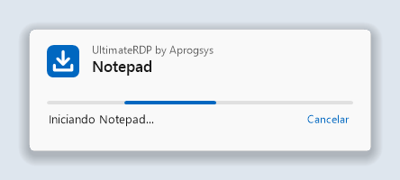

## Sumário

<!-- toc -->
- [Transferências rápidas por conexões paralelas](#transferências-rápidas-por-conexões-paralelas)
- [Por quê](#por-quê)
- [O que é necessário](#o-que-é-necessário)
- [Instalação](#instalação)
  - [No servidor](#no-servidor)
  - [Sessões abertas com o cliente da Microsoft](#sessões-abertas-com-o-cliente-da-microsoft)
  - [No seu computador](#no-seu-computador)
- [Uso](#uso)
  - [Sessões e guias](#sessões-e-guias)
  - [A janela de carregamento](#a-janela-de-carregamento)
  - [Encerrar a sessão](#encerrar-a-sessão)
  - [Arrastar para a sessão](#arrastar-para-a-sessão)
  - [Arquivos grandes](#arquivos-grandes)
  - [Enviar arquivos da sessão para o seu computador](#enviar-arquivos-da-sessão-para-o-seu-computador)
  - [Mensagens da barra de status](#mensagens-da-barra-de-status)
  - [Menu Exibir](#menu-exibir)
  - [Idioma](#idioma)
  - [Credenciais salvas e a senha](#credenciais-salvas-e-a-senha)
- [Configurações do cliente](#configurações-do-cliente)
- [Menu e configurações do agente na área de notificação](#menu-e-configurações-do-agente-na-área-de-notificação)
  - [Configurações para todo o computador](#configurações-para-todo-o-computador)
  - [Unidades do cliente em letras de unidade](#unidades-do-cliente-em-letras-de-unidade)
- [Conexão direta para arquivos grandes](#conexão-direta-para-arquivos-grandes)
  - [Regras de firewall](#regras-de-firewall)
  - [Retorno ao canal](#retorno-ao-canal)
  - [Configurações](#configurações)
  - [Ler as linhas de resumo](#ler-as-linhas-de-resumo)
- [Programas RemoteApp](#programas-remoteapp)
  - [A partir de um atalho ou de um arquivo .bat](#a-partir-de-um-atalho-ou-de-um-arquivo-bat)
  - [No seu computador](#no-seu-computador-1)
  - [No servidor](#no-servidor-1)
  - [Teste em uma conta](#teste-em-uma-conta)
  - [Uma conexão por servidor e conta](#uma-conexão-por-servidor-e-conta)
- [Iniciadores](#iniciadores)
  - [Opções da linha de comando](#opções-da-linha-de-comando)
  - [O gerador de iniciadores](#o-gerador-de-iniciadores)
- [Como funciona](#como-funciona)
- [Solução de problemas](#solução-de-problemas)
- [Compilar a partir do código-fonte](#compilar-a-partir-do-código-fonte)
- [Notas de segurança](#notas-de-segurança)
- [Estado](#estado)
- [Créditos](#créditos)
- [Licença](#licença)
<!-- /toc -->

## Transferências rápidas por conexões paralelas

O que é:

- A partir da versão 0.6.0, os arquivos grandes passam por uma conexão TLS direta entre o cliente e o agente, fora da conexão da Área de Trabalho Remota, e a partir da versão 0.7.0 por várias conexões em paralelo, oito por padrão, dezesseis no máximo. As conexões usam TLS 1.3 quando as duas versões do Windows o oferecem, como o Windows 11 e o Windows Server 2022, e TLS 1.2 nos outros casos.
- O agente cria o seu certificado na memória e informa o SHA-256 dele e um token de uso único pelo canal virtual RDP, que já é autenticado e criptografado. O cliente aceita apenas esse certificado, e o agente aceita apenas conexões que provam conhecer o token.
- Cada arquivo é verificado com o seu SHA-256 no final. Um arquivo que não confere não é mantido.
- Quando a conexão direta não pode ser usada, por exemplo através de um Remote Desktop Gateway ou com portas fechadas, os arquivos passam pelo canal virtual RDP sem que o usuário precise fazer nada, e o log do cliente diz por quê.

Por que isso importa:

- O canal virtual RDP transportou cerca de 2 MB/s em produção, qualquer que fosse o link.
- O redirecionamento de unidades lê um arquivo em pequenos blocos, com uma ida e volta por bloco: 3,6 MB/s em uma medição, em um link que transportava 9,7 MB/s.
- Uma única conexão TCP no caminho de produção começou a 90 a 180 MB/s e se estabilizou em 20 a 22 MB/s após os primeiros segundos. O limite é por conexão, em algum ponto do caminho, e várias conexões se somam.

Medido em uma instalação de produção, um servidor em um provedor de hospedagem e um PC em uma linha de 2,3 Gbit/s:

| Caminho | Taxa |
| --- | --- |
| PC para o servidor, 8 conexões diretas | 255 a 296 MB/s |
| Servidor para o PC, 8 conexões diretas | 115 a 134 MB/s, o teto do link de saída desse servidor |
| Uma conexão direta, após os primeiros segundos | 20 a 22 MB/s |
| Os mesmos arquivos pelo canal virtual RDP | cerca de 2 MB/s |

Estas são medições em uma única instalação; as taxas dependem do link, do servidor e dos discos. O servidor precisa de uma regra de firewall para um intervalo de portas: veja "Conexão direta para arquivos grandes".

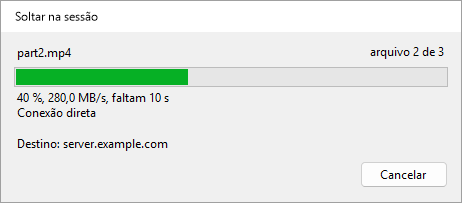

## Por quê

O cliente da Área de Trabalho Remota da Microsoft recusa arquivos soltos na sua janela, porque o RDP não tem canal de arrastar e soltar. Copiar e colar funciona, assim como o redirecionamento de unidades, mas nenhum dos dois é soltar. O UltimateRDP acrescenta o gesto ao que o RDP já oferece.

Enquanto você arrasta sobre a janela do cliente, o agente reproduz o mesmo arrasto dentro da sessão, como um verdadeiro arrastar e soltar OLE. Qualquer aplicativo remoto que aceita arquivos soltos os aceita, portanto, do UltimateRDP, e mostra a sua própria indicação visual enquanto você move o cursor. Quando nada sob o cursor aceita o envio, ele é ignorado: nada é copiado para lugar nenhum.

Os arquivos pequenos passam pelo redirecionamento de unidades. Os arquivos grandes passam pelo canal do UltimateRDP antes de serem soltos: veja "Arquivos grandes" abaixo.

## O que é necessário

- Um computador cliente com Windows 10 ou 11, 64 bits.
- Um servidor com Windows Server 2016 ou posterior, ou um computador com Windows 10 ou 11 que atue como host da Área de Trabalho Remota.
- Um arquivo .rdp que redirecione as unidades. Nas configurações da Conexão de Área de Trabalho Remota, isso fica em Recursos Locais, depois Mais, depois Unidades.
- A possibilidade de executar o agente na sua sessão de usuário no servidor.

O cliente é um único executável portátil. Ele funciona sem direitos de administrador. O arquivo compactado do agente também contém um único executável.

O UltimateRDP funciona através de um Remote Desktop Gateway. A conexão direta para arquivos grandes não funciona, e os arquivos passam então pelo canal: veja "Conexão direta para arquivos grandes".

O UltimateRDP tem um escopo deliberadamente restrito:

- O envio por soltar vai em um só sentido, do computador local para a sessão. A partir da versão 0.9.0, a sessão envia arquivos para o seu computador com o menu Enviar para em vez de soltar, apenas pela conexão direta: veja "Enviar arquivos da sessão para o seu computador".
- Sessões de área de trabalho completa e, a partir da versão 0.8.0, programas RemoteApp: veja "Programas RemoteApp".
- A sessão sempre começa em uma janela, mesmo que o arquivo .rdp peça tela inteira. Você pode passar para tela inteira depois. Em tela inteira, só é possível soltar a partir de um monitor que a sessão não cobre.

## Instalação

Cada zip contém um único arquivo `.exe`.

### No servidor

1. Baixe o zip `UltimateRDP.Agent` da [página de Releases](https://github.com/freeKC/ultimaterdp/releases).
2. Descompacte-o em uma pasta que todos os usuários possam ler, como `C:\Program Files\UltimateRDP`.
3. Em um prompt de comando elevado, execute:

   ```
   "C:\Program Files\UltimateRDP\UltimateRDP.Agent.exe" --install-all-users
   ```

   O agente passa então a iniciar com cada sessão de usuário. Os usuários que já entraram o recebem na próxima entrada. Executar o comando de novo não muda nada. Se você tinha instalado o agente para a sua própria conta com `--install`, o comando também remove essa entrada e avisa, para que o agente não inicie duas vezes na sua sessão. Ele recusa um executável dentro de um perfil de usuário, como uma pasta Downloads, porque os outros usuários talvez não consigam lê-lo.

Para instalá-lo apenas para a sua própria conta, execute o mesmo comando com `--install` em um prompt normal. Isso também inicia o agente na hora.

As sessões RemoteApp não usam a entrada `Run`. Para ter o agente nelas também, veja "Programas RemoteApp" abaixo.

Outras opções:

- `--uninstall` impede o agente de iniciar com a sua sessão e encerra a cópia em execução. Execute-o em um prompt elevado para remover também a entrada para todos os usuários.
- `--send <paths>` envia arquivos e pastas da sessão para o computador do cliente UltimateRDP conectado a ela. O atalho do menu Enviar para o executa; veja "Enviar arquivos da sessão para o seu computador".
- `--status` mostra a versão, as entradas `Run` em `HKEY_CURRENT_USER` e `HKEY_LOCAL_MACHINE`, o arquivo de configurações, o arquivo de configurações do computador e se o agente está em execução na sua sessão. Ele também diz se a sessão é uma sessão RemoteApp, e se o valor `SysProcs` e a tarefa agendada de "Programas RemoteApp" existem. Ele não altera nada.
- `--help` lista as opções.

Para atualizar em um servidor, encerre todas as cópias do agente em um prompt elevado com `taskkill /im UltimateRDP.Agent.exe /f`, substitua o executável e deixe os usuários entrarem de novo. Para atualizar a sua própria cópia, feche-a pelo menu da área de notificação ou com `--uninstall`, substitua o executável e instale-a de novo. O cliente e o agente devem ter a mesma versão.

### Sessões abertas com o cliente da Microsoft

Em um servidor, a maioria dos usuários pode se conectar com o cliente da Microsoft (mstsc), que não tem o canal do UltimateRDP. Para eles, o agente fica fora de vista e não faz nada visível:

- Ele não mostra nenhum ícone, nenhuma janela e nenhuma mensagem. O seu ícone na área de notificação só aparece enquanto um cliente UltimateRDP está conectado à sessão, e some quando esse cliente se desconecta; em uma sessão RemoteApp, ele nunca aparece. A configuração `trayIcon` abaixo muda isso.
- Enquanto espera, ele usa alguns megabytes de memória e nenhum tempo de processador mensurável. Ele tenta abrir o seu canal a cada dez segundos, e imediatamente quando um cliente se conecta à sessão, para que um usuário que se reconecta com o cliente UltimateRDP encontre o agente pronto.
- O seu log recebe uma linha quando ele inicia e no máximo uma linha por hora enquanto ele espera.
- Ele sobrevive a desconexões e reconexões, com qualquer um dos clientes. Ao sair da sessão, ele solta o botão do mouse se um envio estava em andamento, fecha o canal e termina, sem atrasar a saída.
- Um erro inesperado nunca mostra uma caixa de diálogo: ele é gravado no log, e o agente continua ou termina em silêncio.

### No seu computador

1. Baixe o zip `UltimateRDP` da [página de Releases](https://github.com/freeKC/ultimaterdp/releases).
2. Descompacte-o em qualquer lugar. Não há nada para instalar. O UltimateRDP não grava nada no registro.
3. Inicie-o com o seu arquivo de conexão:

   ```
   UltimateRDP.exe path\to\connection.rdp
   ```

   Você também pode clicar duas vezes em `UltimateRDP.exe` e escolher o arquivo .rdp na caixa de diálogo.

## Uso

### Sessões e guias

Cada sessão abre na sua própria guia. A barra de status e os menus acompanham a guia ativa. O menu Arquivo contém:

- **Abrir .rdp...** (Ctrl+O): abre um arquivo de conexão em uma nova guia.
- **Recentes**: os dez últimos arquivos de conexão. **Limpar recentes** esvazia a lista.
- **Criar um iniciador (.bat)...**: a partir da versão 0.10.0, grava um arquivo .bat que abre uma conexão. Veja "Iniciadores".
- **Reabrir em nova guia**: abre mais uma vez o arquivo da guia ativa, em uma segunda guia. A partir da versão 0.10.0, enquanto a sessão da guia está conectada, essa guia continua selecionada em vez disso: uma segunda conexão com a mesma conta assumiria a sessão dela. Veja "Uma conexão por servidor e conta".
- **Fechar guia** (Ctrl+W): desconecta a sessão ativa e fecha a guia dela.
- **Encerrar a sessão remota**: encerra a sua sessão do Windows no servidor. Veja "Encerrar a sessão" abaixo.
- **Esquecer credenciais salvas**: veja "Credenciais salvas e a senha" abaixo.
- **Sempre pedir a senha**: a partir da versão 0.9.0, cada conexão pede a senha em vez de usar uma credencial salva. Veja "Credenciais salvas e a senha" abaixo.
- **Sair**: desconecta todas as sessões e fecha a janela.

O menu Sessão contém Conectar, Desconectar, Procurar o agente novamente e Cancelar a transferência. Veja "Arquivos grandes" abaixo.

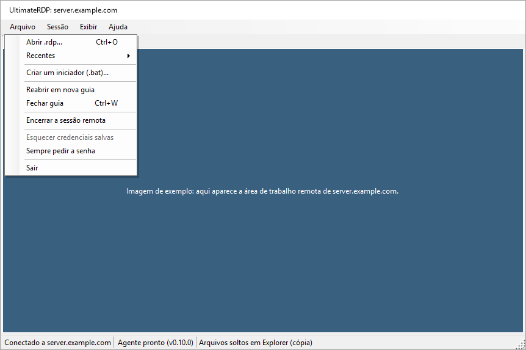

O menu Ajuda contém Sobre o UltimateRDP, que mostra "UltimateRDP by Aprogsys", a versão e o endereço do projeto, Página do projeto e Abrir a pasta de logs.

### A janela de carregamento

A partir da versão 0.9.3, uma pequena janela aparece assim que o UltimateRDP inicia com uma conexão, a partir de um arquivo .bat, de um atalho ou do executável, até o programa ou a área de trabalho estar lá. Ela mostra "UltimateRDP by Aprogsys", o nome do programa ou do servidor, uma barra em movimento e a etapa: "Iniciando...", "Conectando a server.example.com...", "Abrindo a sessão...", "Iniciando Notepad...". Após 10 segundos, ela diz que o servidor está demorando mais do que o normal. O seu botão Cancelar interrompe a conexão.

 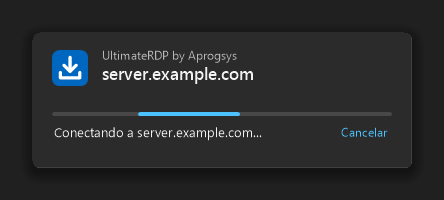

- Ela fecha quando a janela do programa aparece, quando a sessão da área de trabalho é iniciada, ou em qualquer término antes disso.
- Ela segue o tema claro ou escuro do Windows e a escala do seu monitor, nunca toma o teclado e não tem botão na barra de tarefas.
- Ela se esconde enquanto a pergunta sobre o certificado do servidor, a solicitação de senha, o aviso do Windows sobre uma conexão RemoteApp ou uma mensagem do UltimateRDP aguarda uma resposta, e volta acima das outras janelas depois, sem tomar o teclado.
- Uma segunda inicialização entregue ao UltimateRDP em execução mostra imediatamente a janela de carregamento da nova sessão.
- `"loader": "off"` em client.json a desativa.

### Encerrar a sessão

Sair, Fechar guia e Sessão, Desconectar apenas desconectam, como faz o cliente da Área de Trabalho Remota da Microsoft. A sua sessão do Windows continua em execução no servidor, com os seus aplicativos, e você a reencontra na próxima conexão.

Para realmente encerrar a sessão, use Arquivo, Encerrar a sessão remota. A entrada fica disponível assim que a barra de status diz "Agente pronto". O cliente pede uma confirmação, e então o agente encerra a sessão, como faria o comando Sair do menu Iniciar. Os aplicativos com trabalho não salvo perguntam o que fazer, na sessão, antes de ela fechar. A barra de status diz "Encerrando a sessão remota..." e depois mostra a desconexão.

### Arrastar para a sessão

1. Inicie o cliente. Ele se conecta com as configurações do arquivo .rdp. Inicie a sessão como de costume.
2. Observe a barra de status na parte de baixo da janela. O rótulo do agente passa de "Agente: aguardando" para "Agente pronto (v0.4.3)".
3. Arraste arquivos ou pastas do Explorer para a sessão. Uma faixa azul no alto da sessão diz "Solte aqui para enviar os arquivos para a sessão".
4. Passe sobre o aplicativo remoto que você quer. Ele mostra a sua própria indicação visual, por exemplo uma pasta destacada ou uma área de anexos.
5. Solte o botão sobre o destino. O aplicativo remoto recebe os arquivos como em um envio normal.

Uma janela de progresso aparece a cada envio. A janela "Soltar na sessão" abre sobre a sessão assim que você solta o botão. Ela mostra os itens soltos, uma barra que corre sem valor, "Enviando para a sessão..." e o nome do computador remoto. Depois ela mostra o resultado, como "Arquivos soltos em Caixa de Entrada (cópia)" ou "Nada sob o cursor aceitou os arquivos.", e fecha sozinha três segundos depois, a menos que o mouse esteja sobre ela. Quando o envio falha, ela mostra o motivo em vermelho e fica aberta até você clicar em Fechar. Para arquivos grandes, a mesma janela mostra primeiro a transferência, veja "Arquivos grandes" abaixo. A janela nunca toma o teclado da sessão, fica acima da janela principal e continua aberta quando você troca de guia. Fechar a guia da sessão a fecha.

Se nada sob o cursor aceita o envio, ele é ignorado e a barra de status diz "Nada sob o cursor aceitou os arquivos." O agente nunca copia arquivos por conta própria.

Quando o destino é o Explorer, o Explorer mostra a sua caixa de diálogo de cópia habitual do Windows na sessão. Ela mostra o progresso e pergunta o que fazer quando um arquivo já existe.

O UltimateRDP só oferece cópia e atalho ao aplicativo remoto. Ele nunca oferece mover. Ctrl, Shift e Alt não são repassados à sessão durante um arrasto.

### Arquivos grandes

Um aplicativo remoto lê um arquivo pelo redirecionamento de unidades em pequenos blocos, com uma ida e volta pela rede por bloco. Em uma conexão com alguma latência, isso é lento: em uma medição, 3,6 MB/s em um link que transportava 9,7 MB/s. Para arquivos grandes, o UltimateRDP envia portanto os arquivos pelo seu próprio canal, em um fluxo contínuo, antes de soltá-los.

Por padrão, isso acontece quando os arquivos e pastas soltos somam 10 MiB ou mais. A configuração do agente "Transferência rápida de arquivos grandes" muda isso, veja "Menu e configurações do agente na área de notificação" abaixo.

O que você vê:

1. O arrasto sobre a sessão funciona como de costume: o aplicativo remoto mostra a sua indicação visual.
2. Quando você solta o botão, o arrasto termina na sessão sem soltar nada, e a janela "Soltar na sessão" mostra a transferência. A barra de status também mostra o progresso: "Transferindo 3 arquivo(s): 42 % (12,3 MB/s, faltam 1 min)".
3. Quando todos os arquivos estão na sessão, o agente solta as cópias onde você soltou o botão, e a barra de status diz "Arquivos soltos em ..." como de costume.

Durante uma transferência, a janela "Soltar na sessão" mostra o nome do arquivo em envio com "arquivo 2 de 3", uma barra de progresso, uma linha como "42 %, 2,6 MB/s, faltam 1 min 40 s" e o nome do computador remoto. Enquanto o cliente lista os arquivos, a barra corre sem valor e a linha diz "Preparando...". O seu botão Cancelar interrompe a transferência, como faz Sessão, Cancelar a transferência. Após um sucesso, ela diz "3 arquivo(s) transferido(s) em 3 min 13 s a 2,6 MB/s, enviando para a sessão...", depois mostra o resultado do envio e fecha sozinha três segundos depois, a menos que o mouse esteja sobre ela. Após uma falha ou um cancelamento, ela mostra o motivo em vermelho e fica aberta até você clicar em Fechar. Fechar a guia da sessão cancela a transferência e fecha a janela.

 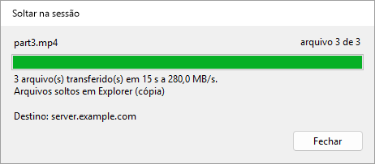

As cópias vão para `%LOCALAPPDATA%\UltimateRDP\staging` na sessão e são excluídas uma hora após o envio. O agente verifica o tamanho e a soma de verificação SHA-256 de cada arquivo. Se algo der errado, nada é solto e a barra de status diz por quê. Sessão, Cancelar a transferência a interrompe; o agente então exclui o que recebeu.

O que é bom saber:

- Uma transferência por vez. Enquanto uma está em andamento, um novo arrasto sobre a sessão é recusado, e a janela de progresso diz "Aguarde o fim desta transferência antes de soltar mais arquivos." por cinco segundos.
- O redirecionamento de unidades ainda deve estar ativado: o arrasto sobre a sessão o utiliza.
- Se você soltar o botão muito rápido, antes de o agente responder ao início do arrasto, o cliente espera essa resposta, por no máximo um segundo e meio, com "Preparando..." na janela de progresso, para que os arquivos grandes ainda passem pelo canal do UltimateRDP. Um novo arrasto é recusado durante essa espera, como durante uma transferência.
- As pastas vazias dentro de uma pasta solta não são criadas na sessão.
- O agente deve estar na versão 0.4.1 ou posterior, e o cliente também. A janela de progresso é nova no cliente 0.4.2 e funciona com um agente 0.4.1. Com um cliente ou um agente mais antigo, todo envio passa pelo redirecionamento de unidades.
- A partir da versão 0.6.0 nos dois lados, os arquivos passam por uma conexão direta quando o servidor abre as suas portas para ela, e pelo canal nos outros casos. A partir da 0.7.0 nos dois lados, a conexão direta usa várias conexões TCP ao mesmo tempo. Veja "Conexão direta para arquivos grandes".

A partir da versão 0.5.0, os arquivos viajam em uma forma mais densa quando a sua conexão permite. O agente informa ao cliente como os dados do cliente chegam até ele. Quando cada caractere chega como dois bytes, como medido em um servidor de produção, o cliente coloca 15 bits do arquivo em cada caractere em vez de base64, e um byte do arquivo custa cerca de 1,07 byte no canal em vez de 2,67. Em um canal que transporta 5,8 MB/s, a transferência passa de cerca de 2,1 MB/s para cerca de 5,4 MB/s. Quando cada caractere chega como um byte, o cliente mantém o base64, a cerca de três quartos do canal. Os dois lados devem estar na 0.5.0 para a forma mais densa; com um agente mais antigo, o cliente envia base64 como antes. A barra de status e a janela de progresso não mudam; o log do cliente diz qual forma uma transferência usa.

O cliente envia os arquivos em blocos de 32 KiB. A configuração `transferChunkBytes` em `%LOCALAPPDATA%\UltimateRDP\client.json` muda esse tamanho, de 4096 (4 KiB) a 262144 (256 KiB). Um valor fora desses limites é trazido de volta para dentro deles. A configuração só pode ser editada no arquivo e vale depois que o cliente reinicia. Não a altere, a menos que uma transferência falhe logo no início.

```json
{
  "transferChunkBytes": 32768,
  "transferBatchCharacters": 200000,
  "transferWindowBytes": 4194304,
  "directTransfer": "auto",
  "directConnections": 8,
  "logLevel": "info"
}
```

O cliente envia as suas mensagens ao agente em conjunto, no máximo `transferBatchCharacters` caracteres em uma chamada ao controle da Área de Trabalho Remota: 200000 por padrão, de 50000 a 1048576. Um valor fora desses limites é trazido de volta para dentro deles. Não a altere, a menos que uma transferência falhe logo no início.

A configuração `logLevel` do mesmo arquivo é `info` por padrão. Defina-a como `debug` para registrar cada mensagem que o cliente envia ao agente e cada chamada que ele faz ao controle da Área de Trabalho Remota, e reinicie o cliente.

O cliente mantém no máximo `transferWindowBytes` bytes de uma transferência enviados e ainda não confirmados pelo agente: 4194304 (4 MiB) por padrão, de 1048576 (1 MiB) a 33554432 (32 MiB). Um valor fora desses limites é trazido de volta para dentro deles. O agente confirma a cada 2 MiB, então uma janela abaixo de 2 MiB mais um bloco é elevada até esse valor; o log informa a janela usada no início de cada transferência. Altere-a apenas para descobrir o que limita uma transferência lenta, veja abaixo.

#### Medir uma transferência lenta

A partir da versão 0.4.4, os dois logs terminam cada transferência com linhas de resumo que dizem para onde foi o tempo. Instale a 0.4.4 nos dois lados para ter o quadro completo; com um cliente ou um agente mais antigo, o outro lado ainda registra as suas próprias linhas.

O log do cliente tem duas linhas:

```
Transfer <id> channel calls: 2410 calls, 482000000 characters, 9100 ms inside SendOnVirtualChannel, 3.78 ms per call on average, 41.20 ms at most; 5 % of the 190000 ms from the first call to the last, 5 % of the 193000 ms of the transfer.
Transfer <id> acknowledgements: 237 matched a call, round trip 1480 ms on average, 20 ms at least, 1900 ms at most; 3700000 bytes in flight on average when one came, 4194304 at most, 88 % of the window of 4194304 bytes.
```

O log do agente tem uma linha por conexão sobre a conexão, e duas linhas por transferência:

```
Transfer <id> channel reads: 302000 reads with data and 12 empty, 482000000 bytes, 1596 bytes per read on average; 301000 of 1600 bytes, 1000 shorter, 0 longer; blocked in the read 178000 ms, processing 14000 ms (9000 ms handling messages), over 193000 ms; read mode wts.
Transfer <id> session counters: 0 bytes, 0 frames and 0 compressed bytes in, 0 bytes out, from WTSSessionInfoEx (zero when Windows does not count them).
```

Como lê-las:

- **O cliente passa bem mais da metade do tempo dentro de SendOnVirtualChannel.** O controle da Área de Trabalho Remota limita a transferência no seu computador.
- **O agente passa quase todo o tempo processando, e pouco bloqueado na leitura.** O agente limita a transferência; o tempo de tratamento das mensagens cobre o JSON, a decodificação dos blocos, a soma de verificação e a gravação do arquivo.
- **As chamadas do cliente ocupam uma pequena parte e o agente espera na leitura quase todo o tempo.** Os dados esperam entre os dois, na conexão da Área de Trabalho Remota. Quando os bytes em trânsito ficam perto da janela, tente uma transferência com `transferWindowBytes` em 16777216. Se a taxa não mudar e a ida e volta ficar quatro vezes maior, o controle de fluxo da conexão é o limite. Se a taxa aumentar, mantenha a janela maior.

Se a conexão usa UDP aparece na barra de conexão da sessão da Área de Trabalho Remota: clique no ícone de sinal para ver as informações da conexão.

### Enviar arquivos da sessão para o seu computador

A partir da versão 0.9.0, arquivos e pastas da sessão vão para o seu computador pela conexão direta, à mesma taxa que os arquivos grandes no outro sentido. Os dois lados devem estar na 0.9.0, e a conexão direta deve funcionar: veja "Conexão direta para arquivos grandes".

Na sessão:

- **Enviar para.** Clique com o botão direito em arquivos ou pastas no Explorer, depois em Enviar para, **Meu PC (UltimateRDP)**. O atalho só existe enquanto um cliente UltimateRDP que recebe arquivos está conectado, e desaparece quando ele se desconecta.
- **O menu do agente na área de notificação**, Enviar arquivos para o meu PC..., escolhe os arquivos em uma caixa de diálogo. O ícone na área de notificação não aparece nas sessões RemoteApp.

  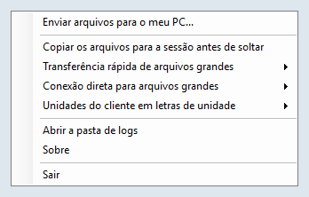

- **A linha de comando**: `UltimateRDP.Agent.exe --send "C:\Users\me\Documents\report.pdf" "C:\Users\me\Pictures\Trip"`.

Se os arquivos não puderem ser enviados, uma mensagem na sessão diz por quê, por exemplo que nenhum cliente que recebe arquivos está conectado.

No seu computador:

- Os arquivos vão para a sua pasta Downloads. Enquanto chegam, eles ficam em uma pasta oculta `.ultimaterdp-<id>.part` dentro dela, e aparecem quando todos os arquivos foram verificados com o seu SHA-256. Um arquivo nunca substitui outro: quando `report.pdf` existe, o novo é `report (2).pdf`, e uma pasta passa a ser `Photos (2)`.
- Uma janela "Arquivos da sessão" mostra o progresso, com Cancelar. No final, ela diz onde estão os arquivos, e Abrir pasta os mostra no Explorer.

  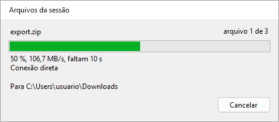 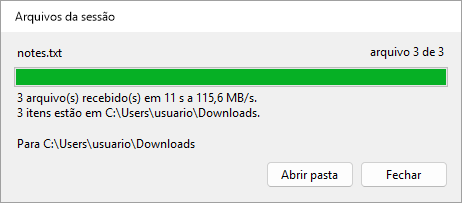

- Todo arquivo recebido ganha a marca que o Windows dá aos downloads, para que o SmartScreen e o Office o tratem como um arquivo vindo da Internet. O UltimateRDP nunca abre nem executa um arquivo recebido.
- Quando a conexão direta não pode ser usada, por exemplo através de um Remote Desktop Gateway ou com portas fechadas por um firewall, nada é enviado e a janela avisa. Não há caminho mais lento; em vez disso, copie os arquivos na sessão para uma unidade do seu computador em `\\tsclient`.
- Nomes que o Windows recusa, um caminho que sairia da pasta ou falta de espaço livre interrompem a transferência, e nada é mantido.

Configurações em `%LOCALAPPDATA%\UltimateRDP\client.json`, que só podem ser editadas no arquivo:

```json
{
  "receiveFiles": "auto",
  "receiveFolder": "%USERPROFILE%\\Desktop\\From the server"
}
```

| Configuração | Valores | Quando ausente | Significado |
| --- | --- | --- | --- |
| `receiveFiles` | `auto`, `never` | `auto` | `never` recusa os arquivos da sessão. `directTransfer` em `never` também os recusa, já que só a conexão direta os transporta. |
| `receiveFolder` | um caminho completo | a sua pasta Downloads | Para onde vão os arquivos. Variáveis de ambiente como `%USERPROFILE%` são expandidas; a pasta é criada quando não existe. |

No servidor, `sendToClient` em agent.json, `auto` por padrão, definido como `never`, desativa o envio para um usuário ou, nas configurações do computador, para todos. `directMaxMegabytesPerSecond` também limita o que o agente envia, o que protege o link de saída do servidor. A partir da versão 0.9.2, `sendMaxMegabytesPerSecond` limita apenas o envio, para que os arquivos vindos dos clientes mantenham a taxa total: por exemplo `"sendMaxMegabytesPerSecond": 85` nas configurações do computador quando o link de saída do servidor transporta cerca de 1 Gbit/s.

### Mensagens da barra de status

Mensagens de um arrasto:

- **"Arrastando 2 item(ns) para a sessão..."**: o agente está reproduzindo o arrasto.
- **"Iniciando o arrasto na sessão..."**: o agente precisa de um momento para iniciar o arrasto.
- **"Copiando 2 item(ns) para a sessão antes de o arrasto começar..."**: o agente copia primeiro os arquivos para a sessão, porque "Copiar os arquivos para a sessão antes de soltar" está ativado.
- **"Arquivos soltos em Caixa de Entrada (cópia)"**: a janela remota aceitou o envio. A mensagem dá o nome da janela e diz cópia ou atalho.
- **"Nada sob o cursor aceitou os arquivos."**: a janela sob o cursor não aceitou o envio. Nada foi copiado.
- **"O agente não confirmou o arrasto"**: nenhuma resposta do agente em um segundo. Veja "Solução de problemas".
- **"Envio recusado"** seguido do motivo dado pelo agente. Por exemplo "Envio recusado: O envio anterior ainda está sendo entregue na sessão. Tente novamente quando ele terminar."
- **"Envio recusado: o arrasto não começou na sessão. Arraste os arquivos novamente."**: o cliente recebeu o envio sem um arrasto em andamento para os mesmos arquivos.
- **"Cancelado"** seguido do motivo, por exemplo "Cancelado: O arrasto foi cancelado: a tecla Esc foi pressionada na sessão."

A janela de progresso que aparece a cada envio também mostra o resultado do envio, e o progresso de uma transferência com mais detalhes, veja "Arrastar para a sessão" e "Arquivos grandes" acima. A barra de status mantém os seus textos.

Mensagens de uma transferência de arquivos grandes:

- **"Preparando a transferência de 2 item(ns)..."**: o cliente lista os arquivos a enviar.
- **"Transferindo 3 arquivo(s): 42 % (12,3 MB/s, faltam 1 min)"**: os arquivos estão a caminho. A taxa cobre os últimos cinco segundos; MB significa um milhão de bytes.
- **"3 arquivo(s) transferido(s) a 12,3 MB/s, enviando..."**: todos os arquivos estão na sessão, e o agente solta as cópias.
- **"Transferência cancelada."**: você cancelou a transferência pelo menu Sessão ou pela janela de progresso.
- **"Há uma transferência em andamento. Aguarde o fim ou cancele-a no menu Sessão."**: um novo arrasto foi recusado durante uma transferência.
- **"Falha na transferência"** seguido do motivo dado pelo agente, por exemplo "Falha na transferência: Dados foram perdidos ou danificados no caminho. Tente novamente."
- **"Envio recusado: Não há espaço livre suficiente na sessão: são necessários 1.234 MB e há 800 MB livres."**: o disco da sessão não comporta os arquivos.
- **"Não é possível ler"** seguido de um nome de arquivo e do motivo do Windows: o cliente não conseguiu ler um arquivo no seu computador.
- **"O agente parou de responder durante a transferência."**: nenhuma confirmação durante um minuto.
- **"A transferência parou: a sessão foi desconectada."**: a conexão terminou durante a transferência.

Mensagens da conexão:

- **"Nenhum agente no computador remoto"**: o cliente enviou mensagens de saudação durante sessenta segundos e não recebeu resposta. Inicie o agente na sessão e use Sessão, Procurar o agente novamente.
- **"Este arquivo .rdp não redireciona unidades: o envio de arquivos não vai funcionar."**: o arquivo .rdp não compartilha nenhuma unidade local. Ative as unidades no arquivo .rdp e reconecte.
- **"A sessão não vê nenhuma unidade redirecionada: o envio de arquivos não vai funcionar."**: o agente respondeu, mas nenhuma unidade `\\tsclient` está acessível a partir da sessão. O servidor pode estar bloqueando o redirecionamento de unidades.
- **"Envio recusado: não conectado."**: ainda não há sessão.
- **"Envio recusado: o agente UltimateRDP ainda não respondeu."**: aguarde "Agente pronto".
- **"Envio recusado: o agente UltimateRDP não está em execução na sessão remota."**: inicie o agente na sessão.
- **"Envio recusado"** com um caminho: só é possível soltar arquivos e pastas de uma unidade local com letra. Os caminhos de rede (UNC) são recusados, porque a sessão acessa os seus arquivos pelo redirecionamento de unidades.
- **"Falha no envio"**: o agente não conseguiu terminar. O resto da mensagem dá o motivo.

Mensagens de um encerramento de sessão:

- **"Encerrando a sessão remota..."**: o agente aceitou a solicitação. A desconexão vem assim que a sessão é fechada. Se um aplicativo pedir para salvar o seu trabalho, responda na sessão.
- **"O agente não respondeu à solicitação de encerramento da sessão."**: nenhuma resposta em cinco segundos. A sessão continua aberta; tente de novo, ou saia pelo menu Iniciar da sessão.
- **"Falha ao encerrar a sessão"**: o Windows recusou encerrar a sessão. O resto da mensagem dá o motivo do Windows.

Estes exemplos estão em português. A barra de status usa o idioma do cliente, veja "Idioma" abaixo.

### Menu Exibir

- **Redimensionar a sessão à janela**: o padrão. A resolução da sessão acompanha o tamanho da janela.
- **Ajustar à janela**: a sessão mantém a sua resolução e a imagem é ajustada à janela.
- **Fator de escala**: Automático, ou de 100 % a 200 %. Automático segue o monitor onde está a janela. Uma alteração vale para uma nova conexão, e o cliente oferece reconectar.
- **Tela inteira** (F11, ou Ctrl+Alt+Pause): alterna a tela inteira. A barra de conexão é exibida e pode ser fixada.
- **Usar todos os monitores**: a sessão cobre todos os monitores em tela inteira. Vale para uma nova conexão.
- **Teclas do Windows**: para onde vão as combinações de teclas como Alt+Tab. "Neste computador", "Na sessão", ou "Na sessão em tela inteira", que é o padrão.
- **Idioma**: veja abaixo.

As suas escolhas do menu Exibir são salvas para as sessões que você abrir depois. Quando o arquivo .rdp define `desktopscalefactor`, `use multimon` ou `keyboardhook`, o arquivo prevalece.

### Idioma

O cliente e o agente falam inglês, francês, alemão, espanhol, italiano, português e holandês.

O submenu Exibir, Idioma lista "Automático (idioma do Windows)" e os sete idiomas, cada um com o nome no seu próprio idioma. Uma escolha vale na hora para os menus, a barra de status e as guias, e o cliente a memoriza. Automático, o padrão, segue o idioma de exibição do Windows, e usa o inglês quando o Windows está em outro idioma.

A escolha é a configuração `language` em `%LOCALAPPDATA%\UltimateRDP\client.json`: `auto`, `en`, `fr`, `de`, `es`, `it`, `pt` ou `nl`.

```json
{
  "language": "fr"
}
```

O cliente informa ao agente o seu idioma, e o agente escreve nesse idioma as mensagens que envia para a barra de status. O menu do agente na área de notificação segue o idioma de exibição do Windows no servidor.

Alguns textos vêm do Windows e seguem o idioma dele: os botões Sim e Não das perguntas, o motivo de uma desconexão e as mensagens de erro do Windows. Os logs estão sempre em inglês.

### Credenciais salvas e a senha

Antes de conectar, o cliente lê a credencial genérica `TERMSRV/<host>` do Gerenciador de Credenciais do Windows. Quando ela existe e contém uma senha, o cliente a aplica e desativa a solicitação para essa conexão. O UltimateRDP nunca grava uma credencial. Você pode criar uma com:

```
cmdkey /generic:TERMSRV/<host> /user:<domain\user> /pass
```

O `cmdkey` então pede a senha.

A partir da versão 0.9.0, o cliente pede a senha em vez disso, e não lê nenhuma credencial salva, quando qualquer um destes itens o indica:

- a opção `--ask-credentials` na linha de comando;
- Arquivo, **Sempre pedir a senha**, que o cliente memoriza como `"credentials": "ask"` em client.json (`saved` por padrão);
- a linha `prompt for credentials:i:1` no arquivo .rdp, como faz o cliente da Microsoft.

O nome de usuário do arquivo .rdp continua preenchido, e a solicitação não oferece salvar a senha. O log do cliente diz qual dos três decidiu, e nunca contém uma senha.

Isso muda o que acontece com um arquivo .rdp que já contém `prompt for credentials:i:1`: a versão 0.8.0 usava a credencial salva e conectava sem solicitação; a versão 0.9.0 pede a senha. Remova a linha do arquivo, ou defina-a como 0, para voltar a usar a credencial salva.

A caixa "Lembrar-me" da solicitação de credenciais do Windows salva outro tipo de credencial, uma senha de domínio. O Windows guarda essa senha para si, então o UltimateRDP não pode lê-la. A própria solicitação do Windows ainda pode usá-la.

Arquivo, Esquecer credenciais salvas exclui os dois tipos de credencial para o host da guia ativa. A sessão aberta não é afetada, e a próxima conexão pede de novo.

Nenhuma opção da linha de comando e nenhum campo do gerador de iniciadores aceita uma senha: veja "Iniciadores". O aviso do Windows sobre o editor de uma conexão RemoteApp é outra questão, e `--trusted` é a única maneira de pulá-lo: veja "Opções da linha de comando".

## Configurações do cliente

O cliente guarda as suas configurações em `%LOCALAPPDATA%\UltimateRDP\client.json`. O menu Exibir, o menu Idioma e Arquivo, Sempre pedir a senha gravam algumas delas; as outras só podem ser editadas no arquivo e valem quando o cliente inicia de novo. Um valor desconhecido resulta no padrão. Comentários são permitidos no arquivo e não são mantidos quando o cliente o grava.

```json
{
  "displayMode": "resizeSession",
  "scaleFactor": null,
  "keyboardHookMode": 2,
  "useAllMonitors": false,
  "language": "auto",
  "transferChunkBytes": 32768,
  "transferBatchCharacters": 200000,
  "transferWindowBytes": 4194304,
  "directTransfer": "auto",
  "directConnections": 8,
  "receiveFiles": "auto",
  "receiveFolder": null,
  "credentials": "saved",
  "loader": "on",
  "logLevel": "info"
}
```

| Configuração | Valores | Quando ausente | Significado |
| --- | --- | --- | --- |
| `displayMode` | `resizeSession`, `scaleToWindow` | `resizeSession` | Exibir, Redimensionar a sessão à janela ou Ajustar à janela. |
| `scaleFactor` | `null`, ou de 100 a 500 | `null` | Exibir, Fator de escala; `null` segue o monitor. |
| `keyboardHookMode` | 0, 1, 2 | 2 | Exibir, Teclas do Windows: neste computador, na sessão, na sessão em tela inteira. |
| `useAllMonitors` | `true`, `false` | `false` | Exibir, Usar todos os monitores. |
| `language` | `auto`, `en`, `fr`, `de`, `es`, `it`, `nl`, `pt` | `auto` | Exibir, Idioma. Veja "Idioma". |
| `recentFiles` | uma lista de caminhos | vazia | Arquivo, Recentes. O cliente a grava. |
| `transferChunkBytes` | de 4096 a 262144 | 32768 | Bytes por bloco de uma transferência pelo canal. Veja "Arquivos grandes". |
| `transferBatchCharacters` | de 50000 a 1048576 | 200000 | Caracteres por chamada ao controle da Área de Trabalho Remota. Veja "Arquivos grandes". |
| `transferWindowBytes` | de 1048576 a 33554432 | 4194304 | Bytes de uma transferência pelo canal enviados e ainda não confirmados. Veja "Arquivos grandes". |
| `directTransfer` | `auto`, `never` | `auto` | `never` mantém os arquivos grandes no canal e recusa os arquivos da sessão. Veja "Conexão direta para arquivos grandes". |
| `directConnections` | de 1 a 16 | 8 | Número máximo de conexões de uma transferência direta. |
| `receiveFiles` | `auto`, `never` | `auto` | `never` recusa os arquivos da sessão. Veja "Enviar arquivos da sessão para o seu computador". |
| `receiveFolder` | `null`, ou um caminho | a sua pasta Downloads | Para onde vão os arquivos da sessão; as variáveis de ambiente são expandidas. |
| `credentials` | `saved`, `ask` | `saved` | Arquivo, Sempre pedir a senha. Veja "Credenciais salvas e a senha". |
| `loader` | `on`, `off` | `on` | A janela de carregamento. Veja "A janela de carregamento". |
| `logLevel` | `debug`, `info` | `info` | `debug` registra cada mensagem para o agente e cada chamada ao controle. |

## Menu e configurações do agente na área de notificação

Por padrão, o ícone do agente na área de notificação só fica visível enquanto um cliente UltimateRDP está conectado à sessão. O seu menu contém:

- **Enviar arquivos para o meu PC...**: a partir da versão 0.9.0, envia os arquivos escolhidos para o computador do cliente. Veja "Enviar arquivos da sessão para o seu computador".
- **Copiar os arquivos para a sessão antes de soltar**: desativado por padrão. Quando ativado, o agente copia os arquivos para a sessão antes de o arrasto começar, e o aplicativo remoto recebe caminhos locais em vez de caminhos `\\tsclient`. Ative-o para aplicativos que recusam caminhos de rede. Arquivos grandes levam tempo para ser copiados antes de o arrasto começar. Quando os arquivos vêm pelo canal, veja abaixo, eles chegam de qualquer forma como cópias locais.
- **Transferência rápida de arquivos grandes**: Automático, Sempre ou Nunca. Automático, o padrão, envia os arquivos pelo canal do UltimateRDP antes de soltá-los quando eles somam 10 MiB ou mais. Sempre faz isso para todo envio, Nunca para nenhum: o aplicativo remoto então lê os arquivos pelo redirecionamento de unidades, como na versão 0.3.
- **Conexão direta para arquivos grandes**: Automático ou Nunca. Automático, o padrão, oferece a conexão direta para uma transferência rápida, com o canal como alternativa. Nunca mantém toda transferência rápida no canal. Veja "Conexão direta para arquivos grandes".
- **Unidades do cliente em letras de unidade**: Automático ou Nunca. Nunca, o padrão, deixa as unidades do seu computador como `\\tsclient\C` e assim por diante. Automático dá a elas letras de unidade da sessão enquanto um cliente UltimateRDP está conectado. Veja "Unidades do cliente em letras de unidade" abaixo.
- **Abrir a pasta de logs**, **Sobre** e **Sair**.

O menu segue o idioma de exibição do Windows no servidor.

As cópias preparadas vão para `%LOCALAPPDATA%\UltimateRDP\staging\<id>` na sessão. Cada pasta é excluída uma hora após o seu envio, porque o destino ainda pode estar lendo os arquivos. Quando o agente inicia, ele exclui as pastas com mais de uma hora.

O agente guarda as suas configurações em `%LOCALAPPDATA%\UltimateRDP\agent.json` no servidor:

```json
{
  "logLevel": "debug",
  "stageFiles": false,
  "fastTransfer": "auto",
  "fastTransferMinBytes": 10485760,
  "directTransfer": "auto",
  "directPortRange": "3400-3449",
  "directConnections": 8,
  "directMaxMegabytesPerSecond": 0,
  "sendMaxMegabytesPerSecond": 0,
  "trayIcon": "auto",
  "channelRead": "wts",
  "mapClientDrives": "never",
  "sendToClient": "auto"
}
```

| Configuração | Valores | Quando ausente | Significado |
| --- | --- | --- | --- |
| `stageFiles` | `true`, `false` | `false` | A entrada do menu da área de notificação "Copiar os arquivos para a sessão antes de soltar". |
| `fastTransfer` | `auto`, `always`, `never` | `auto` | A entrada do menu da área de notificação "Transferência rápida de arquivos grandes". |
| `fastTransferMinBytes` | um número de bytes | `10485760` (10 MiB) | O tamanho a partir do qual `auto` envia os arquivos pelo canal, somado sobre todos os itens soltos. Só pode ser editada no arquivo. |
| `directTransfer` | `auto`, `never` | `auto` | A entrada do menu da área de notificação "Conexão direta para arquivos grandes". |
| `directPortRange` | um intervalo como `3400-3449`, ou uma porta | `3400-3449` | As portas TCP da conexão direta, veja "Conexão direta para arquivos grandes". Só pode ser editada no arquivo. |
| `directConnections` | de 1 a 16 | `8` | Quantas conexões TCP uma transferência direta pode usar no máximo. Só pode ser editada no arquivo. |
| `directMaxMegabytesPerSecond` | 0, ou um número de MB/s | `0` | Um limite na taxa de uma transferência direta, todas as suas conexões juntas; 0 significa sem limite. Só pode ser editada no arquivo. |
| `sendMaxMegabytesPerSecond` | 0, ou um número de MB/s | `0` | A partir da versão 0.9.2, um limite no que o agente envia para o computador do cliente, todas as conexões de um envio juntas. 0 deixa `directMaxMegabytesPerSecond` também como limite de um envio. Só pode ser editada no arquivo. |
| `logLevel` | `debug`, `info`, `warn`, `error` | `info` | O nível mais baixo gravado no log. Só pode ser editada no arquivo. |
| `trayIcon` | `auto`, `always`, `never` | `auto` | `auto` mostra o ícone na área de notificação só enquanto um cliente UltimateRDP está conectado à sessão. `always` o mostra desde o início do agente. `never` nunca o mostra: o agente é então controlado apenas com `--uninstall` e a sua entrada `Run`. Só pode ser editada no arquivo. |
| `mapClientDrives` | `never`, `auto` | `never` | A entrada do menu da área de notificação "Unidades do cliente em letras de unidade". |
| `sendToClient` | `auto`, `never` | `auto` | Se os arquivos da sessão podem ser enviados para o computador de um cliente que os recebe. Só pode ser editada no arquivo. |
| `channelRead` | `wts`, `file` | `wts` | Como o agente lê o canal. `wts` o lê com WTSVirtualChannelRead, 1600 bytes por vez. `file` é um experimento: o agente lê o handle de arquivo do canal com um buffer de 64 KiB, retira os cabeçalhos de canal que encontrar, registra qual enquadramento encontrou, e volta a `wts` para a conexão na primeira inconsistência, com um aviso. Só pode ser editada no arquivo. |

Um valor desconhecido resulta no padrão e em um aviso no log. Reinicie o agente depois de editar o arquivo à mão. Quando o menu da área de notificação muda uma configuração, ele grava essa chave no seu agent.json e mantém as suas outras chaves; os comentários do arquivo não são mantidos.

### Configurações para todo o computador

Um administrador pode definir padrões para todos os usuários do servidor em `%ProgramData%\UltimateRDP\agent.json`, com as mesmas chaves. O agente lê primeiro esse arquivo quando ele existe, depois o agent.json do usuário, cujas chaves prevalecem uma a uma. Uma chave que o usuário não define, ou define como `null`, vem do arquivo do computador. O agente nunca grava o arquivo do computador; o menu da área de notificação só grava o arquivo do usuário. Por exemplo, para ativar as letras de unidade para todos:

```json
{
  "mapClientDrives": "auto"
}
```

Como um usuário pode criar arquivos em `%ProgramData%`, o agente só lê o arquivo do computador quando o seu proprietário é o grupo Administradores, SYSTEM ou TrustedInstaller, como no caso de um arquivo criado em um prompt elevado. Um arquivo de outro proprietário é ignorado, com um aviso no log que dá o comando `icacls` para corrigi-lo. A linha de início do log do agente lista as chaves que vêm do arquivo do computador, e `--status` diz se o arquivo existe. Reinicie os agentes, ou deixe os usuários entrarem de novo, após uma alteração.

### Unidades do cliente em letras de unidade

Com `mapClientDrives` em `auto`, o agente mapeia cada unidade que o seu computador redireciona, `\\tsclient\C`, `\\tsclient\D` e assim por diante, para uma letra de unidade da sessão assim que um cliente UltimateRDP se conecta, para que os programas que exigem uma letra de unidade possam usar os seus arquivos.

- Uma unidade mantém a sua própria letra quando essa letra está livre na sessão, e recebe a primeira letra livre a partir de Z, em ordem decrescente, nos outros casos. C, a unidade do sistema da sessão, costuma estar ocupada, então a sua unidade C: muitas vezes vira Z:.
- O agente nunca substitui uma letra em uso, seja uma unidade local ou um mapeamento, e não mapeia uma unidade que um mapeamento da sessão já alcança. Ele só mapeia as unidades que o seu computador redireciona, e nunca A: ou B:.
- As letras são visíveis apenas para você, na sua própria sessão, e não são memorizadas para a próxima entrada.
- Elas desaparecem quando o cliente se desconecta, quando você escolhe Nunca no menu da área de notificação e quando o agente termina. Se um arquivo estiver aberto em uma unidade, o agente remove a letra mesmo assim, mas apenas uma letra que ele próprio criou. Uma letra deixada por um agente que terminou mal é removida no seu próximo início, quando ainda aponta para a mesma unidade.
- Documentos, Área de Trabalho e as outras pastas do perfil não são redirecionadas.
- Toda falha é gravada no log como um aviso, e nada é mostrado. O log tem uma linha com as letras atribuídas quando o cliente se conecta.

## Conexão direta para arquivos grandes

A partir da versão 0.6.0, os arquivos de uma transferência rápida passam por uma conexão TLS direta entre o cliente e o agente, fora da conexão da Área de Trabalho Remota, quando a rede permite. Pelo canal do UltimateRDP, as transferências medidas em produção chegaram a 2 a 4 MB/s, qualquer que fosse o link; a conexão direta as transporta na taxa da rede. Quando ela não pode ser usada, os arquivos passam pelo canal como antes, sem que o usuário precise fazer nada.

A partir da versão 0.7.0, uma transferência usa várias conexões TCP ao mesmo tempo, oito no máximo por padrão. No caminho de produção, uma única conexão TCP começou a 90 a 180 MB/s e caiu para cerca de 20 MB/s em poucos segundos, enquanto quatro conexões juntas transportavam quatro vezes mais: o limite é por conexão, em algum ponto do caminho, e várias conexões se somam.

Como funciona:

1. Quando o agente decide por uma transferência rápida, ele escuta na primeira porta TCP livre de um intervalo, de 3400 a 3449 por padrão, apenas para essa transferência. Cada sessão usa a sua própria porta, por isso é necessário um intervalo em um servidor com muitas sessões.
2. A sua resposta ao arrasto, pelo canal, informa a porta, um token aleatório de uso único, o SHA-256 do seu certificado TLS, a versão do protocolo e o número de conexões que ele aceita.
3. Após soltar, o cliente se conecta ao host do arquivo .rdp nessa porta, em até 3 segundos. Ele aceita apenas o certificado cujo SHA-256 o agente informou, prova que conhece o token e envia a lista dos arquivos.
4. Quando o agente aceitou essa primeira conexão, o cliente abre as outras para o mesmo endereço, uma para cada 32 MiB iniciados da transferência, até o número que o agente aceita e a sua própria configuração. Uma conexão que não pode ser aberta não é um erro: as outras transportam os arquivos.
5. Os arquivos vão em blocos de 1 MiB por todas as conexões. O agente grava cada bloco no lugar dele no arquivo, verifica o SHA-256 de cada arquivo como pelo canal, e solta as cópias.

O ouvinte só existe enquanto uma transferência é oferecida ou está em andamento. Ele aceita no máximo quatro sockets a mais do que as conexões que oferece, e descarta qualquer socket que não conclua o seu handshake TLS e apresente o seu token em 5 segundos. Ele fecha 10 segundos após o envio quando a primeira conexão não chegou. O certificado é criado na memória pelo agente na sua primeira transferência direta; a sua chave privada é uma chave não exportável do repositório de chaves do usuário, que o agente exclui quando termina. O agente continua sendo executado com os direitos do usuário: uma porta acima de 1024 não exige nenhum direito de administrador.

### Regras de firewall

O administrador abre o intervalo, TCP de entrada para o servidor, restrito aos endereços de cliente permitidos para o RDP. No firewall do Windows do servidor, em um PowerShell elevado:

```
New-NetFirewallRule -DisplayName "UltimateRDP direct transfer" -Direction Inbound -Action Allow -Protocol TCP -LocalPort 3400-3449 -RemoteAddress <allowed client addresses> -Program "C:\Program Files\UltimateRDP\UltimateRDP.Agent.exe" -Profile Any
```

Substitua `<allowed client addresses>` pela mesma lista da regra que permite o RDP, separada por vírgulas, e o caminho do programa pelo local do agente. Com `-Program`, o Windows tem uma regra para o agente e não pergunta nada aos usuários quando ele começa a escutar. Para ter certeza de que os usuários nunca vejam essa pergunta no servidor, execute `Set-NetFirewallProfile -Profile Domain,Private,Public -NotifyOnListen False`.

No provedor de hospedagem, adicione a mesma regra ao firewall na frente do servidor: TCP, portas de destino de 3400 a 3449, origem apenas os endereços de cliente permitidos.

Quando um computador cliente recebe um novo endereço público, por exemplo em outra rede, adicione-o à regra que permite o RDP e a esta regra, no servidor e no provedor de hospedagem. Só com a regra do RDP, a sessão abre, mas os arquivos grandes passam pelo canal a cerca de 2 MB/s, e os arquivos da sessão não podem ser enviados para esse computador.

Se você mudar o intervalo nas configurações do agente, mude as duas regras junto. As conexões de uma transferência usam todas a mesma porta, então as regras são as mesmas da 0.6.0.

### Retorno ao canal

O canal transporta os arquivos, como na versão 0.5.2, quando:

- o cliente se conecta através de um Remote Desktop Gateway, ou um firewall não abre as portas: a primeira conexão falha em até 3 segundos;
- o handshake TLS falha, o certificado não é o que o agente informou, ou o agente recusa o token;
- uma conexão cai antes de o agente confirmar os primeiros 8 MiB;
- o cliente ou o agente está em uma versão anterior à 0.6.0, um lado está na 0.6.0 e o outro na 0.7.0, ou um deles tem a configuração `directTransfer` em `never`;
- nenhuma porta do intervalo está livre no servidor.

Quando uma conexão cai mais tarde, a transferência para com "A conexão direta foi perdida. Tente novamente." e nada é solto. O log do cliente diz no nível info qual caminho uma transferência tomou e por que a conexão direta não foi usada. A barra de status e a janela de progresso mostram "Conexão direta" enquanto os arquivos passam por ela, e mantêm a etapa de preparação até o agente confirmar os primeiros dados; quando um arquivo leva mais de 2 segundos para abrir, elas dizem "Abrindo ... O Windows pode estar verificando o arquivo." até ele ser lido.

Quando você cancela, o cliente avisa o agente, espera no máximo um segundo pela resposta dele e então fecha todas as conexões, mesmo quando uma conexão ou a leitura de um arquivo está travada. O agente exclui o que recebeu e registra a transferência como cancelada.

### Configurações

| Onde | Configuração | Valores | Quando ausente | Significado |
| --- | --- | --- | --- | --- |
| agent.json | `directTransfer` | `auto`, `never` | `auto` | A entrada do menu da área de notificação "Conexão direta para arquivos grandes". `never` envia toda transferência rápida pelo canal. |
| agent.json | `directPortRange` | um intervalo como `3400-3449`, ou uma porta | `3400-3449` | As portas em que o agente pode escutar, de 1025 a 65535, no máximo 1000 portas. Só pode ser editada no arquivo; reinicie o agente após uma alteração. |
| agent.json | `directConnections` | de 1 a 16 | `8` | Quantas conexões o agente aceita para uma transferência no máximo. Só pode ser editada no arquivo; reinicie o agente após uma alteração. |
| agent.json | `directMaxMegabytesPerSecond` | 0, ou de 1 a 100000 | `0` | Protege o servidor: o agente lê todas as conexões de uma transferência juntas a no máximo esse número de MB/s, e o TCP desacelera o cliente. 0 significa sem limite. Só pode ser editada no arquivo; reinicie o agente após uma alteração. |
| client.json | `directTransfer` | `auto`, `never` | `auto` | `never` faz o cliente ignorar a oferta do agente e usar o canal. Só pode ser editada no arquivo. |
| client.json | `directConnections` | de 1 a 16 | `8` | Quantas conexões o cliente abre para uma transferência no máximo, dentro do que o agente aceita. Só pode ser editada no arquivo. |

A conexão direta exige os dois lados na mesma versão, 0.6.0 ou 0.7.0. Um cliente 0.7.0 ignora a oferta de um agente 0.6.0 e usa o canal; um cliente 0.6.0 tenta a conexão direta de um agente 0.7.0, que recusa o seu token imediatamente, e então usa o canal. Um cliente ou um agente 0.5.2 usa o canal.

### Ler as linhas de resumo

No final de uma transferência direta, cada log tem uma linha que começa com `direct connection statistics`. A linha do cliente informa as conexões usadas, os bytes que cada uma transportou, os segundos desde o início dos dados, o tempo que o leitor passou abrindo e lendo os arquivos e o tempo que ele esperou por espaço na sua fila, o tempo que os gravadores passaram em gravações no socket e o tempo que eles esperaram por blocos, e as taxas: a média, a dos primeiros 5 segundos e a dos últimos 5 segundos. A linha do agente informa as conexões, os bytes de cada uma, o tempo gasto em leituras no socket, em gravações de arquivo e na releitura dos arquivos para calcular o hash, e as mesmas taxas. Os tempos de várias threads são somados, então podem passar da duração da transferência.

- **O leitor do cliente ocupa a maior parte do tempo e os gravadores esperam por blocos.** A leitura dos arquivos no seu computador limita a transferência, por exemplo um antivírus que examina um arquivo grande. O cliente também registra no nível info qualquer arquivo cuja abertura ou primeira leitura leva mais de meio segundo.
- **Os gravadores do cliente passam a maior parte do tempo em gravações no socket e o leitor espera por espaço.** A rede limita a transferência. Primeiros 5 segundos muito mais rápidos do que os últimos 5 segundos indicam o limite por conexão descrito acima: mais conexões ajudam, até 16.
- **O agente passa muito tempo em gravações de arquivo ou no cálculo do hash.** O servidor limita a transferência: o seu disco ou o seu processador.

Com `logLevel` em `debug` em client.json ou agent.json, os dois lados também registram a taxa de cada segundo.

## Programas RemoteApp

A partir da versão 0.8.0, o UltimateRDP também abre programas RemoteApp: um programa publicado no servidor que aparece em janelas próprias na sua área de trabalho, sem a área de trabalho remota em volta. Abra o arquivo .rdp dele como qualquer outro, por exemplo o que o seu administrador lhe dá ou o do feed web. Um arquivo com `remoteapplicationmode:i:1` abre uma guia RemoteApp. A versão 0.8.0 foi testada uma vez em um servidor real com o Notepad; a versão 0.9.0 corrige o que esse teste mostrou, e as suas mudanças não tinham sido testadas em um servidor real no momento do lançamento: por favor, relate o que você observar, com os dois logs.

### A partir de um atalho ou de um arquivo .bat

A partir da versão 0.9.0, `UltimateRDP.exe` iniciado com um arquivo RemoteApp mostra apenas as janelas do programa, como faz o cliente da Microsoft. Por exemplo, em um arquivo `Notepad on the server.bat`:

```bat
@echo off
start "" "C:\Tools\UltimateRDP\UltimateRDP.exe" "C:\Users\me\Documents\notepad-server.example.com.rdp"
```

ou um atalho cujo destino é `"C:\Tools\UltimateRDP\UltimateRDP.exe" "C:\Users\me\Documents\notepad-server.example.com.rdp"`.

- A partir da versão 0.9.3, uma janela de carregamento aparece imediatamente, com o nome do programa, uma barra em movimento e a etapa da inicialização, "Conectando a server.example.com...", "Abrindo a sessão...", depois "Iniciando Notepad...", até a janela do programa aparecer. O seu botão Cancelar interrompe a conexão. Ela se esconde enquanto a pergunta sobre o certificado do servidor ou a solicitação de senha aguarda uma resposta. Um arquivo de área de trabalho também a mostra, sobre a janela do UltimateRDP, até a sessão da área de trabalho ser iniciada. `"loader": "off"` em `%LOCALAPPDATA%\UltimateRDP\client.json` a desativa.
- A janela do UltimateRDP fica fora de vista. Um ícone de notificação indica o programa e o seu servidor, e o seu menu contém Mostrar UltimateRDP, Desconectar e Sair. Nenhum botão aparece na barra de tarefas além dos das janelas do programa.
- Quando você fecha a última janela do programa, o servidor mantém a sessão por cerca de 20 segundos, depois a encerra, e o UltimateRDP termina sozinho, sem mensagem. Até lá, só resta o ícone de notificação.
- Quando a conexão falha, ou termina por outro motivo, uma mensagem diz por quê; quando ela falhou antes do início da sessão, a janela do UltimateRDP também aparece, com o motivo na sua guia e Sessão, Conectar.
- Iniciar o UltimateRDP de novo com outro arquivo o entrega à cópia em execução: uma cópia por usuário é executada por vez.
- A partir da versão 0.10.0, uma inicialização RemoteApp para um servidor onde uma guia RemoteApp já está em execução, com a mesma conta, inicia o seu programa nessa conexão, como faz o cliente da Microsoft: veja "Uma conexão por servidor e conta".
- `--show` mostra a janela do UltimateRDP mesmo assim, e `--hidden` a mantém fora de vista também para um arquivo de área de trabalho. Um arquivo de área de trabalho mostra a janela por padrão.
- `--ask-credentials` pede a senha, veja "Credenciais salvas e a senha".

A linha de comando é `UltimateRDP.exe [options] [file.rdp]`. A partir da versão 0.10.0, as opções também podem dar a conexão inteira, sem arquivo .rdp: veja "Iniciadores".

### No seu computador

- A guia mostra os nomes dos programas da conexão, quantas janelas deles estão abertas, o estado da conexão e do agente, o resultado do último envio e um botão Desconectar. O próprio programa abre nas suas próprias janelas, fora da janela do UltimateRDP, que você pode minimizar depois de iniciar a sessão.
- Solte os arquivos em uma janela do programa. Nada acontece enquanto você passa sobre ela: o envio acontece onde você solta o botão. A janela de progresso "Soltar na sessão" abre sobre a janela em que você soltou, como em uma sessão de área de trabalho, e os arquivos grandes passam pelo canal ou pela conexão direta como descrito acima.
- O aplicativo remoto não mostra nenhuma indicação visual enquanto você move o cursor, já que o arrasto só começa na sessão quando você solta o botão.
- Exibir, Redimensionar a sessão à janela, Ajustar à janela, Fator de escala, Tela inteira e Usar todos os monitores não se aplicam a uma guia RemoteApp e ficam desativados nela. A sessão sempre cobre todos os seus monitores.
- Quando o programa fecha a sua última janela, o servidor encerra ou desconecta a sessão cerca de 20 segundos depois, e a guia fecha. A barra de status chama isso de término normal.
- Fechar a guia, ou sair do UltimateRDP, enquanto há janelas do programa abertas pede confirmação antes: o programa continua em execução no servidor e volta na próxima conexão com o mesmo arquivo. Para encerrá-lo, feche-o na própria janela ou use Arquivo, Encerrar a sessão remota.
- Várias guias, de área de trabalho e RemoteApp, funcionam lado a lado. Um envio sobre a janela de um programa vai para a sessão desse programa.

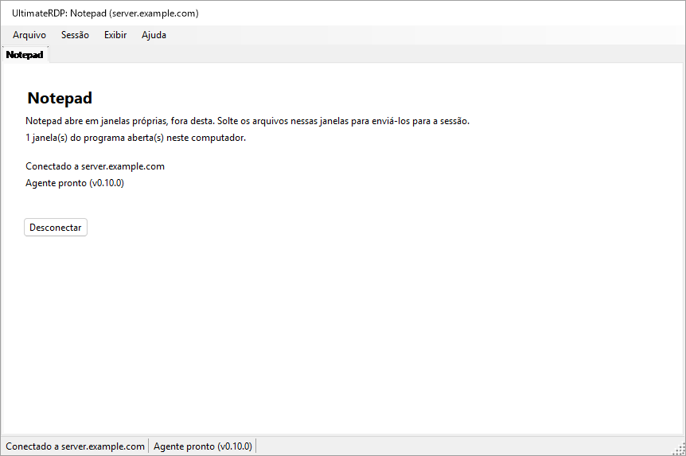

Enquanto a janela principal está fora de vista, o ícone de notificação do UltimateRDP indica os programas e o seu servidor; a sua dica de ferramenta mostra "UltimateRDP by Aprogsys" seguido dos programas.

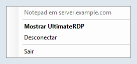

O cliente lê `remoteapplicationprogram`, `remoteapplicationname`, `remoteapplicationcmdline`, `remoteapplicationexpandcmdline`, `remoteapplicationexpandworkingdir` e `remoteapplicationfile`. Um arquivo que pede RemoteApp sem programa é recusado quando você o abre.

### No servidor

Uma sessão RemoteApp não executa o Explorer, por isso ignora a entrada `Run` que `--install-all-users` grava: o agente não inicia nela sozinho. O administrador o inicia com uma tarefa agendada no logon. Uma sessão RemoteApp também termina quando não resta nela nenhum programa do usuário, e um agente que continuasse em execução a manteria aberta. O agente cuida disso, portanto, de duas maneiras:

- Em uma sessão RemoteApp, ele lista os processos da sua sessão a cada 15 segundos. Quando não resta nada além dos processos que toda sessão RemoteApp executa e dos nomes da chave `SysProcs` do servidor, em duas verificações seguidas, e nenhum envio ou transferência está em andamento, ele termina. Durante os seus primeiros 90 segundos, enquanto nenhum programa foi visto, as verificações não contam, para que um programa lento para iniciar não o faça sair. Ele também termina quando a sessão é desconectada e não resta nenhum programa. Em uma sessão de área de trabalho, ele verifica uma vez, no início, e não faz mais nada.
- O seu ícone na área de notificação nunca aparece em uma sessão RemoteApp enquanto `trayIcon` está em `auto`. Não defina `trayIcon` como `always` para usuários de RemoteApp.

O administrador adiciona também o agente a `SysProcs`, para que o próprio Windows não o conte. O UltimateRDP nunca grava no registro nem cria uma tarefa: aqui estão os comandos, para um PowerShell elevado no servidor. Substitua o caminho do agente pelo seu.

1. Leia primeiro o estado atual e guarde a saída:

   ```powershell
   Get-ItemProperty 'HKLM:\SYSTEM\CurrentControlSet\Control\Terminal Server\SysProcs'
   Get-ScheduledTask -TaskPath '\UltimateRDP\' -ErrorAction SilentlyContinue
   quser
   ```

2. Adicione o agente a `SysProcs`. Sozinho, isso não muda nada, já que o agente ainda não é executado nas sessões RemoteApp. Vale para as novas sessões; não reinicie os Serviços de Área de Trabalho Remota por causa disso, o que desconectaria todos os usuários.

   ```powershell
   New-ItemProperty -Path 'HKLM:\SYSTEM\CurrentControlSet\Control\Terminal Server\SysProcs' -Name 'UltimateRDP.Agent.exe' -PropertyType DWord -Value 0
   ```

3. Crie a tarefa apenas para uma conta de teste:

   ```powershell
   $exe       = 'C:\Program Files\UltimateRDP\UltimateRDP.Agent.exe'
   $action    = New-ScheduledTaskAction -Execute $exe
   $trigger   = New-ScheduledTaskTrigger -AtLogOn -User '<DOMAIN\test account>'
   $principal = New-ScheduledTaskPrincipal -UserId '<DOMAIN\test account>' -LogonType Interactive -RunLevel Limited
   $settings  = New-ScheduledTaskSettingsSet -ExecutionTimeLimit ([TimeSpan]::Zero) -AllowStartIfOnBatteries -DontStopIfGoingOnBatteries -MultipleInstances Parallel -Priority 5 -Compatibility Win8
   Register-ScheduledTask -TaskPath '\UltimateRDP\' -TaskName 'Agent' -Action $action -Trigger $trigger -Principal $principal -Settings $settings -Description 'Starts the UltimateRDP agent in each user session, RemoteApp sessions included.'
   ```

   `-LogonType Interactive` executa o agente na sessão do usuário com os direitos do usuário, e nenhuma senha é armazenada. `-RunLevel Limited` impede que ele seja executado elevado. `-ExecutionTimeLimit` zero remove o limite de 72 horas de uma tarefa. Em uma sessão de área de trabalho, a entrada `Run` e a tarefa iniciam ambas o agente; a segunda cópia vê a primeira e termina imediatamente.

4. Teste com a conta de teste, como descrito abaixo.

5. Só então, ative-a para todos os usuários. Altere o objeto da tarefa e grave-o de volta inteiro:

   ```powershell
   $users = (New-Object System.Security.Principal.SecurityIdentifier 'S-1-5-32-545').Translate([System.Security.Principal.NTAccount]).Value
   $task = Get-ScheduledTask -TaskPath '\UltimateRDP\' -TaskName 'Agent'
   $task.Triggers = @(New-ScheduledTaskTrigger -AtLogOn)
   $task.Principal = New-ScheduledTaskPrincipal -GroupId $users -RunLevel Limited
   $task | Set-ScheduledTask
   ```

   A primeira linha obtém o nome local do grupo Usuários, que depende do idioma do Windows. `Set-ScheduledTask -Trigger ... -Principal ...` com esses valores retornou sem erro em um Windows Server em francês e deixou no lugar o gatilho e a entidade de segurança da conta de teste, então verifique o que o agendador armazenou:

   ```powershell
   Export-ScheduledTask -TaskPath '\UltimateRDP\' -TaskName 'Agent'
   ```

   O XML deve mostrar `<GroupId>S-1-5-32-545</GroupId>` e `<LogonTrigger />` sem usuário. `Get-ScheduledTask` sozinho pode mostrar valores que não são os armazenados.

Após uma atualização do agente em outra pasta, aponte a tarefa para ela:

```powershell
Set-ScheduledTask -TaskPath '\UltimateRDP\' -TaskName 'Agent' -Action (New-ScheduledTaskAction -Execute 'C:\Program Files\UltimateRDP\<version>\UltimateRDP.Agent.exe')
```

Nunca use `Stop-ScheduledTask`, ou Finalizar no Agendador de Tarefas, nesta tarefa: isso encerraria os agentes de todas as sessões que a tarefa iniciou.

Para remover tudo, nesta ordem:

```powershell
Unregister-ScheduledTask -TaskPath '\UltimateRDP\' -TaskName 'Agent' -Confirm:$false
Remove-ItemProperty -Path 'HKLM:\SYSTEM\CurrentControlSet\Control\Terminal Server\SysProcs' -Name 'UltimateRDP.Agent.exe'
```

Remover a tarefa não encerra os agentes já em execução; eles terminam com a sua sessão, ou sozinhos nas sessões RemoteApp. Remova o valor `SysProcs` por último, quando nenhum agente estiver em execução em uma sessão RemoteApp.

`UltimateRDP.Agent.exe --status`, executado em uma sessão, diz se é uma sessão RemoteApp, se o valor `SysProcs` do agente existe e se a tarefa `\UltimateRDP\Agent` existe. Ele apenas lê.

Observado em produção com o cliente do Windows (mstsc) em uma sessão RemoteApp: o agente inicia, não encontra o canal do UltimateRDP (erro 50, que o seu log registra uma vez como informação: o cliente da sessão provavelmente não é o UltimateRDP), fica ocioso, e a sessão termina como de costume: o servidor a desconecta 19 segundos após o fechamento da última janela, o agente termina imediatamente, e a sessão desaparece 8 segundos depois.

### Teste em uma conta

Antes de a tarefa existir para todos, apenas com a conta de teste:

1. Sem nenhuma alteração, abra o programa com o cliente da Microsoft, feche-o e observe com `quser` o que acontece com a sessão: ela deve terminar, ou se desconectar, cerca de 20 segundos após o fechamento da última janela. Esse é o comportamento a manter.
2. Após as etapas 2 e 3 acima, abra o programa de novo com o cliente da Microsoft. O agente deve estar em execução na sessão (`Get-CimInstance Win32_Process -Filter "Name='UltimateRDP.Agent.exe'"`, com o seu `SessionId`), sem nenhum ícone nem janela para o usuário, e o seu log deve dizer `RemoteApp session detected`. Feche o programa: a sessão deve terminar como na etapa 1, e o log do agente deve terminar com `the agent exits so that the session can end`, ou com o fim da sessão.
3. Abra o programa com o UltimateRDP e solte um arquivo pequeno, depois um grande, em uma janela do programa.
4. No dia seguinte à etapa 5 de "No servidor", compare o número de sessões, e de sessões desconectadas, com a saída da etapa 1 dessa seção.

Se uma sessão continuar aberta depois que o seu programa fechou, remova primeiro a tarefa, veja acima, e depois relate o caso com o log do agente dessa sessão.

### Uma conexão por servidor e conta

O Windows dá a um usuário uma sessão por servidor. Uma segunda conexão com a mesma conta toma essa sessão da primeira, que termina com "desconectado porque outra conexão foi feita com o computador remoto"; com a versão 0.9.3, um iniciador RemoteApp clicado uma segunda vez enquanto o seu programa estava em execução encerrava as duas conexões sem iniciar o programa. A partir da versão 0.10.0:

- Uma inicialização RemoteApp para o mesmo servidor, porta e gateway de uma guia RemoteApp em execução, com a mesma conta, inicia o seu programa nessa conexão: imediatamente quando a sessão está iniciada, mesmo sem nenhuma janela de programa restante nos seus últimos segundos; após o início da sessão, e após o programa da guia, enquanto ela ainda se conecta, inicia a sessão ou aguarda o aviso do Windows ou a pergunta sobre o certificado. Uma inicialização sem nome de usuário usa a conta da guia; dois nomes de usuário diferentes abrem as suas próprias conexões.
- A janela de carregamento dessa inicialização diz "Iniciando {programa}..." até aparecer uma nova janela de programa, ou o servidor relatar uma falha, ou alguns segundos depois de o servidor responder sem nova janela (um programa pode apenas trazer a sua janela para a frente), ou 30 segundos no máximo. Ela não tem Cancelar, que fecharia a conexão dos outros programas.
- Se a conexão terminar antes de o programa de uma inicialização aparecer, essa inicialização abre a sua própria conexão, a menos que você tenha fechado a guia.
- A guia e a dica de ferramenta do ícone de notificação indicam todos os programas da conexão.
- Abrir de novo uma área de trabalho enquanto uma guia de área de trabalho para o mesmo destino e conta está em execução seleciona essa guia, com um aviso na sua linha de status, em vez de uma segunda conexão que tomaria a sua sessão.
- Quando outra conexão toma uma sessão mesmo assim, por exemplo a partir de outro computador, a guia diz "Esta sessão foi assumida por outra conexão com a mesma conta.", e só uma mensagem aparece por vez.

## Iniciadores

A partir da versão 0.10.0, um único arquivo .bat basta para dar uma conexão às pessoas que a usam: `UltimateRDP.exe` recebe a conexão na sua linha de comando, e Arquivo, **Criar um iniciador (.bat)...** grava o arquivo .bat para você.

### Opções da linha de comando

`UltimateRDP.exe [options] [file.rdp]`. As opções vêm em qualquer ordem e são comparadas sem diferenciar maiúsculas de minúsculas. Uma opção que recebe um valor recebe o argumento seguinte. `UltimateRDP.exe --help` (ou `/?`) mostra esta lista no idioma do cliente.

| Opção | Valor | Chaves .rdp que ela define |
| --- | --- | --- |
| `--server` | nome de host, endereço IPv4, ou endereço IPv6 com ou sem colchetes; sem porta | `full address` |
| `--port` | de 1 a 65535, 3389 quando ausente | `server port` |
| `--user` | nome de usuário | `username` |
| `--domain` | domínio | `domain` |
| `--remoteapp` | `\|\|Name` ou `Name` para um programa publicado, ou um caminho no servidor | `remoteapplicationmode`, `remoteapplicationprogram` |
| `--remoteapp-name` | nome mostrado ao usuário | `remoteapplicationname` |
| `--remoteapp-args` | argumentos do programa, aspas permitidas | `remoteapplicationcmdline` |
| `--gateway` | host de um Remote Desktop Gateway | `gatewayhostname`, `gatewayusagemethod:i:1`, `gatewayprofileusagemethod:i:1` |
| `--multimon` | `on` ou `off`: todos os monitores em tela inteira | `use multimon` |
| `--scale` | de 100 a 500, em porcentagem | `desktopscalefactor` |
| `--windows-keys` | `local`, `remote` ou `fullscreen` | `keyboardhook` 0, 1 ou 2 |
| `--clipboard` | `on` ou `off` | `redirectclipboard` |
| `--drives` | `on` (todas as unidades) ou `off` | `redirectdrives`, `drivestoredirect` |
| `--printers` | `on` ou `off` | `redirectprinters` |
| `--audio` | `local`, `remote` ou `off` | `audiomode` 0, 1 ou 2 |
| `--ask-credentials` | | pede a senha, veja "Credenciais salvas e a senha" |
| `--trusted` | | sem aviso do Windows sobre o editor e os recursos compartilhados para esta inicialização, veja abaixo |
| `--show`, `--hidden` | | a janela principal, veja "A partir de um atalho ou de um arquivo .bat" |
| `--help`, `/?` | | mostra esta lista e não abre nada |

As regras:

- Sem arquivo .rdp, `--server` é necessário. Com um arquivo .rdp, as opções se sobrepõem a ele e prevalecem sobre as suas chaves.
- `--server` substitui o endereço do arquivo, e a porta passa a ser `--port` ou 3389. `--port` sozinho mantém o host do arquivo.
- `--remoteapp`: um valor que começa com `||` é um alias publicado; caso contrário, um valor com `\`, `/` ou `:` é um caminho no servidor, e qualquer outro é um alias publicado, escrito `||Name` para o servidor. `--remoteapp Notepad` e `--remoteapp "||Notepad"` são equivalentes.
- Cada valor é verificado antes de qualquer coisa abrir: um nome de host ou um endereço IP para `--server` e `--gateway`, um número dentro do intervalo, no máximo 256 caracteres para os nomes (1024 para um programa, 2048 para os argumentos), nenhum caractere de controle, nenhuma aspa exceto em `--remoteapp-args`, e nenhum valor que comece com `--` exceto os argumentos. Uma opção errada mostra uma mensagem que diz qual e por quê, e nada se conecta.
- Não há opção para senha, de propósito: uma linha de comando pode ser lida por outros programas do computador, e ela fica no arquivo .bat, nos atalhos e nos logs. O Windows usa a credencial salva para o servidor (veja "Credenciais salvas e a senha"), ou pede a senha. `--password` é recusado com uma mensagem que explica isso.
- Uma segunda inicialização entrega as suas opções ao UltimateRDP que já está em execução, como faz com um arquivo.
- `--trusted`: antes de uma conexão RemoteApp, o Windows mostra um aviso sobre o editor da conexão e os recursos que ela compartilha, com um botão Conectar, para um arquivo .rdp que não está assinado. `--trusted` o desativa para esta inicialização (as propriedades do controle `ShowRedirectionWarningDialog` e `RedirectionWarningType`). Um arquivo .bat ou um atalho é código que o usuário escolheu executar, então a opção não dá ao seu autor nada que o arquivo .bat já não desse; um arquivo .rdp é um dado que pode chegar por e-mail, então nenhuma chave de um arquivo .rdp desativa o aviso, e uma inicialização sem `--trusted` mantém o aviso do Windows como antes. A pergunta sobre o certificado do servidor é outra caixa de diálogo e sempre aparece quando o Windows a faz. O log do cliente diz, para cada conexão, se o aviso fica a cargo do Windows ou se é desativado, e por quê.
- Uma sessão aberta com opções não vai para Arquivo, Recentes, já que as opções se perderiam ali; Arquivo, Reabrir em nova guia a abre de novo com as mesmas opções.
- Tela inteira no início e um tamanho fixo de área de trabalho não são oferecidos: o cliente inicia toda sessão na sua janela e dimensiona a área de trabalho à janela, diga o arquivo o que disser (`screen mode id`, `desktopwidth`, `desktopheight`).

O cliente monta na memória o texto de um arquivo .rdp a partir das opções, depois do texto do arquivo quando há um, e o lê com o mesmo analisador de qualquer arquivo: uma conexão vinda da linha de comando e uma vinda de um arquivo passam pelo mesmo código. Nada é gravado no disco.

Exemplos:

```bat
@echo off
start "" "%LOCALAPPDATA%\UltimateRDP\client-0.10.0\UltimateRDP.exe" --server "server.example.com" --user "jdoe"
```

```bat
@echo off
start "" "%LOCALAPPDATA%\UltimateRDP\client-0.10.0\UltimateRDP.exe" --server "server.example.com" --remoteapp "||Notepad" --remoteapp-name "Notepad" --ask-credentials
```

### O gerador de iniciadores

Arquivo, **Criar um iniciador (.bat)...** abre uma caixa de diálogo preenchida a partir da guia ativa, se houver. A primeira visualização contém o nome do iniciador, o servidor, a porta (3389), o usuário, o que ele abre (a área de trabalho remota ou um programa RemoteApp) e o programa. **Opções avançadas** mostra o nome e os argumentos do programa, o domínio, o gateway, a janela principal, "Sempre pedir a senha", "Não mostrar o aviso do Windows (servidor confiável)" (desativado por padrão, acrescenta `--trusted`), as escolhas de exibição e de redirecionamento da tabela acima ("Padrão" deixa a escolha ao cliente e ao arquivo .rdp), onde o iniciador encontra o UltimateRDP.exe, e o que gravar:

- UltimateRDP.exe: este programa (o caminho do UltimateRDP.exe em execução, o padrão), ao lado do iniciador (`%~dp0UltimateRDP.exe`), ou um caminho que você digita, em que variáveis como `%LOCALAPPDATA%` ou `%ProgramFiles%` ficam como escritas e recebem o seu valor no computador que executa o iniciador.
- Um único arquivo .bat que leva todas as opções (o padrão), ou um arquivo .bat e um arquivo .rdp ao lado dele, com o nome do arquivo .bat; o arquivo .bat abre então `%~dp0<name>.rdp`. O arquivo .rdp é gravado em UTF-16, como o cliente da Microsoft os grava.

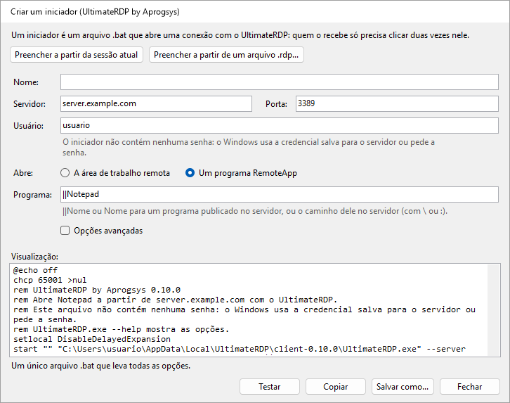

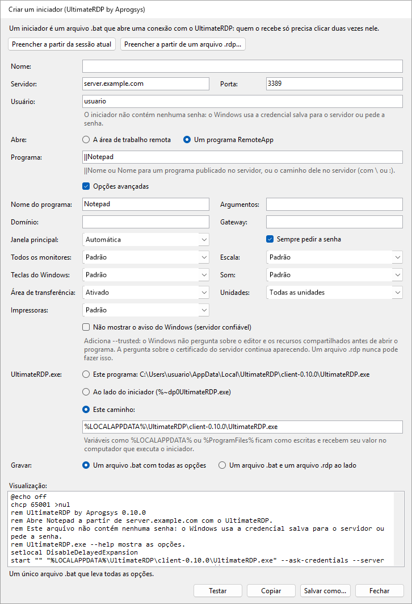

A caixa de diálogo mostra o texto do arquivo .bat enquanto você digita, ou qual campo está errado. **Preencher a partir da sessão atual** e **Preencher a partir de um arquivo .rdp...** preenchem os campos com as configurações da guia ativa ou de um arquivo. **Salvar como...** grava o arquivo, **Copiar** coloca o seu texto na área de transferência, e **Testar** inicia este UltimateRDP com as opções do iniciador, o que abre a conexão no cliente em execução. O iniciador não contém nenhuma senha, e a caixa de diálogo não tem campo para isso.

O arquivo .bat começa com `@echo off`, `chcp 65001 >nul` quando um caractere do arquivo está fora do ASCII, um comentário que começa com "UltimateRDP by Aprogsys" e a sua versão e diz, no idioma do cliente, o que ele abre e que não contém nenhuma senha, `setlocal DisableDelayedExpansion`, e `start "" "<UltimateRDP.exe>" <options>`. Ele é gravado em UTF-8 sem marca de ordem de bytes, com finais de linha CRLF. Cada valor é colocado entre aspas para que o cmd.exe o entregue ao UltimateRDP exatamente como digitado e não possa executar mais nada: veja "Notas de segurança".

## Como funciona

O cliente hospeda o controle ActiveX da Área de Trabalho Remota da Microsoft e se registra como destino de soltura nas janelas dele. O agente é executado na sua sessão e escuta em um canal virtual estático chamado `ULTRDP`. Para arquivos pequenos, o cliente envia os caminhos locais e a posição do cursor, e a sessão lê os arquivos pelas unidades redirecionadas. Os arquivos grandes são enviados pelo canal, como descrito depois das etapas abaixo.

1. Quando o arrasto passa pela primeira vez sobre a sessão, o cliente converte a posição do cursor em coordenadas da área de trabalho remota e envia `dragEnter` com os caminhos.
2. O agente abre uma janela intermediária invisível sobre toda a tela remota. Ele move o cursor remoto até o ponto e simula um clique com o botão esquerdo nessa janela. O clique inicia um verdadeiro arrasto OLE dentro da sessão, com os arquivos como caminhos `\\tsclient\<drive>\...`, ou como cópias preparadas.
3. O agente responde `dragAck`. Sem essa resposta em um segundo, o cliente interrompe o arrasto.
4. Enquanto você move o cursor, o cliente envia `dragMove`. O agente move o cursor remoto, para que o aplicativo sob ele veja o arrasto e mostre a sua indicação visual.
5. Quando você solta o botão, o cliente envia `drop`. O agente move o cursor até o ponto final e solta ali o botão simulado. Se você sair da sessão em vez disso, o cliente envia `dragLeave` e o agente cancela o arrasto.
6. O agente informa `dropResult` com o efeito: `copy` ou `link` quando o destino aceitou, ou `none` quando nada sob o cursor aceitou os arquivos. Com `none`, o envio é ignorado. O cliente mostra o resultado na barra de status.

O arrasto oferece apenas cópia e atalho, nunca mover. As teclas modificadoras são registradas nos logs, mas não injetadas.

Em uma sessão RemoteApp, as janelas do servidor são janelas do cliente, e qualquer coisa que o agente mostrasse apareceria também na sua área de trabalho, inclusive a sua janela intermediária. Por isso o cliente não envia nada enquanto você move o cursor: ao soltar, ele envia `dragEnter` e depois `drop` no mesmo ponto, e mantém o envio aberto do seu lado até o agente responder. O agente reproduz o arrasto ali mesmo, com uma janela intermediária de 32 por 32 pixels sob o ponto em vez de uma sobre a tela inteira.

Para arquivos grandes, o `dragEnter` leva o tamanho de cada item, e o agente responde `dragAck` com `transfer: true` quando eles devem vir pelo canal. Na etapa 5, o cliente então envia `drop` com `deferred: true`: o agente cancela o arrasto na sessão e guarda o ponto. O cliente envia os arquivos em blocos de 32 KiB por padrão, em base64, ou na forma mais densa `u15` quando o agente diz que os dados do cliente chegam até ele como UTF-16, com no máximo 4 MiB ainda não confirmados; o agente os grava na sua pasta de preparação e verifica o tamanho e o SHA-256 de cada um, responde `transferResult`, depois solta as cópias no ponto guardado com um arrasto curto, e informa `dropResult` como na etapa 6.

Para encerrar a sessão, o cliente envia `logoff`. O agente responde `logoffResult`, espera meio segundo para que a resposta chegue ao cliente, e então pede ao Windows que encerre a sessão. Ele nunca força o fechamento de aplicativos que têm trabalho não salvo.

As mensagens são objetos JSON enviados como linhas ASCII, exceto os blocos `u15`, e cada lado detecta em tempo de execução como o controle converte os bytes do canal em caracteres. Veja [docs/design.md](docs/design.md) para os detalhes.

## Solução de problemas

- **A primeira inicialização de uma nova versão leva vários segundos antes de qualquer coisa aparecer.** Esse tempo passa antes de o processo existir: um antivírus analisa um novo executável de cerca de 120 MB na sua primeira inicialização. As inicializações seguintes mostram a janela de carregamento em cerca de 0,1 s.
- **Um iniciador clicado duas vezes.** A partir da versão 0.10.0, o segundo clique inicia o programa na conexão em execução; veja "Uma conexão por servidor e conta".
- **O agente nunca fica pronto.** Execute `UltimateRDP.Agent.exe --status` na sessão: ele diz se o agente está em execução ali e de onde ele está configurado para iniciar. O ícone na área de notificação só aparece depois que o cliente se conecta, então a sua ausência antes disso é normal. Uma política do servidor também pode bloquear os canais virtuais: o log do agente tem então um aviso de que ele não consegue abrir o canal.
- **"O agente não confirmou o arrasto".** O agente não respondeu ao início do arrasto em um segundo. Uma conexão lenta ou um agente ocupado podem causar isso, assim como um agente que terminou ou reiniciou na sessão, o que o cliente não consegue ver de outra forma. O cliente então procura o agente de novo: o rótulo do agente passa para "Agente: aguardando", e volta para "Agente pronto" quando o agente responde. Quando a barra de status diz "A sessão não aceita entrada simulada", a sessão pode estar bloqueada, ou uma política pode bloquear a entrada simulada. Por favor, relate o caso com os dois logs.
- **O destino não mostra nenhuma indicação visual, ou a barra de status diz "Nada sob o cursor aceitou os arquivos."** O aplicativo sob o cursor pode não aceitar arquivos naquele lugar. Alguns aplicativos também recusam caminhos de rede como `\\tsclient\C\...`. Para eles, ative "Copiar os arquivos para a sessão antes de soltar" no menu do agente na área de notificação.
- **O primeiro envio para o Explorer leva vários segundos.** O Explorer lê a unidade redirecionada pela primeira vez, o que pode ser lento. Os envios seguintes costumam ser mais rápidos.
- **Ctrl+W ou Ctrl+O não fazem nada.** Quando a sessão tem o teclado, essas teclas vão para o computador remoto, como todas as outras. Use o menu Arquivo em vez disso.
- **Os meus aplicativos continuam abertos no servidor depois de Sair.** Isso é esperado: Sair e Fechar guia desconectam sem encerrar a sessão. Use Arquivo, Encerrar a sessão remota.
- **Os textos estão no idioma errado.** Escolha o idioma em Exibir, Idioma. Uma mensagem do agente segue o idioma que o cliente anunciou no momento da conexão; após uma mudança de idioma, a próxima mensagem usa o novo.
- **Os envios são recusados por causa das unidades.** Ative o redirecionamento de unidades no arquivo .rdp, em Recursos Locais, Mais, Unidades. No servidor, verifique a política "Não permitir redirecionamento de unidade".
- **Um programa RemoteApp abre, mas os envios sobre as suas janelas são recusados ou não fazem nada.** O log do cliente tem uma linha por janela do programa que começa com `RemoteApp window`, com o resultado do registro do destino de soltura, e um aviso quando ele falhou. As linhas `RemoteApp monitors` e `the target is at` dizem se as janelas no servidor estão onde estão na sua tela; um aviso ali significa que os monitores mudaram desde a conexão, e uma nova conexão corrige isso.
- **Uma sessão RemoteApp continua aberta depois que o seu programa fechou.** Verifique se o log do agente da sessão diz `RemoteApp session detected`, e o que dizem as linhas `RemoteApp session:`: um programa que ainda está listado ali mantém a sessão aberta, com ou sem o agente. Veja "Programas RemoteApp".
- **O envio cai na janela errada.** A conversão de coordenadas após um redimensionamento da janela, ou a tela inteira sobre vários monitores, pode ser a causa. Por favor, relate o caso com os dois logs.
- **Uma transferência de arquivos grandes falha, ou é lenta.** A barra de status dá o motivo. Os dois logs terminam cada transferência com uma linha de resumo: arquivos, bytes, segundos e MB/s, e depois com as linhas descritas em "Medir uma transferência lenta". O log do cliente também informa o comprimento da primeira linha de bloco que ele enviou, e o log do agente tem uma linha para o primeiro bloco de cada arquivo que recebeu. Quando a barra de status diz "O agente não confirmou o recebimento dos primeiros dados da transferência.", os dados não passaram: o log do cliente informa então o modelo de bytes, o tamanho do bloco, o comprimento das linhas e o número de linhas enviadas. Um `transferChunkBytes` menor pode ajudar, veja "Arquivos grandes". Para voltar ao redirecionamento de unidades, escolha Nunca no menu do agente na área de notificação, Transferência rápida de arquivos grandes.
- **Uma transferência falha com "Uma mensagem da transferência se perdeu no caminho".** O controle da Área de Trabalho Remota às vezes perde uma mensagem curta enviada logo antes de uma grande. A partir da 0.5.1 nos dois lados, isso não deve mais aparecer: o agente pede ao cliente que envie de novo as linhas que faltam, e o resumo da transferência nos dois logs conta as linhas reenviadas. Se ainda aparecer, um dos lados está em uma versão mais antiga; se uma transferência falhar com "Linhas da transferência se perderam no caminho e não puderam ser recuperadas", relate o caso com os dois logs obtidos com `logLevel` definido como `debug`.
- **Uma transferência falha imediatamente com "Dados foram perdidos ou danificados no caminho".** O canal às vezes danifica os dados de uma linha no caminho. A partir da 0.5.2 nos dois lados, o agente pede essa linha de novo, como no caso de uma linha perdida, e o seu log diz como era o dano em uma linha que contém "arrived damaged"; um agente 0.5.1 ainda faz a transferência falhar.
- **Os arquivos grandes nunca usam a conexão direta, ou os arquivos da sessão não podem ser enviados.** Verifique primeiro se o endereço público do seu computador está na regra de firewall da conexão direta, no servidor e no provedor de hospedagem, como está na regra que permite o RDP; uma nova rede dá um novo endereço. O log do cliente diz por quê no início de cada transferência: "the direct connection cannot be used" com o motivo, como uma porta que não respondeu em 3 segundos. Verifique as regras de firewall de "Conexão direta para arquivos grandes", no servidor e no provedor de hospedagem, e se os dois lados estão na 0.7.0. O log do agente diz em qual porta ele escutou, e avisa quando nenhuma porta do intervalo estava livre.
- **Uma transferência direta é mais lenta do que o link.** Leia as linhas `direct connection statistics` dos dois logs, veja "Ler as linhas de resumo".
- **Os arquivos enviados da sessão não chegam.** O log do cliente tem uma linha `Send offer` para cada oferta, e depois linhas `Receive <id>:` que dizem se a conexão direta pôde ser estabelecida, e por que não. O log do agente tem as mesmas linhas `Send <id>:`. Quando o log do cliente não tem nenhuma linha `Send offer`, verifique se os dois lados estão na 0.9.0 e se `receiveFiles` e `directTransfer` não estão em `never` em client.json; a linha `Hello from client` do log do agente diz `receives files of the session: True` quando não estão.
- **Onde estão os logs.** O cliente grava `%LOCALAPPDATA%\UltimateRDP\logs\client-yyyyMMdd.log` no seu computador. O agente grava `agent-yyyyMMdd.log` na mesma pasta no servidor; a partir da versão 0.9.0, cada uma das suas linhas informa a sessão e a thread, como `[S3 12]`, já que os agentes de um mesmo usuário em várias sessões gravam o mesmo arquivo. Os dois guardam catorze dias de logs. O cliente abre a sua pasta em Ajuda, Abrir a pasta de logs, e o agente pelo seu menu na área de notificação, Abrir a pasta de logs.

## Compilar a partir do código-fonte

Você precisa do SDK do .NET 10 no Windows.

```
dotnet build UltimateRDP.sln -c Release
dotnet test UltimateRDP.sln
```

Para publicar um executável de arquivo único autocontido sem símbolos:

```
dotnet publish src/UltimateRDP.Client -c Release -r win-x64 --self-contained true -p:PublishSingleFile=true -p:IncludeNativeLibrariesForSelfExtract=true -p:DebugType=none -p:DebugSymbols=false
dotnet publish src/UltimateRDP.Agent -c Release -r win-x64 --self-contained true -p:PublishSingleFile=true -p:IncludeNativeLibrariesForSelfExtract=true -p:DebugType=none -p:DebugSymbols=false
```

As releases são compiladas pelo GitHub Actions quando uma tag `v*` é enviada. O workflow compila, testa, publica os dois aplicativos e anexa os dois zips à release.

Os executáveis de uma release são assinados pela APROGSYS, e o Windows mostra esse editor nas suas solicitações. Um executável que você mesmo compila não é assinado.

## Notas de segurança

- O agente só lê de `\\tsclient\`, ou seja, das unidades que você escolheu compartilhar. O próprio agente só grava na sua pasta de preparação na sua sessão, quando a preparação está ativada ou quando os arquivos vêm pelo canal. Ele recusa qualquer nome de arquivo que sairia dessa pasta. O aplicativo em que você solta decide para onde vão os arquivos. O agente não é executado como serviço e não tem nenhum privilégio além dos seus.
- O agente simula entrada apenas dentro da sua própria sessão, e apenas entre o início e o fim de um arrasto. Ele só usa o botão esquerdo do mouse. Ele só injeta o clique quando a sua própria janela intermediária está sob o cursor, então o clique nunca chega a outro aplicativo. Para cancelar, ele envia Esc à sua janela intermediária em vez de simular uma tecla.
- O agente nunca oferece mover. Um movimento aceito na sessão poderia excluir o arquivo do seu disco local pela unidade redirecionada.
- As mensagens levam caminhos de arquivo, coordenadas, indicadores de teclas modificadoras e nomes de janelas. O conteúdo dos arquivos só passa pelo canal em uma transferência de arquivos grandes, dentro da conexão criptografada da Área de Trabalho Remota.
- A partir da versão 0.6.0, os arquivos de uma transferência de arquivos grandes podem passar, em vez disso, por uma conexão TLS direta. O agente só escuta enquanto uma transferência é oferecida, e só aceita uma conexão com uma prova do token de uso único que ele informou pela conexão criptografada da Área de Trabalho Remota, cada conexão da oferta uma vez, 16 no máximo. O cliente só aceita o certificado cujo SHA-256 o agente informou ali. Os arquivos vão para a mesma pasta de preparação, com as mesmas verificações. Abra as portas apenas para os endereços de cliente permitidos para o RDP.
- A partir da versão 0.9.0, a sessão pode enviar arquivos para o seu computador. Só o usuário da sessão pode iniciar isso, pelo agente dessa sessão: `--send` chega a esse agente por um pipe que só aceita processos do mesmo usuário na mesma sessão. O cliente só recebe arquivos depois de responder a uma oferta que veio pela conexão criptografada da Área de Trabalho Remota da sua própria sessão, apenas pela conexão direta cujo certificado e token essa oferta informou, e apenas na sua pasta de arquivos recebidos. Ele nunca substitui um arquivo, nunca executa um, e marca cada um como download.
- A partir da versão 0.10.0, a linha de comando pode dar uma conexão, e o cliente pode gravar iniciadores. Nenhuma opção aceita uma senha. Cada valor da linha de comando é verificado antes de qualquer coisa abrir, e não pode acrescentar uma chave às configurações .rdp em que se transforma. Em um iniciador, cada valor fica entre aspas duplas com as regras de aspas da linha de comando do Windows, cada `%` é duplicado, um `^` vem antes de `& | < > ^ ( )` onde quer que o cmd.exe leia fora das aspas, e a expansão atrasada fica desativada, para que nenhum valor possa acrescentar um comando ou expandir uma variável. Os testes verificam isso com um modelo do cmd.exe e com o próprio cmd.exe.
- O cliente nunca grava credenciais e nunca as registra no log. Ele lê a credencial genérica `TERMSRV/<host>` quando ela existe, e a entrega ao controle da Microsoft. As outras solicitações de credenciais vêm do controle da Microsoft.

## Estado

A versão 0.10.0 acrescenta as opções de uma conexão na linha de comando, o gerador de iniciadores, uma conexão por servidor e conta para os programas RemoteApp, e `--trusted`. Os seus iniciadores foram verificados com o cmd.exe no computador dos testes; a conexão RemoteApp compartilhada e `--trusted` não tinham sido testados em um servidor real no momento do lançamento. A versão 0.9.0 é uma versão de teste. Os arquivos enviados da sessão para o seu computador, a inicialização de um programa RemoteApp a partir de um atalho, as correções das suas janelas e a opção da senha não tinham sido testados em um servidor real no momento do lançamento; as letras de unidade da 0.8.0 também não.

Verificado em uma sessão real da Área de Trabalho Remota, com a versão 0.2.1:

- O canal virtual entre o cliente e o agente, com um byte por caractere nos dois sentidos.
- A transferência pelo redirecionamento de unidades para a área de trabalho remota.
- O arrasto em tempo real para um aplicativo remoto.

O comando de encerramento da sessão e as traduções são novos na 0.3.0. A transferência rápida de arquivos grandes é nova na 0.4.0. O seu primeiro teste em um servidor real falhou. A versão 0.4.1 corrige os dois defeitos encontrados nele; com ela, um arquivo de 496 MB chegou a uma sessão real em 193 segundos. A versão 0.4.2 acrescenta uma janela de progresso a cada envio e só altera o cliente. A versão 0.4.3 corrige mensagens curtas que o controle da Área de Trabalho Remota às vezes perdia logo antes de uma grande, o que fazia algumas transferências falharem no início. A versão 0.4.4 mede para onde vai o tempo de uma transferência, nos dois lados, e acrescenta as configurações `transferWindowBytes` e `channelRead` para testar o que a limita.

As suas medições mostraram que nenhum dos lados limita a transferência: o canal está cheio, e a codificação dos dados ocupava a maior parte dele. A versão 0.5.0 envia os arquivos em uma forma mais densa quando os dados do cliente chegam ao agente como UTF-16, o que deve aumentar a taxa cerca de 2,5 vezes, de 2,1 MB/s para cerca de 5,4 MB/s em um canal de 5,8 MB/s. Ela também mantém a transferência rápida quando você solta o botão rapidamente, antes de o agente responder ao início do arrasto, inclusive quando essa resposta vem em duas etapas. A versão 0.5.1 numera as mensagens de uma transferência, para que o agente peça as que o controle da Área de Trabalho Remota perdeu e a transferência continue. A versão 0.5.2 faz o mesmo para uma mensagem que chega danificada. A versão 0.6.0 envia os arquivos grandes por uma conexão TLS direta quando o servidor abre as suas portas para ela, já que o canal ficava em 2 a 4 MB/s. O seu primeiro teste em produção chegou a 135 a 180 MB/s por alguns segundos, depois a cerca de 20 MB/s, o limite de uma conexão TCP nesse caminho; a versão 0.7.0 usa portanto várias conexões ao mesmo tempo, e registra para onde vai o tempo de uma transferência. A versão 0.8.0 abre programas RemoteApp e aceita envios sobre as suas janelas, impede o agente de manter uma sessão RemoteApp aberta, pode dar às unidades do cliente letras da sessão, e lê configurações para todo o computador. O seu primeiro teste real com o Notepad funcionou e mostrou uma janela vazia do controle sobre um monitor, uma janela principal sempre visível, dez segundos perdidos antes de o programa iniciar, e um término normal mostrado como erro. A versão 0.9.0 corrige isso, abre programas RemoteApp a partir de um atalho com apenas as suas próprias janelas na tela, envia arquivos da sessão para o seu computador, e pode pedir a senha toda vez.

Retornos que ajudam:

- Se o arrasto em tempo real funciona na sua sessão, e com quais aplicativos.
- Se o encerramento da sessão funciona para você, e a redação no seu idioma.
- A taxa de uma transferência de arquivos grandes na sua conexão, a partir da linha de resumo dos dois logs.

- Quanto tempo leva o primeiro envio para o Explorer.
- Se os envios caem no lugar certo em tela inteira, com um monitor ou com todos os monitores.
- Se as credenciais salvas funcionam, e qual tipo você tem no Gerenciador de Credenciais.
- Com RemoteApp: se o programa abre, se um envio sobre as suas janelas cai onde você soltou o botão, e se a sessão termina como antes quando o programa fecha, com os dois logs.

Por favor, envie-os pelas [issues do GitHub](https://github.com/freeKC/ultimaterdp/issues), com os dois logs.

## Créditos

O UltimateRDP by Aprogsys é desenvolvido e publicado pela [APROGSYS](https://www.aprogsys.com/). O código-fonte está no [GitHub](https://github.com/freeKC/ultimaterdp), sob a licença MIT.

## Licença

MIT. Veja [LICENSE](LICENSE).
